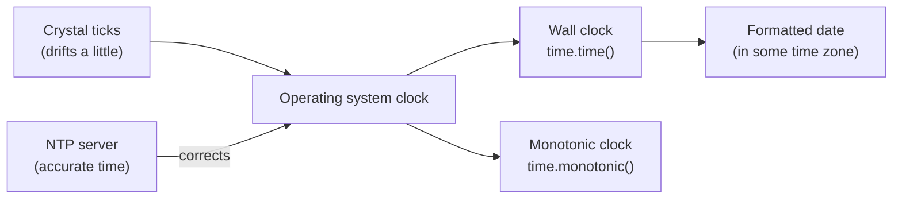

# How computers keep time

After this you can say what a timestamp is, pick the right clock for "what time is it" versus "how long did that take", and name the ways a computer's clock goes wrong.

Before this: [Testing and documenting APIs](../03-api-quality/02-testing-and-documenting-apis.md).

## The idea

A server logs "order placed" and a second server logs "payment received". When you sort the two logs together, the payment appears 3 seconds before the order. Nothing is wrong with the code. The two machines disagree about the time, and the log lines are only as good as the clocks that wrote them.

A computer does not "know" the time. It has a counter driven by a crystal that ticks at a nearly fixed rate, and it sets that counter from outside: an operator, a network time server, or a GPS receiver. Everything you see as a date is a number from that counter, formatted by software.



In the diagram, the crystal drifts, the network corrects it, and two different clocks are read from the result. The rest of the lesson explains each box.

## Key terms

**Unix time** (also epoch time or POSIX time) is the number of seconds since 1970-01-01 00:00:00 UTC, which is called the **epoch**. A timestamp is one number, with no zone and no calendar in it.

**UTC** (Coordinated Universal Time) is the world's reference time, the same everywhere. **Local time** is UTC plus an offset that depends on where you are and the season.

A **wall clock** (or real-time clock) tells the current date and time. It can be set, so it can jump forwards or backwards. A **monotonic clock** only moves forward at a steady rate and has no connection to the date; its value is meaningful only as a difference between two readings.

**NTP** (Network Time Protocol) is how a machine asks time servers for the time and adjusts its clock. **Clock drift** is the slow gain or loss of a clock between corrections, often 10 to 50 parts per million, which is tens of seconds per month for an uncorrected machine.

A **leap second** is a second added to UTC (so far always added, never removed) so that UTC stays close to the Earth's rotation.

## How it works

Unix time counts seconds as if every day had exactly 86,400 of them. A timestamp such as `1767225600` always names one instant, and turning it into "January 1, 2026, 00:00 UTC" or "December 31, 2025, 7 p.m. in Toronto" is a display step. That is why storing timestamps (or UTC) is safe and storing "7 p.m." is not.

```python
import time
from datetime import datetime, timezone

print(time.time() > 1_700_000_000)
print(datetime.fromtimestamp(0, tz=timezone.utc))
print(datetime.fromtimestamp(2**31 - 1, tz=timezone.utc))

start = time.monotonic()
time.sleep(0.2)
elapsed = time.monotonic() - start
print(round(elapsed, 1))
```

```text
True
1970-01-01 00:00:00+00:00
2038-01-19 03:14:07+00:00
0.2
```

Never measure a duration with the wall clock. NTP can step the clock backwards by a second, an operator can change it, and a virtual machine can resume from a pause with a stale value. The subtraction `time.time() - start` can then be negative or wrong. `time.monotonic()` (in JavaScript, `performance.now()`) cannot go backwards, so use it for timeouts, retries, benchmarks and rate limits. Use the wall clock only to record when something happened.

Leap seconds break the "86,400 per day" rule. When one was inserted, the last minute of the day had 61 seconds, and systems handled it by repeating a second or "smearing" it over hours. The last one was on 31 December 2016. As of 2026 the 28th General Conference on Weights and Measures voted (15 October 2026) to let UTC drift from Earth rotation by up to one hour instead of 0.9 seconds, which ends leap seconds in practice from 20 May 2027 ([Wikipedia: Leap second](https://en.wikipedia.org/wiki/Leap_second); it follows the 2022 resolution to do this "in, or before, 2035"). Software written today rarely needs special handling, but old logs and some timing systems still contain them.

The **2038 problem** is the same kind of limit as any fixed-size integer. A signed 32-bit `time_t` holds at most $2^{31}-1$ seconds, which is 03:14:07 UTC on 19 January 2038 (the second line of output above). One second later it wraps to a negative number, which means December 1901. Most current systems use 64 bits, which lasts for hundreds of billions of years, but old embedded devices, file formats and database columns with a 32-bit integer for time still carry the problem.

## Worked examples

<div class="example" markdown>

### Example 1: two timing bugs

Step 1. A retry helper measures `time.time() - start > 30` to give up after 30 seconds. Step 2. During the wait, NTP steps the clock back 5 seconds. The helper waits 35 real seconds. If the clock had stepped forward, it would give up early. Step 3. Replace `time.time()` with `time.monotonic()` for both readings.

Step 4. A second service stores a user's "last login" as a 32-bit unsigned integer. Unsigned 32-bit lasts until 2106, so it works for now, but the same field as a signed integer fails in 2038. Check:

```python
import datetime as dt
print(dt.datetime.fromtimestamp(2**32 - 1, tz=dt.timezone.utc))
```

```text
2106-02-07 06:28:15+00:00
```

Whenever you see a time column, check its size and signedness.

</div>

## Common mistakes

<div class="warning" markdown>

Watch out: using `time.time()` for durations. The wall clock can jump, so use the monotonic clock for elapsed time.

Watch out: comparing timestamps from two machines to decide what happened first. Clock drift of even a few milliseconds can reverse the order. Use a sequence number or a database-assigned order when order matters.

Watch out: storing a timestamp in seconds and reading it in milliseconds (or the reverse). JavaScript `Date.now()` is in milliseconds; Python `time.time()` is in seconds. A value near `1.7e9` is seconds, near `1.7e12` is milliseconds.

</div>

## Working with AI

<div class="ai" markdown>

Words to use: Unix timestamp, epoch, UTC, wall clock, monotonic clock, NTP, clock drift, 2038 problem.

Prompts to try:

- "In Python 3.14, I time retries with `time.time()`. Replace it with the correct clock and explain what goes wrong with the old one when NTP adjusts the clock."
- "List every column in this schema that stores time as an integer and say whether it is seconds or milliseconds, and whether it is a 32-bit integer."

What to check:

- Generated code that measures durations with `datetime.now()` or `Date.now()`. Replace with a monotonic clock.
- Seconds mixed with milliseconds in a conversion. Print one real value and see if the year is sensible.
- A claim that leap seconds "will be abolished in 2035". Check the current status, since the dates changed in 2026.

</div>

## Quiz

1\. What does the number `1767225600` represent, and what is missing from it?

<details class="solution" markdown>
<summary>Answer</summary>

It is a Unix timestamp: seconds since 1970-01-01 00:00:00 UTC, which is the instant 2026-01-01 00:00:00 UTC. It has no time zone, which is correct, because it names one instant everywhere. A time zone is only needed to display it.

</details>

2\. Which clock do you use to time a database query, and why?

<details class="solution" markdown>
<summary>Answer</summary>

The monotonic clock (`time.monotonic()` or `performance.now()`). It cannot jump backwards when NTP or an operator adjusts the wall clock.

</details>

3\. A 32-bit signed `time_t` holds 2147483647. What date and time is that, and what happens one second later?

<details class="solution" markdown>
<summary>Answer</summary>

03:14:07 UTC on 19 January 2038. One second later the value wraps to $-2^{31}$, which is read as 13 December 1901.

</details>

4\. Two servers log events 5 ms apart. Server A's log says its event came first. Can you trust that?

<details class="solution" markdown>
<summary>Answer</summary>

Not necessarily. NTP keeps clocks within some milliseconds, so a 5 ms gap can be clock error. Use a shared ordering, such as a database sequence, when order matters.

</details>

## Lab

<div class="lab" markdown>

### Lab: measure a wall-clock jump

Goal: see why durations need a monotonic clock. Time: about 10 minutes. Runs in: any shell with Python.

1. Create `clocks.py` that reads `time.time()` and `time.monotonic()` before and after `time.sleep(1)`, then prints both differences rounded to 2 decimals.
2. Run it. Both differences should be about 1.00.
3. Change `start_wall` by hand to simulate a clock step: subtract 5 from the starting wall reading. Print the difference again.
4. Write one sentence on which of the two numbers you would trust for a timeout.

Expected result: the monotonic difference stays about 1.00 and the corrupted wall difference reads about 6.00.

<details class="solution" markdown>
<summary>Solution</summary>

```python
import time

start_wall = time.time()
start_mono = time.monotonic()
time.sleep(1)
print(round(time.time() - start_wall, 2))
print(round(time.monotonic() - start_mono, 2))

start_wall -= 5   # pretend NTP stepped the clock by 5 seconds
print(round(time.time() - start_wall, 2))
```

The third number is wrong by exactly the step size. The monotonic clock has no such step, so use it for timeouts.

</details>

</div>

## Where this shows up

- Next: [Time zones and daylight saving](02-time-zones-and-daylight-saving.md), which is what turns a timestamp into a clock time.
- Timeouts, retries and rate limits in [Background jobs](../03-api-quality/01-background-jobs.md) all need elapsed time, so they use the monotonic clock.
