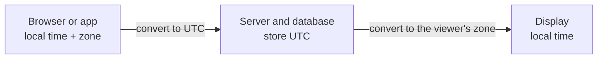

# Time zones and daylight saving

After this you can explain why "2026-03-08 02:30 in Toronto" does not exist, decide what to store for a past event and for a future meeting, and add days to a date without breaking it.

Before this: [How computers keep time](01-how-computers-keep-time.md).

## The idea

A user in Toronto books a call for "9 a.m. on November 2". A colleague in London sees the invite. The call was booked on October 30, when Toronto was 4 hours behind UTC, but on November 2 Toronto is 5 hours behind, because daylight saving time ended the day before. If the app stored "13:00 UTC" on October 30, the call moves to 8 a.m. for the user.

A timestamp names an instant. People think in local clock times, and the rules that map an instant to a clock time are political: governments change them. The skill is knowing which of the two to store.



In the diagram, the edges (input and display) deal with zones and the middle only holds UTC. This is the rule "store UTC, convert at the edges".

## Key terms

A **UTC offset** is the difference from UTC at one moment, such as `-05:00`. It does not say where you are or what happens next month.

A **time zone** is a region with one history of offsets. The **IANA time zone database** (also the tz database or Olson database) names zones by region, such as `America/Toronto`, and records every past and announced offset change for each. Use these names, not abbreviations such as `EST`, which are ambiguous.

**Daylight saving time** (DST) is the seasonal shift of local time by one hour. In Ontario (as of 2026) clocks go forward on the second Sunday of March and back on the first Sunday of November (the rule in the tz database, release 2026f).

A **gap** is a range of local times that never happens, when clocks jump forwards. An **overlap** (or fold) is a range that happens twice, when clocks jump back.

## How it works

For America/Toronto in 2026 the dates are Sunday 8 March and Sunday 1 November (checked with a calendar and the 2026f tz database).

```text
Spring forward, 8 March 2026 (EST, UTC-5 -> EDT, UTC-4)
  01:59:59 EST  ->  03:00:00 EDT      02:xx local never happens (gap)

Fall back, 1 November 2026 (EDT, UTC-4 -> EST, UTC-5)
  01:59:59 EDT  ->  01:00:00 EST      01:xx local happens twice (overlap)
```

In the gap, "02:30" has no instant. Software has to guess, and different libraries guess differently (shift forward, shift backward, or raise an error). In the overlap, "01:30" has two instants one hour apart, and you need an extra bit to say which one. Python calls that bit `fold`.

```python
from datetime import datetime, timedelta, timezone
from zoneinfo import ZoneInfo

tor = ZoneInfo("America/Toronto")

gap = datetime(2026, 3, 8, 2, 30, tzinfo=tor)
print(gap.isoformat(), gap.astimezone(timezone.utc).isoformat())

for fold in (0, 1):
    t = datetime(2026, 11, 1, 1, 30, tzinfo=tor, fold=fold)
    print(fold, t.isoformat(), t.astimezone(timezone.utc).isoformat())
```

```text
2026-03-08T02:30:00-05:00 2026-03-08T07:30:00+00:00
0 2026-11-01T01:30:00-04:00 2026-11-01T05:30:00+00:00
1 2026-11-01T01:30:00-05:00 2026-11-01T06:30:00+00:00
```

The gap line shows the library accepting a time that does not exist and using the old offset, so it silently means 03:30 EDT. The two overlap lines are one hour apart in UTC. Neither case raises an error, which is why they cause bugs.

What to store depends on what the time means.

| Kind of time | Store | Why |
|---|---|---|
| Something that already happened (order placed, log line) | UTC timestamp | The instant is fixed |
| A future event pinned to a place (meeting, flight, shop opening) | Local date and time plus the zone name | The rules might change before it happens, and the user means the wall-clock time |
| A user's preference | The IANA zone name | The offset changes twice a year |

## Worked examples

<div class="example" markdown>

### Example 1: a meeting that keeps its local time

Step 1. The user books 09:00 on two different days. Step 2. Store `2026-10-30 09:00` plus `America/Toronto`, not the UTC value. Step 3. Convert to UTC only when you need an instant, such as to send a reminder.

```python
from datetime import datetime, timezone
from zoneinfo import ZoneInfo

tor = ZoneInfo("America/Toronto")
for month, day in ((10, 30), (11, 2)):
    t = datetime(2026, month, day, 9, 0, tzinfo=tor)
    print(t.isoformat(), "->", t.astimezone(timezone.utc).isoformat())
```

```text
2026-10-30T09:00:00-04:00 -> 2026-10-30T13:00:00+00:00
2026-11-02T09:00:00-05:00 -> 2026-11-02T14:00:00+00:00
```

Check: the same 09:00 local is 13:00 UTC on one date and 14:00 UTC on the other. Had you stored 13:00 UTC, the November call would be at 08:00 local.

</div>

<div class="example" markdown>

### Example 2: add 1 day versus add 24 hours

On 7 March 2026 at noon in Toronto, "tomorrow at noon" is 23 hours away, because the day of 8 March is only 23 hours long.

```python
from datetime import datetime, timedelta, timezone
from zoneinfo import ZoneInfo

tor = ZoneInfo("America/Toronto")
before = datetime(2026, 3, 7, 12, 0, tzinfo=tor)
print((before + timedelta(days=1)).isoformat())
in_utc = before.astimezone(timezone.utc) + timedelta(hours=24)
print(in_utc.astimezone(tor).isoformat())
```

```text
2026-03-08T12:00:00-04:00
2026-03-08T13:00:00-04:00
```

Python's `+ timedelta(days=1)` on an aware datetime keeps the local clock time (noon), while 24 elapsed hours lands at 13:00. Use days for calendar questions ("same time tomorrow") and hours for durations ("in 24 hours"). Some libraries do the opposite, so test it.

</div>

## Common mistakes

<div class="warning" markdown>

Watch out: storing a local time with no zone. `2026-11-01 01:30` is two different instants, and without a zone it is none.

Watch out: storing a fixed offset such as `-05:00` for a user. Their zone has `-04:00` for part of the year. Store `America/Toronto`.

Watch out: assuming a day has 24 hours or that midnight exists. In some zones DST jumps at midnight, so "start of day" can be 01:00.

</div>

## Working with AI

<div class="ai" markdown>

Words to use: IANA zone name, UTC offset, DST gap, overlap, `fold`, wall-clock time, tz database.

Prompts to try:

- "I store meetings as UTC in Postgres. Users book recurring 9 a.m. America/Toronto meetings. Show what breaks when DST changes and propose a schema that stores local time and zone."
- "Write tests for a function `next_day_same_time(dt)` covering the 2026 DST gap and overlap in America/Toronto."

What to check:

- Code that stores or hard-codes offsets such as `UTC-5` or abbreviations such as `EST`. Replace with the IANA name.
- Date arithmetic that adds `hours=24` when the intent is "tomorrow". Run it across 8 March 2026.
- A confident statement of next year's DST dates. Look them up, or let the tz database compute them.

</div>

## Quiz

1\. Why is `EST` a poor way to store a zone?

<details class="solution" markdown>
<summary>Answer</summary>

It is a fixed offset (UTC-5), not a region, and it is ambiguous (used in more than one country). Toronto is on EST only part of the year. Use `America/Toronto`.

</details>

2\. In Toronto, what happens to local times between 02:00 and 03:00 on 8 March 2026?

<details class="solution" markdown>
<summary>Answer</summary>

They never happen: clocks jump from 01:59:59 EST to 03:00:00 EDT. A datetime built with such a time is invalid, and libraries handle it in different ways.

</details>

3\. A user schedules a dentist reminder for 8:00 a.m. on 15 March 2027 in Toronto, today. Do you store the UTC time?

<details class="solution" markdown>
<summary>Answer</summary>

Store local time and zone: `2027-03-15 08:00` and `America/Toronto`. The offset rules could change before then, and the user means 8:00 on their clock.

</details>

4\. Why does `before + timedelta(days=1)` and "24 hours later" differ on 7 March 2026?

<details class="solution" markdown>
<summary>Answer</summary>

8 March has only 23 hours in Toronto. "1 day" keeps the clock time (noon), while 24 elapsed hours ends one hour later on the clock (13:00).

</details>

## Lab

<div class="lab" markdown>

### Lab: find the repeated hour

Goal: list the instants of a repeated hour. Time: about 15 minutes. Runs in: any shell with Python and `tzdata` installed (`python -m pip install tzdata` in a venv; Windows has no system tz database).

1. Write a script that loops over the UTC hours from `2026-11-01 04:00 UTC` to `2026-11-01 08:00 UTC`.
2. For each, convert to `America/Toronto` and print the UTC time, the local time and the offset.
3. Find the two lines that show the same local hour.
4. Do the same for `2026-03-08 06:00 UTC` to `09:00 UTC` and find the missing local hour.

Expected result: the first run shows local `01:00` twice, with different offsets.

<details class="solution" markdown>
<summary>Solution</summary>

```python
from datetime import datetime, timedelta, timezone
from zoneinfo import ZoneInfo

tor = ZoneInfo("America/Toronto")
t = datetime(2026, 11, 1, 4, tzinfo=timezone.utc)
for _ in range(5):
    local = t.astimezone(tor)
    print(t.strftime("%H:%M UTC"), local.strftime("%H:%M %z"))
    t += timedelta(hours=1)
```

```text
04:00 UTC 00:00 -0400
05:00 UTC 01:00 -0400
06:00 UTC 01:00 -0500
07:00 UTC 02:00 -0500
08:00 UTC 03:00 -0500
```

For the spring run, the local hour 02:00 never appears.

</details>

</div>

## Where this shows up

- Next: [Dates in Python and JavaScript](03-dates-in-python-and-javascript.md), which covers the library details.
- Scheduling and recurring work in [Background jobs](../03-api-quality/01-background-jobs.md): a cron job at 02:30 local either skips or runs twice a year.
- Postgres `timestamptz` and conversions in [Text, dates and times](../../10-databases-sql-and-postgres/02-querying/09-text-dates-and-times.md).
