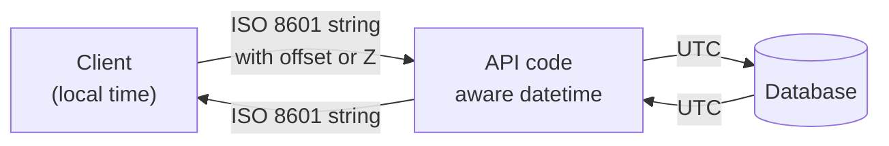

# Dates in Python and JavaScript

After this you can write and parse timestamps in a standard format, avoid the common traps in Python's `datetime` and JavaScript's `Date`, and test code that depends on the current time.

Before this: [Time zones and daylight saving](02-time-zones-and-daylight-saving.md).

## The idea

A front end sends `"2026-03-01"` to your API. In Toronto, `new Date("2026-03-01")` is midnight UTC, which is February 28 at 7 p.m. local time, so the page shows the wrong day. The data was fine and the parsing rule was the surprise. Both languages have a date type with sharp edges, and you avoid them with a few habits: use a standard text format on the wire, keep every datetime aware of its zone, and convert only at the edges.



In the diagram, strings with an explicit offset cross the network, and only the client turns UTC into local text.

## Key terms

**ISO 8601** is the international standard for writing dates and times as text, such as `2026-07-01T09:30:00-04:00`. **RFC 3339** is the internet profile of it: a stricter subset used by APIs, with a required offset or `Z` (UTC) after the time. Use it for JSON.

A **naive** datetime has no zone information, so it does not say which instant it is. An **aware** datetime carries an offset or a zone, so it names an instant.

**zoneinfo** is Python's standard library module for IANA zones. **`tzdata`** is a pip package holding the zone data, needed on Windows, which has no system tz database.

**Temporal** is a new JavaScript date API (a TC39 proposal, standardized separately from `Date`) with separate types for instants, zoned datetimes and plain dates.

A **clock** (injected) is an object your code asks for the current time, instead of calling `now()` directly, so a test can replace it.

## How it works

Python first. `datetime.fromisoformat` parses an RFC 3339 string (including `Z` since Python 3.11) and gives an aware value. `datetime.now(timezone.utc)` is the aware "now". Plain `datetime.now()` and `datetime.utcnow()` are naive, and `utcnow()` is deprecated, so avoid both. Mixing naive and aware values raises an error, which is a useful alarm.

```python
from datetime import datetime, timezone
from zoneinfo import ZoneInfo

t = datetime.fromisoformat("2026-07-01T09:30:00-04:00")
print(t, t.utcoffset().total_seconds() / 3600)

naive = datetime(2026, 7, 1, 9, 30)
aware = naive.replace(tzinfo=ZoneInfo("America/Toronto"))
print(naive.tzinfo, aware.tzinfo)
try:
    naive < aware
except TypeError as e:
    print(e)
```

```text
2026-07-01 09:30:00-04:00 -4.0
None America/Toronto
can't compare offset-naive and offset-aware datetimes
```

`replace(tzinfo=...)` attaches a zone without converting. `astimezone(zone)` converts to another zone. The previous lesson showed `fold`, which selects the first (`0`) or second (`1`) occurrence of a repeated hour.

On Windows, `ZoneInfo("America/Toronto")` fails with `ZoneInfoNotFoundError` until you run `python -m pip install tzdata` (checked with Python 3.14). On Linux and macOS the system database is used, and `tzdata` is a fallback; add it to `requirements.txt` for containers and CI.

JavaScript's `Date` is a wrapper around one number: milliseconds since the epoch, always UTC inside. It has a few traps.

```javascript
console.log(new Date(2026, 0, 15).getMonth());
console.log(new Date("2026-03-01").toISOString());
console.log(new Date("2026-03-01T00:00:00").toISOString());

const a = new Date("2026-01-31T12:00:00Z");
const b = a;
b.setUTCMonth(1);
console.log(a.toISOString());
```

Run with `TZ=America/Toronto node dates.js` (the output depends on the machine's zone; with `TZ=UTC` the second and third lines are both `2026-03-01T00:00:00.000Z`):

```text
0
2026-03-01T00:00:00.000Z
2026-03-01T05:00:00.000Z
2026-03-03T12:00:00.000Z
```

Line by line: months count from 0, so `0` is January. A date-only string is read as UTC, but a date-time string without an offset is read as local time, so the two inputs differ by 5 hours here. `Date` is mutable: `b = a` is the same object, and `setUTCMonth(1)` on 31 January overflows into 3 March and changes `a` too. Format for people with `Intl.DateTimeFormat` and a `timeZone` option, and always send a string with `Z` or an offset.

Temporal fixes these (`Temporal.PlainDate`, `Temporal.Instant`, `Temporal.ZonedDateTime`, immutable, 1-based months), but as of 2026 MDN lists it as not Baseline ("does not work in some of the most widely-used browsers"), and it is not defined in Node 24 here (`typeof Temporal` prints `undefined`). Check [MDN's Temporal page](https://developer.mozilla.org/en-US/docs/Web/JavaScript/Reference/Global_Objects/Temporal) for the current table, and use a polyfill such as `@js-temporal/polyfill` or a library if you need it now.

For tests, code that calls `datetime.now()` inside a function is hard to test, because the result changes every run. Pass the clock in.

## Worked examples

<div class="example" markdown>

### Example 1: a testable expiry check

Step 1. Define a clock with one method, `now()`. Step 2. The real one returns the current UTC time. Step 3. A test uses a fixed one. Step 4. The function receives the clock as a parameter.

```python
from datetime import datetime, timezone

class Clock:
    def now(self):
        return datetime.now(timezone.utc)

class FixedClock:
    def __init__(self, t):
        self.t = t
    def now(self):
        return self.t

def is_expired(expires_at, clock):
    return clock.now() >= expires_at

exp = datetime(2026, 1, 1, tzinfo=timezone.utc)
print(is_expired(exp, FixedClock(datetime(2025, 12, 31, 23, 59, tzinfo=timezone.utc))))
print(is_expired(exp, FixedClock(datetime(2026, 1, 1, tzinfo=timezone.utc))))
```

```text
False
True
```

Check: the second case sits exactly on the boundary, and it is the one that catches `>` versus `>=` mistakes. Libraries such as `freezegun` (Python) and fake timers in Node's `node:test` can freeze time without changing the code, but a passed-in clock works in every language.

</div>

## Common mistakes

<div class="warning" markdown>

Watch out: calling `datetime.utcnow()` or `datetime.now()` and storing the naive result. Use `datetime.now(timezone.utc)`.

Watch out: sending `"2026-03-01"` for a moment in time. A date-only string means a calendar day, not an instant. If you mean a moment, send the full string with `Z` or an offset.

Watch out: building dates by string concatenation or splitting on `-`. Use a parser, so that leap days and invalid dates such as `2026-02-30` are rejected.

</div>

## Working with AI

<div class="ai" markdown>

Words to use: ISO 8601, RFC 3339, naive datetime, aware datetime, `zoneinfo`, `fold`, `tzdata`, Temporal, injected clock.

Prompts to try:

- "This Python 3.14 function uses `datetime.now()` and `utcnow()`. Make it timezone-aware, take a clock parameter for testing, and add a test for the boundary instant."
- "My Node 24 API returns dates as `new Date(row.day)` and the day is off by one in Toronto. Explain how JavaScript parses `YYYY-MM-DD` and fix it."

What to check:

- Use of `utcnow()`, naive `now()` or `pytz`-style `localize` calls in new code. The first two are naive, the last is old API.
- Any JavaScript that constructs a date with a month number. Months start at 0.
- Code that uses Temporal without a polyfill. Run it on your Node version and browser targets.
- Tests that depend on the real clock or the machine's zone. Re-run with a different `TZ`.

</div>

## Quiz

1\. Which is RFC 3339 valid: `2026-07-01 9:30`, `2026-07-01T09:30:00`, or `2026-07-01T09:30:00-04:00`?

<details class="solution" markdown>
<summary>Answer</summary>

Only the last. RFC 3339 requires an offset or `Z` after the time. The first has no `T` and a one-digit hour, and the second has no offset.

</details>

2\. In Node, `new Date(2026, 11, 25).getMonth()` returns what?

<details class="solution" markdown>
<summary>Answer</summary>

`11`, which is December. Months run from 0 to 11, and the argument `11` means December too.

</details>

3\. A Toronto user reports that the birthday `1990-05-14` displays as 13 May. The API returns the string and the front end calls `new Date(str)`. What is the cause and the fix?

<details class="solution" markdown>
<summary>Answer</summary>

A date-only string is parsed as UTC midnight, which is the evening of 13 May in Toronto, and then displayed in local time. Treat a birthday as a calendar date: split it and show it without a zone, or use a plain date type such as `Temporal.PlainDate`.

</details>

4\. Why pass a clock into a function instead of calling `now()` inside it?

<details class="solution" markdown>
<summary>Answer</summary>

A test can then supply a fixed time and check boundaries (just before, exactly at, just after) and zone rules without waiting or patching globals.

</details>

## Lab

<div class="lab" markdown>

### Lab: parse, convert and freeze

Goal: write a function that is correct across zones and testable. Time: about 20 minutes. Runs in: any shell with Python 3.14 and Node 24.

1. In a new venv, run `python -m pip install tzdata`.
2. Write `local_start(iso_utc, zone)` that parses an RFC 3339 string and returns it as an ISO string in the given IANA zone.
3. Call it with `"2026-11-01T05:30:00Z"` and `"2026-11-01T06:30:00Z"` for `America/Toronto`. Both are 01:30 local; confirm the offsets differ.
4. In JavaScript, run `console.log(new Date("2026-11-01T05:30:00Z").toLocaleString("en-CA", { timeZone: "America/Toronto" }))` and compare. Run it with two different `TZ` values and note that the output does not change because `timeZone` is explicit.

Expected result: Python prints `-04:00` for the first and `-05:00` for the second.

<details class="solution" markdown>
<summary>Solution</summary>

```python
from datetime import datetime
from zoneinfo import ZoneInfo

def local_start(iso_utc, zone):
    return datetime.fromisoformat(iso_utc).astimezone(ZoneInfo(zone)).isoformat()

print(local_start("2026-11-01T05:30:00Z", "America/Toronto"))
print(local_start("2026-11-01T06:30:00Z", "America/Toronto"))
```

```text
2026-11-01T01:30:00-04:00
2026-11-01T01:30:00-05:00
```

</details>

</div>

## Where this shows up

- Storing times in Postgres (`timestamptz`) and converting them in queries: [Text, dates and times](../../10-databases-sql-and-postgres/02-querying/09-text-dates-and-times.md).
- Request and response formats in [REST API design](../01-servers-and-apis/04-rest-api-design.md): send RFC 3339 strings in JSON.
