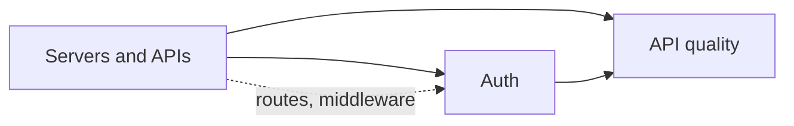

# Back end

What a server does, how to design and secure an API, and how to run background jobs.

Before this folder: Front end and Networking.

This folder covers the server side of a web app. You learn what a back end does, how Node.js and Express handle requests, how to design a REST API with validation and error handling, and how authentication works: sessions, cookies, JWT, OAuth and CORS. The last chapter covers background jobs and testing and documenting an API.

AI tools can generate an endpoint in seconds, and the common failures are here: no input validation, an authorization check missing on one route, tokens stored unsafely, a slow task run inside a request. With the right terms you can review an endpoint instead of trusting it.

It builds on [Front end](../08-front-end/index.md), whose JavaScript you reuse in Node.js, and on [Networking](../07-networking/index.md) for HTTP. It feeds [Databases, SQL and Postgres](../10-databases-sql-and-postgres/index.md), [Security](../12-security/index.md), [DevOps and cloud](../13-devops-and-cloud/index.md) and [Software and system design](../14-software-and-system-design/index.md).

### How to use this folder

- Keep the Servers and APIs cheat sheet open while you design endpoints.
- GraphQL, gRPC and webhooks, and Python back ends, are optional.
- Read the auth lessons in order. Each one builds on the one before.

<!-- lessons:start -->
## Lessons

### 1. [Servers and APIs](01-servers-and-apis/index.md)

1. [What a back end does](01-servers-and-apis/01-what-a-back-end-does.md)
2. [Node.js and its runtime](01-servers-and-apis/02-nodejs-and-its-runtime.md)
3. [Express: routing and middleware](01-servers-and-apis/03-express-routing-and-middleware.md)
4. [REST API design](01-servers-and-apis/04-rest-api-design.md)
5. [Validation and error handling](01-servers-and-apis/05-validation-and-error-handling.md)
6. [Other API styles: GraphQL, gRPC and webhooks](01-servers-and-apis/06-other-api-styles-graphql-grpc-webhooks.md) (optional)
7. [Python back ends: FastAPI and Django](01-servers-and-apis/07-python-back-ends-fastapi-and-django.md) (optional)

### 2. [Authentication and authorization](02-auth/index.md)

1. [Authentication vs authorization](02-auth/01-authentication-vs-authorization.md)
2. [Sessions, cookies and JWT](02-auth/02-sessions-cookies-and-jwt.md)
3. [OAuth and SSO](02-auth/03-oauth-and-sso.md)
4. [CORS and same origin](02-auth/04-cors-and-same-origin.md)

### 3. [API quality](03-api-quality/index.md)

1. [Background jobs](03-api-quality/01-background-jobs.md)
2. [Testing and documenting APIs](03-api-quality/02-testing-and-documenting-apis.md)

<!-- lessons:end -->
