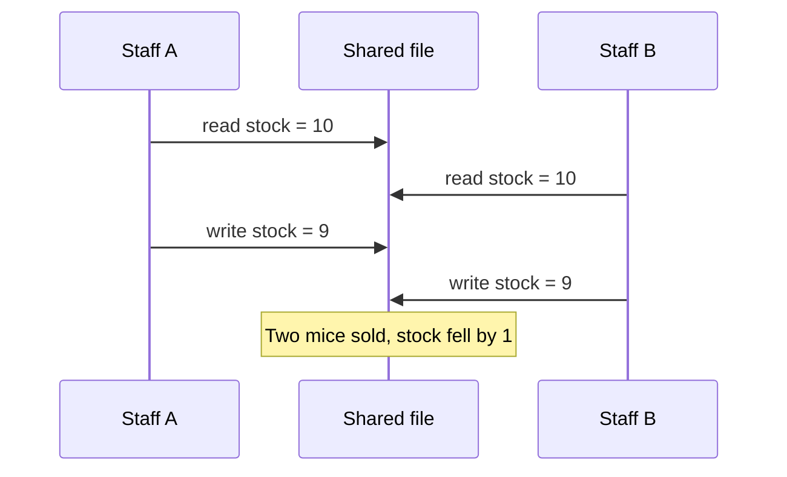
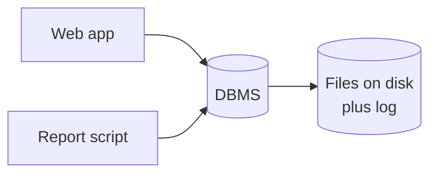

# What a database is

After this you can explain what a database management system does that a file or a spreadsheet does not, and name the kinds of database you will meet.

Before this: programming fundamentals. No earlier database knowledge is needed.

## The idea

Picture the `shop` store from this folder, kept in one spreadsheet. Two staff members open it at the same time. Both read that the Wireless Mouse has 10 in stock. Each sells one and saves. The file now says 9, but two mice left the building. The second save overwrote the first, and nobody got an error.

A spreadsheet or a plain file is built for one person at a time. A **database** is an organized collection of data that many programs and people can read and change safely at the same time. The software that provides this is a **database management system** (DBMS). PostgreSQL, MySQL, SQLite and SQL Server are DBMSs; people often say "database" for both the data and the software.



The diagram shows a lost update. A DBMS prevents it by running changes as transactions that cannot trample each other.

## Key terms

A **DBMS** is software that stores data, answers queries about it and enforces rules, so that applications do not manage files themselves.

A **query** is a request for data written in a query language. In relational databases the language is SQL.

A **transaction** is a group of changes that succeed or fail together. A transfer between two bank accounts is one transaction: either both the debit and the credit happen, or neither does.

**Durability** means that once the DBMS has confirmed a change, the change survives a crash or power loss.

**OLTP** (online transaction processing) is the workload of many small reads and writes from applications, such as placing an order. It is the workload this folder concentrates on. Large analytical scans over history are a different workload, called OLAP, covered in the data engineering folder ([Data engineering and data science](../../11-data-engineering-and-data-science/index.md)).

## How it works

A DBMS gives you four things that files and spreadsheets give you poorly or not at all.

| Need | Spreadsheet or file | DBMS |
|---|---|---|
| Concurrency | Last save wins; or the file is locked for everyone else | Many users change data at once; transactions keep each other isolated |
| Integrity | Any cell can hold anything | Rules (types, keys, `CHECK`) reject bad data before it is stored |
| Querying | Filter and sort by hand or write a script | One declarative language, SQL, with indexes to find rows fast |
| Durability | A crash mid-save can corrupt the file | A write-ahead log lets the system recover to a consistent state |

Declarative means you state what you want ("customers in Ontario, newest first") and the DBMS chooses how to get it. You do not write the loop.

Databases come in several families. A **relational** database stores data as tables of rows and columns, linked by shared values, and is queried with SQL; Postgres is one. Others trade some of that structure for a different shape or for scale: document stores keep JSON-like records, key-value stores map one key to one value (Redis), graph databases store nodes and edges, and column stores are tuned for analytics. The next lesson explains the relational model. The relational family is the default choice for application data, and the others are chosen for a reason you can name.



In the diagram, every program talks to the DBMS and none touches the files on disk. The DBMS is the only writer, which is what lets it keep the rules.

## Worked examples

<div class="example" markdown>

### Example 1: the database refuses bad data

Order 1 belongs to a real customer. Try to add an order for customer 99999, who does not exist. A spreadsheet would accept the row. The `shop` database has a foreign key from `orders.customer_id` to `customers`, so the DBMS rejects it.

1. First count the customers: 200 rows, and none has the id 99999.
2. Run the `INSERT`. It names a customer id that is not in `customers`.
3. Read the error. It names the constraint that was broken.

<div class="sql-runner" data-db="shop" markdown>

```sql
SELECT count(*) AS customers,
       count(*) FILTER (WHERE customer_id = 99999) AS with_id_99999
FROM customers;
```

</div>

<div class="sql-runner" data-db="shop" markdown>

<!-- sql: expect-error -->
```sql
INSERT INTO orders (order_id, customer_id, status, created_at, ship_province)
VALUES (100000, 99999, 'pending', now(), 'ON');
```

</div>

Check: the first query returns 200 and 0. The second fails with a foreign key violation, and the `orders` table is unchanged. The rule lives in the database, so every program that writes to it obeys it.

</div>

## Common mistakes

<div class="warning" markdown>

Watch out: treating the database as a file you read whole. Loading all of `order_items` (1689 rows here, millions in a real store) into your program to filter it there wastes time and memory. Ask the database for the rows you need with a `WHERE`.

</div>

<div class="warning" markdown>

Watch out: assuming "relational" means "slow" or "NoSQL" means "faster". A single Postgres server handles far more than most applications need. Choose another family when you can name the requirement (a graph traversal, a huge key-value workload), not because it sounds scalable.

</div>

## Working with AI

<div class="ai" markdown>

Words to use: DBMS, transaction, concurrency, integrity constraint, durability, OLTP, relational, declarative.

Prompts to try:

- "I store orders in a JSON file and two requests sometimes overwrite each other. Explain which database property fixes this and what the first PostgreSQL feature to use is."
- "Compare PostgreSQL and a document database for an online store with orders, customers and stock. List what I give up with each."

What to check:

- Claims that a NoSQL database "scales better" with no workload named. Ask for the specific limit being hit.
- Advice to use a database you have not heard of for a small app. The default for application data is a relational DBMS.
- Mixing up the data and the software. Postgres is the DBMS; `shop` is a database inside it.

</div>

## Quiz

1\. Name the problem in the two-staff spreadsheet story, and the DBMS feature that prevents it.

<details class="solution" markdown>
<summary>Answer</summary>

A lost update: both read 10, both wrote 9. Transactions with isolation (concurrency control) prevent it.

</details>

2\. A power cut happens one second after the DBMS confirmed your `COMMIT`. Is the change there after restart, and which property says so?

<details class="solution" markdown>
<summary>Answer</summary>

Yes. Durability: a confirmed change survives a crash, because the DBMS has recorded it in its write-ahead log on disk.

</details>

3\. How many rows does `order_items` have in `shop`? Write the query.

<div class="sql-runner" data-db="shop" data-solution="sol-quiz-3" markdown>

```sql
-- write your query here
SELECT 1;
```

</div>

<details class="solution" id="sol-quiz-3" markdown>
<summary>Solution</summary>

```sql
SELECT count(*) FROM order_items;
```

It returns 1689.

</details>

4\. Your teammate says "we need NoSQL because we have a lot of orders". What do you ask them?

<details class="solution" markdown>
<summary>Answer</summary>

Which requirement a relational database fails to meet: write rate, data shape or latency. "A lot of orders" alone is not one, since 900 orders or 9 million both fit comfortably in Postgres.

</details>

## Lab

<div class="lab" markdown>

### Lab: how big is the shop?

Goal: count the rows in every table of `shop` and check the integrity rule yourself. Time: about 10 minutes. Runs in: the browser.

1. Write one query that returns one row with the columns `customers`, `products`, `orders` and `order_items`, each holding that table's row count.
2. Press Check.
3. Predict, then confirm: how many customers have no `email` stored? Write a second query returning that count as `no_email`.

Expected result: 200, 38, 900, 1689 for the first query and 22 for the second.

<div class="sql-runner" data-db="shop" data-solution="sol-lab-1" markdown>

```sql
-- step 1
SELECT 1;
```

</div>

<details class="solution" id="sol-lab-1" markdown>
<summary>Solution</summary>

```sql
SELECT (SELECT count(*) FROM customers) AS customers,
       (SELECT count(*) FROM products) AS products,
       (SELECT count(*) FROM orders) AS orders,
       (SELECT count(*) FROM order_items) AS order_items;
```

</details>

<div class="sql-runner" data-db="shop" data-solution="sol-lab-2" markdown>

```sql
-- step 3
SELECT 1;
```

</div>

<details class="solution" id="sol-lab-2" markdown>
<summary>Solution</summary>

```sql
SELECT count(*) AS no_email FROM customers WHERE email IS NULL;
```

</details>

</div>

## Where this shows up

- The next lesson, [the relational model](02-the-relational-model.md), explains the tables and keys behind the integrity rule in Example 1.
- Transactions and ACID get their own lesson in the Postgres chapter<!-- link: ../04-postgres-in-depth/03-transactions-and-acid.md -->.
