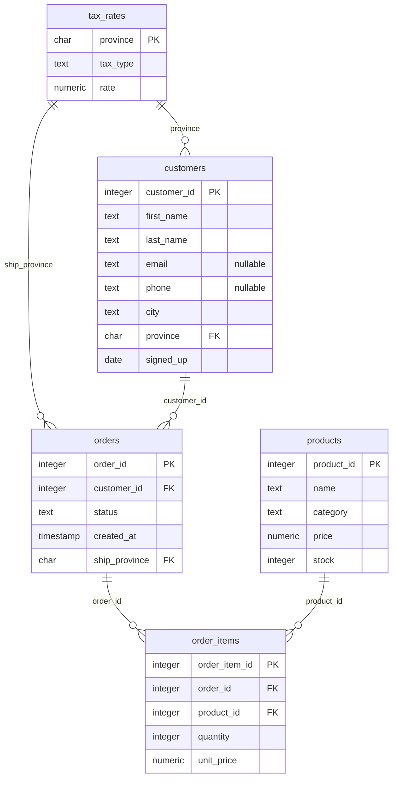

# The relational model

After this you can read a table's structure, name its keys, explain what `NULL` means, and read the `shop` schema from its entity-relationship diagram.

Before this: [What a database is](01-what-a-database-is.md).

## The idea

A relational database stores everything in tables, and a table looks like a spreadsheet sheet: columns across the top, one record per row. The difference is the rules. Every column has one type, every row can be told apart from every other, and a row in one table refers to a row in another by copying its identifying value, never by position or by pasting the data again.

In `shop`, a customer's name is stored once, in `customers`. An order stores only the `customer_id`. To change a customer's city you edit one row, and every order sees the change.

```text
            columns (attributes) -->
            customer_id | first_name | last_name | city     | province
row         ------------+------------+-----------+----------+---------
(tuple)     14          | Gabriel    | Wong      | Gatineau | QC
   |        15          | ...        | ...       | ...      | ...
   v
```

In the sketch, one row is one customer, and one column is one fact about every customer. The values shown are the real row for customer 14 in `customers`.

## Key terms

The model comes from mathematics, so each idea has a formal name and an everyday one.

A **relation** (everyday word: table) is a set of rows that all have the same columns. As a set, it has no duplicate rows and no built-in order. Rows come back in any order unless the query says `ORDER BY`.

A **tuple** (row, record) is one item in a relation. An **attribute** (column, field) is a named part of every tuple.

A **domain** is the set of values an attribute may hold. In SQL it is the column's data type plus any rules: `integer`, `text`, `date`, `numeric(10,2)`, and `CHECK (price >= 0)`.

A **primary key** is a column, or set of columns, whose value identifies exactly one row. It is never `NULL` and never repeated. A key is the row's identity: the customer's name can change, the `customer_id` does not.

A **foreign key** is a column that holds the primary key value of a row in another (or the same) table. The DBMS rejects a value with no matching row, which is the rule Example 1 of the previous lesson broke.

**NULL** marks a missing or unknown value. It is not zero and not an empty string. Any comparison with `NULL` (`email = NULL`) is neither true nor false but unknown, so a `WHERE` condition on it keeps no rows. Test with `IS NULL`.

## How it works

The `shop` schema has five tables. This diagram is drawn from the `CREATE TABLE` statements in `shop.sql`, and the line `REFERENCES` clause in each statement becomes a foreign key.



Read each line as "one on the left, zero or more on the right": one customer has zero or more orders (42 customers have none). The crow's-foot end sits on the table that holds the foreign key. Only `email` and `phone` allow `NULL`; every other column is declared `NOT NULL`.

An `order_item` belongs to exactly one order and one product, so `order_items` is where the many-to-many relationship between orders and products is stored. It also keeps its own `unit_price`, the price at the time of sale, because `products.price` can change later.

The `CHECK` rules in the schema are part of the domains: `price >= 0`, `quantity > 0`, and `status` is one of six words.

## Worked examples

<div class="example" markdown>

### Example 1: keys and NULL in practice

1. Look up one row by its primary key. The key guarantees at most one row.
2. Count the customers with `count(*)` (all rows) and with `count(email)` (rows where `email` is not `NULL`). `count(column)` skips `NULL`.
3. Try `email = NULL` and `email IS NULL`.

<div class="sql-runner" data-db="shop" markdown>

```sql
SELECT customer_id, first_name, last_name, city, province
FROM customers
WHERE customer_id = 14;
```

</div>

<div class="sql-runner" data-db="shop" markdown>

```sql
SELECT count(*) AS customers,
       count(email) AS with_email,
       count(*) FILTER (WHERE email = NULL) AS equals_null,
       count(*) FILTER (WHERE email IS NULL) AS is_null
FROM customers;
```

</div>

Check: the first query returns one row, Gabriel Wong of Gatineau, QC. The second returns 200, 178, 0 and 22. The 22 customers with no email plus the 178 with one make 200, and `email = NULL` matches none of them.

</div>

## Common mistakes

<div class="warning" markdown>

Watch out: `WHERE phone = NULL` returns no rows and no error. Write `WHERE phone IS NULL`. A related trap: `WHERE province <> 'ON'` also drops rows where `province` is `NULL`, because `NULL <> 'ON'` is unknown.

</div>

<div class="warning" markdown>

Watch out: using a value that changes as the key. An email address or a name looks unique but people change both. Use a stable id (`customer_id`) as the primary key and keep the email as an ordinary column.

</div>

<div class="warning" markdown>

Watch out: assuming rows have an order. Without `ORDER BY`, the order of rows from a table is not defined, even if it looked sorted the last time you ran the query.

</div>

## Working with AI

<div class="ai" markdown>

Words to use: relation, tuple, attribute, domain, primary key, foreign key, `NOT NULL`, referential integrity, one-to-many.

Prompts to try:

- "Here is my `CREATE TABLE` text: [paste]. Draw it as a Mermaid erDiagram and list every foreign key and its parent table."
- "Why does `SELECT count(email) FROM customers` return a smaller number than `count(*)`? Explain in terms of `NULL`."

What to check:

- A generated diagram against the `CREATE TABLE` statements: every `REFERENCES` clause should be one line, and the one-to-many direction should match which table holds the foreign key.
- Suggested keys such as email or name. Ask whether the value can change or repeat.
- `= NULL` anywhere in generated SQL. It should be `IS NULL`.

</div>

## Quiz

1\. What is the difference between a primary key and a foreign key?

<details class="solution" markdown>
<summary>Answer</summary>

A primary key identifies one row of its own table. A foreign key is a column holding another table's primary key value, so a row can refer to that table's row.

</details>

2\. A customer has `NULL` in `phone`. What does `phone = ''` return for that row, and why?

<details class="solution" markdown>
<summary>Answer</summary>

Unknown, so the row is not kept. `NULL` is not an empty string; any comparison with `NULL` is unknown.

</details>

3\. How many customers have a phone number stored? Return a single column named `with_phone`.

<div class="sql-runner" data-db="shop" data-solution="sol-quiz-3" markdown>

```sql
-- write your query here
SELECT 1;
```

</div>

<details class="solution" id="sol-quiz-3" markdown>
<summary>Solution</summary>

```sql
SELECT count(phone) AS with_phone FROM customers;
```

It returns 152 (200 customers minus 48 with no phone).

</details>

4\. In the diagram, which table would you query to find which products one order contained, and which two foreign keys does it hold?

<details class="solution" markdown>
<summary>Answer</summary>

`order_items`. It holds `order_id` (to `orders`) and `product_id` (to `products`).

</details>

## Lab

<div class="lab" markdown>

### Lab: read the schema back from the database

Goal: confirm the diagram by asking Postgres to list its own columns. Time: about 15 minutes. Runs in: the browser.

1. Write a query on `information_schema.columns` that returns `column_name` and `data_type` for `table_name = 'customers'`, sorted by `ordinal_position`. Expected: 8 rows.
2. Write a query that returns each `table_name` and the number of columns as `columns`, for the `public` schema, sorted by `table_name`. Expected: 5 rows (customers 8, order_items 5, orders 5, products 5, tax_rates 3).
3. Compare with the erDiagram. Which table has the most columns?

<div class="sql-runner" data-db="shop" data-solution="sol-lab-1" markdown>

```sql
-- step 1
SELECT 1;
```

</div>

<details class="solution" id="sol-lab-1" markdown>
<summary>Solution</summary>

```sql
SELECT column_name, data_type
FROM information_schema.columns
WHERE table_schema = 'public' AND table_name = 'customers'
ORDER BY ordinal_position;
```

</details>

<div class="sql-runner" data-db="shop" data-solution="sol-lab-2" markdown>

```sql
-- step 2
SELECT 1;
```

</div>

<details class="solution" id="sol-lab-2" markdown>
<summary>Solution</summary>

```sql
SELECT table_name, count(*) AS columns
FROM information_schema.columns
WHERE table_schema = 'public'
GROUP BY table_name
ORDER BY table_name;
```

`customers` has the most, with 8.

</details>

</div>

## Where this shows up

- [Joins](../02-querying/04-joins.md) follow the foreign keys in the diagram, on exactly this schema.
- Writing constraints yourself is in [data types and constraints](../03-schema-design/01-data-types-and-constraints.md), and drawing diagrams for a new design in [modelling relationships and ER diagrams](../03-schema-design/03-modelling-relationships-and-er-diagrams.md).
