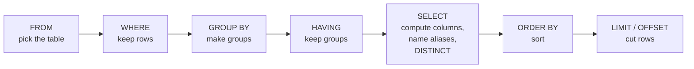

# SELECT, WHERE and ORDER BY

After this you can pick the columns and rows you want from one table, sort and page the result, and predict why a query's clauses can or can't see each other.

Before this: [the relational model](../01-database-basics/02-the-relational-model.md) and [Postgres and psql](../01-database-basics/03-postgres-and-psql.md).

## The idea

You ask a database a question by describing the answer, not the steps: "the names and prices of the Electronics products under \$100, cheapest first". The database decides how to find them. That is why SQL reads like a question, but it is also why the order you write the clauses is not the order the database applies them.

Every query is applied in a fixed logical order. The database may reorder the real work for speed, but the result must be the same as if it followed this order.



In the diagram, a clause can only use what earlier boxes produced. `WHERE` runs before `SELECT`, so it can't use a column alias made in `SELECT`. `ORDER BY` runs after, so it can. Grouping is covered in the aggregates lesson<!-- link: 03-aggregates-group-by-and-having.md -->.

## Key terms

A **query** is one `SELECT` statement. It reads rows and returns a result table; it changes nothing.

A **predicate** is a condition that is true, false or unknown for a row. `WHERE` keeps the rows whose predicate is true (unknown is covered in the `NULL` lesson<!-- link: 02-null-and-three-valued-logic.md -->).

An **alias** is a new name for a column or table, given with `AS`: `price * 1.13 AS with_tax`.

**Pagination** is returning a long result in pages. `LIMIT n` keeps the first $n$ rows; `OFFSET m` skips $m$ rows first.

## How it works

The pieces of a `WHERE` clause:

| Tool | Example | Meaning |
|---|---|---|
| Comparison | `price >= 20`, `status <> 'paid'` | `=`, `<>` (not equal), `<`, `<=`, `>`, `>=` |
| `AND`, `OR`, `NOT` | `a AND b OR c` | `AND` binds tighter than `OR`, so this means `(a AND b) OR c` |
| `IN` | `category IN ('Books', 'Toys')` | equal to any value in the list |
| `BETWEEN` | `price BETWEEN 20 AND 50` | `price >= 20 AND price <= 50`, both ends included |
| `LIKE` | `last_name LIKE 'S%'` | `%` matches any run of characters, `_` matches one. Case-sensitive |
| `ILIKE` | `last_name ILIKE 's%'` | the same, ignoring case (a Postgres extension) |
| `IS NULL` | `email IS NULL` | the value is missing |

`ORDER BY` takes several keys: later keys break ties in earlier ones, and each key has its own `ASC` (default) or `DESC`. Without `ORDER BY`, the order of rows is not defined, even if it looks stable today. `SELECT DISTINCT` drops duplicate result rows after the columns are computed.

This query uses most of the tools. Predict what order the rows come in before you run it.

<div class="sql-runner" data-db="shop" markdown>

```sql
SELECT name, price, price * 1.13 AS with_tax
FROM products
WHERE category IN ('Electronics', 'Outdoors')
  AND price BETWEEN 20 AND 100
ORDER BY price DESC, name;
```

</div>

There are 10 rows. The most expensive, Trekking Poles at 89.00, comes first, and two products at 24.99 are ordered between themselves by `name`.

## Worked examples

<div class="example" markdown>

### Example 1: AND binds tighter than OR

We want the paid or shipped orders that ship to Ontario. This version looks right but isn't.

1. Postgres reads `status = 'paid' OR status = 'shipped' AND ship_province = 'ON'` as `paid OR (shipped AND ON)`.
2. So every paid order is kept, whatever its province.
3. Parentheses make the intent explicit.

<div class="sql-runner" data-db="shop" markdown>

```sql
SELECT count(*) FILTER (WHERE status = 'paid' OR status = 'shipped' AND ship_province = 'ON') AS wrong,
       count(*) FILTER (WHERE (status = 'paid' OR status = 'shipped') AND ship_province = 'ON') AS right_one
FROM orders;
```

</div>

Check: the result is 24 and 21. The three extra rows in the first are paid orders shipped outside Ontario. Whenever `AND` and `OR` share a `WHERE`, add parentheses even where they are not needed.

</div>

<div class="example" markdown>

### Example 2: case and the logical order

`LIKE` is case-sensitive, so a lowercase pattern finds nothing in names that start with a capital letter.

<div class="sql-runner" data-db="shop" markdown>

```sql
SELECT count(*) FILTER (WHERE last_name LIKE 's%')  AS like_lower,
       count(*) FILTER (WHERE last_name LIKE 'S%')  AS like_upper,
       count(*) FILTER (WHERE last_name ILIKE 's%') AS ilike_lower
FROM customers;
```

</div>

Check: 0, 27 and 27. Now the order of evaluation: this query fails, because `WHERE` runs before `SELECT` creates `with_tax`.

<!-- sql: expect-error -->
<!-- db: shop -->
```sql
SELECT name, price * 1.13 AS with_tax
FROM products
WHERE with_tax > 50;
```

Postgres reports that the column "with_tax" does not exist. Repeat the expression in `WHERE` (`price * 1.13 > 50`), or use `ORDER BY with_tax`, which is allowed.

</div>

## Paging

`LIMIT 20 OFFSET 40` returns rows 41 to 60. It is easy but has two problems. The database still produces and throws away the 40 skipped rows, so deep pages get slower. And if a row is inserted or deleted between two page requests, rows shift: a row can appear twice or be skipped.

**Keyset pagination** (also called the seek method) remembers the last row of the previous page and asks for rows after it. The sort must be unique, so add the primary key as a last tie-breaker, and an index on the sort columns<!-- link: ../04-postgres-in-depth/01-indexes.md --> lets Postgres jump straight to the place.

<div class="sql-runner" data-db="shop" markdown>

```sql
SELECT order_id, created_at
FROM orders
WHERE (created_at, order_id) > ('2025-01-02 03:22:24', 339)
ORDER BY created_at, order_id
LIMIT 3;
```

</div>

This returns orders 897, 279 and 164, the three rows after order 339 in time order. The application passes the last row's `(created_at, order_id)` back for the next page.

## Common mistakes

<div class="warning" markdown>

Watch out: `LIMIT` without `ORDER BY` returns some rows, not the first rows. The same query can return different rows after an update or on another server. Always sort when you cut.

</div>

<div class="warning" markdown>

Watch out: `SELECT *` in application code. It returns every column, so adding a column to the table changes the result, and it hides which columns the code really needs. Name the columns.

</div>

<div class="warning" markdown>

Watch out: `price BETWEEN 50 AND 20` returns no rows, because the lower bound must come first. Dates are the usual trap: `BETWEEN '2026-01-01' AND '2026-01-31'` on a timestamp column drops everything after midnight on January 31. Use `>=` and `<`.

</div>

## Working with AI

<div class="ai" markdown>

Words to use: predicate, alias, logical order of evaluation, operator precedence, `ILIKE`, keyset pagination, tie-breaker, `NULLS LAST`.

Prompts to try:

- "PostgreSQL: the `orders` table has `created_at timestamp` and `order_id integer primary key`. Write a keyset pagination query for 50 rows per page, sorted newest first, and show how the application passes the cursor."
- "This `WHERE` mixes `AND` and `OR`: [paste]. Add the parentheses that match this sentence: [describe the intent]."

What to check:

- Operator precedence. Count the `AND`s and `OR`s and check the parentheses against your intent.
- `OFFSET` on large tables. Ask for keyset pagination if the table will grow.
- A sort that is not unique. Without a tie-breaker, rows with equal sort values can repeat or vanish between pages.
- Invented functions or syntax from MySQL or SQL Server (`TOP`, backtick quoting). Run the query.

</div>

## Quiz

1\. A query has `SELECT price * 2 AS double_price ... ORDER BY double_price`. Why does that work, while the same alias in `WHERE` does not?

<details class="solution" markdown>
<summary>Answer</summary>

`ORDER BY` runs after `SELECT`, so the alias exists. `WHERE` runs before `SELECT`, so the alias does not exist yet.

</details>

2\. How many rows does this return? Predict, then run it.

<div class="sql-runner" data-db="shop" markdown>

```sql
SELECT DISTINCT province, city
FROM customers;
```

</div>

<details class="solution" markdown>
<summary>Answer</summary>

26 rows: every city appears in one province, so the 26 distinct cities give 26 distinct pairs (there are 10 provinces).

</details>

3\. A page of results uses `LIMIT 10 OFFSET 20`. Rows are inserted at the top of the sort order while a user clicks from page 3 to page 4. What goes wrong, and what is the fix?

<details class="solution" markdown>
<summary>Answer</summary>

Every row shifts down, so the user sees some rows from page 3 again on page 4. Use keyset pagination, which starts after the last row seen.

</details>

4\. Write a query that returns the customers whose last name starts with `Mc`, ignoring case, sorted by `customer_id`. Expected: the query runs without error.

<div class="sql-runner" data-db="shop" data-solution="sol-quiz-4" markdown>

```sql
-- write your query here
SELECT 1;
```

</div>

<details class="solution" id="sol-quiz-4" markdown>
<summary>Solution</summary>

```sql
SELECT customer_id, last_name
FROM customers
WHERE last_name ILIKE 'mc%'
ORDER BY customer_id;
```

The result is empty: no last name in this data starts with "Mc". An empty result from a correct query is a valid answer.

</details>

## Lab

<div class="lab" markdown>

### Lab: three filters on the shop database

Goal: write three queries with the tools from this lesson and check each. Time: about 15 minutes. Runs in: the browser.

Task 1. Return `name` and `price` of Electronics or Outdoors products costing from 20 to 100 (both included), sorted by `price` descending, then `name`. Expected: 10 rows.

<div class="sql-runner" data-db="shop" data-solution="sol-lab-1" markdown>

```sql
-- task 1
SELECT 1;
```

</div>

<details class="solution" id="sol-lab-1" markdown>
<summary>Solution</summary>

```sql
SELECT name, price
FROM products
WHERE category IN ('Electronics', 'Outdoors')
  AND price BETWEEN 20 AND 100
ORDER BY price DESC, name;
```

</details>

Task 2. Return `customer_id`, `last_name` and `province` of customers in ON or QC with no email, sorted by `province`, `last_name`, `customer_id`. Expected: 11 rows.

<div class="sql-runner" data-db="shop" data-solution="sol-lab-2" markdown>

```sql
-- task 2
SELECT 1;
```

</div>

<details class="solution" id="sol-lab-2" markdown>
<summary>Solution</summary>

```sql
SELECT customer_id, last_name, province
FROM customers
WHERE province IN ('ON', 'QC')
  AND email IS NULL
ORDER BY province, last_name, customer_id;
```

</details>

Task 3. Return the next 3 orders (`order_id`, `created_at`) after order 339 in `(created_at, order_id)` order, using keyset pagination. Order 339 was created at `2025-01-02 03:22:24`. Expected: orders 897, 279, 164.

<div class="sql-runner" data-db="shop" data-solution="sol-lab-3" markdown>

```sql
-- task 3
SELECT 1;
```

</div>

<details class="solution" id="sol-lab-3" markdown>
<summary>Solution</summary>

```sql
SELECT order_id, created_at
FROM orders
WHERE (created_at, order_id) > ('2025-01-02 03:22:24', 339)
ORDER BY created_at, order_id
LIMIT 3;
```

</details>

Expected result: all three tasks show "matches" in the runner.

</div>

## Where this shows up

- Every report starts with `FROM` and `WHERE`; the same logical order explains why `HAVING` exists, in the aggregates lesson<!-- link: 03-aggregates-group-by-and-having.md -->.
- Indexes<!-- link: ../04-postgres-in-depth/01-indexes.md --> are what make a keyset query fast, and the same sort columns should be the index columns.
