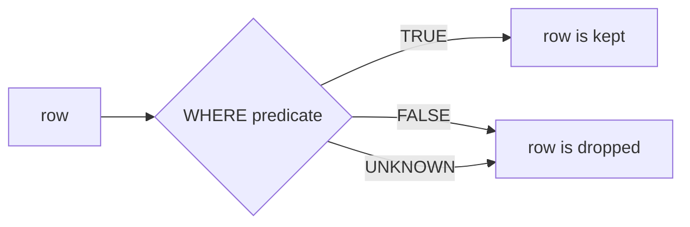

# NULL and three-valued logic

After this you can predict what a comparison with `NULL` returns, write filters that handle missing values, and avoid the `NOT IN` trap.

Before this: [SELECT, WHERE and ORDER BY](01-select-where-and-order-by.md).

## The idea

In the `shop` database, 48 of 200 customers have no phone number. The column holds `NULL` for them. `NULL` doesn't mean zero or an empty string; it means "no value here", either because it is not known or because it doesn't apply.

A question about an unknown value has an unknown answer. Is the missing phone number equal to `'403-555-0534'`? We can't say. So SQL needs a third truth value, **unknown**, next to true and false. Every comparison with `NULL` gives unknown, and `WHERE` keeps a row only when the predicate is true.



In the diagram, unknown and false end in the same place for a plain `WHERE`. They behave differently once you combine or negate predicates, which is where the bugs come from.

## Key terms

**`NULL`** is the marker for a missing value. It has no type of its own and is not equal to anything, including another `NULL`.

**Three-valued logic** is the logic with the values true, false and unknown. In the standard it is written as `TRUE`, `FALSE` and `UNKNOWN`; Postgres shows unknown as `NULL`.

`IS NULL` and `IS NOT NULL` are the tests for missing values. They always return true or false, never unknown. `IS DISTINCT FROM` is a comparison that treats `NULL` as an ordinary value: `NULL IS DISTINCT FROM NULL` is false, and `1 IS DISTINCT FROM NULL` is true.

`COALESCE(a, b, ...)` returns its first argument that is not `NULL`. `NULLIF(a, b)` returns `NULL` when `a = b`, and `a` otherwise.

## How it works

The rules. Any arithmetic or comparison with `NULL` gives `NULL` (`1 + NULL`, `NULL = NULL`, `'a' || NULL`). The three logical operators follow these tables, with U for unknown:

| `a AND b` | b = T | b = F | b = U |
|---|---|---|---|
| a = T | T | F | U |
| a = F | F | F | F |
| a = U | U | F | U |

| `a OR b` | b = T | b = F | b = U |
|---|---|---|---|
| a = T | T | T | T |
| a = F | T | F | U |
| a = U | T | U | U |

`NOT T` is `F`, `NOT F` is `T`, and `NOT U` is `U`. The pattern: `false AND anything` is false, and `true OR anything` is true, because the unknown side can't change the answer. Otherwise unknown spreads. This runner computes all nine combinations so you can compare it with the tables.

<div class="sql-runner" data-db="shop" markdown>

```sql
SELECT a, b, a AND b AS a_and_b, a OR b AS a_or_b, NOT a AS not_a
FROM (VALUES (true), (false), (NULL::boolean)) AS x(a)
CROSS JOIN (VALUES (true), (false), (NULL::boolean)) AS y(b);
```

</div>

Aggregates and sorting have their own rules. Aggregate functions skip `NULL` inputs (`count(phone)` counts only non-missing phones; `count(*)` counts rows). `ORDER BY` sorts `NULL` as larger than every value, so it comes last in ascending order and first in descending order, and `NULLS FIRST` or `NULLS LAST` overrides that. `DISTINCT` and `GROUP BY` treat all `NULL`s as one group.

## Worked examples

<div class="example" markdown>

### Example 1: three ways to ask the same question

We count customers by their relation to one phone number, `'403-555-0534'`.

1. `phone = '...'` is true for one row.
2. `phone <> '...'` is true for every row with a different, known phone. A `NULL` phone gives unknown, so those rows vanish from both counts.
3. `phone IS NULL` finds the missing ones, and `IS DISTINCT FROM` includes them with the "different" rows.

<div class="sql-runner" data-db="shop" markdown>

```sql
SELECT count(*) FILTER (WHERE phone = '403-555-0534')  AS equal_to,
       count(*) FILTER (WHERE phone <> '403-555-0534') AS not_equal,
       count(*) FILTER (WHERE phone IS NULL)           AS missing,
       count(*) FILTER (WHERE phone IS DISTINCT FROM '403-555-0534') AS distinct_from
FROM customers;
```

</div>

Check: the result is 1, 151, 48 and 199. The first three add up to 200, so each row lands in exactly one of them, and `distinct_from` is `not_equal + missing`. The same trap hides in `WHERE NOT (phone = '...')`, which also returns 151.

</div>

<div class="example" markdown>

### Example 2: the NOT IN trap

`x NOT IN (a, b, NULL)` expands to `x <> a AND x <> b AND x <> NULL`. The last term is unknown, so the whole `AND` is never true, and the query returns no rows at all. We want customers whose phone is not one of the phones in Halifax. Two Halifax customers have no phone. (The parenthesized `SELECT` inside `IN` is a subquery, a query used as a list; the subqueries lesson<!-- link: 05-subqueries.md --> covers it.)

<div class="sql-runner" data-db="shop" markdown>

```sql
SELECT
  (SELECT count(*) FROM customers
   WHERE phone NOT IN (SELECT phone FROM customers WHERE city = 'Halifax')) AS not_in,
  (SELECT count(*) FROM customers c
   WHERE c.phone IS NOT NULL
     AND NOT EXISTS (SELECT 1 FROM customers h
                     WHERE h.city = 'Halifax' AND h.phone = c.phone)) AS not_exists;
```

</div>

Check: 0 and 150. The first is wrong without any error. Use `NOT EXISTS`, or filter `NULL` out of the list (`AND phone IS NOT NULL` inside the subquery). The 150 is the 152 customers with a phone minus the 2 Halifax phones.

</div>

## Handling NULL in output

`COALESCE` supplies a default for display, and `NULLIF` turns a sentinel into `NULL` so it can't poison a calculation. Concatenation with `NULL` gives `NULL`, so a missing phone erases the whole label.

<div class="sql-runner" data-db="shop" markdown>

```sql
SELECT customer_id,
       first_name || ' ' || phone                        AS label_raw,
       first_name || ' ' || COALESCE(phone, 'no phone')  AS label,
       10 / NULLIF(0, 0)                                 AS safe_division
FROM customers
WHERE customer_id IN (1, 2)
ORDER BY customer_id;
```

</div>

Customer 1 has a label either way. Customer 2 has no phone: `label_raw` is `NULL`, `label` is "... no phone", and `10 / NULLIF(0, 0)` is `NULL` instead of a division-by-zero error.

## Common mistakes

<div class="warning" markdown>

Watch out: `WHERE email = NULL` is never true, so it returns zero rows and no error. Write `IS NULL`. In the shop data it finds 22 customers with no email.

</div>

<div class="warning" markdown>

Watch out: `COALESCE(x, 0)` can hide a real difference. A missing price replaced by 0 makes an average smaller and a free item indistinguishable from an unknown one. Decide what "missing" means before you replace it.

</div>

<div class="warning" markdown>

Watch out: `NOT IN` with a subquery on a column that allows `NULL`. A single `NULL` in the list empties the result (Example 2). Prefer `NOT EXISTS`.

</div>

## Working with AI

<div class="ai" markdown>

Words to use: `NULL`, three-valued logic, unknown, `IS NOT DISTINCT FROM`, `COALESCE`, `NULLIF`, anti-join, `NOT EXISTS`.

Prompts to try:

- "PostgreSQL: `customers.phone` is nullable. Write a query for customers whose phone is not in the list of Halifax customers' phones, correct even when that list contains `NULL`. Explain why `NOT IN` fails."
- "Explain the result of `SELECT count(*) FROM t WHERE x <> 5` when `x` has `NULL` values, and show a version that counts the `NULL` rows too."

What to check:

- Every `= NULL`, `<> NULL` and `NOT IN`. Search the generated SQL for them.
- Whether a column is nullable. Look at the `CREATE TABLE`: a `NOT NULL` column can't hit these problems, a nullable one can.
- Defaults inserted by `COALESCE`. Ask what the default does to sums, averages and counts.

</div>

## Quiz

1\. What does `NULL = NULL` return, and what should you write instead to test for a missing value?

<details class="solution" markdown>
<summary>Answer</summary>

It returns `NULL` (unknown), not true. Use `x IS NULL`, or `a IS NOT DISTINCT FROM b` to compare two values that may be `NULL`.

</details>

2\. Predict the result. `false AND NULL`, `true AND NULL`, `true OR NULL`.

<div class="sql-runner" data-db="shop" markdown>

```sql
SELECT false AND NULL AS r1, true AND NULL AS r2, true OR NULL AS r3;
```

</div>

<details class="solution" markdown>
<summary>Answer</summary>

`false`, `NULL`, `true`. A false operand decides an `AND`, and a true operand decides an `OR`; otherwise the unknown side makes the result unknown.

</details>

3\. A report says 200 customers, but a query for `phone = X` plus a query for `phone <> X` totals 152. Why, and how many customers are missing from the total?

<details class="solution" markdown>
<summary>Answer</summary>

Customers with a `NULL` phone satisfy neither test, so 48 are missing (200 minus 152). Add `OR phone IS NULL` to the second query, or use `IS DISTINCT FROM`.

</details>

4\. Write a query that lists `customer_id` and `phone` for the first 3 customers by phone, with missing phones first, then by `customer_id`. Expected: customers 2, 4 and 6.

<div class="sql-runner" data-db="shop" data-solution="sol-quiz-4" markdown>

```sql
-- write your query here
SELECT 1;
```

</div>

<details class="solution" id="sol-quiz-4" markdown>
<summary>Solution</summary>

```sql
SELECT customer_id, phone
FROM customers
ORDER BY phone NULLS FIRST, customer_id
LIMIT 3;
```

</details>

## Lab

<div class="lab" markdown>

### Lab: counting what is missing

Goal: measure missing data and write the right filters. Time: about 15 minutes. Runs in: the browser.

Task 1. In one row, return `total` (all customers), `with_phone` (`count(phone)`) and `without_phone`, computed with `count(*) - count(phone)`. Expected: 200, 152, 48.

<div class="sql-runner" data-db="shop" data-solution="sol-lab-1" markdown>

```sql
-- task 1
SELECT 1;
```

</div>

<details class="solution" id="sol-lab-1" markdown>
<summary>Solution</summary>

```sql
SELECT count(*) AS total,
       count(phone) AS with_phone,
       count(*) - count(phone) AS without_phone
FROM customers;
```

</details>

Task 2. Return `customer_id` and `contact`, where `contact` is the phone, or the string `no phone` when it is missing, for the customers in Halifax, sorted by `customer_id`. Expected: 4 rows, 2 of them `no phone`.

<div class="sql-runner" data-db="shop" data-solution="sol-lab-2" markdown>

```sql
-- task 2
SELECT 1;
```

</div>

<details class="solution" id="sol-lab-2" markdown>
<summary>Solution</summary>

```sql
SELECT customer_id, COALESCE(phone, 'no phone') AS contact
FROM customers
WHERE city = 'Halifax'
ORDER BY customer_id;
```

</details>

Task 3. Return the number of customers whose phone is not `'403-555-0534'`, counting those with no phone. Expected: 199. Then explain in one sentence why `<>` alone gives 151.

<div class="sql-runner" data-db="shop" data-solution="sol-lab-3" markdown>

```sql
-- task 3
SELECT 1;
```

</div>

<details class="solution" id="sol-lab-3" markdown>
<summary>Solution</summary>

```sql
SELECT count(*) AS n
FROM customers
WHERE phone IS DISTINCT FROM '403-555-0534';
```

With `<>`, a `NULL` phone gives unknown and `WHERE` drops those 48 rows.

</details>

Expected result: all three tasks show "matches" in the runner.

</div>

## Where this shows up

- Aggregates<!-- link: 03-aggregates-group-by-and-having.md --> skip `NULL`, and [left joins](04-joins.md) create `NULL`s for unmatched rows.
- Column constraints such as `NOT NULL`<!-- link: ../03-schema-design/01-data-types-and-constraints.md --> are how a schema removes the problem at the source.
