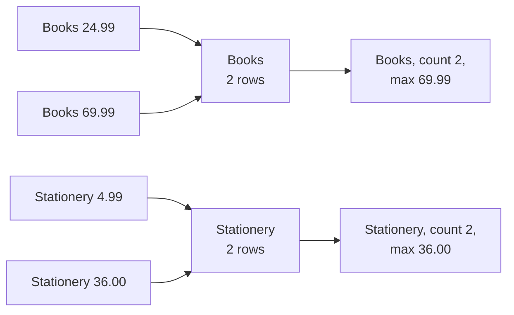

# Aggregates, GROUP BY and HAVING

After this you can summarize many rows into totals, counts and averages per group, filter on the summaries, and keep money arithmetic exact.

Before this: [SELECT, WHERE and ORDER BY](01-select-where-and-order-by.md) and [NULL and three-valued logic](02-null-and-three-valued-logic.md).

## The idea

A report rarely wants the 1689 order lines; it wants "units sold per product" or "orders per province". An **aggregate function** turns many rows into one value. `GROUP BY` first splits the rows into groups, and then each aggregate runs once per group.

Four sample rows from `products` show the mechanism. `GROUP BY category` puts rows with the same category together, and every output row stands for one whole group.



In the diagram, four input rows become two output rows. After grouping, the individual prices are gone; only values computed over the group remain. That is the source of the main `GROUP BY` rule below. Without a `GROUP BY`, the whole table is one group, so `SELECT count(*) FROM orders` returns one row.

## Key terms

An **aggregate function** takes the values of a column over a group of rows and returns one value: `count`, `sum`, `avg`, `min`, `max`. All of them skip `NULL` inputs, except `count(*)`.

**`GROUP BY`** splits the rows that survive `WHERE` into groups of equal values, one group per distinct combination of the listed columns.

**`HAVING`** filters groups after the aggregates are computed. `WHERE` filters rows before grouping.

**`FILTER`** limits one aggregate to some rows: `count(*) FILTER (WHERE status = 'refunded')`.

**`numeric`** is Postgres's exact decimal type, used for money. `float8` (double precision) is binary floating point and is approximate.

## How it works

The three `count` forms differ in what they ignore.

| Form | Counts |
|---|---|
| `count(*)` | rows |
| `count(col)` | rows where `col` is not `NULL` |
| `count(DISTINCT col)` | different non-`NULL` values of `col` |

<div class="sql-runner" data-db="shop" markdown>

```sql
SELECT count(*)              AS all_rows,
       count(phone)          AS phones,
       count(DISTINCT city)  AS cities
FROM customers;
```

</div>

The result is 200, 152 and 26. The rule for `GROUP BY`: every column in `SELECT` must be either listed in `GROUP BY` or inside an aggregate, because after grouping a group has one value for the first and many for the second.

<div class="sql-runner" data-db="shop" markdown>

```sql
SELECT category,
       count(*)             AS products,
       round(avg(price), 2) AS avg_price,
       min(price)           AS cheapest,
       max(price)           AS dearest
FROM products
GROUP BY category
ORDER BY category;
```

</div>

Five rows come back, one per category. Electronics has 10 products at an average price of 104.89, from 14.99 to 329.00. Over zero rows (an empty table, or a `WHERE` that matches nothing), `sum` and `avg` return `NULL`, while `count` returns 0.

<!-- sql: expect-error -->
<!-- db: shop -->
```sql
SELECT category, name, count(*)
FROM products
GROUP BY category;
```

This fails with `column "products.name" must appear in the GROUP BY clause or be used in an aggregate function`. The database refuses to pick one name out of the group.

## Worked examples

<div class="example" markdown>

### Example 1: WHERE and HAVING

We want categories that have more than 5 products priced over \$20.

1. `WHERE price > 20` removes cheap rows before grouping.
2. `GROUP BY category` makes the groups from what is left.
3. `HAVING count(*) > 5` removes groups with too few remaining rows. It can use aggregates, which `WHERE` can't.

<div class="sql-runner" data-db="shop" markdown>

```sql
SELECT category, count(*) AS products
FROM products
WHERE price > 20
GROUP BY category
HAVING count(*) > 5
ORDER BY category;
```

</div>

Check: 4 rows (Books 6, Electronics 8, Home 7, Outdoors 7). Remove the `WHERE` line and 5 rows come back, because Stationery has 6 products but only 1 over \$20. A condition on a plain column belongs in `WHERE`, since it filters earlier and cheaper; `HAVING` is for conditions on aggregates.

</div>

<div class="example" markdown>

### Example 2: several counts in one pass with FILTER

To compare orders and refunds per province, `FILTER` avoids a second query.

<div class="sql-runner" data-db="shop" markdown>

```sql
SELECT ship_province,
       count(*) AS orders,
       count(*) FILTER (WHERE status = 'refunded') AS refunded
FROM orders
GROUP BY ship_province
ORDER BY orders DESC, ship_province;
```

</div>

Check: Ontario has 319 orders and 18 refunded, Quebec 162 and 11, and NL has 29 and 0. The `refunded` column is a count, so a province with no refunds shows 0, not `NULL`.

</div>

## Money and rounding

Use `numeric` for money. `float8` stores binary fractions, so sums pick up tiny errors; `numeric` does decimal arithmetic exactly. Round once, at the end, with `round(x, 2)`.

<div class="sql-runner" data-db="shop" markdown>

```sql
SELECT 0.1::float8 + 0.2::float8 = 0.3::float8   AS float_equal,
       0.1::numeric + 0.2::numeric = 0.3::numeric AS numeric_equal,
       sum(quantity * unit_price)                 AS revenue,
       round(avg(quantity * unit_price), 2)       AS avg_line
FROM order_items;
```

</div>

The float comparison is false (the sum is `0.30000000000000004`), the numeric one is true, total revenue is 118666.03 and the average order line is 70.26.

## Common mistakes

<div class="warning" markdown>

Watch out: putting an aggregate in `WHERE`, such as `WHERE count(*) > 5`. `WHERE` runs before groups exist, so Postgres rejects it. Move the test to `HAVING`.

</div>

<div class="warning" markdown>

Watch out: `avg` ignores `NULL`, so it is the average of the known values, not of all rows. If missing means zero, say so with `avg(COALESCE(x, 0))`, and decide that on purpose.

</div>

<div class="warning" markdown>

Watch out: `count(*)` after a join counts joined rows, not the entities you meant. Counting orders through `order_items` counts items; use `count(DISTINCT order_id)`, as the joins lesson<!-- link: 04-joins.md --> shows.

</div>

## Working with AI

<div class="ai" markdown>

Words to use: aggregate, group, `GROUP BY`, `HAVING`, `FILTER`, `count(DISTINCT ...)`, `numeric`, rounding.

Prompts to try:

- "PostgreSQL: table `order_items(order_id, product_id, quantity, unit_price numeric(10,2))`. Write a query for revenue per product with revenue over 3000, sorted by revenue descending. Use `HAVING` and exact `numeric` arithmetic."
- "Explain this error and fix it without changing the meaning: [paste the 'must appear in the GROUP BY clause' message and the query]."

What to check:

- That every non-aggregated `SELECT` column is in `GROUP BY`, and that the grain (one row per what?) matches the question.
- `count(*)` vs `count(col)` vs `count(DISTINCT col)` against what you meant by "how many".
- Money in `float` or `real` columns, and rounding done before summing instead of after.

</div>

## Quiz

1\. What is the difference between `WHERE` and `HAVING`?

<details class="solution" markdown>
<summary>Answer</summary>

`WHERE` filters individual rows before grouping and can't use aggregates. `HAVING` filters whole groups after the aggregates are computed.

</details>

2\. For purchase events, how many events are there and how many different users made them? Predict, then run it.

<div class="sql-runner" data-db="events" markdown>

```sql
SELECT count(*) AS events, count(DISTINCT user_id) AS users
FROM events
WHERE event_type = 'purchase';
```

</div>

<details class="solution" markdown>
<summary>Answer</summary>

227 events from 134 users. Some users bought more than once, so `count(*)` is larger than `count(DISTINCT user_id)`.

</details>

3\. This query was meant to give the number of products per category, but fails with "must appear in the GROUP BY clause". Write the fixed version, with columns `category` and `products`, sorted by `category`.

<!-- sql: expect-error -->
<!-- db: shop -->
```sql
SELECT category, name, count(*) AS products
FROM products
GROUP BY category;
```

<div class="sql-runner" data-db="shop" data-solution="sol-quiz-3" markdown>

```sql
-- write the fixed query here
SELECT 1;
```

</div>

<details class="solution" id="sol-quiz-3" markdown>
<summary>Solution</summary>

`name` has several values per category, so remove it: the question never asked for it.

```sql
SELECT category, count(*) AS products
FROM products
GROUP BY category
ORDER BY category;
```

</details>

4\. Why should a `price` column hold `numeric(10,2)` rather than `float8`?

<details class="solution" markdown>
<summary>Answer</summary>

`numeric` is exact decimal arithmetic. `float8` is binary and approximate, so `0.1 + 0.2 = 0.3` is false and sums of many prices drift by fractions of a cent.

</details>

## Lab

<div class="lab" markdown>

### Lab: three summaries

Goal: write grouped queries with `HAVING` and check them. Time: about 15 minutes. Runs in: the browser.

Task 1. Order statuses with more than 40 orders: `status` and `orders`, sorted by `orders` descending. Expected: 4 rows, delivered first with 734.

<div class="sql-runner" data-db="shop" data-solution="sol-lab-1" markdown>

```sql
-- task 1
SELECT 1;
```

</div>

<details class="solution" id="sol-lab-1" markdown>
<summary>Solution</summary>

```sql
SELECT status, count(*) AS orders
FROM orders
GROUP BY status
HAVING count(*) > 40
ORDER BY orders DESC;
```

</details>

Task 2. Products with more than 3000 in revenue: `product_id`, `units` (sum of `quantity`) and `revenue` (sum of `quantity * unit_price`), from `order_items`, sorted by `revenue` descending. Expected: 12 rows, product 7 first with 18749.25.

<div class="sql-runner" data-db="shop" data-solution="sol-lab-2" markdown>

```sql
-- task 2
SELECT 1;
```

</div>

<details class="solution" id="sol-lab-2" markdown>
<summary>Solution</summary>

```sql
SELECT product_id,
       sum(quantity) AS units,
       sum(quantity * unit_price) AS revenue
FROM order_items
GROUP BY product_id
HAVING sum(quantity * unit_price) > 3000
ORDER BY revenue DESC;
```

</details>

Task 3. In the `events` database, users with at least 3 purchases: `user_id` and `purchases`, sorted by `purchases` descending, then `user_id`. Expected: 25 rows, users 145, 172 and 175 first with 5.

<div class="sql-runner" data-db="events" data-solution="sol-lab-3" markdown>

```sql
-- task 3
SELECT 1;
```

</div>

<details class="solution" id="sol-lab-3" markdown>
<summary>Solution</summary>

```sql
SELECT user_id, count(*) AS purchases
FROM events
WHERE event_type = 'purchase'
GROUP BY user_id
HAVING count(*) >= 3
ORDER BY purchases DESC, user_id;
```

</details>

Expected result: all three tasks show "matches" in the runner.

</div>

## Where this shows up

- Dashboards and reports are grouped aggregates; [window functions](07-window-functions.md) add a per-row running total or rank without collapsing rows.
- Warehouse queries<!-- link: ../../11-data-engineering-and-data-science/01-data-engineering/01-oltp-vs-olap-and-warehouses.md --> are mostly `GROUP BY` over a fact table.
