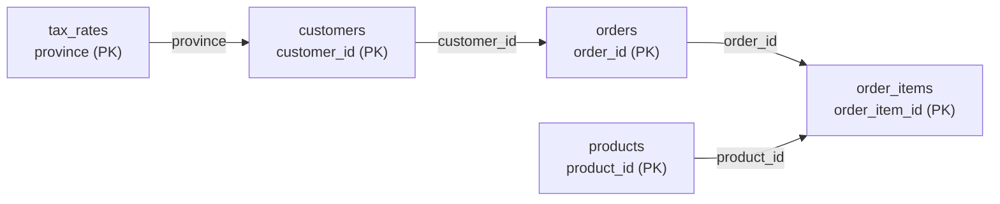

# Joins

After this you can combine rows from several tables with the right kind of join, keep unmatched rows when you need them, and check that a join did not drop or duplicate rows.

Before this: [the relational model](../01-database-basics/02-the-relational-model.md) and aggregates, GROUP BY and HAVING<!-- link: 03-aggregates-group-by-and-having.md -->.

## The idea

The `shop` database stores a customer's name once, in `customers`. An order stores only a `customer_id`, and each line of an order stores an `order_id` and a `product_id`. A name or a price is written in one place, so it can't disagree with itself, but "who bought the Wireless Mouse?" now needs rows from four tables.

A **join** puts those tables back together at query time. For each row of one table it finds the rows in another table where a condition is true, usually "the foreign key equals the primary key". A primary key identifies one row of its table; a foreign key is a column that holds another table's primary key value.



Each arrow points from the table with the primary key to the table that holds it as a foreign key. A customer has many orders, an order many items, and a product appears in many items. These one-to-many relationships are why row counts change when you join.

## Key terms

A **join** combines each row of one table with the rows of another table that satisfy a condition, written after `ON`.

An **inner join** keeps only the pairs where the condition is true. A row with no partner disappears.

A **left outer join** keeps every row of the left table. When no right-hand row matches, the right-hand columns are filled with `NULL`. A right outer join swaps the sides, a **full outer join** keeps unmatched rows from both sides, and a **cross join** pairs every row with every row, with no condition. The word `OUTER` is optional.

A **table alias** is a short name given to a table in `FROM`, such as `customers AS c`, so you can write `c.customer_id`.

## How it works

Take customer 13, who has no orders, and customer 14, who has two (orders 61 and 498).

| Join | Rows for customers 13 and 14 |
|---|---|
| `INNER JOIN` | (14, 61), (14, 498). Customer 13 is gone. |
| `LEFT JOIN` | (13, NULL), (14, 61), (14, 498). Customer 13 is kept, with `NULL` for the order. |

Conceptually, the database takes each left row and emits one output row per right row where the `ON` condition is true. Zero matches gives no row for an inner join and one `NULL`-padded row for a left join. Two matches give two rows, so the left row is repeated. The real planner is faster than comparing every pair; the lesson on query plans<!-- link: ../04-postgres-in-depth/02-explain-and-query-plans.md --> shows how.

Each extra `JOIN` adds one table to the result so far, so a chain follows the arrows in the diagram. This query lists what order 1 contained. When two columns share a name, `USING (customer_id)` can replace the `ON` condition and keeps one copy of the column. `JOIN` on its own means `INNER JOIN`.

<div class="sql-runner" data-db="shop" markdown>

```sql
SELECT c.last_name, o.order_id, p.name, i.quantity, i.unit_price
FROM customers c
JOIN orders o ON o.customer_id = c.customer_id
JOIN order_items i ON i.order_id = o.order_id
JOIN products p ON p.product_id = i.product_id
WHERE o.order_id = 1;
```

</div>

Order 1 has four items, so four rows come back. Without the `WHERE`, the chain returns 1689 rows, the same as `order_items`: joining from the "many" side towards the "one" side keeps the count of the many side.

## Worked examples

<div class="example" markdown>

### Example 1: customers who never ordered

An inner join can't answer this, because the customers we want are exactly the ones it throws away. Use a left join, then keep the rows where the right side is `NULL`.

1. `FROM customers c LEFT JOIN orders o ON ...` keeps all 200 customers.
2. For a customer with no orders, every `o.` column is `NULL`.
3. `WHERE o.order_id IS NULL` keeps those rows. Test the primary key of the right table, because a primary key is never `NULL` in a real match.

<div class="sql-runner" data-db="shop" markdown>

```sql
SELECT c.customer_id, c.first_name, c.last_name, c.province
FROM customers c
LEFT JOIN orders o ON o.customer_id = c.customer_id
WHERE o.order_id IS NULL
ORDER BY c.customer_id;
```

</div>

Check: the query returns 42 rows. Remove the `WHERE` line and the same join returns 942 rows, which is 900 matched orders plus 42 customers padded with `NULL`. The same pattern finds products that were never ordered (6 of them): `products` on the left, `order_items` on the right, test `i.order_item_id IS NULL`.

</div>

## Common mistakes

<div class="warning" markdown>

Watch out: a `WHERE` filter on the right table turns a left join back into an inner join. A padded row has `NULL` in every right-hand column, so a test such as `o.status = 'refunded'` is not true for it and the row is removed. To count refunded orders per province and still list provinces with none, put the filter in `ON`.

<div class="sql-runner" data-db="shop" markdown>

```sql
SELECT t.province, count(o.order_id) AS refunded_orders
FROM tax_rates t
LEFT JOIN orders o
  ON o.ship_province = t.province AND o.status = 'refunded'
GROUP BY t.province
ORDER BY refunded_orders, t.province;
```

</div>

This returns 10 provinces, and NL shows 0. Move `AND o.status = 'refunded'` into a `WHERE` clause and NL disappears, leaving 9 rows.

</div>

<div class="warning" markdown>

Watch out: joining a "one" row to "many" rows repeats the one row, and aggregates then count or add the repeats. Joining `orders` to `order_items` gives 1689 rows for 900 orders, so `count(*)` counts items, not orders.

<div class="sql-runner" data-db="shop" markdown>

```sql
SELECT count(*) AS item_rows,
       count(DISTINCT o.order_id) AS orders
FROM orders o
JOIN order_items i ON i.order_id = o.order_id;
```

</div>

The result is 1689 and 900. Count with `count(DISTINCT ...)` on the "one" side's key, or aggregate the "many" side first.

</div>

<div class="warning" markdown>

Watch out: a lost join condition. In `FROM a, b` the comma is a cross join, so `customers, orders` with no `WHERE` returns 200 times 900 rows.

</div>

## Working with AI

<div class="ai" markdown>

Words to use: primary key, foreign key, one-to-many, inner join, left join, join condition, row multiplication, `NULL`.

Prompts to try:

- "Here is my schema: [paste the CREATE TABLE statements]. One row of `orders` is one purchase by one customer; one row of `order_items` is one product line inside an order. Write a PostgreSQL query that lists every customer with their number of orders, including customers with zero orders."
- "This query returns 1689 rows but I expected 900, one per order: [paste query]. Which join multiplies the rows, and how do I count orders once?"

What to check:

- Row counts before and after every join. Run `SELECT count(*)` on the first table, then on the joined result, and explain any change.
- Duplicates. If the join goes from "one" to "many" and the query sums or counts a "one" side column, look for `DISTINCT` or a pre-aggregation.
- `NULL` handling. A `WHERE` filter on the right table of a left join removes unmatched rows without an error, and `COALESCE(sum(...), 0)` is often needed so missing groups show 0.
- Invented columns such as `customers.orders_count`. Compare every column with the `CREATE TABLE` text you pasted.

</div>

## Quiz

1\. In one sentence each, what is the difference between `INNER JOIN` and `LEFT JOIN`, and which would you use to list customers with no orders?

<details class="solution" markdown>
<summary>Answer</summary>

An inner join keeps only left and right rows that match. A left join also keeps every left row, filling the right-hand columns with `NULL` when nothing matches. Use a left join with `WHERE o.order_id IS NULL`, because an inner join discards the customers you want.

</details>

2\. `customers` has 200 rows, 42 of them have no orders, and `orders` has 900 rows. How many rows does `customers LEFT JOIN orders ON orders.customer_id = customers.customer_id` return?

<details class="solution" markdown>
<summary>Answer</summary>

942. The 900 orders each match one customer, and the 42 customers without orders each add one row padded with `NULL`.

<!-- db: shop -->
```sql
SELECT count(*) AS n
FROM customers c
LEFT JOIN orders o ON o.customer_id = c.customer_id;
```

</details>

3\. This query is meant to count orders per province, but it counts order items. Fix it so the columns are `province` and `orders`, with one row per province, sorted by `province`.

<div class="sql-runner" data-db="shop" data-solution="sol-quiz-3" markdown>

```sql
SELECT c.province, count(*) AS orders
FROM customers c
JOIN orders o USING (customer_id)
JOIN order_items i USING (order_id)
GROUP BY c.province
ORDER BY c.province;
```

</div>

<details class="solution" id="sol-quiz-3" markdown>
<summary>Solution</summary>

The join to `order_items` repeats each order once per item, so `count(*)` counts items (Ontario gives 601 instead of 319). Count distinct order ids, or drop the unneeded join.

```sql
SELECT c.province, count(DISTINCT o.order_id) AS orders
FROM customers c
JOIN orders o USING (customer_id)
JOIN order_items i USING (order_id)
GROUP BY c.province
ORDER BY c.province;
```

</details>

4\. List the products that were never ordered. Return `name` and `category`, sorted by `name`. Expected: 6 rows.

<div class="sql-runner" data-db="shop" data-solution="sol-quiz-4" markdown>

```sql
-- write your query here
SELECT 1;
```

</div>

<details class="solution" id="sol-quiz-4" markdown>
<summary>Solution</summary>

```sql
SELECT p.name, p.category
FROM products p
LEFT JOIN order_items i ON i.product_id = p.product_id
WHERE i.order_item_id IS NULL
ORDER BY p.name;
```

A `NOT EXISTS` subquery gives the same rows; the next lesson covers it.

</details>

## Lab

<div class="lab" markdown>

### Lab: four join questions on the shop database

Goal: answer four questions of increasing difficulty with joins, and check each result. Time: about 20 minutes. Runs in: the browser.

For each task, write the query in the runner and press Check. The column names must match exactly.

Task 1, pending orders. Return `order_id`, `customer` (first and last name joined with a space) and `status` for orders whose status is `pending`, sorted by `order_id`. Expected: 3 rows.

<div class="sql-runner" data-db="shop" data-solution="sol-lab-1" markdown>

```sql
-- task 1
SELECT 1;
```

</div>

<details class="solution" id="sol-lab-1" markdown>
<summary>Solution</summary>

```sql
SELECT o.order_id,
       c.first_name || ' ' || c.last_name AS customer,
       o.status
FROM orders o
JOIN customers c ON c.customer_id = o.customer_id
WHERE o.status = 'pending'
ORDER BY o.order_id;
```

</details>

Task 2, customers without orders by province. Return `province` and `customers_without_orders`, sorted by `province`. The numbers must add up to 42.

<div class="sql-runner" data-db="shop" data-solution="sol-lab-2" markdown>

```sql
-- task 2
SELECT 1;
```

</div>

<details class="solution" id="sol-lab-2" markdown>
<summary>Solution</summary>

```sql
SELECT c.province, count(*) AS customers_without_orders
FROM customers c
LEFT JOIN orders o ON o.customer_id = c.customer_id
WHERE o.order_id IS NULL
GROUP BY c.province
ORDER BY c.province;
```

</details>

Task 3, refunded revenue by shipping province, including provinces with none. Revenue is `quantity * unit_price` summed over order items of orders with status `refunded`. Return `province` and `refunded_revenue`, sorted by `refunded_revenue` and then `province`. A province with no refunds shows 0, not `NULL`. Expected: 10 rows, NL first with 0.

<div class="sql-runner" data-db="shop" data-solution="sol-lab-3" markdown>

```sql
-- task 3
SELECT 1;
```

</div>

<details class="solution" id="sol-lab-3" markdown>
<summary>Solution</summary>

Start from `tax_rates` so every province is on the left. Put the status filter in `ON`, and use a second left join so provinces without orders survive the chain.

```sql
SELECT t.province,
       COALESCE(sum(i.quantity * i.unit_price), 0) AS refunded_revenue
FROM tax_rates t
LEFT JOIN orders o
  ON o.ship_province = t.province AND o.status = 'refunded'
LEFT JOIN order_items i ON i.order_id = o.order_id
GROUP BY t.province
ORDER BY refunded_revenue, t.province;
```

</details>

Task 4, distinct buyers per product. Return `name` and `buyers` (the number of different customers who bought the product, 0 if none), sorted by `buyers` and then `name`. Expected: 38 rows, with 6 products at 0.

<div class="sql-runner" data-db="shop" data-solution="sol-lab-4" markdown>

```sql
-- task 4
SELECT 1;
```

</div>

<details class="solution" id="sol-lab-4" markdown>
<summary>Solution</summary>

`count(DISTINCT o.customer_id)` ignores `NULL`, so unsold products get 0, and `DISTINCT` stops a customer who bought a product in several orders from being counted more than once.

```sql
SELECT p.name, count(DISTINCT o.customer_id) AS buyers
FROM products p
LEFT JOIN order_items i ON i.product_id = p.product_id
LEFT JOIN orders o ON o.order_id = i.order_id
GROUP BY p.name
ORDER BY buyers, p.name;
```

</details>

Expected result: all four tasks show "matches" in the runner.

</div>

## Where this shows up

- Reports join tables, and the zero rows in them (provinces with no refunds) are the left join's job.
- Subqueries<!-- link: 05-subqueries.md --> and CTEs<!-- link: 06-ctes-and-recursive-queries.md --> are often alternatives to a join, and the next lesson compares them.
- Indexes<!-- link: ../04-postgres-in-depth/01-indexes.md --> on foreign key columns are what make a join fast on large tables.
