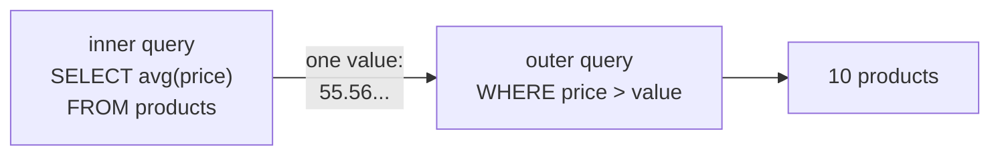
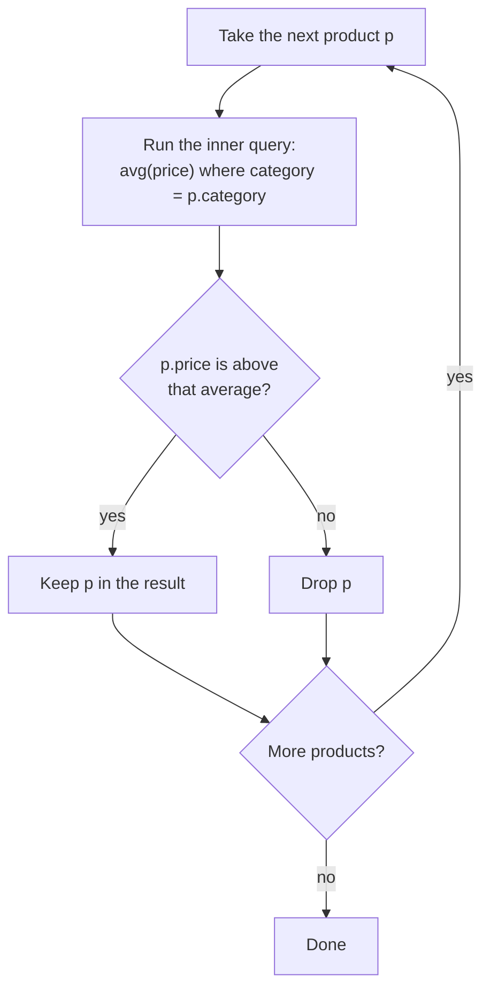

# Subqueries

After this you can use one query inside another as a value, a list, an existence test or a table, and choose between a subquery, a join and a CTE.

Before this: [aggregates, GROUP BY and HAVING](03-aggregates-group-by-and-having.md) and [joins](04-joins.md).

## The idea

"Which products cost more than the average product?" has two steps. First compute the average price. Then keep the products above it. A **subquery** lets you write both steps as one statement: the inner query runs and its result feeds the outer query.



In the diagram, the inner query produces one value, and the outer query's `WHERE` compares each price to it. A subquery is written in parentheses and can appear wherever its result fits: as a single value, as a list, as a yes/no test, or as a table in `FROM`.

## Key terms

A **subquery** is a `SELECT` inside parentheses within another statement.

A **scalar subquery** returns exactly one column and at most one row, and is used as a value. If it returns more than one row, Postgres raises an error; if it returns none, the value is `NULL`.

`IN (subquery)` tests membership in the one-column result. `EXISTS (subquery)` is true when the subquery returns at least one row; its select list doesn't matter, so `SELECT 1` is the convention.

A **correlated subquery** refers to a column of the outer query, so it can't run on its own and conceptually runs once per outer row.

A **derived table** is a subquery in `FROM`. It needs an alias, and the outer query treats it as a table.

## How it works

A scalar subquery in `WHERE` compares each row with a single computed value. Then `IN` and `EXISTS` ask the same question two ways: customers with at least one refunded order.

<div class="sql-runner" data-db="shop" markdown>

```sql
SELECT
  (SELECT count(*) FROM products
   WHERE price > (SELECT avg(price) FROM products)) AS above_average,
  (SELECT count(*) FROM customers
   WHERE customer_id IN (SELECT customer_id FROM orders WHERE status = 'refunded')) AS in_form,
  (SELECT count(*) FROM customers c
   WHERE EXISTS (SELECT 1 FROM orders o
                 WHERE o.customer_id = c.customer_id AND o.status = 'refunded')) AS exists_form;
```

</div>

The result is 10, 46 and 46. The `IN` form builds a list of customer ids and tests membership. The `EXISTS` form is correlated: `o.customer_id = c.customer_id` ties the inner query to the current customer `c`. It can stop at the first matching order, and unlike `NOT IN` it is safe with `NULL`s, as the `NULL` lesson<!-- link: 02-null-and-three-valued-logic.md --> showed.

Correlated subqueries are easiest to read as a loop. The database may plan it as a join or a hash lookup, but the result is always the same as this loop.



In the diagram, step B changes with every product: Books are compared with the Books average, Electronics with the Electronics average.

## Worked examples

<div class="example" markdown>

### Example 1: above the average of their own category

A plain scalar subquery compares every product with the overall average. We want each product compared with its own category's average.

1. The outer query ranges over `products p`.
2. The inner query computes `avg(price)` for `category = p.category`.
3. `WHERE price > (...)` keeps the products above it.

<div class="sql-runner" data-db="shop" markdown>

```sql
SELECT name, category, price
FROM products p
WHERE price > (SELECT avg(price)
               FROM products
               WHERE category = p.category)
ORDER BY category, price DESC, name;
```

</div>

Check: 14 rows. Intro to Statistics (69.99), Linear Algebra Notes (54.00) and Atlas of Canada (49.95) are the three Books above the Books average of 46.15, which agrees with the average printed in the aggregates lesson<!-- link: 03-aggregates-group-by-and-having.md -->. The inner query is run for each row conceptually, so a correlated subquery on a large table needs an index<!-- link: ../04-postgres-in-depth/01-indexes.md --> on `category`.

</div>

<div class="example" markdown>

### Example 2: derived table and NOT EXISTS

A derived table lets you aggregate twice. How many orders does a customer who has orders place, on average? First count orders per customer, then average those counts.

<div class="sql-runner" data-db="shop" markdown>

```sql
SELECT count(*) AS customers_with_orders,
       round(avg(n), 2) AS avg_orders,
       max(n) AS most_orders
FROM (SELECT customer_id, count(*) AS n
      FROM orders
      GROUP BY customer_id) AS per_customer;
```

</div>

Check: 158 customers, an average of 5.70 and a maximum of 13. The 158 plus the 42 customers who never ordered make the 200 in the table. To list those 42, `NOT EXISTS` finds customers with no matching order.

<div class="sql-runner" data-db="shop" markdown>

```sql
SELECT count(*) AS never_ordered
FROM customers c
WHERE NOT EXISTS (SELECT 1 FROM orders o WHERE o.customer_id = c.customer_id);
```

</div>

The count is 42, the same answer as the left join in the joins lesson.

</div>

## Subquery, join or CTE

The same question often has several forms. Customers with a refunded order, as a join:

<!-- db: shop -->
```sql
SELECT count(DISTINCT c.customer_id) AS customers
FROM customers c
JOIN orders o ON o.customer_id = c.customer_id
WHERE o.status = 'refunded';
```

It returns 46, the same as `IN` and `EXISTS`, but without `DISTINCT` a customer with two refunds would appear twice. `EXISTS` says what you mean (does a matching order exist?) and can't duplicate rows. Use a join when you need columns from both tables in the result. Use `EXISTS` or `NOT EXISTS` when you only need to test for a match. Use a CTE<!-- link: 06-ctes-and-recursive-queries.md --> when a derived table is long or used twice, because a name reads better than nesting. Postgres often plans equivalent forms the same way, so write the clearest one first and measure only if it is slow.

## Common mistakes

<div class="warning" markdown>

Watch out: a scalar subquery that returns several rows. `price = (SELECT price FROM products WHERE category = 'Books')` fails with "more than one row returned by a subquery used as an expression". Aggregate it, or use `IN`.

<!-- sql: expect-error -->
<!-- db: shop -->
```sql
SELECT name FROM products
WHERE price = (SELECT price FROM products WHERE category = 'Books');
```

</div>

<div class="warning" markdown>

Watch out: forgetting the correlation. In `EXISTS (SELECT 1 FROM orders WHERE status = 'refunded')` nothing links the inner query to the outer row, so it is true for every customer or for none. Check that the inner query mentions the outer alias.

</div>

<div class="warning" markdown>

Watch out: `NOT IN (SELECT col ...)` when `col` can be `NULL`. One `NULL` makes the result empty. Use `NOT EXISTS`.

</div>

## Working with AI

<div class="ai" markdown>

Words to use: scalar subquery, correlated subquery, `EXISTS`, `NOT EXISTS`, semi-join, anti-join, derived table, CTE.

Prompts to try:

- "PostgreSQL: tables `customers(customer_id)` and `orders(order_id, customer_id, status)`. Write a query for customers with no refunded orders using `NOT EXISTS`, then the same with a `LEFT JOIN`, and tell me when each is clearer."
- "Rewrite this correlated subquery as a join to a grouped derived table: [paste]. Check that both return the same row count on my data."

What to check:

- That the result is the same for both forms: compare row counts and a few rows.
- Whether the answer used `NOT IN` on a nullable column. Replace it with `NOT EXISTS`.
- Correlated subqueries on big tables: ask for the query plan<!-- link: ../04-postgres-in-depth/02-explain-and-query-plans.md --> and look for a missing index.
- Joins that duplicate rows when the question only asked "does a match exist".

</div>

## Quiz

1\. What makes a subquery correlated, and why can't you run it by itself?

<details class="solution" markdown>
<summary>Answer</summary>

It refers to a column of the outer query (such as `p.category`). Alone, that column doesn't exist, so the inner query only makes sense for one outer row at a time.

</details>

2\. Predict: how many rows does this return?

<div class="sql-runner" data-db="shop" markdown>

```sql
SELECT name
FROM products
WHERE price = (SELECT max(price) FROM products);
```

</div>

<details class="solution" markdown>
<summary>Answer</summary>

One row, the 27in Monitor at 329.00. `max` makes the subquery return a single value, and no other product costs 329.00.

</details>

3\. Return the products that were never ordered, with `product_id` and `name`, sorted by `name`, using `NOT EXISTS`. Expected: 6 rows.

<div class="sql-runner" data-db="shop" data-solution="sol-quiz-3" markdown>

```sql
-- write your query here
SELECT 1;
```

</div>

<details class="solution" id="sol-quiz-3" markdown>
<summary>Solution</summary>

```sql
SELECT p.product_id, p.name
FROM products p
WHERE NOT EXISTS (SELECT 1 FROM order_items i WHERE i.product_id = p.product_id)
ORDER BY p.name;
```

</details>

4\. Joining `customers` to their refunded orders returns how many rows, and how many different customers are in them?

<details class="solution" markdown>
<summary>Answer</summary>

<!-- db: shop -->
```sql
SELECT count(*) AS joined_rows, count(DISTINCT c.customer_id) AS customers
FROM customers c
JOIN orders o ON o.customer_id = c.customer_id
WHERE o.status = 'refunded';
```

51 rows (one per refunded order) for 46 customers, so some customers have several refunds. `EXISTS` returns each customer once.

</details>

## Lab

<div class="lab" markdown>

### Lab: three subqueries

Goal: use a scalar subquery, `EXISTS` and a derived table. Time: about 20 minutes. Runs in: the browser.

Task 1. Return the `order_id` of orders with at least 4 items (rows in `order_items`), using a correlated scalar subquery, sorted by `order_id`. Expected: 73 rows.

<div class="sql-runner" data-db="shop" data-solution="sol-lab-1" markdown>

```sql
-- task 1
SELECT 1;
```

</div>

<details class="solution" id="sol-lab-1" markdown>
<summary>Solution</summary>

```sql
SELECT o.order_id
FROM orders o
WHERE (SELECT count(*) FROM order_items i WHERE i.order_id = o.order_id) >= 4
ORDER BY o.order_id;
```

</details>

Task 2. Return `customer_id` of customers with at least one refunded order, using `EXISTS`, sorted by `customer_id`. Expected: 46 rows.

<div class="sql-runner" data-db="shop" data-solution="sol-lab-2" markdown>

```sql
-- task 2
SELECT 1;
```

</div>

<details class="solution" id="sol-lab-2" markdown>
<summary>Solution</summary>

```sql
SELECT c.customer_id
FROM customers c
WHERE EXISTS (SELECT 1 FROM orders o
              WHERE o.customer_id = c.customer_id AND o.status = 'refunded')
ORDER BY c.customer_id;
```

</details>

Task 3. Return `customer_id` and `orders` for customers with more orders than the average customer who has orders (5.70), using a derived table, sorted by `orders` descending, then `customer_id`.

<div class="sql-runner" data-db="shop" data-solution="sol-lab-3" markdown>

```sql
-- task 3
SELECT 1;
```

</div>

<details class="solution" id="sol-lab-3" markdown>
<summary>Solution</summary>

```sql
SELECT customer_id, n AS orders
FROM (SELECT customer_id, count(*) AS n
      FROM orders
      GROUP BY customer_id) AS per_customer
WHERE n > (SELECT avg(n)
           FROM (SELECT count(*) AS n FROM orders GROUP BY customer_id) AS t)
ORDER BY orders DESC, customer_id;
```

</details>

Expected result: all three tasks show "matches" in the runner.

</div>

## Where this shows up

- CTEs<!-- link: 06-ctes-and-recursive-queries.md --> give a name to a subquery, and recursive CTEs do what subqueries can't.
- Row-level security policies<!-- link: ../04-postgres-in-depth/05-roles-privileges-and-row-level-security.md --> often use `EXISTS` to check ownership.
