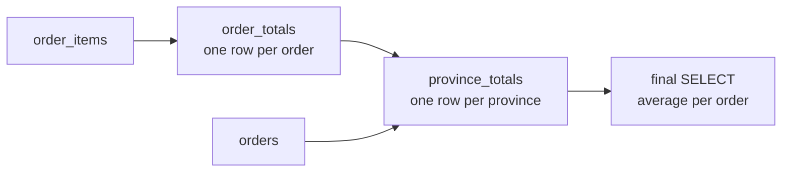
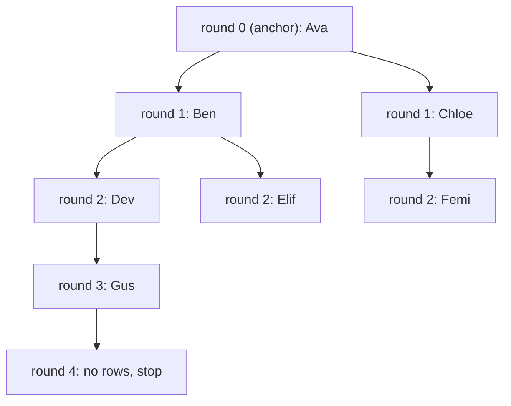

# CTEs and recursive queries

After this you can split a long query into named steps with `WITH`, and write a recursive query that walks a hierarchy or generates a sequence without looping forever.

Before this: [joins](04-joins.md) and [subqueries](05-subqueries.md).

## The idea

A report question often has stages: "total each order, then total each province, then compare provinces". Written as nested subqueries, the first stage ends up in the middle of the text and you read the query from the inside out.

A **common table expression** (CTE) names each stage and puts it at the top, so the query reads from top to bottom like a short script. A CTE is a temporary named result that exists only for the one statement it belongs to.



In the diagram, each box with a name is a CTE, and the arrows show which step reads which. The final `SELECT` is the only part that returns rows to you.

## Key terms

A **CTE** is a named subquery written in a `WITH` clause before the main query: `WITH name AS (SELECT ...) SELECT ... FROM name`. Several CTEs are separated by commas, and a later one can read an earlier one.

A **recursive CTE** is a CTE that refers to itself. It is written `WITH RECURSIVE`, and is made of an **anchor member** (a query that does not refer to the CTE and produces the starting rows) and a **recursive member** (a query that reads the rows produced in the previous round and produces new ones), joined by `UNION ALL`.

A **cycle** is a path that returns to a row it has already visited, such as A manages B, B manages C, C manages A.

## How it works

A plain CTE works like a view that lasts for one statement. Before PostgreSQL 12, every CTE was computed once and stored, which could block optimizations. Since version 12, a CTE that is non-recursive, has no side effects and is used once is folded into the main query like a subquery. You can force either behaviour with `AS MATERIALIZED` or `AS NOT MATERIALIZED` ([PostgreSQL docs, as of 2026](https://www.postgresql.org/docs/current/queries-with.html)). For learning, treat a CTE as a readability tool.

<div class="sql-runner" data-db="shop" markdown>

```sql
WITH order_totals AS (
  SELECT order_id, sum(quantity * unit_price) AS total
  FROM order_items
  GROUP BY order_id
),
province_totals AS (
  SELECT o.ship_province AS province,
         count(*) AS orders,
         sum(t.total) AS revenue
  FROM orders o
  JOIN order_totals t USING (order_id)
  WHERE o.status NOT IN ('cancelled', 'refunded')
  GROUP BY o.ship_province
)
SELECT province, orders, revenue, round(revenue / orders, 2) AS avg_order
FROM province_totals
ORDER BY revenue DESC;
```

</div>

The query returns 10 provinces. Ontario is first with 278 orders and 36560.62 in revenue, an average of 131.51 per order. Prince Edward Island has only 14 orders but the highest average, 195.56.

A recursive CTE runs in rounds:

1. Run the anchor member. Its rows are the result so far, and also the "working rows" for round 1.
2. Run the recursive member, where the CTE's own name means only the working rows from the previous round. Its output is added to the result and becomes the new working rows.
3. Repeat step 2 until a round produces no rows.



The `depth` column in the next example is the round number. Because the loop stops only when a round is empty, the recursive member needs a condition that eventually finds nothing.

## Worked examples

<div class="example" markdown>

### Example 1: walking an org chart

The staff table is written inline with `VALUES`: each row is an id, a name and the id of the person's boss (`NULL` for the top).

1. The anchor selects the row with no boss, with depth 0 and the name as the starting `path`.
2. The recursive member joins `staff` to `chain` on `s.boss_id = c.id`: the people whose boss was found in the previous round.
3. Each round adds 1 to `depth` and appends the name to `path`.

<div class="sql-runner" data-db="shop" markdown>

```sql
WITH RECURSIVE staff(id, name, boss_id) AS (
  VALUES (1, 'Ava', NULL::int), (2, 'Ben', 1), (3, 'Chloe', 1),
         (4, 'Dev', 2), (5, 'Elif', 2), (6, 'Femi', 3), (7, 'Gus', 4)
),
chain AS (
  SELECT id, name, 0 AS depth, name::text AS path
  FROM staff
  WHERE boss_id IS NULL
  UNION ALL
  SELECT s.id, s.name, c.depth + 1, c.path || ' > ' || s.name
  FROM staff s
  JOIN chain c ON s.boss_id = c.id
)
SELECT depth, path FROM chain ORDER BY path;
```

</div>

Check: 7 rows come back, one per person, and Gus is at depth 3 with the path `Ava > Ben > Dev > Gus`. That matches round 3 in the diagram.

</div>

<div class="example" markdown>

### Example 2: generating a sequence, and a cycle

A recursive CTE can count. This one doubles a number until it passes 100, and the last value is 128 after 8 rows.

<!-- db: shop -->
```sql
WITH RECURSIVE n(i) AS (
  SELECT 1
  UNION ALL
  SELECT i * 2 FROM n WHERE i < 100
)
SELECT max(i) AS biggest, count(*) AS rows FROM n;
```

For plain sequences, `generate_series` is simpler and faster to read. `generate_series(1, 5)` gives 1 to 5, and with dates it takes a step: `generate_series(date '2026-01-01', date '2026-12-01', interval '1 month')` gives 12 month starts.

Now break the org chart: Ava reports to Chloe, who reports to Ben, who reports to Ava. Nobody is at the top, and the query below starts from Ava. PostgreSQL 14 added a `CYCLE` clause that marks a row when its `id` has already appeared on the path, and stops following that row.

<div class="sql-runner" data-db="shop" markdown>

```sql
WITH RECURSIVE staff(id, name, boss_id) AS (
  VALUES (1, 'Ava', 3), (2, 'Ben', 1), (3, 'Chloe', 2)
),
chain AS (
  SELECT id, name FROM staff WHERE id = 1
  UNION ALL
  SELECT s.id, s.name FROM staff s JOIN chain c ON s.boss_id = c.id
)
CYCLE id SET is_cycle USING trail
SELECT id, name, is_cycle FROM chain;
```

</div>

Check: 4 rows come back, and only the last row, Ava again, has `is_cycle` true. Without the `CYCLE` line this query never ends.

</div>

## Common mistakes

<div class="warning" markdown>

Watch out: a recursive member with no end. If the data can contain a cycle, add the `CYCLE` clause, or a depth limit such as `WHERE c.depth < 10` in the recursive member. Replacing `UNION ALL` with `UNION` also stops a cycle here, because a repeated row is dropped, but it fails as soon as a column such as `depth` differs on each visit.

</div>

<div class="warning" markdown>

Watch out: treating a CTE as a stored table. It exists only inside its statement, and if the main query uses it twice, it may be computed twice unless you write `AS MATERIALIZED`.

</div>

## Working with AI

<div class="ai" markdown>

Words to use: CTE, `WITH RECURSIVE`, anchor member, recursive member, cycle, `MATERIALIZED`, `generate_series`.

Prompts to try:

- "Rewrite this nested subquery as CTEs with one step per CTE, PostgreSQL 17, and keep the result identical: [paste query]."
- "My table `categories(id, parent_id, name)` is a tree. Write a recursive CTE that lists every descendant of id 5 with its depth, and protect it against cycles."

What to check:

- Run the old and the new query and compare row counts and totals; a rewrite can change a join.
- The recursive member must reference the CTE exactly once and must have a way to run out of rows.
- Tools sometimes write `WITH RECURSIVE` for a plain sequence; `generate_series` is shorter.

</div>

## Quiz

1\. Why does a recursive CTE need both an anchor member and a recursive member?

<details class="solution" markdown>
<summary>Answer</summary>

The anchor produces the starting rows, and the recursive member can only build on rows from the previous round, so without an anchor there is nothing to build on. Without the recursive member, there is no repetition.

</details>

2\. What does this query return?

<!-- db: shop -->
```sql
WITH RECURSIVE n(i) AS (
  SELECT 1 UNION ALL SELECT i * 2 FROM n WHERE i < 100
)
SELECT max(i) AS biggest, count(*) AS rows FROM n;
```

<details class="solution" markdown>
<summary>Answer</summary>

`biggest` is 128 and `rows` is 8. The values are 1, 2, 4, 8, 16, 32, 64, 128. The row 64 passes the test `i < 100`, so 128 is produced, and 128 fails the test, so the next round is empty.

</details>

3\. Using a CTE, count the customers who placed 5 or more orders. Return one column named `customers_with_5_plus`. Expected: 111.

<div class="sql-runner" data-db="shop" data-solution="sol-quiz-3" markdown>

```sql
-- write your query here
SELECT 1;
```

</div>

<details class="solution" id="sol-quiz-3" markdown>
<summary>Solution</summary>

```sql
WITH per_customer AS (
  SELECT customer_id, count(*) AS orders
  FROM orders
  GROUP BY customer_id
)
SELECT count(*) AS customers_with_5_plus
FROM per_customer
WHERE orders >= 5;
```

</details>

4\. Return the first day of every month of 2026 as a `date` column named `month_start`, in order, without a recursive CTE. Expected: 12 rows.

<div class="sql-runner" data-db="shop" data-solution="sol-quiz-4" markdown>

```sql
-- write your query here
SELECT 1;
```

</div>

<details class="solution" id="sol-quiz-4" markdown>
<summary>Solution</summary>

```sql
SELECT m::date AS month_start
FROM generate_series(date '2026-01-01', date '2026-12-01', interval '1 month') AS m
ORDER BY 1;
```

</details>

## Lab

<div class="lab" markdown>

### Lab: two CTE tasks

Goal: use a chain of CTEs, then a recursive CTE with a starting point other than the top. Time: about 15 minutes. Runs in: the browser.

1. Task 1. Total each customer's spend (`quantity * unit_price` over their order items, excluding orders with status `cancelled` or `refunded`) in one CTE. Then return `province`, `customers` (customers with spend) and `avg_spend` (rounded to 2 places), sorted by `avg_spend` descending, with a limit of 5. Expected: NB first with 5 customers and 1183.84.
2. Task 2. Using the staff table from Example 1, list Ben and everyone below him: columns `name` and `depth` (Ben is 0), sorted by `depth` then `name`. Expected: 4 rows (Ben, Dev, Elif, Gus).
3. Press Check on each task.

<div class="sql-runner" data-db="shop" data-solution="sol-lab-1" markdown>

```sql
-- task 1
SELECT 1;
```

</div>

<details class="solution" id="sol-lab-1" markdown>
<summary>Solution</summary>

```sql
WITH spend AS (
  SELECT o.customer_id, sum(i.quantity * i.unit_price) AS total
  FROM orders o
  JOIN order_items i USING (order_id)
  WHERE o.status NOT IN ('cancelled', 'refunded')
  GROUP BY o.customer_id
)
SELECT c.province, count(*) AS customers, round(avg(s.total), 2) AS avg_spend
FROM spend s
JOIN customers c USING (customer_id)
GROUP BY c.province
ORDER BY avg_spend DESC
LIMIT 5;
```

</details>

<div class="sql-runner" data-db="shop" data-solution="sol-lab-2" markdown>

```sql
-- task 2
SELECT 1;
```

</div>

<details class="solution" id="sol-lab-2" markdown>
<summary>Solution</summary>

Change only the anchor: start from the row named Ben instead of the row with no boss.

```sql
WITH RECURSIVE staff(id, name, boss_id) AS (
  VALUES (1, 'Ava', NULL::int), (2, 'Ben', 1), (3, 'Chloe', 1),
         (4, 'Dev', 2), (5, 'Elif', 2), (6, 'Femi', 3), (7, 'Gus', 4)
),
team AS (
  SELECT id, name, 0 AS depth FROM staff WHERE name = 'Ben'
  UNION ALL
  SELECT s.id, s.name, t.depth + 1
  FROM staff s JOIN team t ON s.boss_id = t.id
)
SELECT name, depth FROM team ORDER BY depth, name;
```

</details>

Expected result: both tasks show "matches".

</div>

## Where this shows up

- Reports with several stages, and category or comment trees stored with a `parent_id` column.
- The next lesson, [window functions](07-window-functions.md), often sits in a CTE so its result can be filtered.
- Calendar tables for gaps use `generate_series`, covered in [text, dates and times](09-text-dates-and-times.md).
