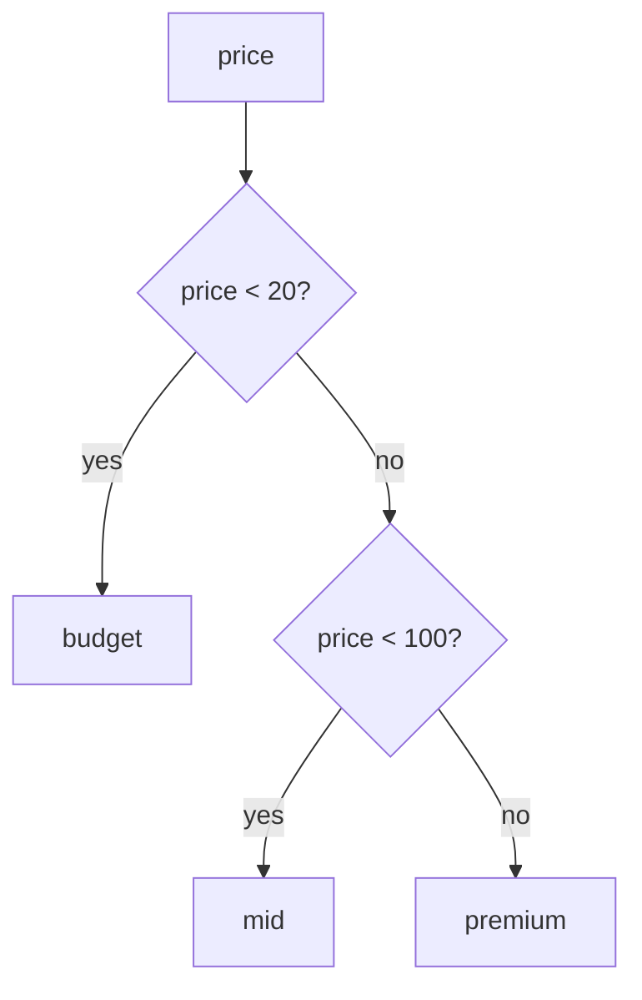

# Set operations and CASE

After this you can combine the results of two queries with `UNION`, `INTERSECT` and `EXCEPT`, and put if-then-else logic into a query with `CASE`, including to turn rows into columns.

Before this: [aggregates, GROUP BY and HAVING](03-aggregates-group-by-and-having.md) and [joins](04-joins.md).

## The idea

Two questions about the `events` data: "which users added something to their cart and also bought something?" and "which users added something to their cart and never bought?". Each is a question about two lists of users. A join can answer them, but the list version is shorter and says what you mean.

A **set operation** takes the rows of two queries and combines them as sets. A second tool, `CASE`, works inside one query: it picks a value for each row from a list of conditions. Both are about shaping results, one by stacking queries and the other by computing values.

```text
A = {1, 2, 3}      B = {3, 4}

A UNION B          1, 2, 3, 4        all rows, duplicates removed
A UNION ALL B      1, 2, 3, 3, 4     all rows, duplicates kept
A INTERSECT B      3                 rows in both
A EXCEPT B         1, 2              rows in A but not in B
B EXCEPT A         4                 order matters
```

The same pictures apply to the data. Of the 199 users with an `add_to_cart` event, 134 also have a `purchase` event, and no purchaser skipped the cart:

```text
users with add_to_cart (199)
+---------------------------------------+
|  A EXCEPT P = 65     +---------------+|
|  (cart, no purchase) | A INTERSECT P ||
|                      | = 134         ||
|                      +---------------+|
+---------------------------------------+
purchasers P (134) sit entirely inside A
A UNION P = 199      P EXCEPT A = 0
```

## Key terms

A **set operation** combines the result sets of two `SELECT` statements: `UNION`, `INTERSECT` or `EXCEPT`. `UNION` and `INTERSECT` give the same rows in either order; `EXCEPT` does not.

Without `ALL`, each operation removes duplicate rows. With `ALL` (`UNION ALL`, `INTERSECT ALL`, `EXCEPT ALL`), duplicates are kept and counted, which is faster because no duplicate removal is needed.

A **`CASE` expression** returns the value of the first branch whose condition is true. The **searched** form is `CASE WHEN condition THEN value ... ELSE value END`. The **simple** form is `CASE expression WHEN value THEN result ... END`, which compares one expression for equality. If no branch matches and there is no `ELSE`, the result is `NULL`.

## How it works

Two queries can be combined only when they have the same number of columns and each pair of columns has compatible types. The column names come from the first query. An `ORDER BY` or `LIMIT` at the end applies to the combined result. `INTERSECT` binds more tightly than `UNION` and `EXCEPT`, so use parentheses when you mix them.

<div class="sql-runner" data-db="events" markdown>

```sql
SELECT count(*) AS stack_rows, count(DISTINCT user_id) AS distinct_users
FROM (
  SELECT user_id FROM events WHERE event_type = 'add_to_cart'
  UNION ALL
  SELECT user_id FROM events WHERE event_type = 'purchase'
) t;
```

</div>

`UNION ALL` stacks 719 rows (492 cart events plus 227 purchases) that cover 199 different users. Replace `UNION ALL` with `UNION` and the same outer query reports 199 rows, because each user now appears once. The three operations on the sets of users:

<div class="sql-runner" data-db="events" markdown>

```sql
SELECT 'cart but no purchase' AS label, count(*) AS users FROM (
  SELECT user_id FROM events WHERE event_type = 'add_to_cart'
  EXCEPT
  SELECT user_id FROM events WHERE event_type = 'purchase'
) a
UNION ALL
SELECT 'cart and purchase', count(*) FROM (
  SELECT user_id FROM events WHERE event_type = 'add_to_cart'
  INTERSECT
  SELECT user_id FROM events WHERE event_type = 'purchase'
) b;
```

</div>

The result is 65 and 134. Swapping the sides of the `EXCEPT` returns 0, which shows why order matters.

A `CASE` expression is evaluated from top to bottom for each row, and stops at the first true condition:



Because the conditions are tried in order, the second test does not need to say `price >= 20`. A row reaching it has already failed the first test.

## Worked examples

<div class="example" markdown>

### Example 1: price bands and a pivot

First, count products by band. `CASE` creates a derived column, and `GROUP BY 1` groups by it.

<div class="sql-runner" data-db="shop" markdown>

```sql
SELECT CASE
         WHEN price < 20 THEN 'budget'
         WHEN price < 100 THEN 'mid'
         ELSE 'premium'
       END AS band,
       count(*) AS products
FROM products
GROUP BY 1
ORDER BY 2 DESC;
```

</div>

Check: 24 mid, 9 budget and 5 premium, which adds up to the 38 products.

Now a **pivot**: one row per province, with one column per order status. Inside an aggregate, `CASE` decides whether the row counts. `sum(CASE WHEN ... THEN 1 ELSE 0 END)` counts matching rows, and `count(*) FILTER (WHERE ...)` is the shorter PostgreSQL form of the same idea.

<div class="sql-runner" data-db="shop" markdown>

```sql
SELECT ship_province,
       count(*) AS orders,
       sum(CASE WHEN status = 'delivered' THEN 1 ELSE 0 END) AS delivered,
       sum(CASE WHEN status = 'refunded' THEN 1 ELSE 0 END) AS refunded,
       count(*) FILTER (WHERE status = 'cancelled') AS cancelled
FROM orders
GROUP BY ship_province
ORDER BY orders DESC, ship_province
LIMIT 5;
```

</div>

Check: Ontario is first with 319 orders, 255 delivered, 18 refunded and 23 cancelled. Without the `LIMIT` there are 10 provinces. A province's four columns need not add up, because three other statuses exist.

</div>

## Common mistakes

<div class="warning" markdown>

Watch out: mismatched columns. The next two queries fail with "UNION types integer and text cannot be matched" and "each UNION query must have the same number of columns". Fix them by casting (`customer_id::text`) or by selecting the same number of columns.

<!-- sql: expect-error -->
<!-- db: shop -->
```sql
SELECT customer_id FROM customers
UNION
SELECT name FROM products;
```

<!-- sql: expect-error -->
<!-- db: shop -->
```sql
SELECT customer_id, first_name FROM customers
UNION
SELECT product_id FROM products;
```

Also, columns are matched by position, not by name. Swapping two columns in one query silently puts the wrong values in the wrong column when their types match.

</div>

<div class="warning" markdown>

Watch out: a missing `ELSE` returns `NULL`, and `sum()` of only `NULL` values is `NULL`, not 0. On the 900 orders, `sum(CASE WHEN status = 'nonsense' THEN 1 END)` is `NULL`, while the same expression with `ELSE 0` is 0. Use `ELSE 0` for counts.

</div>

## Working with AI

<div class="ai" markdown>

Words to use: `UNION ALL`, `INTERSECT`, `EXCEPT`, `CASE WHEN`, searched `CASE`, pivot, `FILTER`.

Prompts to try:

- "PostgreSQL 17, tables `events(user_id, event_type, occurred_at)` and `users(user_id, plan)`. Which users have `page_view` events but no `add_to_cart` event? Give an `EXCEPT` version and a `NOT EXISTS` version and tell me if they can differ."
- "Turn this query into one row per province with a column per order status, using `FILTER`: [paste query]."

What to check:

- `UNION` where `UNION ALL` was meant. If the numbers add up to fewer rows than the parts, duplicates were removed.
- The side order of `EXCEPT`, and whether `NULL` rows matter: set operations treat two `NULL`s as equal.
- A `CASE` with no `ELSE` inside `sum`, and the order of `WHEN` branches when ranges overlap.

</div>

## Quiz

1\. When would you choose `UNION ALL` over `UNION`?

<details class="solution" markdown>
<summary>Answer</summary>

When you want every row kept, or when you know the two sides cannot overlap. `UNION ALL` skips the duplicate removal, so it is faster, and it keeps rows that `UNION` would silently merge.

</details>

2\. 199 users have an `add_to_cart` event and 134 of them also have a `purchase` event; all purchasers have one. How many rows do the union, intersection and cart-minus-purchase queries return?

<details class="solution" markdown>
<summary>Answer</summary>

`UNION` returns 199 and `INTERSECT` returns 134, as the 134 purchasers are inside the 199 cart users. `EXCEPT` of purchasers from cart users gives 199 - 134 = 65.

</details>

3\. Return the users who had a `page_view` event but never an `add_to_cart` event, as a single column `n` with the count. Expected: 66.

<div class="sql-runner" data-db="events" data-solution="sol-quiz-3" markdown>

```sql
-- write your query here
SELECT 1;
```

</div>

<details class="solution" id="sol-quiz-3" markdown>
<summary>Solution</summary>

```sql
SELECT count(*) AS n FROM (
  SELECT user_id FROM events WHERE event_type = 'page_view'
  EXCEPT
  SELECT user_id FROM events WHERE event_type = 'add_to_cart'
) t;
```

</details>

4\. Pivot the `users` table: one row per `plan`, with columns `y2025` and `y2026` counting the users who signed up before and from 2026-01-01. Sorted by `plan`. Expected: basic 47 and 6, free 171 and 12, pro 60 and 4.

<div class="sql-runner" data-db="events" data-solution="sol-quiz-4" markdown>

```sql
-- write your query here
SELECT 1;
```

</div>

<details class="solution" id="sol-quiz-4" markdown>
<summary>Solution</summary>

```sql
SELECT plan,
       count(*) FILTER (WHERE signup_date < '2026-01-01') AS y2025,
       count(*) FILTER (WHERE signup_date >= '2026-01-01') AS y2026
FROM users
GROUP BY plan
ORDER BY plan;
```

A `sum(CASE WHEN ... THEN 1 ELSE 0 END)` version gives the same table.

</details>

## Lab

<div class="lab" markdown>

### Lab: segments, parts of the day and unsold products

Goal: use `CASE` for bands and `EXCEPT` for a "never happened" list. Time: about 15 minutes. Runs in: the browser.

1. Task 1. Segment customers by total spend (`quantity * unit_price` over all their order items; customers with no orders are `none`): under 200 is `low`, under 1000 is `medium`, otherwise `high`. Return `segment` and `customers`, most customers first. Expected: medium 103, none 42, high 41, low 14.
2. Task 2. Count events by part of the day, using the hour of `occurred_at`: before 6 is `night`, before 12 `morning`, before 18 `afternoon`, otherwise `evening`. Return `part_of_day` and `events`, most events first. Expected: evening 1025, afternoon 692, night 627, morning 321.
3. Task 3. Use `EXCEPT` to find products that never appear in `order_items`. Return the product `name`, sorted. Expected: 6 rows, from 27in Monitor to Toque.

<div class="sql-runner" data-db="shop" data-solution="sol-lab-1" markdown>

```sql
-- task 1
SELECT 1;
```

</div>

<details class="solution" id="sol-lab-1" markdown>
<summary>Solution</summary>

A left join keeps customers without orders, and their `spend.customer_id` is `NULL`, which the first `WHEN` catches.

```sql
WITH spend AS (
  SELECT o.customer_id, sum(i.quantity * i.unit_price) AS total
  FROM orders o JOIN order_items i USING (order_id)
  GROUP BY o.customer_id
)
SELECT CASE WHEN s.customer_id IS NULL THEN 'none'
            WHEN total < 200 THEN 'low'
            WHEN total < 1000 THEN 'medium'
            ELSE 'high' END AS segment,
       count(*) AS customers
FROM customers c
LEFT JOIN spend s USING (customer_id)
GROUP BY 1
ORDER BY customers DESC;
```

</details>

<div class="sql-runner" data-db="events" data-solution="sol-lab-2" markdown>

```sql
-- task 2
SELECT 1;
```

</div>

<details class="solution" id="sol-lab-2" markdown>
<summary>Solution</summary>

```sql
SELECT CASE WHEN extract(hour FROM occurred_at) < 6 THEN 'night'
            WHEN extract(hour FROM occurred_at) < 12 THEN 'morning'
            WHEN extract(hour FROM occurred_at) < 18 THEN 'afternoon'
            ELSE 'evening' END AS part_of_day,
       count(*) AS events
FROM events
GROUP BY 1
ORDER BY events DESC;
```

</details>

<div class="sql-runner" data-db="shop" data-solution="sol-lab-3" markdown>

```sql
-- task 3
SELECT 1;
```

</div>

<details class="solution" id="sol-lab-3" markdown>
<summary>Solution</summary>

`EXCEPT` returns ids, so a second step turns them into names.

```sql
SELECT p.name FROM products p WHERE p.product_id IN (
  SELECT product_id FROM products
  EXCEPT
  SELECT product_id FROM order_items
)
ORDER BY p.name;
```

</details>

Expected result: all three tasks show "matches".

</div>

## Where this shows up

- Reconciling two lists: users in system A and not in system B is an `EXCEPT`.
- Pivots feed charts and spreadsheets; `CASE` also appears in the cleaning step of [data pipelines](../../11-data-engineering-and-data-science/01-data-engineering/03-etl-and-elt-pipelines.md).
- [Text, dates and times](09-text-dates-and-times.md) is the last lesson of this chapter.
