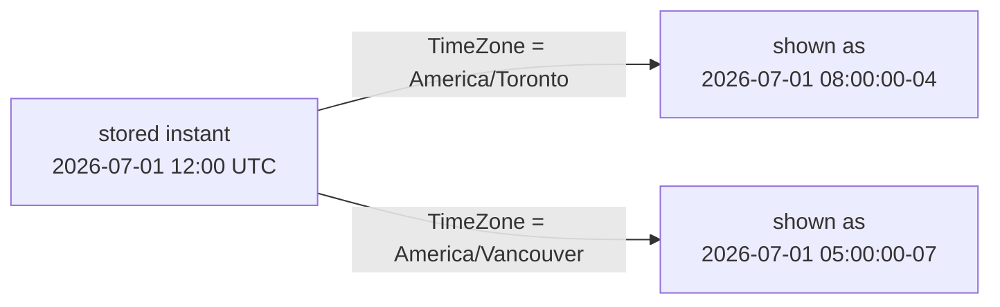

# Text, dates and times

After this you can clean and search text with string functions, `LIKE` and regular expressions, group rows by day or month, do date arithmetic, and store and display moments in time without time zone surprises.

Before this: [joins](04-joins.md) and [CTEs](06-ctes-and-recursive-queries.md).

## The idea

Real data is messy in two ways. Text arrives with stray spaces, mixed case and inconsistent formats ("647-555-9674" in one row, "(647) 555 9674" in another). Times arrive from places in different time zones, and a report that groups by "day" has to say whose day it means.

PostgreSQL has a function for most of these jobs. The main skill is knowing the three families (string functions, pattern matching, date and time types and functions) and the one concept that causes most bugs: the difference between a time on a clock and a moment in time.



In the diagram, one stored instant is displayed differently depending on the session's time zone. The stored value does not change.

## Key terms

**String functions** work on `text`. The common ones: `||` (concatenate), `length`, `lower`, `upper`, `initcap`, `trim`, `replace`, `left`, `substr`, `position`, `split_part` and `concat_ws`. Concatenating with `||` returns `NULL` if either side is `NULL`; `concat` and `concat_ws` skip `NULL` values.

`LIKE` matches a simple pattern, where `%` is any run of characters and `_` is exactly one. `ILIKE` ignores case. A **regular expression** is a richer pattern language; in PostgreSQL the operator `~` tests a match, `~*` ignores case, and `regexp_replace` and `substring(text FROM pattern)` rewrite and extract.

A **`date`** is a calendar day. A **`timestamp`** (`timestamp without time zone`) is a date and clock time with no zone, a label like "2026-07-01 12:00". A **`timestamptz`** (`timestamp with time zone`) is a moment: PostgreSQL stores it as UTC and converts it to the session's `TimeZone` setting when displaying it. An **`interval`** is a length of time such as `1 month` or `90 minutes`.

## How it works

The text functions compose like any other. This query builds a full name, uppercases a surname, measures an email and extracts its domain.

<div class="sql-runner" data-db="shop" markdown>

```sql
SELECT first_name || ' ' || last_name AS full_name,
       upper(last_name) AS shout,
       length(email) AS email_len,
       split_part(email, '@', 2) AS domain,
       first_name || ' ' || phone AS joined
FROM customers
ORDER BY customer_id
LIMIT 3;
```

</div>

The first three customers all have the domain `example.ca`. Customer 2 has no phone, so for them `first_name || ' ' || phone` would be `NULL`; `concat_ws(', ', last_name, first_name, phone)` returns "Chen, Maya" instead.

For searching, `LIKE` handles prefixes and suffixes, and `~` handles shapes. Among the 200 customers, 27 have a surname starting with S, and 90 have an email with three digits just before the `@`.

<div class="sql-runner" data-db="shop" markdown>

```sql
SELECT count(*) FILTER (WHERE last_name LIKE 'S%') AS starts_s,
       count(*) FILTER (WHERE last_name ILIKE '%an') AS ends_an,
       count(*) FILTER (WHERE last_name ~ '^(Chen|Wong)$') AS chen_or_wong,
       count(*) FILTER (WHERE email ~ '[0-9]{3}@') AS three_digits
FROM customers;
```

</div>

The counts are 27, 8, 17 and 90. In a regex, `^` and `$` anchor the start and end, `|` means "or", and `[0-9]{3}` means three digits. A `LIKE` pattern that starts with `%` can't use an ordinary index, and a regex scan reads every row; both are fine on 200 rows and slow on 200 million.

Dates and times work by arithmetic. A `date` plus an integer adds days; a `timestamp` plus an `interval` adds time; subtracting two `date` values gives a number of days. Month arithmetic clamps to the end of the month: `date '2026-01-31' + interval '1 month'` is 2026-02-28.

<!-- db: shop -->
```sql
SELECT (date '2026-01-31' + interval '1 month')::date AS plus_month,
       date '2026-03-01' - date '2026-01-31' AS days_between,
       age(timestamp '2026-09-01', timestamp '2024-12-21')::text AS age_full;
```

The result is 2026-02-28, 29 and `1 year 8 mons 11 days`.

`date_trunc('month', ts)` rounds a timestamp down to the start of the month, which is the usual way to group by period. `extract(dow FROM ts)` pulls out one field (`dow` is 0 for Sunday), and `to_char(ts, 'Dy, DD Mon YYYY HH24:MI')` formats it. For order 1, created at 2025-04-30 04:17:40, `to_char` gives `Wed, 30 Apr 2025 04:17`.

<div class="sql-runner" data-db="shop" markdown>

```sql
SELECT to_char(date_trunc('month', created_at), 'YYYY-MM') AS month,
       count(*) AS orders
FROM orders
GROUP BY 1
ORDER BY 1
LIMIT 6;
```

</div>

The first six months have 46, 31, 49, 48, 47 and 30 orders. Note that months with no orders would not appear at all; the next section fixes that.

## Worked examples

<div class="example" markdown>

### Example 1: time zones and daylight saving

The clock in Toronto jumps from 02:00 to 03:00 on 2026-03-08. Take 01:30 that morning, in Toronto (UTC-5, written `-05`), and add one day. With `timestamptz`, `interval '1 day'` means "the same wall-clock time tomorrow", and `interval '24 hours'` means exactly 24 elapsed hours.

```text
2026-03-08  01:30 -05   starting instant
    + 1 day   -> 2026-03-09  01:30 -04   same clock time, only 23 hours later
    + 24 hours-> 2026-03-09  02:30 -04   24 hours later, a different clock time
```

<div class="sql-runner" data-db="shop" markdown>

```sql
SET TIME ZONE 'America/Toronto';
SELECT (timestamptz '2026-03-08 01:30:00-05')::text AS start,
       (timestamptz '2026-03-08 01:30:00-05' + interval '1 day')::text AS plus_day,
       (timestamptz '2026-03-08 01:30:00-05' + interval '24 hours')::text AS plus_24h;
```

</div>

Check: the three values are `2026-03-08 01:30:00-05`, `2026-03-09 01:30:00-04` and `2026-03-09 02:30:00-04`. The offset changed from `-05` to `-04` because Toronto moved to daylight time. Casting to `text` shows the offset, so the output does not depend on your browser.

The `AT TIME ZONE` operator converts between the two types: on a `timestamptz` it returns the clock time in that zone (a `timestamp`), and on a `timestamp` it says "this clock time is in that zone" and returns the moment (a `timestamptz`). For 12:00 UTC on 2026-07-01, the Toronto clock reads 08:00 and the Vancouver clock reads 05:00.

</div>

<div class="example" markdown>

### Example 2: calendar gaps with generate_series

`GROUP BY` can only report days that have rows. To list every day, including quiet ones, generate the days with `generate_series` and left join the data to them. The figure shows the idea for 1 to 7 March 2025.

```text
GROUP BY on events          generate_series + LEFT JOIN
2025-03-01  1               2025-03-01  1
2025-03-02  1               2025-03-02  1
2025-03-03  1               2025-03-03  1
2025-03-04  4               2025-03-04  4
(no row for 03-05)          2025-03-05  0   <- gap now visible
2025-03-06  3               2025-03-06  3
2025-03-07  2               2025-03-07  2
```

<div class="sql-runner" data-db="events" markdown>

```sql
SELECT d::date AS day, count(e.event_id) AS purchases
FROM generate_series(timestamp '2025-03-01', timestamp '2025-03-07', interval '1 day') AS d
LEFT JOIN events e
  ON e.occurred_at >= d AND e.occurred_at < d + interval '1 day'
 AND e.event_type = 'purchase'
GROUP BY d
ORDER BY d;
```

</div>

Check: 7 rows, and 2025-03-05 shows 0. The join uses a half-open range (`>=` the day, `<` the next day) so a row at exactly midnight lands in one day only. `count(e.event_id)` counts the matching rows and ignores the `NULL` of an empty day, whereas `count(*)` would count 1.

Over the whole range of the data (2025-01-01 to 2026-08-18, 595 days), 433 days have no purchase.

</div>

## Common mistakes

<div class="warning" markdown>

Watch out: using `timestamp` for real moments. Two servers in different zones will store different clock labels for the same moment, and nothing says which zone the label meant. Store events as `timestamptz`, store a plain `date` for calendar days, and keep the zone name (`America/Toronto`, not a fixed `-05`) when a user's local time matters, because only a named zone follows daylight saving.

</div>

<div class="warning" markdown>

Watch out: `BETWEEN` on timestamps. `created_at BETWEEN '2026-03-01' AND '2026-03-31'` stops at midnight at the start of 31 March and misses almost the whole last day. Use `>= '2026-03-01' AND < '2026-04-01'`.

</div>

<div class="warning" markdown>

Watch out: `LIKE` with `%` or `_` in the data. To match a literal percent sign, escape it: `'100%' LIKE '100\%'` is true, since a backslash is the default escape character.

</div>

## Working with AI

<div class="ai" markdown>

Words to use: `timestamptz`, `AT TIME ZONE`, `date_trunc`, `interval`, `generate_series`, regular expression, half-open range.

Prompts to try:

- "PostgreSQL 17. My column `created_at` is `timestamp` and holds UTC. Show daily order counts in America/Toronto time, including days with zero orders."
- "Explain what `date_trunc('week', ts)` returns and which weekday a week starts on, then write a query that groups by ISO week."

What to check:

- The column type. If a query mixes `timestamp` and `timestamptz`, ask which zone the conversion used; the session `TimeZone` setting decides.
- Range filters: `BETWEEN` with a date on a timestamp column, and a missing upper bound.
- Date format codes (`MM` is month, `MI` is minutes), and `extract(dow ...)` versus `isodow`: Sunday is 0 for `dow` and 7 for `isodow`.
- Functions from another database, such as `REGEXP_LIKE` or `DATEADD`, which PostgreSQL does not have. Run the query to find out.

</div>

## Quiz

1\. What is the difference between `timestamp` and `timestamptz`?

<details class="solution" markdown>
<summary>Answer</summary>

`timestamp` stores a clock reading with no zone. `timestamptz` stores a moment in time (internally UTC) and converts it to the session `TimeZone` for display.

</details>

2\. What do these two expressions return?

<!-- db: shop -->
```sql
SELECT (date '2026-01-31' + interval '1 month')::date AS a,
       extract(epoch FROM interval '1 day 2 hours') AS b;
```

<details class="solution" markdown>
<summary>Answer</summary>

`a` is 2026-02-28, because February has no 31st and PostgreSQL clamps to the last day of the month. `b` is 93600 seconds (26 hours times 3600).

</details>

3\. Count customers by phone area code (the first 3 characters of `phone`), calling the missing ones `unknown`. Columns `area_code` and `customers`, most customers first, then by `area_code`. Expected: 9 rows, starting with unknown 48, then 416 with 27 and 647 with 27.

<div class="sql-runner" data-db="shop" data-solution="sol-quiz-3" markdown>

```sql
-- write your query here
SELECT 1;
```

</div>

<details class="solution" id="sol-quiz-3" markdown>
<summary>Solution</summary>

```sql
SELECT coalesce(left(phone, 3), 'unknown') AS area_code, count(*) AS customers
FROM customers
GROUP BY 1
ORDER BY customers DESC, area_code;
```

</details>

4\. Count orders by day of the week. Columns `weekday` (`Mon`, `Tue`, ...) and `orders`, in order from Monday to Sunday. Expected: Mon 134, Tue 117, Wed 137, Thu 125, Fri 120, Sat 131, Sun 136.

<div class="sql-runner" data-db="shop" data-solution="sol-quiz-4" markdown>

```sql
-- write your query here
SELECT 1;
```

</div>

<details class="solution" id="sol-quiz-4" markdown>
<summary>Solution</summary>

Sorting by the name would give alphabetical order, so sort by the ISO weekday number (Monday is 1).

```sql
SELECT to_char(created_at, 'Dy') AS weekday, count(*) AS orders
FROM orders
GROUP BY to_char(created_at, 'Dy'), extract(isodow FROM created_at)
ORDER BY extract(isodow FROM created_at);
```

</details>

## Lab

<div class="lab" markdown>

### Lab: three small tasks on text and dates

Goal: build a text handle, list gap days and filter by an interval. Time: about 15 minutes. Runs in: the browser.

1. Task 1. For customers 1 to 5, return `customer_id` and `handle`: the lowercase first letter of the first name followed by the lowercase last name. Sorted by `customer_id`. Expected: qchen, mchen, nahmed, msharma, lwong.
2. Task 2. List the days in March 2025 with no `purchase` event. Return one column `day`, sorted. Expected: 10 rows, the first being 2025-03-05 and 2025-03-10.
3. Task 3. Count customers whose `signed_up` is more than 18 months before 2026-09-01. Return the column `long_time_customers`. Expected: 92.

<div class="sql-runner" data-db="shop" data-solution="sol-lab-1" markdown>

```sql
-- task 1
SELECT 1;
```

</div>

<details class="solution" id="sol-lab-1" markdown>
<summary>Solution</summary>

```sql
SELECT customer_id, lower(left(first_name, 1) || last_name) AS handle
FROM customers
WHERE customer_id <= 5
ORDER BY customer_id;
```

</details>

<div class="sql-runner" data-db="events" data-solution="sol-lab-2" markdown>

```sql
-- task 2
SELECT 1;
```

</div>

<details class="solution" id="sol-lab-2" markdown>
<summary>Solution</summary>

```sql
SELECT d::date AS day
FROM generate_series(timestamp '2025-03-01', timestamp '2025-03-31', interval '1 day') AS d
WHERE NOT EXISTS (
  SELECT 1 FROM events e
  WHERE e.event_type = 'purchase'
    AND e.occurred_at >= d AND e.occurred_at < d + interval '1 day'
)
ORDER BY day;
```

</details>

<div class="sql-runner" data-db="shop" data-solution="sol-lab-3" markdown>

```sql
-- task 3
SELECT 1;
```

</div>

<details class="solution" id="sol-lab-3" markdown>
<summary>Solution</summary>

```sql
SELECT count(*) AS long_time_customers
FROM customers
WHERE signed_up < date '2026-09-01' - interval '18 months';
```

</details>

Expected result: all three tasks show "matches".

</div>

## Where this shows up

- Every report is grouped by day, week or month, and every log table has a timestamp column.
- Storing times correctly matters again in [data types and constraints](../03-schema-design/01-data-types-and-constraints.md) and in [application code](../05-databases-in-apps/01-sql-from-code-and-sql-injection.md).
- [Full-text search](../04-postgres-in-depth/07-jsonb-and-full-text-search.md) is the next step up from `LIKE` and regular expressions.
- The same rules in Python and JavaScript, with daylight saving traps: [time zones and daylight saving](../../09-back-end/04-dates-and-times/02-time-zones-and-daylight-saving.md).
