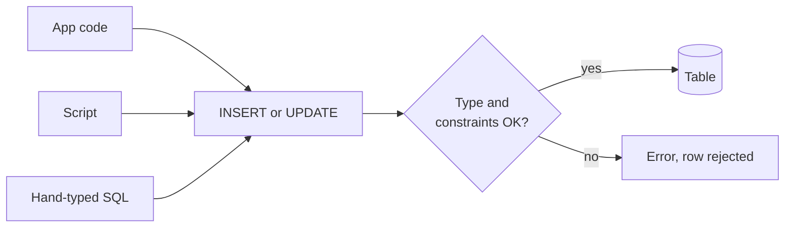
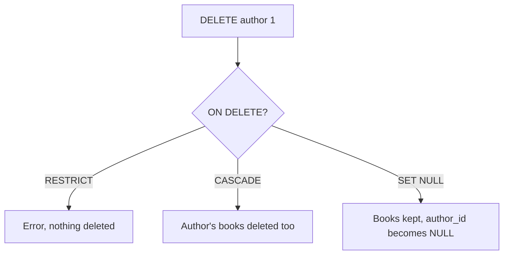

# Data types and constraints

After this you can pick a sensible Postgres type for each column and add constraints so the database itself rejects bad rows.

Before this: [joins](../02-querying/04-joins.md) and [the relational model](../01-database-basics/02-the-relational-model.md).

## The idea

An app signs up a user with a negative balance, a transfer that points at an account nobody deleted properly, or the same email twice. If only the application code checks for these, every other program that writes to the table (a script, a second service, a hand-typed `UPDATE`) can break the rule. A bug in one place becomes bad data everywhere.

The fix is to state the rules in the table definition. A **data type** says what kind of value a column holds, and a **constraint** says which values are allowed. Postgres checks both on every write, from every client, and refuses the change with an error when a rule is broken.



In the diagram, every writer passes through the same check. The error is the safety net: the bad row never reaches the table.

## Key terms

A **data type** fixes the set of values a column can store and the operations allowed on them. `integer` holds whole numbers and `text` holds strings.

A **constraint** is a rule attached to a column or table that every row must satisfy. The main ones are `NOT NULL` (a value is required), `DEFAULT` (not a check, but the value used when none is given), `UNIQUE` (no two rows share the value), `CHECK` (an arbitrary true-or-false condition), `PRIMARY KEY` (`NOT NULL` plus `UNIQUE`, and the row's identity) and `FOREIGN KEY` (the value must exist as a key in another table).

An **identity column** is an integer column the database numbers for you: `GENERATED ALWAYS AS IDENTITY`. A **UUID** is a 128-bit random-looking identifier such as `3f2b...`, generated by `gen_random_uuid()`.

## How it works

The types you will use most, and the usual choice for each job:

| Job | Type | Why |
|---|---|---|
| Whole numbers, counts | `integer` (about 2.1 billion max), `bigint` when it could grow past that | `bigint` costs 4 more bytes per value |
| Money, exact decimals | `numeric(12,2)` | Exact. `real` and `double precision` are binary fractions and drift |
| Measurements, scientific values | `double precision` | Fast, approximate |
| Text | `text` | No length limit and no speed penalty in Postgres. `varchar(n)` only when a limit is a real business rule |
| Yes or no | `boolean` | `true`, `false`, or `NULL` |
| Calendar day | `date` | No time or zone |
| A moment in time | `timestamptz` | Stores an instant; displays in the session's time zone |
| Row id | `bigint GENERATED ALWAYS AS IDENTITY`, or `uuid` | Identity is small and ordered; UUIDs can be made by clients without asking the database |
| Flexible nested data | `jsonb` | Previewed below; a later lesson covers it |
| A short list in one column | `integer[]`, `text[]` | Fine for tags; use a table when you need to join or constrain the items |

Use `timestamptz` for events (orders, logins). Plain `timestamp` has no zone, so the same value means different instants for different readers. Floating point is the classic trap, as the first box shows.

<div class="sql-runner" data-db="shop" markdown>

```sql
SELECT 0.1::double precision + 0.2::double precision AS float_sum,
       0.1::double precision + 0.2::double precision = 0.3 AS float_equal,
       0.1::numeric + 0.2::numeric AS numeric_sum,
       0.1::numeric + 0.2::numeric = 0.3 AS numeric_equal;
```

</div>

Constraints are written inline on a column, or after the columns for rules about several. This table uses most of them; the box creates it, adds two rows and reads them back.

<div class="sql-runner" data-db="shop" markdown>

```sql
CREATE TABLE accounts (
  account_id   bigint GENERATED ALWAYS AS IDENTITY PRIMARY KEY,
  email        text NOT NULL UNIQUE,
  balance      numeric(12,2) NOT NULL DEFAULT 0 CHECK (balance >= 0),
  is_active    boolean NOT NULL DEFAULT true,
  opened_at    timestamptz NOT NULL DEFAULT now(),
  prefs        jsonb NOT NULL DEFAULT '{}',
  tags         text[]
);

INSERT INTO accounts (email) VALUES ('ada@example.com');
INSERT INTO accounts (email, balance, prefs, tags)
VALUES ('lin@example.com', 25.50, '{"theme": "dark"}', ARRAY['beta', 'early']);

SELECT account_id, email, balance, is_active, prefs ->> 'theme' AS theme, tags
FROM accounts;
```

</div>

The first row gets every default: id 1, balance 0, active. The `->>` operator reads one key out of a `jsonb` value as text.

A foreign key also says what happens when the referenced row is deleted. `RESTRICT` refuses the delete (the plain default, `NO ACTION`, behaves the same here). `CASCADE` deletes the child rows too. `SET NULL` keeps them and blanks the reference, so the column must allow `NULL`.



## Worked examples

<div class="example" markdown>

### Example 1: the constraints say no

The box creates the table, inserts a good row, then tries a row with a negative balance. A statement that breaks a rule is rejected whole; the row is not partly stored.

<!-- sql: expect-error -->
<div class="sql-runner" data-db="shop" markdown>

```sql
CREATE TABLE accounts (
  account_id bigint GENERATED ALWAYS AS IDENTITY PRIMARY KEY,
  email      text NOT NULL UNIQUE,
  balance    numeric(12,2) NOT NULL DEFAULT 0 CHECK (balance >= 0)
);
INSERT INTO accounts (email, balance) VALUES ('ada@example.com', 10);
INSERT INTO accounts (email, balance) VALUES ('lin@example.com', -5);
```

</div>

The last statement fails with `new row for relation "accounts" violates check constraint "accounts_balance_check"`. Postgres names the constraint automatically (table, column, kind). Change `-5` to `5` and the email to `'ada@example.com'` and you get `duplicate key value violates unique constraint "accounts_email_key"` instead.

Check: the error names the table and the constraint, which is what you search for when you see it in a log. The two other common errors read `null value in column "email" of relation "accounts" violates not-null constraint` and, for a foreign key, `insert or update on table "..." violates foreign key constraint "..."`. A refused delete says `update or delete on table "..." violates RESTRICT setting of foreign key constraint`.

</div>

<div class="example" markdown>

### Example 2: delete behaviour

`books.author_id` cascades; `articles.author_id` sets null. Deleting author 1 removes their book and blanks the author on their article.

<div class="sql-runner" data-db="shop" markdown>

```sql
CREATE TABLE authors (author_id integer PRIMARY KEY, name text NOT NULL);
CREATE TABLE books (
  book_id   integer PRIMARY KEY,
  author_id integer NOT NULL REFERENCES authors ON DELETE CASCADE
);
CREATE TABLE articles (
  article_id integer PRIMARY KEY,
  author_id  integer REFERENCES authors ON DELETE SET NULL
);
INSERT INTO authors VALUES (1, 'Ada'), (2, 'Lin');
INSERT INTO books VALUES (10, 1), (11, 2);
INSERT INTO articles VALUES (20, 1), (21, 2);

DELETE FROM authors WHERE author_id = 1;

SELECT (SELECT count(*) FROM books) AS books_left,
       (SELECT count(*) FROM articles WHERE author_id IS NULL) AS orphaned_articles;
```

</div>

Check: one book is left and one article now has a `NULL` author. With `ON DELETE RESTRICT` instead, the `DELETE` would fail.

</div>

## Common mistakes

<div class="warning" markdown>

Watch out: money in `real` or `double precision`. Sums drift by tiny fractions, and `=` comparisons fail, as the first box showed. Use `numeric(12,2)`, or store integer cents.

</div>

<div class="warning" markdown>

Watch out: `ON DELETE CASCADE` on everything. Deleting one `customers` row can silently delete their orders, invoices and payments. Use `CASCADE` only for rows that mean nothing without the parent (order lines), and `RESTRICT` where history matters.

</div>

<div class="warning" markdown>

Watch out: skipping `NOT NULL`. A nullable column that is always filled in practice will eventually hold a `NULL`, and every query that touches it then needs `NULL` handling. Make columns `NOT NULL` unless "unknown" is a real answer.

</div>

## Working with AI

<div class="ai" markdown>

Words to use: data type, constraint, `NOT NULL`, `CHECK`, foreign key, `ON DELETE CASCADE`, identity column, `numeric`, `timestamptz`.

Prompts to try:

- "Write a PostgreSQL `CREATE TABLE` for an `invoices` table: money as exact decimals, an identity primary key, a required customer foreign key that refuses deletes, and a `CHECK` that the total is not negative."
- "Review this schema for missing constraints and risky types: [paste]. List each column that should be `NOT NULL`, `UNIQUE` or `CHECK`, and say why."

What to check:

- Money or rates in `float`, `real` or `double precision`.
- `timestamp` where `timestamptz` was meant, and `varchar(255)` copied from MySQL habits.
- `CASCADE` chosen without asking what should happen to history.
- MySQL syntax such as `AUTO_INCREMENT`. Postgres uses identity columns (or `serial`); run the statement to see.

</div>

## Quiz

1\. Why prefer a `CHECK (balance >= 0)` constraint over only checking in application code?

<details class="solution" markdown>
<summary>Answer</summary>

Every writer goes through the database, including scripts, other services and manual fixes. A constraint enforces the rule for all of them, so one buggy client can't store a bad row.

</details>

2\. What does this return?

<div class="sql-runner" data-db="shop" markdown>

```sql
SELECT 0.1::numeric + 0.2::numeric = 0.3 AS a,
       0.1::double precision + 0.2::double precision = 0.3 AS b;
```

</div>

<details class="solution" markdown>
<summary>Answer</summary>

`a` is true and `b` is false. `numeric` is exact decimal arithmetic; `double precision` stores binary approximations of 0.1 and 0.2.

</details>

3\. This insert fails. Why, and what is the message's kind of problem?

<!-- sql: expect-error -->
<div class="sql-runner" data-db="shop" markdown>

```sql
CREATE TABLE users (user_id integer PRIMARY KEY, email text NOT NULL);
INSERT INTO users (user_id) VALUES (1);
```

</div>

<details class="solution" markdown>
<summary>Answer</summary>

No `email` was given and the column has no default, so it would be `NULL`, which `NOT NULL` forbids. The error is `null value in column "email" of relation "users" violates not-null constraint`.

</details>

4\. A `comments` table has `post_id integer REFERENCES posts`. You delete a post that has comments, and Postgres refuses. Name two other behaviours you could choose and when each fits.

<details class="solution" markdown>
<summary>Answer</summary>

`ON DELETE CASCADE` deletes the comments with the post, which fits when comments are meaningless without it. `ON DELETE SET NULL` keeps the comments with no post (the column must allow `NULL`), which fits when you want to keep the content.

</details>

## Lab

<div class="lab" markdown>

### Lab: a payments table that defends itself

Goal: write a table definition whose constraints reject three kinds of bad rows. Time: about 15 minutes. Runs in: the browser.

1. Create `payments` with: an identity bigint primary key, `payer_email text NOT NULL`, `amount numeric(10,2) NOT NULL` with a check that it is above 0, `status text NOT NULL DEFAULT 'pending'` with a check that it is one of `pending`, `paid`, `failed`, and `created_at timestamptz NOT NULL DEFAULT now()`.
2. Insert one valid payment giving only the email and an amount.
3. Select `payment_id, amount, status` to confirm the default.

Expected result: one row with status `pending`. Then try inserting amount 0 and status `refunded` to see the two check errors.

<div class="sql-runner" data-db="shop" data-solution="sol-lab" markdown>

```sql
-- write your CREATE TABLE, INSERT and SELECT here
SELECT 1;
```

</div>

<details class="solution" id="sol-lab" markdown>
<summary>Solution</summary>

```sql
CREATE TABLE payments (
  payment_id  bigint GENERATED ALWAYS AS IDENTITY PRIMARY KEY,
  payer_email text NOT NULL,
  amount      numeric(10,2) NOT NULL CHECK (amount > 0),
  status      text NOT NULL DEFAULT 'pending'
              CHECK (status IN ('pending', 'paid', 'failed')),
  created_at  timestamptz NOT NULL DEFAULT now()
);
INSERT INTO payments (payer_email, amount) VALUES ('ada@example.com', 19.99);
SELECT payment_id, amount, status FROM payments;
```

</details>

</div>

## Where this shows up

- [Creating and changing tables and data](02-creating-and-changing-tables-and-data.md) uses these types in `CREATE TABLE` and `ALTER TABLE`.
- [JSONB](../04-postgres-in-depth/07-jsonb-and-full-text-search.md) covers the `jsonb` type properly.
