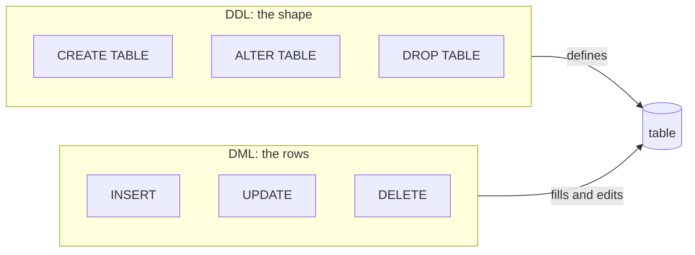
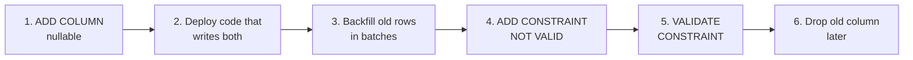

# Creating and changing tables and data

After this you can create and alter tables, add, change and delete rows safely, and write an upsert.

Before this: [data types and constraints](01-data-types-and-constraints.md).

## The idea

A schema is never finished. A new feature needs a column, a column gets the wrong name, and a bug leaves 4,000 rows with the wrong status. SQL has two families of statements for this. Statements that change the structure (`CREATE`, `ALTER`, `DROP`) are **DDL**, data definition language. Statements that change the rows (`INSERT`, `UPDATE`, `DELETE`) are **DML**, data manipulation language. `SELECT` only reads.



Both kinds are permanent once they succeed (a later [lesson on transactions](../04-postgres-in-depth/03-transactions-and-acid.md) covers undoing them). That makes the habits in this lesson matter: say which rows you mean before you change them.

## Key terms

A **migration** is a script that moves the schema from one version to the next, kept in version control and run in order.

`DROP TABLE` removes a table, its rows and its definition. `TRUNCATE` removes every row but keeps the table. `DELETE` removes the rows matching a `WHERE`, one by one, and with no `WHERE` it also empties the table, more slowly.

`RETURNING` is a Postgres clause on `INSERT`, `UPDATE` and `DELETE` that sends back the affected rows, so you can see what changed (or read generated ids) without a second query.

An **upsert** is "insert, or update if the row already exists", written `INSERT ... ON CONFLICT ... DO UPDATE`.

## How it works

`INSERT` takes one row or many. Always name the columns, so adding a column later doesn't break the statement. `INSERT ... SELECT` copies the result of a query into a table. The box creates a table, copies the cheap products in, adds two rows by hand and reads back the new ids with `RETURNING`.

<div class="sql-runner" data-db="shop" markdown>

```sql
CREATE TABLE cheap_products (
  product_id integer PRIMARY KEY,
  name       text NOT NULL,
  price      numeric(10,2) NOT NULL
);

INSERT INTO cheap_products (product_id, name, price)
SELECT product_id, name, price FROM products WHERE price < 10;

INSERT INTO cheap_products (product_id, name, price)
VALUES (100, 'Sticker', 1.50), (101, 'Pen', 2.25)
RETURNING product_id, name;
```

</div>

`ALTER TABLE` changes an existing table. It can add, drop and rename columns, change a type, and add or drop constraints. The box applies four changes to the `shop` tables and then reads the new column list from `information_schema`.

<div class="sql-runner" data-db="shop" markdown>

```sql
ALTER TABLE products ADD COLUMN discontinued boolean NOT NULL DEFAULT false;
ALTER TABLE products RENAME COLUMN stock TO units_in_stock;
ALTER TABLE products ADD CONSTRAINT units_not_negative CHECK (units_in_stock >= 0);
ALTER TABLE customers DROP COLUMN phone;

SELECT column_name, data_type, is_nullable
FROM information_schema.columns
WHERE table_name = 'products'
ORDER BY ordinal_position;
```

</div>

Adding a constraint checks the existing rows first, and fails if any row already breaks the rule. Renaming or dropping a column breaks every query and app that still uses the old name, so those changes need the code deployed in step.

On a big table, some `ALTER TABLE` forms rewrite the table or hold a lock that blocks other queries for the whole time. A safe migration works in small steps, as in the diagram: add the column as nullable (instant), backfill it in batches, add the constraint as `NOT VALID` so new rows are checked at once, then `VALIDATE CONSTRAINT`, which checks old rows without blocking writes. Build indexes with `CREATE INDEX CONCURRENTLY`. The [ALTER TABLE page](https://www.postgresql.org/docs/current/sql-altertable.html) (as of 2026) lists the lock each form takes, and says that `ALTER TABLE` takes an `ACCESS EXCLUSIVE` lock unless noted. Never test a migration for the first time on production.



## Worked examples

<div class="example" markdown>

### Example 1: UPDATE with and without WHERE

Raise the price of every book by 10 percent. The `WHERE` picks the rows, `SET` says what changes, and `RETURNING` shows the result.

1. Write the `SELECT` with the same `WHERE` first, and check it matches the rows you expect.
2. Change `SELECT ... FROM` into `UPDATE ... SET`, keeping the `WHERE` line.
3. Add `RETURNING` to see the new values.

<div class="sql-runner" data-db="shop" markdown>

```sql
UPDATE products
SET price = round(price * 1.10, 2)
WHERE category = 'Books'
RETURNING product_id, name, price;
```

</div>

Check: six rows come back, the six Books, and no other category changes. Now the missing `WHERE`. Without it, `SET price = 0` applies to every row.

<div class="sql-runner" data-db="shop" markdown>

```sql
UPDATE products SET price = 0;

SELECT count(*) FILTER (WHERE price = 0) AS free_products, count(*) AS total
FROM products;
```

</div>

All 38 products are now free, and Postgres reported success because the statement was valid. The database can't know what you meant. `DELETE FROM products;` without a `WHERE` empties the table the same way.

</div>

<div class="example" markdown>

### Example 2: upsert

A stock table keyed by `sku`. Receiving more stock should add to an existing row, or create the row if it is new. `ON CONFLICT (sku)` names the unique key to watch, `EXCLUDED` is the row you tried to insert, and `DO UPDATE` says what to do instead.

<div class="sql-runner" data-db="shop" markdown>

```sql
CREATE TABLE stock_levels (sku text PRIMARY KEY, qty integer NOT NULL);
INSERT INTO stock_levels VALUES ('mouse', 5);

INSERT INTO stock_levels (sku, qty)
VALUES ('mouse', 3), ('cable', 10)
ON CONFLICT (sku) DO UPDATE SET qty = stock_levels.qty + EXCLUDED.qty
RETURNING sku, qty;
```

</div>

Check: `mouse` is 8 (5 plus 3) and `cable` is a new row with 10. `DO NOTHING` would skip the conflicting row instead. An upsert is one atomic statement; a `SELECT` followed by an `INSERT` or `UPDATE` can race with another client.

</div>

## Common mistakes

<div class="warning" markdown>

Watch out: `UPDATE` or `DELETE` with no `WHERE`, or with a `WHERE` that matches more than you thought (`OR` without parentheses). Run the `SELECT` form first, compare the row count, and in a shared database take a backup or work inside a transaction.

</div>

<div class="warning" markdown>

Watch out: `INSERT` without a column list, such as `INSERT INTO t VALUES (1, 'x')`. It works until someone adds or reorders a column, then it writes into the wrong columns or fails. Always list the columns.

</div>

<div class="warning" markdown>

Watch out: `DROP COLUMN` or a rename that ships before the code that uses it. Deploy code that no longer uses the column first, then drop it in a later migration.

</div>

## Working with AI

<div class="ai" markdown>

Words to use: DDL, DML, migration, `ALTER TABLE`, `RETURNING`, upsert, `ON CONFLICT`, `NOT VALID`, backfill.

Prompts to try:

- "I have a PostgreSQL `orders` table with 50 million rows. Write a migration that adds a `NOT NULL` column `currency` defaulting to 'CAD' without a long lock, and explain each step."
- "Write an upsert for `page_views(url text primary key, hits int)` that adds 1 to `hits` on conflict, and show the `RETURNING` output."

What to check:

- Any `UPDATE` or `DELETE` the AI wrote without a `WHERE`, or with a filter wider than your description.
- A migration that rewrites or locks a big table (a type change, `SET NOT NULL`, a plain `CREATE INDEX`). Ask what lock it takes and read it in the Postgres docs.
- `ON CONFLICT` without a unique index on the named column: Postgres errors, and the AI may have invented the index.
- Statements from another dialect (`INSERT IGNORE`, `ON DUPLICATE KEY UPDATE`, `AUTO_INCREMENT`). Run the statement on a scratch copy.

</div>

## Quiz

1\. What is the difference between `DELETE FROM t`, `TRUNCATE t` and `DROP TABLE t`?

<details class="solution" markdown>
<summary>Answer</summary>

`DELETE FROM t` removes all rows one by one and keeps the table. `TRUNCATE t` also removes all rows and keeps the table, but much faster. `DROP TABLE t` removes the rows and the table itself.

</details>

2\. After this runs, how many rows does `notes` hold, and what is the value of `body` in the new row?

<div class="sql-runner" data-db="shop" markdown>

```sql
CREATE TABLE notes (note_id integer PRIMARY KEY, body text NOT NULL DEFAULT 'empty');
INSERT INTO notes (note_id) VALUES (1), (2);
INSERT INTO notes (note_id, body) VALUES (3, 'hello');
SELECT note_id, body FROM notes ORDER BY note_id;
```

</div>

<details class="solution" markdown>
<summary>Answer</summary>

Three rows. Rows 1 and 2 got the default, so `body` is `empty`; row 3 has `hello`.

</details>

3\. A teammate runs `UPDATE orders SET status = 'cancelled' WHERE customer_id = 7 OR created_at < '2020-01-01' AND status = 'pending'` and cancels too many orders. What went wrong?

<details class="solution" markdown>
<summary>Answer</summary>

`AND` binds tighter than `OR`, so the condition means "customer 7, or (old and pending)". Every order of customer 7 is cancelled, whatever its status. Add parentheses to say what was meant, and run the `SELECT` form first.

</details>

4\. You add `NOT NULL` to a column of a 100-million-row table in one statement. Name the risk and a safer route.

<details class="solution" markdown>
<summary>Answer</summary>

Postgres scans the whole table while holding a strong lock, so other queries wait. Safer: add the column nullable, backfill in batches, add a `CHECK (col IS NOT NULL) NOT VALID`, then `VALIDATE CONSTRAINT` (the `NOT NULL` flag can then be set without a long scan).

</details>

## Lab

<div class="lab" markdown>

### Lab: stock movements with an upsert

Goal: write a table, load it, and apply a day's changes with one statement. Time: about 15 minutes. Runs in: the browser.

1. Create `inventory(sku text PRIMARY KEY, qty integer NOT NULL CHECK (qty >= 0))`.
2. Insert `('pen', 40)` and `('ruler', 12)`.
3. In one upsert, receive `('pen', 10)` and `('stapler', 5)`, adding to existing rows. Return the changed rows.
4. Then `UPDATE` the ruler to quantity 0 with `WHERE sku = 'ruler'`, and `DELETE` every row with quantity 0. Select what remains.

Expected result: pen 50, stapler 5, nothing else.

<div class="sql-runner" data-db="shop" data-solution="sol-lab" markdown>

```sql
-- write your statements here, ending with a SELECT
SELECT 1;
```

</div>

<details class="solution" id="sol-lab" markdown>
<summary>Solution</summary>

```sql
CREATE TABLE inventory (sku text PRIMARY KEY, qty integer NOT NULL CHECK (qty >= 0));
INSERT INTO inventory (sku, qty) VALUES ('pen', 40), ('ruler', 12);
INSERT INTO inventory (sku, qty) VALUES ('pen', 10), ('stapler', 5)
ON CONFLICT (sku) DO UPDATE SET qty = inventory.qty + EXCLUDED.qty;
UPDATE inventory SET qty = 0 WHERE sku = 'ruler';
DELETE FROM inventory WHERE qty = 0;
SELECT sku, qty FROM inventory ORDER BY sku;
```

</details>

</div>

## Where this shows up

- [ORMs and migrations](../05-databases-in-apps/02-orms-and-migrations.md) generate and run `ALTER TABLE` scripts for you; this lesson is what to read in them.
- [Modelling relationships and ER diagrams](03-modelling-relationships-and-er-diagrams.md) decides which tables to create in the first place.
- [Transactions](../04-postgres-in-depth/03-transactions-and-acid.md) make a bad `UPDATE` undoable.
