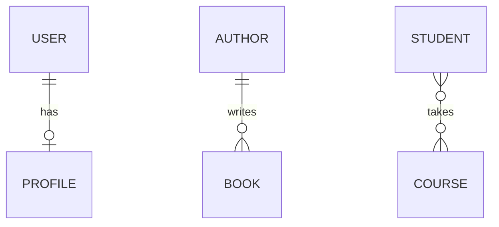
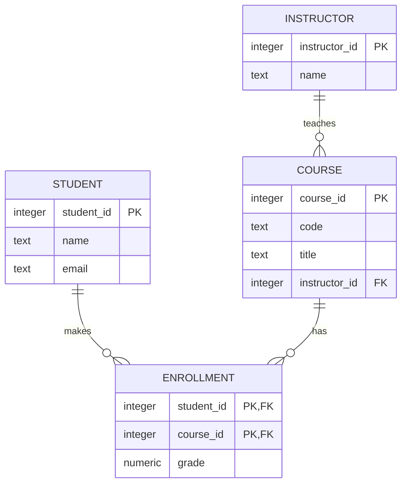

# Modelling relationships and ER diagrams

After this you can turn a description of an app into tables: pick the entities, draw the relationships as an ER diagram, and write the `CREATE TABLE` statements, including the junction table for a many-to-many relationship.

Before this: [creating and changing tables and data](02-creating-and-changing-tables-and-data.md).

## The idea

A university wants a course-registration app. Students sign up for courses, each course is taught by one instructor, and a student can take several courses while a course has many students. Before writing any SQL, decide which things the app stores and how they connect. A picture of that is cheaper to change than a table full of rows.

An **entity-relationship diagram** (ER diagram) draws the things (entities) as boxes and the connections (relationships) as lines. Each entity becomes a table, each attribute a column, and each relationship becomes a foreign key. The ends of a line carry the cardinality, the "how many" on each side.



The three lines are the three kinds of relationship. In crow's-foot notation, `||` means exactly one, `o|` zero or one, `o{` zero or many and `|{` one or many. Read a line from one entity across to the other: one author writes zero or many books, and each book has exactly one author.

## Key terms

An **entity** is a kind of thing the app stores, such as a student. An **attribute** is a fact about it, such as `email`. A **relationship** is a connection between entities, such as "enrols in".

**Cardinality** is how many rows on one side can relate to a row on the other. In a **one-to-one** relationship (1:1) each row pairs with at most one row of the other table; in **one-to-many** (1:N) a row on the "one" side pairs with many on the "many" side; in **many-to-many** (M:N) rows on both sides pair with many.

A **junction table** (also called a join or bridge table) implements a many-to-many relationship. It holds one foreign key to each side, and each row is one pairing.

## How it works

The rule for turning a relationship into tables depends on its cardinality.

| Relationship | Implementation |
|---|---|
| 1:N | Put a foreign key on the "many" side: `books.author_id` |
| 1:1 | Put a foreign key on either side and make it `UNIQUE` (or share the primary key): `profiles.user_id UNIQUE` |
| M:N | Add a junction table with two foreign keys, and make the pair its primary key |

A single column can't hold a many-to-many link. If `courses` had a `student_id`, a course could have only one student. The pairing is its own thing, so it gets its own table, which also gives it room for facts about the pairing (the grade belongs to the student in that course, to neither alone).

Naming conventions keep a schema readable, and AI tools follow them when you do. Use `snake_case`. Name tables as plural nouns (`students`) and primary keys `<singular>_id` (`student_id`). Give a foreign key the same name as the key it points to, so `courses.instructor_id` references `instructors.instructor_id`. Name junction tables after the thing they record (`enrollments`), not `student_course`, when the pairing is an event or has its own attributes.

Applying this to the registration app gives four entities and three relationships: an instructor teaches many courses, a student makes many enrolments, and a course has many enrolments.



In the diagram, `ENROLLMENT` is the junction table: it carries the two foreign keys, which together are its primary key, and the `grade` attribute. Each foreign key is on the "many" end of its line.

## Worked examples

<div class="example" markdown>

### Example 1: from diagram to tables

The statements below follow the diagram line by line, in an order where each table exists before another references it. Foreign keys decide how deletes behave: removing a student removes their enrolments (`CASCADE`), but a course with enrolments can't be deleted (`RESTRICT`). The last query joins all four tables to print a roster.

<div class="sql-runner" data-db="shop" markdown>

```sql
CREATE TABLE instructors (
  instructor_id integer GENERATED ALWAYS AS IDENTITY PRIMARY KEY,
  name          text NOT NULL
);
CREATE TABLE courses (
  course_id     integer GENERATED ALWAYS AS IDENTITY PRIMARY KEY,
  code          text NOT NULL UNIQUE,
  title         text NOT NULL,
  instructor_id integer NOT NULL REFERENCES instructors
);
CREATE TABLE students (
  student_id integer GENERATED ALWAYS AS IDENTITY PRIMARY KEY,
  name       text NOT NULL,
  email      text NOT NULL UNIQUE
);
CREATE TABLE enrollments (
  student_id integer NOT NULL REFERENCES students ON DELETE CASCADE,
  course_id  integer NOT NULL REFERENCES courses ON DELETE RESTRICT,
  grade      numeric(4,1) CHECK (grade BETWEEN 0 AND 100),
  PRIMARY KEY (student_id, course_id)
);

INSERT INTO instructors (name) VALUES ('Dr. Osei'), ('Dr. Tran');
INSERT INTO courses (code, title, instructor_id) VALUES
  ('CS201', 'Data Structures', 1), ('CS340', 'Databases', 2), ('MA101', 'Calculus', 1);
INSERT INTO students (name, email) VALUES
  ('Ada', 'ada@uni.ca'), ('Lin', 'lin@uni.ca'), ('Sam', 'sam@uni.ca');
INSERT INTO enrollments (student_id, course_id, grade) VALUES
  (1, 1, 91.5), (1, 2, 84.0), (2, 2, 77.0), (2, 3, NULL);

SELECT s.name AS student, c.code, i.name AS instructor, e.grade
FROM enrollments e
JOIN students s ON s.student_id = e.student_id
JOIN courses c ON c.course_id = e.course_id
JOIN instructors i ON i.instructor_id = c.instructor_id
ORDER BY s.name, c.code;
```

</div>

Check: four rows, one per pairing. Sam has no enrolments, so Sam does not appear in an inner join; a `LEFT JOIN` from `students` would list Sam with `NULL`s. Ada takes two courses and `CS340` has two students, which is the many-to-many in action.

</div>

<div class="example" markdown>

### Example 2: the composite key blocks duplicates

Because `(student_id, course_id)` is the primary key, the same student can't enrol in the same course twice. No extra check in app code is needed.

<!-- sql: expect-error -->
<div class="sql-runner" data-db="shop" markdown>

```sql
CREATE TABLE students (student_id integer PRIMARY KEY);
CREATE TABLE courses (course_id integer PRIMARY KEY);
CREATE TABLE enrollments (
  student_id integer REFERENCES students,
  course_id  integer REFERENCES courses,
  PRIMARY KEY (student_id, course_id)
);
INSERT INTO students VALUES (1);
INSERT INTO courses VALUES (10);
INSERT INTO enrollments VALUES (1, 10);
INSERT INTO enrollments VALUES (1, 10);
```

</div>

Check: the last statement fails with a `duplicate key value violates unique constraint "enrollments_pkey"` error. A primary key is a unique index on its columns.

</div>

## Common mistakes

<div class="warning" markdown>

Watch out: storing a list in one column, such as `courses.student_ids` holding `'1,2,5'`. You can't join on it, constrain it or index it well. Use a junction table.

</div>

<div class="warning" markdown>

Watch out: putting the foreign key on the wrong side. The key goes on the "many" side. If `instructors` had a `course_id`, an instructor could teach only one course.

</div>

<div class="warning" markdown>

Watch out: a junction table with a surrogate `id` and no unique pair. Without a unique constraint on the two foreign keys, duplicate pairings are allowed. Use the pair as the primary key, or add `UNIQUE (student_id, course_id)`.

</div>

## Working with AI

<div class="ai" markdown>

Words to use: entity, attribute, cardinality, one-to-many, many-to-many, junction table, foreign key, composite primary key, crow's-foot.

Prompts to try:

- "Here are the requirements for a course-registration app: [paste]. List the entities, attributes and relationships with their cardinalities, then give a Mermaid `erDiagram`. Ask me about anything ambiguous before writing SQL."
- "Turn this Mermaid `erDiagram` into PostgreSQL `CREATE TABLE` statements with primary keys, foreign keys, `ON DELETE` behaviour and `NOT NULL`, in dependency order: [paste]."

What to check:

- Cardinality read backwards: confirm each line by saying it aloud in both directions.
- A many-to-many drawn as a direct line and implemented as a column, with no junction table.
- A junction table with no composite key or unique pair.
- The `ON DELETE` choices: the AI may default to `CASCADE` everywhere. Ask what each delete should do.

</div>

## Quiz

1\. Which side of a one-to-many relationship holds the foreign key?

<details class="solution" markdown>
<summary>Answer</summary>

The "many" side. Each book row stores one `author_id`, while an author row can't store a variable number of book ids.

</details>

2\. Read the line `AUTHOR ||--o{ BOOK : writes` in words.

<details class="solution" markdown>
<summary>Answer</summary>

One author writes zero or many books, and each book has exactly one author.

</details>

3\. Patients can see many doctors and doctors see many patients. Sketch the tables.

<details class="solution" markdown>
<summary>Answer</summary>

`patients`, `doctors`, and a junction table such as `appointments(patient_id, doctor_id, ...)`. The visit date and notes belong in the junction table. If the same pair can meet twice, add `starts_at` to the key or use a surrogate id instead of the pair.

</details>

4\. In the registration schema, what happens when you delete a student who has enrolments? And a course that has enrolments?

<details class="solution" markdown>
<summary>Answer</summary>

Deleting the student removes their rows in `enrollments` (`ON DELETE CASCADE`). Deleting a course with enrolments is refused (`ON DELETE RESTRICT`), so the registrar has to decide what happens to those records first.

</details>

## Lab

<div class="lab" markdown>

### Lab: model a library

Goal: design and build tables for a small library. Time: about 20 minutes. Runs in: the browser.

Requirements: members borrow books; a book title can have several physical copies; each loan is one copy borrowed by one member, with a due date.

1. Write the entities and relationships (on paper or as a Mermaid `erDiagram`).
2. Write `CREATE TABLE` for `members`, `books`, `copies` and `loans`.
3. Insert two members, one book with two copies and two loans.
4. Select member name, book title and due date for every loan.

Expected result: two rows. `loans` holds a `copy_id` and a `member_id`, so the members-to-copies link is many-to-many through `loans`.

<div class="sql-runner" data-db="shop" data-solution="sol-lab" markdown>

```sql
-- write your tables, inserts and final SELECT here
SELECT 1;
```

</div>

<details class="solution" id="sol-lab" markdown>
<summary>Solution</summary>

```sql
CREATE TABLE members (member_id integer PRIMARY KEY, name text NOT NULL);
CREATE TABLE books (book_id integer PRIMARY KEY, title text NOT NULL);
CREATE TABLE copies (
  copy_id integer PRIMARY KEY,
  book_id integer NOT NULL REFERENCES books
);
CREATE TABLE loans (
  loan_id   integer PRIMARY KEY,
  copy_id   integer NOT NULL REFERENCES copies,
  member_id integer NOT NULL REFERENCES members,
  due_date  date NOT NULL
);
INSERT INTO members VALUES (1, 'Ada'), (2, 'Lin');
INSERT INTO books VALUES (1, 'Databases');
INSERT INTO copies VALUES (1, 1), (2, 1);
INSERT INTO loans VALUES (1, 1, 1, '2026-11-01'), (2, 2, 2, '2026-11-05');
SELECT m.name, b.title, l.due_date
FROM loans l
JOIN members m ON m.member_id = l.member_id
JOIN copies c ON c.copy_id = l.copy_id
JOIN books b ON b.book_id = c.book_id
ORDER BY l.loan_id;
```

</details>

</div>

## Where this shows up

- [Normalization and denormalization](04-normalization-and-denormalization.md) tests whether a model like this stores each fact once.
- ORMs<!-- link: ../05-databases-in-apps/02-orms-and-migrations.md --> express the same relationships as classes with `ForeignKey` and `ManyToMany` fields.
- Data modelling for warehouses<!-- link: ../../11-data-engineering-and-data-science/01-data-engineering/02-star-schemas-and-dimensional-modelling.md --> draws different diagrams for a different job.
