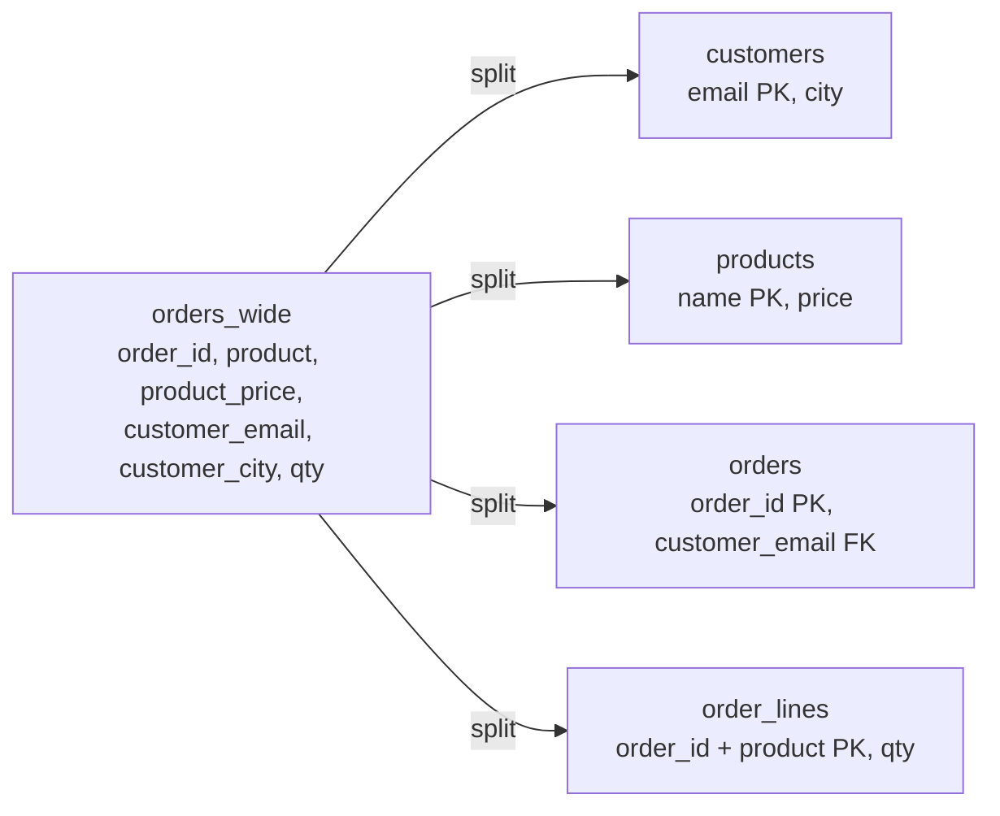
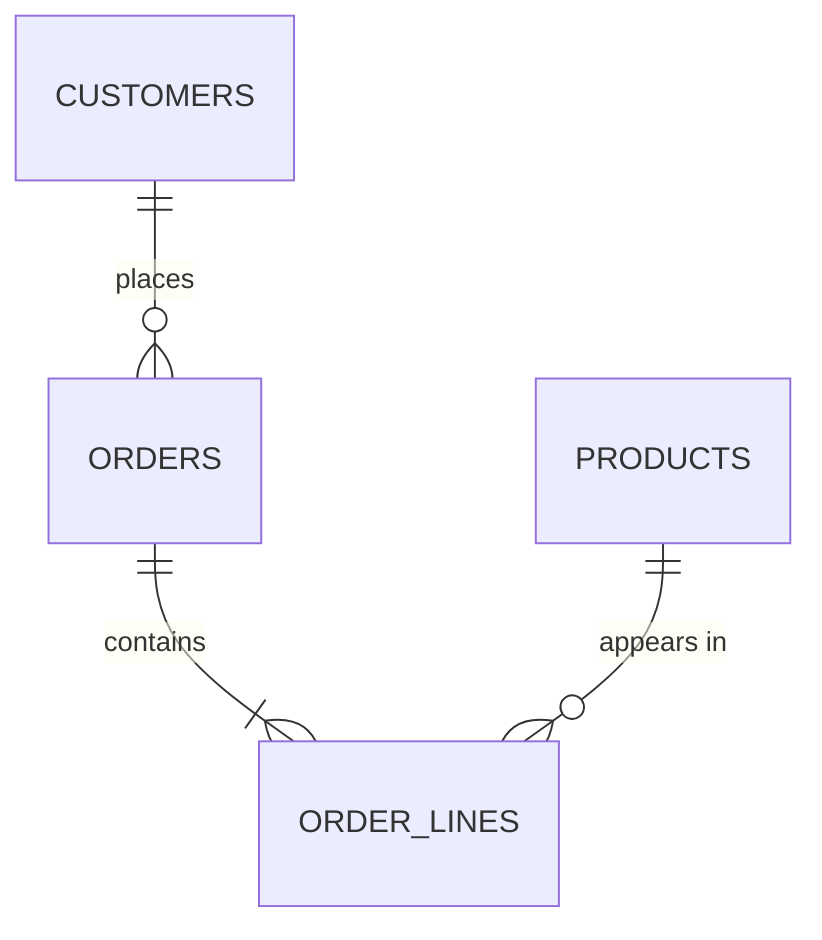

# Normalization and denormalization

After this you can spot update, insert and delete anomalies in a table, split it into normal forms, and say when it is reasonable to break the rules for speed.

Before this: [modelling relationships and ER diagrams](03-modelling-relationships-and-er-diagrams.md).

## The idea

A shop keeps all its orders in one wide spreadsheet-style table. Each row has the customer's email and city, the product's name and price, and the quantity. Ada's city appears on every row of every order she ever placed, and the price of a pen appears on every row that contains a pen.

That repetition is the problem. When Ada moves, someone must update every one of her rows, and if one is missed, the table says she lives in two cities. **Normalization** is the process of splitting such a table so that each fact is stored exactly once.



In the diagram, one wide table with repeating columns becomes four narrow tables joined by keys. Customer facts live in `customers`, product facts in `products`, and `order_lines` holds only the facts about one product in one order.

## Key terms

A **functional dependency** means that one column (or set of columns) decides another: knowing `customer_email` tells you `customer_city`. Written `customer_email -> customer_city`. Normal forms are rules about which dependencies a table may have.

An **anomaly** is a bug caused by redundancy. An **update anomaly**: changing a fact in some rows but not all leaves the table contradicting itself. An **insert anomaly**: you can't record a fact without recording an unrelated one, such as a new product that nobody has ordered yet. A **delete anomaly**: deleting a row loses a fact you wanted to keep, such as the price of a product when its last order is deleted.

**Denormalization** is deliberately storing a fact more than once, or storing a precomputed result, to make reads faster.

## How it works

Each normal form builds on the one before. In the wide table the key is `(order_id, product)`, and the dependencies are `(order_id, product) -> qty`, `product -> product_price`, `order_id -> customer_email` and `customer_email -> customer_city`.

| Form | Rule in plain words | What it fixes in the wide table |
|---|---|---|
| 1NF | One value per cell, no repeating groups, and a key | A cell like `'pen, ruler'` becomes one row per product |
| 2NF | Every non-key column depends on the whole key, not part of it | `product_price` depends only on `product`, so it moves to `products` |
| 3NF | Non-key columns depend on the key and nothing else | `customer_city` depends on `customer_email`, not on the order, so it moves to `customers` |
| BCNF | Every column that decides another is itself a candidate key | A stricter 3NF; the difference appears only in odd tables with overlapping keys |

A memory aid for 3NF: every column depends on the key, the whole key, and nothing but the key. Most real schemas aim for 3NF, which the tables from the previous lesson already satisfy. 4NF and 5NF deal with rarer multi-valued cases and are rarely needed.

First the problem. The box builds the wide table and updates Ada's city on one row only, the way a forgotten `WHERE` or a second code path would.

<div class="sql-runner" data-db="shop" markdown>

```sql
CREATE TABLE orders_wide (
  order_id       integer,
  product        text,
  product_price  numeric(6,2),
  customer_email text,
  customer_city  text,
  qty            integer
);
INSERT INTO orders_wide VALUES
  (1, 'pen',     1.50, 'ada@x.ca', 'Toronto', 10),
  (1, 'ruler',   2.25, 'ada@x.ca', 'Toronto', 2),
  (2, 'pen',     1.50, 'lin@x.ca', 'Ottawa',  5),
  (3, 'pen',     1.50, 'ada@x.ca', 'Toronto', 1),
  (3, 'stapler', 8.00, 'ada@x.ca', 'Toronto', 1);

UPDATE orders_wide SET customer_city = 'Hamilton'
WHERE order_id = 1 AND product = 'pen';

SELECT customer_email, count(DISTINCT customer_city) AS cities
FROM orders_wide
GROUP BY customer_email
ORDER BY customer_email;
```

</div>

Ada now lives in two cities. The other two anomalies are visible in the same table: a new product can't be added without an order, and deleting order 2 would erase the fact that Lin lives in Ottawa.

## Worked examples

<div class="example" markdown>

### Example 1: split into 3NF

1. Make one table per entity, each with the key that decides its columns.
2. Fill them from the wide data with `INSERT ... SELECT DISTINCT`, so repeated facts collapse to one row.
3. Join them back to read the same information as before.

<div class="sql-runner" data-db="events" markdown>

```sql
CREATE TABLE orders_wide (
  order_id integer, product text, product_price numeric(6,2),
  customer_email text, customer_city text, qty integer
);
INSERT INTO orders_wide VALUES
  (1, 'pen', 1.50, 'ada@x.ca', 'Toronto', 10), (1, 'ruler', 2.25, 'ada@x.ca', 'Toronto', 2),
  (2, 'pen', 1.50, 'lin@x.ca', 'Ottawa', 5),   (3, 'pen', 1.50, 'ada@x.ca', 'Toronto', 1),
  (3, 'stapler', 8.00, 'ada@x.ca', 'Toronto', 1);

CREATE TABLE customers (email text PRIMARY KEY, city text NOT NULL);
CREATE TABLE products (name text PRIMARY KEY, price numeric(6,2) NOT NULL);
CREATE TABLE orders (order_id integer PRIMARY KEY, customer_email text NOT NULL REFERENCES customers);
CREATE TABLE order_lines (
  order_id integer REFERENCES orders, product text REFERENCES products,
  qty integer NOT NULL, PRIMARY KEY (order_id, product)
);

INSERT INTO customers SELECT DISTINCT customer_email, customer_city FROM orders_wide;
INSERT INTO products SELECT DISTINCT product, product_price FROM orders_wide;
INSERT INTO orders SELECT DISTINCT order_id, customer_email FROM orders_wide;
INSERT INTO order_lines SELECT order_id, product, qty FROM orders_wide;

UPDATE customers SET city = 'Hamilton' WHERE email = 'ada@x.ca';

SELECT l.order_id, l.product, c.city, l.qty * p.price AS line_total
FROM order_lines l
JOIN orders o ON o.order_id = l.order_id
JOIN customers c ON c.email = o.customer_email
JOIN products p ON p.name = l.product
ORDER BY l.order_id, l.product;
```

</div>

The box uses the `events` sample database so the new table names are free. Check: Ada's move is one `UPDATE` of one row, and every order of hers shows Hamilton. The price of a pen exists once in `products`, so a price change can't leave two prices. Real tables usually use surrogate ids (`customer_id`) as keys, as in the previous lesson, because emails change; text keys keep this example short.



</div>

<div class="example" markdown>

### Example 2: denormalize with a materialized view

A report that sums every order line is slow when the table has millions of rows. A **materialized view** stores the result of a query as a table that you refresh on demand. The report reads a few rows, and the normalized tables stay the source of truth. The cost is staleness: until the next refresh, the view is out of date.

<div class="sql-runner" data-db="shop" markdown>

```sql
CREATE MATERIALIZED VIEW revenue_by_category AS
SELECT p.category, sum(i.quantity * i.unit_price) AS revenue
FROM order_items i
JOIN products p ON p.product_id = i.product_id
GROUP BY p.category;

INSERT INTO order_items (order_item_id, order_id, product_id, quantity, unit_price)
VALUES (99999, 1, 27, 1, 50.00);

CREATE TEMP TABLE before_refresh AS
SELECT revenue FROM revenue_by_category WHERE category = 'Books';

REFRESH MATERIALIZED VIEW revenue_by_category;

SELECT b.revenue AS stale, m.revenue AS after_refresh
FROM before_refresh b, revenue_by_category m
WHERE m.category = 'Books';
```

</div>

Check: `after_refresh` is exactly 50.00 above `stale`, the new line. Between the insert and the refresh, any reader of the view saw the old number.

</div>

## Common mistakes

<div class="warning" markdown>

Watch out: denormalizing before measuring. A copied column (`orders.customer_city`) is easy to add and hard to keep correct. Normalize first, add an index, and look at the [query plan](../04-postgres-in-depth/02-explain-and-query-plans.md) before copying data.

</div>

<div class="warning" markdown>

Watch out: over-splitting. Putting `city` and `province` in their own tables for an address that is only ever shown whole adds joins and no safety. Normalize facts that change independently or repeat a lot.

</div>

<div class="warning" markdown>

Watch out: a denormalized copy with no plan to refresh it. For every copy or cache, write down what updates it and how stale it may be.

</div>

## Working with AI

<div class="ai" markdown>

Words to use: functional dependency, 3NF, update anomaly, partial dependency, transitive dependency, denormalization, materialized view, star schema.

Prompts to try:

- "Here is a table with columns [list] and sample rows [paste]. Which functional dependencies hold, which normal form is it in, and how would you split it to 3NF? Give `CREATE TABLE` statements."
- "This report query joins 6 tables and takes 8 seconds on PostgreSQL: [paste query and `EXPLAIN` output]. Would a materialized view or an index fit better, and how stale would the result be?"

What to check:

- Dependencies the AI assumed from column names. Confirm each from the real data (`SELECT email, count(DISTINCT city) ... HAVING count(DISTINCT city) > 1`).
- A split that loses information. Join the new tables back and compare row counts with the original.
- Denormalization suggested with no refresh or update strategy.
- Surrogate keys added everywhere without a `UNIQUE` constraint on the natural key.

</div>

## Quiz

1\. Ada's email is on 40 rows of a table, and her city changed on 39 of them. Which anomaly is this, and what is the fix?

<details class="solution" markdown>
<summary>Answer</summary>

An update anomaly. Store the city once in a `customers` table (3NF) and reference it by key, so there is one row to update.

</details>

2\. In a table with key `(order_id, product)`, the column `product_price` depends only on `product`. Which normal form does this break?

<details class="solution" markdown>
<summary>Answer</summary>

2NF: a non-key column depends on part of the key. Move `product_price` to a `products` table keyed by `product`.

</details>

3\. A table `employees(employee_id, department_id, department_name)` stores the department name on every employee. Name the form it breaks and write the fix.

<details class="solution" markdown>
<summary>Answer</summary>

3NF: `department_name` depends on `department_id`, a non-key column. Fix: `employees(employee_id, department_id)` and `departments(department_id, department_name)`.

</details>

4\. A dashboard sums a billion-row `events` table every hour. Give one denormalized option and its cost.

<details class="solution" markdown>
<summary>Answer</summary>

A materialized view (or a summary table updated by a job) holding the hourly totals. The dashboard reads a few rows. The cost is staleness and the work of refreshing it.

</details>

## Lab

<div class="lab" markdown>

### Lab: normalize a table of enrolments

Goal: split a wide table into 3NF and show that an update touches one row. Time: about 20 minutes. Runs in: the browser.

1. The table is `signups(student_email, student_name, course_code, course_title, term)`, with key `(student_email, course_code)`. Write down which columns depend on only part of the key.
2. Create it and insert three rows: Ada in `CS201` and `CS340`, Lin in `CS340`.
3. Create `students(email, name)`, `courses(code, title)` and `registrations(student_email, course_code, term)` and fill them from `signups`.
4. Rename the course `CS340` to 'Database Systems' with one `UPDATE`, then select email, code and title for every registration.

Expected result: three rows, all `CS340` rows showing the new title.

<div class="sql-runner" data-db="shop" data-solution="sol-lab" markdown>

```sql
-- write your tables, inserts and final SELECT here
SELECT 1;
```

</div>

<details class="solution" id="sol-lab" markdown>
<summary>Solution</summary>

`student_name` depends only on `student_email`, and `course_title` only on `course_code`; both are partial dependencies.

```sql
CREATE TABLE signups (
  student_email text, student_name text, course_code text, course_title text, term text,
  PRIMARY KEY (student_email, course_code)
);
INSERT INTO signups VALUES
  ('ada@uni.ca', 'Ada', 'CS201', 'Data Structures', 'F26'),
  ('ada@uni.ca', 'Ada', 'CS340', 'Databases', 'F26'),
  ('lin@uni.ca', 'Lin', 'CS340', 'Databases', 'F26');

CREATE TABLE students (email text PRIMARY KEY, name text NOT NULL);
CREATE TABLE courses (code text PRIMARY KEY, title text NOT NULL);
CREATE TABLE registrations (
  student_email text REFERENCES students, course_code text REFERENCES courses,
  term text NOT NULL, PRIMARY KEY (student_email, course_code)
);
INSERT INTO students SELECT DISTINCT student_email, student_name FROM signups;
INSERT INTO courses SELECT DISTINCT course_code, course_title FROM signups;
INSERT INTO registrations SELECT student_email, course_code, term FROM signups;

UPDATE courses SET title = 'Database Systems' WHERE code = 'CS340';

SELECT r.student_email, r.course_code, c.title
FROM registrations r JOIN courses c ON c.code = r.course_code
ORDER BY r.student_email, r.course_code;
```

</details>

</div>

## Where this shows up

- [Star schemas](../../11-data-engineering-and-data-science/01-data-engineering/02-star-schemas-and-dimensional-modelling.md) are deliberately denormalized: one fact table of events surrounded by wide dimension tables, built for fast reports rather than safe updates. The `warehouse` sample database uses one.
- [Views and materialized views](../04-postgres-in-depth/06-views-functions-and-triggers.md) are covered in the Postgres chapter.
- Caches [such as Redis](../05-databases-in-apps/04-redis-and-caching.md) are denormalization outside the database, with the same staleness question.
