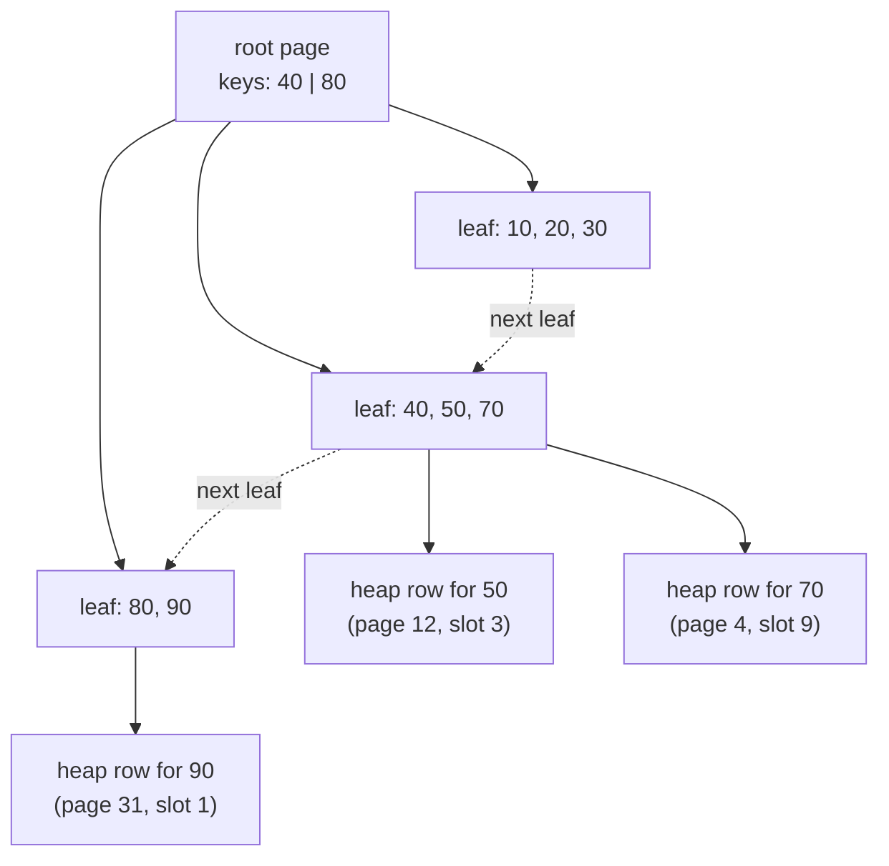

# Indexes

After this you can say which queries an index helps, choose the column order of a composite index, and weigh what an index costs on writes.

Before this: [joins](../02-querying/04-joins.md) and [data types and constraints](../03-schema-design/01-data-types-and-constraints.md).

## The idea

A table with 100,000 orders answers `WHERE order_id = 500` by reading every row and testing the condition. That is a **sequential scan**, and it takes time proportional to the table size. The index at the back of a textbook does better: look the word up in sorted order, then jump to the page.

An **index** is a separate, sorted data structure that maps column values to the location of the matching table rows. Postgres keeps it in step with the table on every write. The default kind is a **B-tree**: a shallow tree of pages whose leaves hold the sorted values, each with a pointer to a row in the table's storage (called the **heap**).



A lookup walks from the root to one leaf (three or four page reads even for millions of rows), then follows the pointer into the heap. Because the leaves are sorted and linked, a range such as `BETWEEN 40 AND 70` walks along the leaf chain without going back to the root.

## Key terms

An **index scan** reads matching entries from the index and fetches each row from the heap. An **index only scan** answers from the index alone. A **composite index** (multicolumn index) is built on several columns, sorted by the first, then the second within ties.

A **covering index** contains every column a query needs. `INCLUDE` adds payload columns to the leaf entries that are not part of the sort key. A **partial index** covers only the rows matching a `WHERE` condition. An **expression index** is built on a computed value such as `lower(email)`.

## How it works

Which queries can use a B-tree index:

| Query shape | Uses an index on `(customer_id)`? |
|---|---|
| `customer_id = 42`, `IN (...)`, `< 100`, `BETWEEN`, `ORDER BY customer_id` | Yes |
| `customer_id + 0 = 42` or `lower(name) = ...` | No: the column is wrapped in an expression |
| `name LIKE '%son'` | No: the sorted order helps only prefixes |
| `customer_id = 42` when most rows match | Planner prefers a sequential scan |

The planner decides by estimated cost, so an index is a permission, not an instruction. Here is the effect on 100,000 rows we generate in the box. Without an index, the plan reads everything:

<div class="sql-runner" data-db="shop" markdown>

```sql
DROP TABLE IF EXISTS orders_big;
CREATE TABLE orders_big AS
SELECT g AS order_id,
       (g % 5000) + 1 AS customer_id,
       (ARRAY['paid','paid','paid','shipped','refunded'])[g % 5 + 1] AS status,
       g * 3 % 10007 AS amount
FROM generate_series(1, 100000) g;
ANALYZE orders_big;
EXPLAIN SELECT * FROM orders_big WHERE order_id = 500;
```

</div>

```text
Seq Scan on orders_big  (cost=0.00..1890.00 rows=1 width=18)
  Filter: (order_id = 500)
```

Now add the index and plan again. `EXPLAIN` is the next lesson; read it as "how will Postgres run this".

<div class="sql-runner" data-db="shop" markdown>

```sql
DROP TABLE IF EXISTS orders_big;
CREATE TABLE orders_big AS
SELECT g AS order_id,
       (g % 5000) + 1 AS customer_id,
       (ARRAY['paid','paid','paid','shipped','refunded'])[g % 5 + 1] AS status,
       g * 3 % 10007 AS amount
FROM generate_series(1, 100000) g;
CREATE INDEX orders_big_order_id_idx ON orders_big (order_id);
ANALYZE orders_big;
EXPLAIN SELECT * FROM orders_big WHERE order_id = 500;
```

</div>

```text
Index Scan using orders_big_order_id_idx on orders_big  (cost=0.29..8.31 rows=1 width=18)
  Index Cond: (order_id = 500)
```

The estimated cost drops from 1890 to about 8 units. A primary key or `UNIQUE` constraint creates this kind of index for you, so you don't add one on those columns.

### Column order in a composite index

An index on `(customer_id, status)` is sorted by `customer_id` first. It serves a query on `customer_id` alone, or on both columns, but not on `status` alone, just as a phone book sorted by last name then first name can't find everyone called "Ben". Put the column tested with `=` and most often used first.

<div class="sql-runner" data-db="shop" markdown>

```sql
DROP TABLE IF EXISTS orders_big;
CREATE TABLE orders_big AS
SELECT g AS order_id,
       (g % 5000) + 1 AS customer_id,
       (ARRAY['paid','paid','paid','shipped','refunded'])[g % 5 + 1] AS status
FROM generate_series(1, 100000) g;
CREATE INDEX orders_big_cust_status_idx ON orders_big (customer_id, status);
ANALYZE orders_big;
EXPLAIN (COSTS OFF) SELECT * FROM orders_big WHERE status = 'refunded';
```

</div>

```text
Seq Scan on orders_big
  Filter: (status = 'refunded'::text)
```

The index exists, but a filter on `status` alone ignores it. Change the `WHERE` to `customer_id = 42 AND status = 'refunded'` and the plan becomes a `Bitmap Index Scan` on this index.

### Other index shapes

A partial index is small and fast when queries target a minority of rows. An expression index fixes the "wrapped column" case:

```sql
CREATE INDEX refunded_idx ON orders_big (customer_id) WHERE status = 'refunded';
CREATE INDEX users_email_lower_idx ON users (lower(email));
```

The second index serves `WHERE lower(email) = 'user77@example.com'` and nothing that writes the expression differently. A covering index adds payload so the heap is never visited:

```sql
CREATE INDEX orders_cust_amount_idx ON orders_big (customer_id) INCLUDE (amount);
```

Index only scans also need the table's **visibility map** to be current, which `VACUUM` maintains (the isolation lesson<!-- link: 04-isolation-locking-and-mvcc.md --> explains why). Until then the plan shows `Heap Fetches: N`, the number of rows still checked in the heap.

Postgres has other index types, chosen with `USING`: hash (equality only, rarely worth it over B-tree), GIN (many values per row, such as arrays, JSONB and full-text search), GiST (geometric and range data, nearest-neighbour search), and BRIN (tiny, for huge tables whose values correlate with physical order, such as timestamps in an append-only log).

## Worked examples

<div class="example" markdown>

### Example 1: an index only scan, and why it still fetches the heap

On the primary key of a fresh table, a query that needs only `order_id` can be answered from the index.

<div class="sql-runner" data-db="shop" markdown>

```sql
DROP TABLE IF EXISTS orders_pk;
CREATE TABLE orders_pk AS
SELECT g AS order_id, (g % 5000) + 1 AS customer_id, g * 3 % 10007 AS amount
FROM generate_series(1, 100000) g;
ALTER TABLE orders_pk ADD PRIMARY KEY (order_id);
ANALYZE orders_pk;
EXPLAIN (ANALYZE, COSTS OFF, TIMING OFF, SUMMARY OFF, BUFFERS OFF)
SELECT order_id FROM orders_pk WHERE order_id < 100;
```

</div>

```text
Index Only Scan using orders_pk_pkey on orders_pk (actual rows=99.00 loops=1)
  Index Cond: (order_id < 100)
  Heap Fetches: 99
  Index Searches: 1
```

1. `Index Only Scan` means no heap visit was planned for the column values.
2. `Heap Fetches: 99` says it visited the heap anyway, once per row. The table was just created and never vacuumed, so the visibility map is empty and each row must be checked.
3. Ask for `amount` too (`SELECT order_id, amount`) and the plan falls back to a plain `Index Scan`.

Check: after `VACUUM orders_pk;` in a real `psql` session, the same query shows `Heap Fetches: 0`. The runner can't run `VACUUM` because it wraps a block in one transaction.

</div>

## Common mistakes

<div class="warning" markdown>

Watch out: "index everything". Each index is extra storage and each `INSERT`, `UPDATE` and `DELETE` must update every index on the table. In our 100,000-row table the heap is 5120 kB and one index on `customer_id` with `INCLUDE (amount)` adds 2224 kB. Keep indexes that a real query uses, and drop the rest (`pg_stat_user_indexes.idx_scan` counts uses).

</div>

<div class="warning" markdown>

Watch out: foreign keys are not indexed automatically. Postgres indexes the primary key side only. A join or an `ON DELETE` check on `orders.customer_id` scans the whole `orders` table until you add `CREATE INDEX ON orders (customer_id)`.

</div>

<div class="warning" markdown>

Watch out: `CREATE INDEX` blocks writes to the table while it builds. On a live table use `CREATE INDEX CONCURRENTLY`, which takes longer, can't run inside a transaction block, and leaves an `INVALID` index to drop if it fails.

</div>

## Working with AI

<div class="ai" markdown>

Words to use: B-tree, composite index, column order, covering index, partial index, sequential scan, selectivity, foreign key index.

Prompts to try:

- "PostgreSQL 18. Table `orders(order_id, customer_id, status, created_at)` with 50 million rows. This query is slow: [paste query]. Suggest one index, say which queries it also serves, and give the `CREATE INDEX CONCURRENTLY` statement."
- "Here is `EXPLAIN (ANALYZE, BUFFERS)` output: [paste]. Why did the planner ignore my index on `status`?"

What to check:

- Column order against the `WHERE` clause. An index leading with a column the query doesn't filter on is not used.
- Redundant indexes. `(a)` is covered by `(a, b)`, so suggesting both wastes write cost.
- Run `EXPLAIN` before and after on realistic data. An index that helps a 100-row test table can do nothing at scale, and the reverse.
- Invented index types or options. Look up any `USING` method or storage parameter in the Postgres docs.

</div>

## Quiz

1\. Why can an index on `(customer_id, status)` not speed up `WHERE status = 'refunded'`?

<details class="solution" markdown>
<summary>Answer</summary>

The entries are sorted by `customer_id` first, so rows with the same `status` are scattered through the whole index. Without a `customer_id` value the planner has no place to start.

</details>

2\. A query selects `customer_id` and `amount` where `customer_id = 42`. Which index lets Postgres answer it without visiting the heap, once the table is vacuumed?

<details class="solution" markdown>
<summary>Answer</summary>

`CREATE INDEX ON orders (customer_id) INCLUDE (amount)`. The key column serves the filter and the included column supplies `amount`, which makes it a covering index.

</details>

3\. A teammate says `WHERE lower(email) = 'a@b.com'` is slow even though `email` is indexed. What is wrong and what is the fix?

<details class="solution" markdown>
<summary>Answer</summary>

The index stores `email` as written, not `lower(email)`, so the planner can't use it. Create an expression index: `CREATE INDEX ON users (lower(email))`.

</details>

4\. Your `orders` table has 90% `status = 'paid'` rows and you only ever search for the other 10%. What index is smallest?

<details class="solution" markdown>
<summary>Answer</summary>

A partial index: `CREATE INDEX ON orders (customer_id) WHERE status <> 'paid'`. It holds only the 10% of rows, and queries must repeat that condition to use it.

</details>

## Lab

<div class="lab" markdown>

### Lab: watch an index change a plan

Goal: generate 100,000 rows, find the slow query, and fix it with the right index. Time: about 15 minutes. Runs in: the browser.

1. In the runner below, create `ev` with 100,000 rows and run `EXPLAIN` on `WHERE user_id = 77`. Note the node name and the cost.
2. Add `CREATE INDEX ev_user_idx ON ev (user_id);` and `ANALYZE ev;` before the `EXPLAIN` and run again.
3. Change the query to `WHERE kind = 'click'`. Does the plan use an index on `kind`? Why?

<div class="sql-runner" data-db="shop" markdown>

```sql
DROP TABLE IF EXISTS ev;
CREATE TABLE ev AS
SELECT g AS id, (g % 2000) + 1 AS user_id,
       (ARRAY['view','view','view','view','click'])[g % 5 + 1] AS kind
FROM generate_series(1, 100000) g;
ANALYZE ev;
EXPLAIN SELECT * FROM ev WHERE user_id = 77;
```

</div>

Expected result: a `Seq Scan` first, then a `Bitmap Heap Scan` over a `Bitmap Index Scan` on `ev_user_idx` with a far lower cost. In step 3, an index on `kind` would match 20% of rows, so the planner keeps the sequential scan.

<details class="solution" markdown>
<summary>Solution</summary>

```sql
DROP TABLE IF EXISTS ev;
CREATE TABLE ev AS
SELECT g AS id, (g % 2000) + 1 AS user_id,
       (ARRAY['view','view','view','view','click'])[g % 5 + 1] AS kind
FROM generate_series(1, 100000) g;
CREATE INDEX ev_user_idx ON ev (user_id);
ANALYZE ev;
EXPLAIN SELECT * FROM ev WHERE user_id = 77;
```

</details>

</div>

## Where this shows up

- The next lesson, [EXPLAIN and query plans](02-explain-and-query-plans.md), shows how to confirm the planner uses the index you built.
- Every ORM migration that adds a foreign key should add its index too; see [ORMs and migrations](../05-databases-in-apps/02-orms-and-migrations.md).
