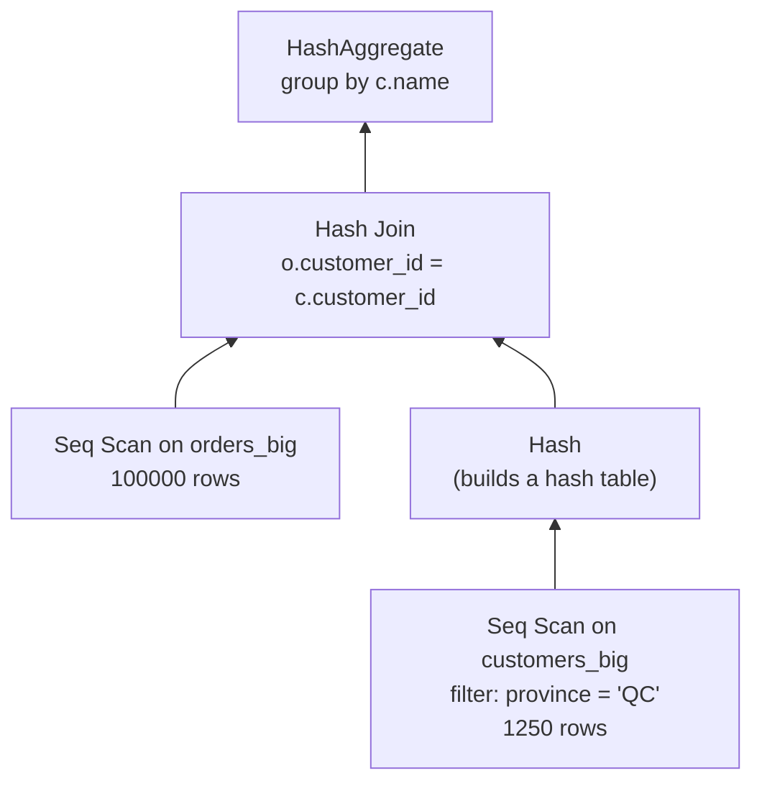
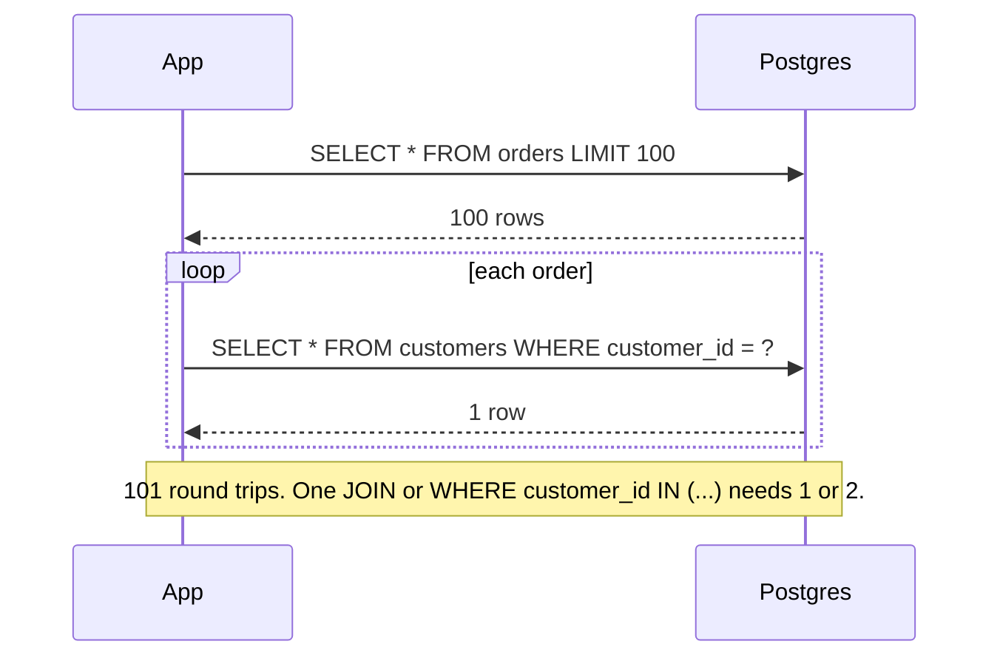

# EXPLAIN and query plans

After this you can read an `EXPLAIN` plan from the bottom up, name the scan and join methods in it, and tell when a slow query is caused by bad estimates, a missing index or too many queries.

Before this: [indexes](01-indexes.md) and [joins](../02-querying/04-joins.md).

## The idea

SQL says what rows you want, not how to get them. For each query the **planner** (also called the optimizer) compares many ways to run it and picks the one with the lowest estimated cost. `EXPLAIN` prints the chosen plan without running the query. When a query is slow, the plan is where you look first, the way a profiler is for code.

A plan is a tree. Data flows upward: leaf nodes read tables or indexes, inner nodes join, sort or aggregate, and the root produces the final rows.



Read it bottom-up: the two scans run first, the smaller one is hashed, the join probes it, and the aggregate runs last. In the text output below, deeper indentation means lower in this diagram.

## Key terms

A **plan node** is one step: a scan, a join, a sort or an aggregate. Its **cost** is the planner's estimate in arbitrary units, shown as `cost=startup..total`, where one unit is roughly the price of reading one page sequentially. Costs compare plans; they are not milliseconds.

**Estimated rows** (`rows=` in plain `EXPLAIN`) come from table statistics. **Actual rows** appear only with `EXPLAIN ANALYZE`, which really runs the query and reports what happened. **Statistics** are per-column summaries (distinct values, common values, histograms) that `ANALYZE` collects and autovacuum refreshes.

## How it works

`EXPLAIN` shows the plan only. `EXPLAIN ANALYZE` runs the statement and adds actual rows, timing and loop counts. Because it runs the statement, wrap `INSERT`, `UPDATE` and `DELETE` in a transaction you roll back.

Scan methods read one table:

| Node | Meaning |
|---|---|
| `Seq Scan` | Read every page of the table. Fine for small tables or when most rows match. |
| `Index Scan` | Walk the index, then fetch each matching row from the heap, in index order. |
| `Index Only Scan` | Answer from the index alone (needs the visibility map to be current). |
| `Bitmap Index Scan` + `Bitmap Heap Scan` | Collect matching row locations from the index, then read the heap pages in physical order. Used for medium numbers of matches. |

Join methods:

| Node | Idea | Best when |
|---|---|---|
| `Nested Loop` | For each outer row, look up matches in the inner side. | The outer side is small and the inner side has an index. |
| `Hash Join` | Build a hash table on one input, probe it with the other. | Large unsorted inputs, equality joins. |
| `Merge Join` | Walk two inputs already sorted on the join key. | Both sides are sorted or have an index on the key. |

Here is the plan in the diagram, with real row counts. `COSTS OFF` hides the cost numbers so the output stays short, and `TIMING OFF` and `SUMMARY OFF` hide times that vary from run to run.

<div class="sql-runner" data-db="shop" markdown>

```sql
DROP TABLE IF EXISTS orders_big;
DROP TABLE IF EXISTS customers_big;
CREATE TABLE customers_big AS
SELECT g AS customer_id, 'Customer ' || g AS name,
       (ARRAY['ON','QC','BC','AB'])[g % 4 + 1] AS province
FROM generate_series(1, 5000) g;
ALTER TABLE customers_big ADD PRIMARY KEY (customer_id);
CREATE TABLE orders_big AS
SELECT g AS order_id, (g % 5000) + 1 AS customer_id, g * 3 % 10007 AS amount
FROM generate_series(1, 100000) g;
ALTER TABLE orders_big ADD PRIMARY KEY (order_id);
ANALYZE customers_big;
ANALYZE orders_big;
EXPLAIN (ANALYZE, COSTS OFF, TIMING OFF, SUMMARY OFF, BUFFERS OFF)
SELECT c.name, sum(o.amount)
FROM customers_big c JOIN orders_big o ON o.customer_id = c.customer_id
WHERE c.province = 'QC'
GROUP BY c.name;
```

</div>

```text
HashAggregate (actual rows=1250.00 loops=1)
  Group Key: c.name
  Batches: 1  Memory Usage: 137kB
  ->  Hash Join (actual rows=25000.00 loops=1)
        Hash Cond: (o.customer_id = c.customer_id)
        ->  Seq Scan on orders_big o (actual rows=100000.00 loops=1)
        ->  Hash (actual rows=1250.00 loops=1)
              Buckets: 2048  Batches: 1  Memory Usage: 62kB
              ->  Seq Scan on customers_big c (actual rows=1250.00 loops=1)
                    Filter: (province = 'QC'::text)
                    Rows Removed by Filter: 3750
```

Each node shows `actual rows=` next to the estimate that `EXPLAIN` alone would give. The scan on `customers_big` removed 3750 rows with its filter and kept 1250, the join produced 25000 rows (1250 customers with 20 orders each), and the aggregate collapsed them to 1250 groups.

## Worked examples

<div class="example" markdown>

### Example 1: a join that scans the big table, then doesn't

Fetching one customer and their orders should be fast. Here is the plan with only the primary keys indexed:

<div class="sql-runner" data-db="shop" markdown>

```sql
DROP TABLE IF EXISTS orders_big;
DROP TABLE IF EXISTS customers_big;
CREATE TABLE customers_big AS
SELECT g AS customer_id, 'Customer ' || g AS name FROM generate_series(1, 5000) g;
ALTER TABLE customers_big ADD PRIMARY KEY (customer_id);
CREATE TABLE orders_big AS
SELECT g AS order_id, (g % 5000) + 1 AS customer_id, g * 3 % 10007 AS amount
FROM generate_series(1, 100000) g;
ALTER TABLE orders_big ADD PRIMARY KEY (order_id);
ANALYZE customers_big;
ANALYZE orders_big;
EXPLAIN (COSTS OFF)
SELECT * FROM customers_big c JOIN orders_big o ON o.customer_id = c.customer_id
WHERE c.customer_id = 42;
```

</div>

```text
Nested Loop
  ->  Index Scan using customers_big_pkey on customers_big c
        Index Cond: (customer_id = 42)
  ->  Seq Scan on orders_big o
        Filter: (customer_id = 42)
```

1. The bottom-most node on the first branch finds customer 42 through the primary key: one row.
2. For that one row, the `Nested Loop` runs its second child. That child is a `Seq Scan on orders_big` with a filter, so all 100,000 orders are read to find 20.
3. The cause is the missing index on the foreign key column `orders_big.customer_id` (see the indexes lesson).
4. Add `CREATE INDEX ON orders_big (customer_id);` and `ANALYZE orders_big;` before the `EXPLAIN` and run again.

Check: the second child becomes a `Bitmap Heap Scan` on `orders_big_customer_id_idx`, and the estimated total cost falls from about 1834 to about 82.

</div>

### Estimates that are wrong

The planner trusts its statistics. If they are stale, it picks a plan for a table that no longer exists. Here we analyze 1,000 rows, then add 100,000 more without re-analyzing:

<div class="sql-runner" data-db="shop" markdown>

```sql
DROP TABLE IF EXISTS ev;
CREATE TABLE ev (id int, kind text);
INSERT INTO ev SELECT g, 'old' FROM generate_series(1, 1000) g;
ANALYZE ev;
INSERT INTO ev SELECT g, 'new' FROM generate_series(1, 100000) g;
EXPLAIN (ANALYZE, COSTS ON, TIMING OFF, SUMMARY OFF, BUFFERS OFF)
SELECT * FROM ev WHERE kind = 'new';
```

</div>

```text
Seq Scan on ev  (cost=0.00..1564.50 rows=1 width=8) (actual rows=100000.00 loops=1)
  Filter: (kind = 'new'::text)
  Rows Removed by Filter: 1000
```

The estimate is `rows=1` and the actual is 100000. Add `ANALYZE ev;` before the `EXPLAIN` and the estimate becomes about 100000 (99973 in one run; `ANALYZE` samples, so your digits can differ). A gap of 100 times or more between estimated and actual rows is the main sign to look for. It can lead the planner to choose a nested loop where a hash join would be far faster. Postgres runs autovacuum's analyze for you after enough rows change; run `ANALYZE` by hand after a bulk load.

## The N+1 problem, from the app side

An ORM makes it easy to write "for each order, load its customer". The code is correct and the plans are all fast, but the database receives one query for the list and one for each row:



Each round trip costs network time that `EXPLAIN` never shows, because each query on its own is fast. Look for it in query logs (the same statement many times with different ids) and fix it with a join or a batched `IN` query; most ORMs call this eager loading.

## Common mistakes

<div class="warning" markdown>

Watch out: running `EXPLAIN ANALYZE` on a `DELETE` or `UPDATE` really changes the data. Use `BEGIN; EXPLAIN ANALYZE ...; ROLLBACK;`.

</div>

<div class="warning" markdown>

Watch out: comparing `cost` numbers between different queries, or reading them as time. Compare estimated and actual rows, and use the `actual time` and `Buffers` fields from `EXPLAIN (ANALYZE, BUFFERS)` for time and I/O.

</div>

<div class="warning" markdown>

Watch out: testing on a tiny table. With 100 rows the planner correctly prefers a `Seq Scan` and your new index looks useless. Test with data of production size, or generate it as in this lesson.

</div>

## Working with AI

<div class="ai" markdown>

Words to use: query plan, Seq Scan, Index Scan, Bitmap Heap Scan, nested loop, hash join, estimated rows, actual rows, statistics, N+1.

Prompts to try:

- "PostgreSQL 18. Here is `EXPLAIN (ANALYZE, BUFFERS)` output: [paste]. Which node dominates the time, and do the estimated rows match the actual rows?"
- "My Django view runs 101 queries for 100 orders. Show how to load the customers with the orders (eager loading) and what SQL that produces."

What to check:

- Whether the explanation refers to nodes that appear in your pasted plan. AI answers often describe a typical plan instead of yours.
- Advice to "add an index" without naming the column order. Re-run `EXPLAIN` after adding it.
- Suggested planner settings such as `SET enable_seqscan = off`. These are for experiments only, never a fix.

</div>

## Quiz

1\. What is the difference between `EXPLAIN` and `EXPLAIN ANALYZE`?

<details class="solution" markdown>
<summary>Answer</summary>

`EXPLAIN` shows the chosen plan with estimates and does not run the query. `EXPLAIN ANALYZE` runs it and adds actual rows, timing and loop counts, so it also executes any writes.

</details>

2\. A plan shows `Seq Scan ... (cost=0.00..1564.50 rows=1 ...) (actual rows=100000 ...)`. What is the likely cause and the first fix?

<details class="solution" markdown>
<summary>Answer</summary>

Stale statistics: the table grew after the last `ANALYZE`. Run `ANALYZE` on the table and look at the plan again.

</details>

3\. Which join method suits one outer row and an indexed inner table, and which suits two large unsorted tables?

<details class="solution" markdown>
<summary>Answer</summary>

A nested loop for the first case (one index lookup), a hash join for the second (one pass over each side).

</details>

4\. A page makes 51 queries to show 50 orders with customer names. Name the problem and one fix.

<details class="solution" markdown>
<summary>Answer</summary>

The N+1 problem. Join `customers` in the orders query, or fetch all customers for the page in one `WHERE customer_id IN (...)` query.

</details>

## Lab

<div class="lab" markdown>

### Lab: stale statistics and join methods

Goal: make the planner wrong, then right, and force a different join. Time: about 15 minutes. Runs in: the browser.

1. Run the stale-statistics example above and note estimated and actual rows.
2. Add `ANALYZE ev;` before the `EXPLAIN` and compare.
3. In the join example, change the `WHERE` to `WHERE o.order_id < 10` and run. Which node now drives the nested loop?
4. Add `SET enable_hashjoin = off; SET enable_nestloop = off;` and remove the `WHERE`, then add `CREATE INDEX ON orders_big (customer_id);` and `ANALYZE orders_big;`. Which join method do you get?

Expected result: step 2 shows an estimate near 100000. Step 3 shows a `Nested Loop` driven by an `Index Scan` on `orders_big_pkey`. Step 4 shows a `Merge Join`. Settings like `enable_hashjoin` are for experiments only.

<details class="solution" markdown>
<summary>Solution</summary>

Step 4 as one block:

<!-- db: shop -->
```sql
DROP TABLE IF EXISTS orders_big;
DROP TABLE IF EXISTS customers_big;
CREATE TABLE customers_big AS
SELECT g AS customer_id, 'Customer ' || g AS name FROM generate_series(1, 5000) g;
ALTER TABLE customers_big ADD PRIMARY KEY (customer_id);
CREATE TABLE orders_big AS
SELECT g AS order_id, (g % 5000) + 1 AS customer_id, g * 3 % 10007 AS amount
FROM generate_series(1, 100000) g;
ALTER TABLE orders_big ADD PRIMARY KEY (order_id);
CREATE INDEX ON orders_big (customer_id);
ANALYZE customers_big;
ANALYZE orders_big;
SET enable_hashjoin = off;
SET enable_nestloop = off;
EXPLAIN (COSTS OFF)
SELECT * FROM customers_big c JOIN orders_big o ON o.customer_id = c.customer_id;
```

</details>

</div>

## Where this shows up

- Slow-query triage in production starts with `EXPLAIN (ANALYZE, BUFFERS)`; the same plans appear in `pg_stat_statements` workflows.
- Next: [transactions and ACID](03-transactions-and-acid.md).
