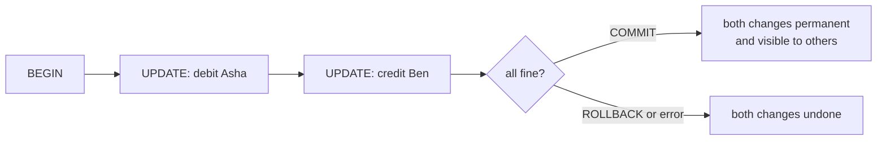
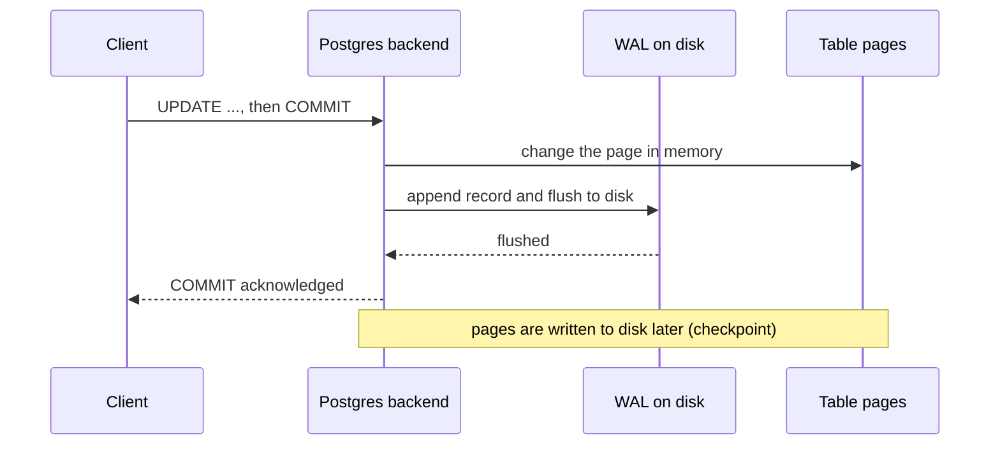

# Transactions and ACID

After this you can group statements into a transaction, predict what `COMMIT`, `ROLLBACK` and an error do to them, and explain what each letter of ACID promises.

Before this: [creating and changing tables and data](../03-schema-design/02-creating-and-changing-tables-and-data.md) and [data types and constraints](../03-schema-design/01-data-types-and-constraints.md).

## The idea

Moving \$30 from Asha's account to Ben's takes two updates: subtract from one row, add to the other. If the server crashes between them, \$30 has vanished. A **transaction** groups statements so that either all of them take effect or none do, and other sessions never see the half-finished state.



Until `COMMIT`, the changes exist only for your session. In the diagram, every path ends at one of the two boxes on the right; there is no box for "only the debit happened".

## Key terms

A **transaction** is a sequence of statements that Postgres runs as one unit. **Autocommit** is the default in `psql` and most drivers: a statement outside `BEGIN` is its own transaction, committed as soon as it succeeds.

**ACID** names four guarantees. **Atomicity**: all of a transaction's changes happen or none do. **Consistency**: a committed transaction moves the database from one state that satisfies the constraints to another. **Isolation**: concurrent transactions don't see each other's unfinished work (the next lesson). **Durability**: once `COMMIT` returns, the changes survive a crash.

A **savepoint** is a named point inside a transaction that you can roll back to without abandoning the whole transaction.

## How it works

Four commands control a transaction: `BEGIN` (or `START TRANSACTION`) opens it, `COMMIT` makes it permanent, `ROLLBACK` discards it, and `SAVEPOINT name` with `ROLLBACK TO name` marks and undoes part of it.

**Atomicity** is implemented with row versions: an update writes a new version of the row that other sessions ignore until the transaction commits (the isolation lesson<!-- link: 04-isolation-locking-and-mvcc.md --> shows how). Rolling back just leaves that version invisible; nothing needs to be undone on disk.

**Consistency** is the database's part and yours. Constraints (`CHECK`, `NOT NULL`, foreign keys, `UNIQUE`) are checked on every statement, and a violation aborts the statement and, in a transaction, the whole block. Business rules the constraints don't express, such as "the totals must add up", are your job.

**Durability** comes from the write-ahead log (WAL). Before a commit is acknowledged, Postgres writes a record of the change to the WAL and flushes it to disk. The table's own pages can be written later; after a crash, Postgres replays the WAL to rebuild them.



The acknowledgement waits for the flush step only. That is why a commit is fast even though the data files change later. The setting `synchronous_commit` (on by default) controls whether the server waits for that flush; turning it off trades a few recent commits after a crash for speed.

## Worked examples

<div class="example" markdown>

### Example 1: a transfer, rolled back

We create two accounts, with a `CHECK` that a balance can't go below zero. The `COMMIT` after the inserts matters only in this runner, which wraps a whole block in one transaction; in your own session you would not need it.

<div class="sql-runner" data-db="shop" markdown>

```sql
DROP TABLE IF EXISTS accounts;
CREATE TABLE accounts (
  id int PRIMARY KEY,
  owner text,
  balance numeric NOT NULL CHECK (balance >= 0)
);
INSERT INTO accounts VALUES (1, 'Asha', 100), (2, 'Ben', 50);
COMMIT;
BEGIN;
UPDATE accounts SET balance = balance - 30 WHERE id = 1;
UPDATE accounts SET balance = balance + 30 WHERE id = 2;
SELECT id, balance FROM accounts ORDER BY id;
ROLLBACK;
SELECT id, balance FROM accounts ORDER BY id;
```

</div>

1. Inside the transaction both updates are applied. The `SELECT` before `ROLLBACK` sees Asha at 70 and Ben at 80.
2. `ROLLBACK` discards both. The final `SELECT` shows the original balances.
3. Replace `ROLLBACK` with `COMMIT` and the final `SELECT` shows 70 and 80, now permanent.

Check: the runner shows only the last `SELECT`, which is `1 | 100` and `2 | 50`.

```text
 id | balance
----+---------
  1 |     100
  2 |      50
```

</div>

<div class="example" markdown>

### Example 2: an error aborts the whole transaction

Now the debit is more than Asha has. The `CHECK` constraint rejects it:

<!-- sql: expect-error -->
<div class="sql-runner" data-db="shop" markdown>

```sql
DROP TABLE IF EXISTS accounts;
CREATE TABLE accounts (
  id int PRIMARY KEY,
  owner text,
  balance numeric NOT NULL CHECK (balance >= 0)
);
INSERT INTO accounts VALUES (1, 'Asha', 100), (2, 'Ben', 50);
COMMIT;
BEGIN;
UPDATE accounts SET balance = balance + 500 WHERE id = 2;
UPDATE accounts SET balance = balance - 500 WHERE id = 1;
COMMIT;
```

</div>

```text
ERROR:  new row for relation "accounts" violates check constraint "accounts_balance_check"
```

In `psql`, after this error the transaction is in an aborted state: every later command fails with `current transaction is aborted, commands ignored until end of transaction block` until you `ROLLBACK`. Ben's credit of 500 was applied first, but it is rolled back with the rest, so no money appears from nowhere. A **savepoint** lets you recover from one failed step and keep the earlier ones:

<div class="sql-runner" data-db="shop" markdown>

```sql
DROP TABLE IF EXISTS accounts;
CREATE TABLE accounts (
  id int PRIMARY KEY,
  owner text,
  balance numeric NOT NULL CHECK (balance >= 0)
);
INSERT INTO accounts VALUES (1, 'Asha', 100), (2, 'Ben', 50);
COMMIT;
BEGIN;
UPDATE accounts SET balance = balance + 30 WHERE id = 2;
SAVEPOINT debit;
UPDATE accounts SET balance = 0 WHERE id = 1;
ROLLBACK TO SAVEPOINT debit;
COMMIT;
SELECT id, balance FROM accounts ORDER BY id;
```

</div>

```text
 id | balance
----+---------
  1 |     100
  2 |      80
```

The credit to Ben survived (80), and the zeroing of Asha's balance was undone by `ROLLBACK TO SAVEPOINT`.

</div>

## Common mistakes

<div class="warning" markdown>

Watch out: forgetting `COMMIT`. A session with an open `BEGIN` holds its changes private and keeps locks and old row versions alive. An idle-in-transaction connection can block other sessions and stop `VACUUM` from cleaning up. In app code, use the driver's transaction block so commit or rollback always happens.

</div>

<div class="warning" markdown>

Watch out: believing a transaction makes a read-modify-write safe. Reading a balance into your app, adding to it and writing it back inside a transaction can still lose another session's update. Isolation and locking, next, explain when.

</div>

<div class="warning" markdown>

Watch out: doing slow work inside a transaction, such as an HTTP call. The transaction stays open for the duration, holding locks. Do the slow work first, then open the transaction for the quick writes.

</div>

## Working with AI

<div class="ai" markdown>

Words to use: transaction, atomicity, rollback, savepoint, autocommit, constraint, write-ahead log (WAL), durability.

Prompts to try:

- "PostgreSQL 18, Node.js `pg` driver. Write a money transfer between two accounts in one transaction with `BEGIN`, `COMMIT` and a `ROLLBACK` in the error path. Release the client in `finally`."
- "Explain what happens to my data if the server loses power between `COMMIT` and the next checkpoint, in terms of the WAL."

What to check:

- That every code path ends in `COMMIT` or `ROLLBACK`, including the error path. Search the generated code for the rollback.
- That the transaction uses one connection throughout. With a connection pool, running `BEGIN` on one client and the updates on another silently runs the updates in autocommit.
- Claims that `ROLLBACK` can undo `CREATE SEQUENCE` values or `nextval()` calls. It can't; sequence values are consumed even if you roll back.

</div>

## Quiz

1\. What does autocommit mean?

<details class="solution" markdown>
<summary>Answer</summary>

A statement outside an explicit `BEGIN` is its own transaction and is committed as soon as it succeeds. There is no way to roll it back afterwards.

</details>

2\. Asha has 100 and Ben has 50. Inside a transaction we subtract 30 from Asha, add 30 to Ben, then run `ROLLBACK`. What are the balances?

<details class="solution" markdown>
<summary>Answer</summary>

100 and 50. Both updates are discarded together.

</details>

3\. A transaction runs five statements and the fourth fails. In `psql`, what happens to statement five, and to statements one to three?

<details class="solution" markdown>
<summary>Answer</summary>

Statement five is rejected ("current transaction is aborted") until you roll back. Statements one to three are undone when you `ROLLBACK`, unless you had set a savepoint after them and roll back only to it.

</details>

4\. Why can Postgres acknowledge a commit before the table pages are written to disk?

<details class="solution" markdown>
<summary>Answer</summary>

The change is already in the flushed write-ahead log. After a crash, replaying the WAL reconstructs the pages, so the commit is durable.

</details>

## Lab

<div class="lab" markdown>

### Lab: a transfer that must not lose money

Goal: write a transfer that is atomic and survives a failed step. Time: about 10 minutes. Runs in: the browser.

1. Use the accounts table from Example 1 (the runner recreates it).
2. Write a transaction that moves 60 from Asha (100) to Ben (50), then moves another 60 from Asha to Ben, and ends with `COMMIT`. It will fail on the second debit.
3. Note the error. Then change the block so the second move sits behind a savepoint and is undone with `ROLLBACK TO`. What are the final balances?

Expected result: step 2 fails with the `CHECK` error, and no money moves. In step 3 the balances end at Asha 40 and Ben 110.

<div class="sql-runner" data-db="shop" markdown>

```sql
DROP TABLE IF EXISTS accounts;
CREATE TABLE accounts (
  id int PRIMARY KEY,
  owner text,
  balance numeric NOT NULL CHECK (balance >= 0)
);
INSERT INTO accounts VALUES (1, 'Asha', 100), (2, 'Ben', 50);
COMMIT;
-- write your transaction here
SELECT id, balance FROM accounts ORDER BY id;
```

</div>

<details class="solution" markdown>
<summary>Solution</summary>

<!-- db: shop -->
```sql
DROP TABLE IF EXISTS accounts;
CREATE TABLE accounts (
  id int PRIMARY KEY,
  owner text,
  balance numeric NOT NULL CHECK (balance >= 0)
);
INSERT INTO accounts VALUES (1, 'Asha', 100), (2, 'Ben', 50);
COMMIT;
BEGIN;
UPDATE accounts SET balance = balance - 60 WHERE id = 1;
UPDATE accounts SET balance = balance + 60 WHERE id = 2;
SAVEPOINT second;
UPDATE accounts SET balance = balance - 40 WHERE id = 1;
ROLLBACK TO SAVEPOINT second;
COMMIT;
SELECT id, balance FROM accounts ORDER BY id;
```

The runner stops at the first error, so this version undoes the second move by choice. In a real `psql` session a failing statement after the savepoint can be undone the same way, and the first move still commits.

</details>

</div>

## Where this shows up

- Every payment, order or inventory write in an app is a transaction; see SQL from code<!-- link: ../05-databases-in-apps/01-sql-from-code-and-sql-injection.md -->.
- Next: [isolation, locking and MVCC](04-isolation-locking-and-mvcc.md) covers what other sessions see while your transaction is open.
