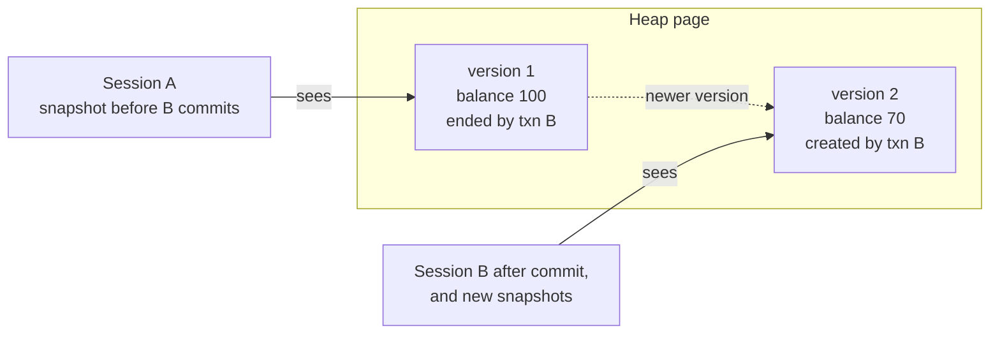

# Isolation, locking and MVCC

After this you can name the concurrency anomalies, say which Postgres isolation level prevents each, use `SELECT ... FOR UPDATE` to avoid a lost update, and explain how row versions let readers and writers work at the same time.

Before this: [transactions and ACID](03-transactions-and-acid.md).

## The idea

A real database has many sessions at once. Two people buy the last ticket, two jobs update the same balance, a report runs while orders arrive. **Isolation** is the I in ACID: each transaction should behave as if it ran alone, even though it doesn't. Perfect isolation is expensive, so SQL defines weaker levels, each allowing some **anomalies** (surprising results from interleaving).

Postgres avoids most locking for reads by keeping several versions of each row. This is **MVCC** (multiversion concurrency control). An `UPDATE` doesn't overwrite a row; it writes a new version and marks the old one as ended by that transaction. Each query sees the versions that were committed when its snapshot was taken.



In the diagram, both sessions read the same row without waiting for each other: A reads version 1, later snapshots read version 2. Readers don't block writers, and writers don't block readers.

## Key terms

A **snapshot** is the set of transactions whose changes a query can see. A **row lock** is held by a transaction that has updated or deleted a row, or asked for it with `SELECT ... FOR UPDATE`; other writers to that row wait. A **deadlock** is a cycle of sessions each waiting for a lock another holds. **VACUUM** removes row versions that no snapshot can see any more.

## How it works

The anomalies, as sequences of two sessions. Time runs downward.

A **dirty read** sees another transaction's uncommitted change. Postgres never allows it at any level.

A **non-repeatable read** returns different values for the same row inside one transaction, because another transaction committed in between:

```text
Session A                       Session B
BEGIN;
SELECT balance ... -> 100
                                BEGIN; UPDATE ... SET balance = 70; COMMIT;
SELECT balance ... -> 70        (READ COMMITTED: new value)
                                (REPEATABLE READ: still 100)
```

A **phantom** is the same with a set of rows: a second `SELECT ... WHERE status = 'pending'` finds a row that another transaction inserted and committed. In Postgres, `REPEATABLE READ` prevents phantoms too, although the SQL standard allows them there.

A **lost update** happens when two sessions read a value, compute a new one in the application, and write it back. The second write overwrites the first:

```text
Session A                          Session B
SELECT balance -> 100              SELECT balance -> 100
UPDATE SET balance = 130 (100+30)
COMMIT;
                                   UPDATE SET balance = 120 (100+20)
                                   COMMIT;        -- A's +30 is gone, final 120
```

A **write skew** is the subtle one: two transactions each read an overlapping set of rows, then each write a different row, and the combination breaks a rule neither checked alone. Example: a rule says at least one doctor must stay on call. Two doctors both read "2 on call", each sets themselves off call, and zero remain. No single row was updated twice, so row locks don't stop it.

Which level prevents what, in Postgres (from [the Postgres documentation, section 13.2](https://www.postgresql.org/docs/current/transaction-iso.html), as of 2026):

| Level | Dirty read | Non-repeatable read | Phantom | Lost update | Write skew |
|---|---|---|---|---|---|
| `READ COMMITTED` (default) | no | possible | possible | possible | possible |
| `REPEATABLE READ` | no | no | no | no (error) | possible |
| `SERIALIZABLE` | no | no | no | no (error) | no (error) |

`READ UNCOMMITTED` is accepted but behaves like `READ COMMITTED`. At `REPEATABLE READ` and `SERIALIZABLE`, Postgres resolves a conflict by aborting one transaction with `ERROR: could not serialize access due to concurrent update` (or `... due to read/write dependencies among transactions`), SQLSTATE `40001`. Your code must be ready to retry the whole transaction.

You can check the defaults in the box:

<div class="sql-runner" data-db="shop" markdown>

```sql
SELECT current_setting('transaction_isolation') AS isolation,
       current_setting('deadlock_timeout') AS deadlock_timeout;
```

</div>

```text
 isolation      | deadlock_timeout
----------------+------------------
 read committed | 1s
```

### Fixing a lost update

In `READ COMMITTED` there are three fixes, from simplest to heaviest. First, do the arithmetic in the `UPDATE`: `SET balance = balance + 30`. If the row is locked by a concurrent update, Postgres waits, then re-reads the new version and re-evaluates, so both additions count. Second, lock the row before reading it, so the second session waits until the first commits:

```sql
BEGIN;
SELECT balance FROM accounts WHERE id = 1 FOR UPDATE;
-- application computes the new balance
UPDATE accounts SET balance = 130 WHERE id = 1;
COMMIT;
```

Third, use `REPEATABLE READ` or `SERIALIZABLE` and retry on `40001`. `FOR UPDATE` row locks are held until the transaction ends; `FOR SHARE` lets others read-lock the row but not change it.

### Deadlocks

Session A updates row 1 and then wants row 2. Session B has already updated row 2 and now wants row 1. Neither can proceed:

```text
Session A                      Session B
UPDATE ... WHERE id = 1;       UPDATE ... WHERE id = 2;
UPDATE ... WHERE id = 2;       UPDATE ... WHERE id = 1;
 (waits for B)                  (waits for A)
```

After `deadlock_timeout` (1 second by default) Postgres detects the cycle and aborts one transaction with `ERROR: deadlock detected`. Avoid them by touching rows in the same order everywhere (for example by ascending id), and keep transactions short.

### Versions and VACUUM

The runner below makes MVCC visible. Every row has a hidden `ctid`, its physical location as (page, slot). Update Asha's row and it moves:

<div class="sql-runner" data-db="shop" markdown>

```sql
DROP TABLE IF EXISTS accounts;
CREATE TABLE accounts (id int PRIMARY KEY, owner text, balance numeric NOT NULL);
INSERT INTO accounts VALUES (1, 'Asha', 100), (2, 'Ben', 50);
COMMIT;
UPDATE accounts SET balance = 70 WHERE id = 1;
SELECT ctid, id, balance FROM accounts ORDER BY id;
```

</div>

```text
 ctid  | id | balance
-------+----+---------
 (0,3) |  1 |      70
 (0,2) |  2 |      50
```

Asha's row was at slot 1 of page 0; the update wrote a new version at slot 3 (slot 2 is Ben's row). The old version is still in the page but invisible to new snapshots. It is a **dead tuple** once no running transaction can need it. `VACUUM` reclaims that space, and updates the visibility map that index only scans use (the [indexes lesson](01-indexes.md)). Autovacuum runs it for you. A transaction left open for hours keeps old versions needed, so the table bloats; that is the cost of MVCC.

## Worked examples

<div class="example" markdown>

### Example 1: the doctors on call under each level

The table `oncall(doctor, on_call)` has Ana and Raj both on call. Each of two sessions runs:

```sql
BEGIN ISOLATION LEVEL REPEATABLE READ;
SELECT count(*) FROM oncall WHERE on_call;    -- both see 2
UPDATE oncall SET on_call = false WHERE doctor = 'Ana';   -- session A
-- UPDATE oncall SET on_call = false WHERE doctor = 'Raj'; -- session B
COMMIT;
```

1. Both sessions read 2 and decide leaving is safe.
2. They update different rows, so neither waits for the other.
3. Both commit and the table has zero doctors on call: write skew.
4. At `SERIALIZABLE` the second commit fails with `could not serialize access due to read/write dependencies among transactions`, and that session retries (and now reads 1, so it refuses).

Check: at `SERIALIZABLE` exactly one of the two commits succeeds. The WSL lab below lets you try a related case.

</div>

## Common mistakes

<div class="warning" markdown>

Watch out: read-modify-write in the application under `READ COMMITTED`. The code looks right and passes tests with one user. Move the arithmetic into SQL, add `FOR UPDATE`, or raise the isolation level and retry.

</div>

<div class="warning" markdown>

Watch out: raising isolation without a retry loop. `REPEATABLE READ` and `SERIALIZABLE` abort transactions on conflict by design. If the app shows that error to a user instead of retrying, you have traded wrong data for failed requests.

</div>

<div class="warning" markdown>

Watch out: believing `SELECT` takes locks that block writers. In Postgres, plain reads take no row locks. Only `FOR UPDATE`, `FOR SHARE` and similar clauses do.

</div>

## Working with AI

<div class="ai" markdown>

Words to use: isolation level, snapshot, MVCC, lost update, write skew, `SELECT ... FOR UPDATE`, deadlock, serialization failure, retry.

Prompts to try:

- "PostgreSQL 18, default isolation. Two workers each run: read stock, subtract 1 in Python, write back. Show the lost update as two interleaved sessions and fix it three ways."
- "My app gets `ERROR: could not serialize access due to concurrent update` (SQLSTATE 40001). Write a retry wrapper for the transaction with a limit and backoff."

What to check:

- That a proposed fix names the isolation level it assumes. `FOR UPDATE` in `REPEATABLE READ` can itself error out.
- That the retry covers the whole transaction, including the reads, not just the failed statement.
- Claims copied from other databases: "Postgres blocks readers while writing" is false, and dirty reads are not possible.
- Lock order in code that updates several rows. Check it is consistent to rule out deadlocks.

</div>

## Quiz

1\. What does MVCC let a long-running report do while orders are being updated?

<details class="solution" markdown>
<summary>Answer</summary>

It reads from its snapshot, seeing older row versions, without blocking the writers and without being blocked by them.

</details>

2\. Session A runs `SELECT balance` twice inside one transaction at `READ COMMITTED`. Session B commits a change between the two. What does A see?

<details class="solution" markdown>
<summary>Answer</summary>

The second `SELECT` returns the new value (a non-repeatable read). At `REPEATABLE READ` it would return the old value both times.

</details>

3\. A page does `SELECT stock`, then `UPDATE ... SET stock = 4` computed in Python. Two users sometimes oversell. Give two fixes.

<details class="solution" markdown>
<summary>Answer</summary>

Use `UPDATE ... SET stock = stock - 1 WHERE stock > 0` so the arithmetic is atomic in SQL, or read with `SELECT ... FOR UPDATE` so the second session waits. Raising the level to `REPEATABLE READ` with a retry also works.

</details>

4\. Why does a table with many updates grow, and what cleans it?

<details class="solution" markdown>
<summary>Answer</summary>

Each update leaves the old row version in place until no snapshot can see it. `VACUUM` (usually autovacuum) removes those dead versions so the space can be reused.

</details>

## Lab

<div class="lab" markdown>

### Lab: two terminals, one lost update

Goal: reproduce a lost update with two `psql` sessions, then stop it. Time: about 20 minutes. Runs in: WSL (Ubuntu), with Postgres installed as in [Postgres and psql](../01-database-basics/03-postgres-and-psql.md). These steps were not run here; they follow the [Postgres documentation on transaction isolation](https://www.postgresql.org/docs/current/transaction-iso.html) and `psql` behaviour and are unverified.

1. In a first terminal, create the database and table, then keep this `psql` session open as session A.

    ```bash
    createdb lab
    psql lab
    ```

    ```sql
    CREATE TABLE accounts (id int PRIMARY KEY, balance numeric NOT NULL);
    INSERT INTO accounts VALUES (1, 100);
    ```

2. Open a second terminal and run `psql lab` as session B.
3. Lost update. In A: `BEGIN; SELECT balance FROM accounts WHERE id = 1;` (100). In B: the same two statements (100). In A: `UPDATE accounts SET balance = 130 WHERE id = 1; COMMIT;`. In B: `UPDATE accounts SET balance = 120 WHERE id = 1; COMMIT;`. Run `SELECT balance FROM accounts;` and note the result.
4. Reset with `UPDATE accounts SET balance = 100;`. Repeat step 3, but start both transactions with `SELECT ... FOR UPDATE`. In B, the `SELECT` waits until A commits and then returns 130; B then writes 150.
5. Reset again and repeat step 3 with `BEGIN ISOLATION LEVEL REPEATABLE READ;` in both. B's `UPDATE` should fail.
6. Cleanup: leave both sessions with `\q`, then run `dropdb lab`.

Expected result: step 3 ends with 120 (A's +30 lost). Step 4 ends with 150 when each session adds to the value it reads. Step 5 shows:

```text
ERROR:  could not serialize access due to concurrent update
```

<details class="solution" markdown>
<summary>Solution</summary>

Step 3 loses the update because both sessions read 100 before either wrote. In step 4, `FOR UPDATE` takes the row lock at read time, so B's read happens after A's commit and sees 130. In step 5, B's snapshot was taken before A committed, so B's attempt to update a row that changed after its snapshot is rejected; the application would roll back and retry the whole transaction.

</details>

</div>

## Where this shows up

- Payment, booking and inventory code retries on `40001` and `40P01` (deadlock detected); see [SQL from code](../05-databases-in-apps/01-sql-from-code-and-sql-injection.md).
- Connection poolers and replicas change what "the same session" means; see [backups, replication and pooling](08-backups-replication-and-pooling.md).
