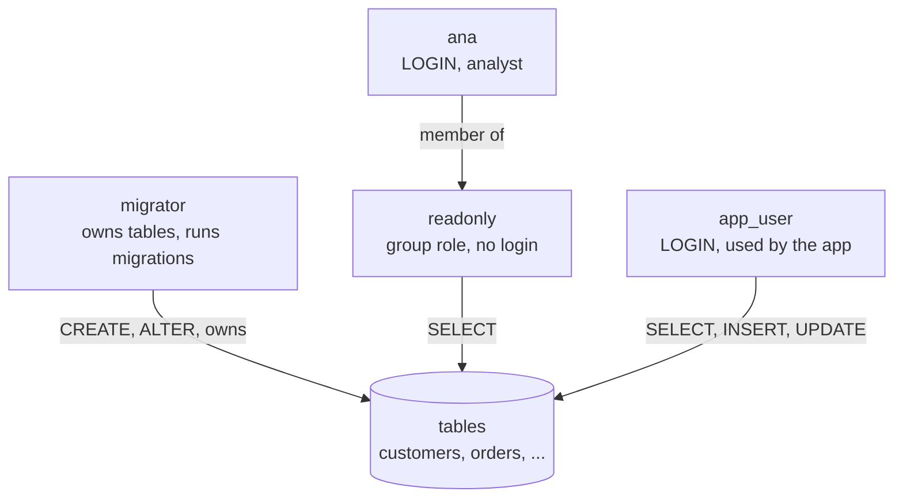
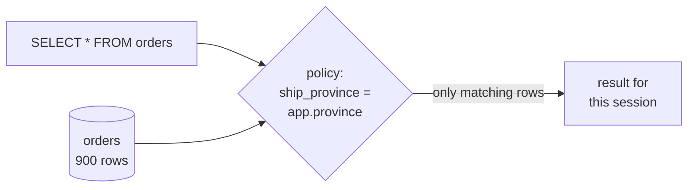

# Roles, privileges and row-level security

After this you can give each part of a system the least access it needs, using roles, GRANT and REVOKE, and restrict which rows a role sees with a row-level security policy.

Before this: [joins](../02-querying/04-joins.md) and [data types and constraints](../03-schema-design/01-data-types-and-constraints.md).

## The idea

Your web app connects to Postgres with a username and password. If that login is the owner of every table, then one SQL injection bug, one leaked password or one bad AI-written query can drop the whole schema. A reporting analyst needs to read orders, but not to delete them. A migration tool needs to change tables, but the running app does not.

Postgres handles all of this with **roles**, and then limits what each role can do with **privileges**. Row-level security goes one step further and limits which rows a role can see, so one table can serve many users.



In the diagram, `ana` has no privileges of her own. She is a member of `readonly`, so she gets what `readonly` gets. The app role can change rows but not the table definitions, and only the migrator owns the tables.

## Key terms

A **role** is a named holder of privileges. It can own objects, and other roles can be members of it. A **user** is the informal name for a role that has the `LOGIN` attribute, so it can open a connection. A **group role** is a role without `LOGIN` that exists only to hold privileges for its members.

A **privilege** is permission to do one kind of thing to one object, such as `SELECT` on a table or `USAGE` on a schema. `GRANT` adds a privilege and `REVOKE` removes it. A table's **owner** can do everything to it and can grant privileges to others.

**Least privilege** means each role gets only the privileges its job needs.

**Default privileges** (`ALTER DEFAULT PRIVILEGES`) say which grants apply automatically to objects created later, so new tables don't start out unreadable.

**Row-level security** (RLS) attaches a **policy** to a table: a boolean expression checked for every row. A role sees or changes only the rows where it is true.

## How it works

Privileges are checked in layers. A role needs `USAGE` on the schema to reach its tables, then the right privilege on the table, and optionally on single columns (`GRANT SELECT (id, city) ON customers`). Privileges are not inherited from the owner: a new role can do nothing until you grant something.

```sql
CREATE ROLE readonly;                         -- group role, no LOGIN
GRANT SELECT ON ALL TABLES IN SCHEMA public TO readonly;
CREATE ROLE ana LOGIN PASSWORD 'change-me';   -- a user
GRANT readonly TO ana;                        -- membership
```

Existing tables get the grant, but tables created tomorrow don't. `ALTER DEFAULT PRIVILEGES IN SCHEMA public GRANT SELECT ON TABLES TO readonly;` fixes that, for tables created later by the role that ran it.

For RLS, three steps: enable it on the table, write a policy with `USING` (which existing rows are visible) and optionally `WITH CHECK` (which new or changed rows are allowed), and make the policy depend on who is asking. Two common inputs are `current_user` (the connected role) and a setting your app stores per connection, read with `current_setting('app.name', true)`. Table owners and superusers skip RLS unless the table uses `FORCE ROW LEVEL SECURITY`, and superusers and roles with `BYPASSRLS` skip it regardless. Once RLS is on and no policy matches, a role sees zero rows, which fails safe.



The runner below is a single-user database, so we use `SET ROLE` to act as another role. A real app does the same by logging in as that role or by setting a per-request value.

<div class="sql-runner" data-db="shop" markdown>

```sql
CREATE ROLE readonly;
GRANT SELECT ON ALL TABLES IN SCHEMA public TO readonly;
CREATE ROLE ana LOGIN;
GRANT readonly TO ana;
SET ROLE ana;
SELECT current_user AS acting_as, count(*) AS orders_visible FROM orders;
```

</div>

## Worked examples

<div class="example" markdown>

### Example 1: a read-only role that really is read-only

Continue with the `ana` role from above. She can read, so check that she can't write.

1. The block creates the same two roles and switches to `ana`.
2. `DELETE FROM orders` needs the `DELETE` privilege, which `readonly` never received.
3. Postgres refuses with `permission denied for table orders` before it looks at any row.

<!-- sql: expect-error -->
<div class="sql-runner" data-db="shop" markdown>

```sql
CREATE ROLE readonly;
GRANT SELECT ON ALL TABLES IN SCHEMA public TO readonly;
CREATE ROLE ana LOGIN;
GRANT readonly TO ana;
SET ROLE ana;
DELETE FROM orders WHERE order_id = 1;
```

</div>

Check: change the last line to `SELECT count(*) FROM orders;` and the same session works. `has_table_privilege('ana', 'orders', 'DELETE')` returns `false` for the same reason.

</div>

<div class="example" markdown>

### Example 2: each session sees only its province

An app serving regional managers can set `app.province` for the connection after login. The policy compares each order's shipping province to that setting. `set_config(name, value, false)` stores the value for the session.

<div class="sql-runner" data-db="shop" markdown>

```sql
CREATE ROLE app_user LOGIN;
GRANT SELECT ON orders TO app_user;
ALTER TABLE orders ENABLE ROW LEVEL SECURITY;
CREATE POLICY province_only ON orders FOR SELECT
  USING (ship_province = current_setting('app.province', true));
SET ROLE app_user;
SELECT set_config('app.province', 'NL', false);
SELECT ship_province, count(*) AS orders FROM orders GROUP BY ship_province;
```

</div>

Only `NL` comes back, with 29 rows out of 900. Without the `set_config` line, `current_setting(..., true)` returns `NULL`, the comparison is never true and the query returns 0 rows.

</div>

Supabase builds its API security on exactly this. Requests arrive as the `anon` role (not signed in) or `authenticated` role (signed in), and policies use `auth.uid()`, which reads the user id from the login token, as in `USING ((select auth.uid()) = user_id)`. Tables in an exposed schema without RLS are readable and writable by those roles ([Supabase docs](https://supabase.com/docs/guides/database/postgres/row-level-security), as of 2026), so turn RLS on for every such table. The `service_role` key bypasses RLS and must stay on the server.

## Common mistakes

<div class="warning" markdown>

Watch out: running the app as the table owner or as a superuser. Owners and superusers skip RLS, and either can drop tables. Create a separate migrator role that owns the tables and an app role that doesn't, and test policies as the app role, not as `postgres`.

</div>

<div class="warning" markdown>

Watch out: enabling RLS and adding no policy. The table then returns zero rows to everyone but the owner, which looks like an empty table. Add policies for each command the role needs (`SELECT`, `INSERT`, `UPDATE`, `DELETE`), and add `WITH CHECK` so users can't insert rows they couldn't read.

</div>

<div class="warning" markdown>

Watch out: `GRANT ALL` and `PUBLIC`. Every role is a member of `PUBLIC`, so a grant to `PUBLIC` reaches everyone. Grant the specific privileges to a specific role, and read the result back with `\dp orders` in `psql`.

</div>

## Working with AI

<div class="ai" markdown>

Words to use: role, `LOGIN`, `GRANT`, `REVOKE`, least privilege, default privileges, row-level security, policy, `USING`, `WITH CHECK`.

Prompts to try:

- "I am on PostgreSQL 18. Write SQL for three roles on schema `public`: `migrator` owns the tables, `app_user` can SELECT, INSERT and UPDATE but not DELETE or change tables, and `analyst` can only SELECT. Include ALTER DEFAULT PRIVILEGES so new tables follow the same rules."
- "Here is my RLS policy: [paste]. Explain which rows each of `anon`, `authenticated` and the table owner can read and write, and whether `WITH CHECK` is missing."

What to check:

- Policies tested as the real app role. Run `SET ROLE app_user;` and count rows, because the owner and superusers bypass RLS.
- A `FOR ALL` policy with only `USING`, which lets users update a row to belong to someone else.
- `GRANT ... TO PUBLIC` or `GRANT ALL` that opens the table to every role.
- Missing `USAGE` on the schema or on sequences, which shows up as "permission denied" on inserts.

</div>

## Quiz

1\. What is the difference between a user and a group role in Postgres?

<details class="solution" markdown>
<summary>Answer</summary>

Both are roles. A user has the `LOGIN` attribute, so it can open a connection. A group role has no `LOGIN` and holds privileges that its member roles receive.

</details>

2\. An analyst role has `SELECT` on `orders`. What happens when it runs `UPDATE orders SET status = 'paid'`?

<details class="solution" markdown>
<summary>Answer</summary>

Postgres raises `permission denied for table orders`, and no row is changed, because `UPDATE` was never granted.

</details>

3\. You enable RLS on a table and the app role suddenly sees 0 rows, though the data is there. What is the most likely cause, and the fix?

<!-- db: shop -->
```sql
CREATE ROLE app_user LOGIN;
GRANT SELECT ON orders TO app_user;
ALTER TABLE orders ENABLE ROW LEVEL SECURITY;
SET ROLE app_user;
SELECT count(*) AS visible FROM orders;
```

<details class="solution" markdown>
<summary>Answer</summary>

RLS is on but no policy exists, so no row passes. The query returns 0. Add a policy such as `CREATE POLICY p ON orders FOR SELECT USING (...)`. The same happens when a policy compares to a setting that was never set.

</details>

4\. A table owner tests a new policy by querying as the owner and sees every row. Does the policy work?

<details class="solution" markdown>
<summary>Answer</summary>

Unknown. Owners skip RLS unless `FORCE ROW LEVEL SECURITY` is set, and superusers skip it always. Test with `SET ROLE` to the real app role.

</details>

## Lab

<div class="lab" markdown>

### Lab: lock down the shop database

Goal: create an analyst role that can read customers but not their email, then add a row-level policy by province. Time: about 15 minutes. Runs in: the browser.

1. Create a role `support` with `LOGIN`.
2. Grant `SELECT` only on the columns `customer_id`, `first_name`, `city` and `province` of `customers`.
3. Switch to `support` and check that `SELECT first_name, city FROM customers` works.
4. Enable RLS on `customers` and add a policy so `support` sees only rows where `province` equals `current_setting('app.province', true)`.
5. Set the province to `'NL'` for the session and return `province` and `count(*)`.

Expected result: one row, `NL` with its customer count.

<details class="solution" markdown>
<summary>Solution</summary>

<div class="sql-runner" data-db="shop" markdown>

```sql
CREATE ROLE support LOGIN;
GRANT SELECT (customer_id, first_name, city, province) ON customers TO support;
ALTER TABLE customers ENABLE ROW LEVEL SECURITY;
CREATE POLICY by_province ON customers FOR SELECT
  USING (province = current_setting('app.province', true));
SET ROLE support;
SELECT set_config('app.province', 'NL', false);
SELECT province, count(*) AS customers FROM customers GROUP BY province;
```

</div>

Selecting `email` as `support` fails with `permission denied for table customers`, because the column was never granted.

</details>

</div>

## Where this shows up

- Every managed Postgres (Supabase, RDS, Neon) gives you a superuser-like admin role plus a flow for creating restricted app roles.
- SQL injection<!-- link: ../05-databases-in-apps/01-sql-from-code-and-sql-injection.md --> does less damage when the app role can't drop tables.
- Views<!-- link: 06-views-functions-and-triggers.md --> are the other way to expose only part of a table.
