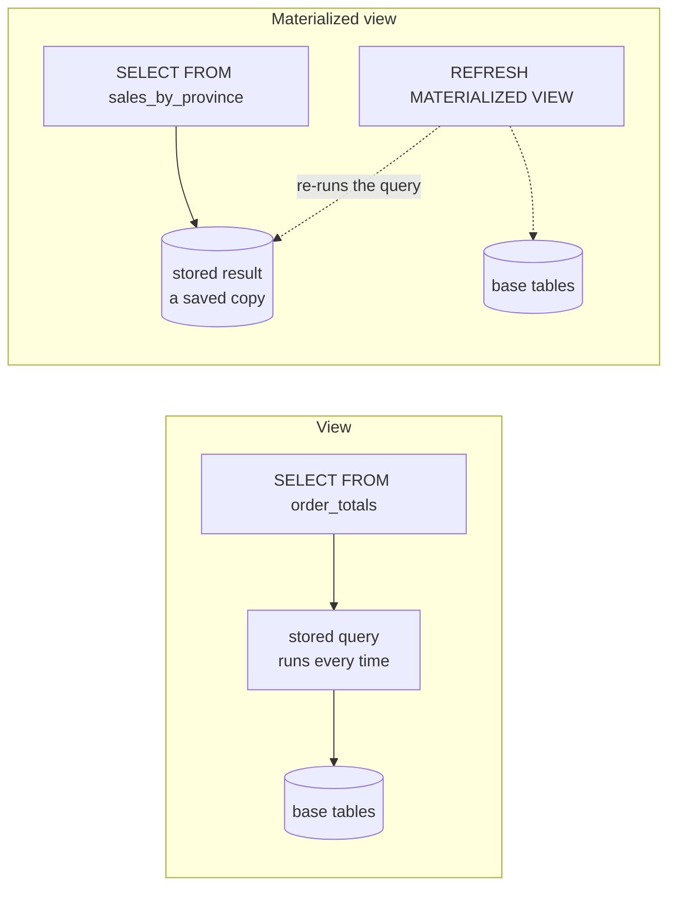
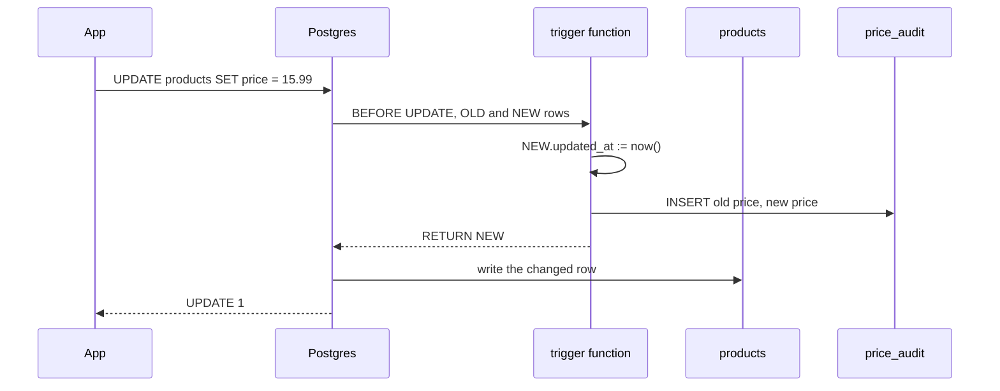

# Views, functions and triggers

After this you can name a query with a view, speed up a heavy report with a materialized view, write a small SQL or PL/pgSQL function, and use a trigger to keep an `updated_at` column and an audit table correct.

Before this: [joins](../02-querying/04-joins.md) and [creating and changing tables and data](../03-schema-design/02-creating-and-changing-tables-and-data.md).

## The idea

The same join of `orders` and `order_items` that computes an order total appears in the revenue report, the customer page and a nightly export. If the total rule changes, you fix it in three places and miss one. Postgres lets you put that query in the database under a name, and lets the database run small pieces of code at the right moment.



In the diagram, a view stores a query and a materialized view stores that query's result. The second kind reads fast but is only as fresh as its last refresh.

## Key terms

A **view** is a named, stored `SELECT`. Querying it runs the stored query against the current data. A view takes no space for rows, and it can hide columns or rows you don't want a role to see.

A view is **updatable** when it is a simple selection of one table (no `GROUP BY`, `DISTINCT` or joins). `INSERT` and `UPDATE` on it change the base table. `WITH CHECK OPTION` rejects changes that would make a row disappear from the view.

A **materialized view** stores the query result on disk like a table. `REFRESH MATERIALIZED VIEW` recomputes it. It is not updated automatically.

A **function** is named code you call inside a query. A **SQL function** has a body that is one or more SQL statements. A **PL/pgSQL function** uses Postgres's procedural language, with variables, `IF` and loops.

A **trigger** runs a function automatically before or after an `INSERT`, `UPDATE` or `DELETE`. A **row-level trigger** (`FOR EACH ROW`) runs once per affected row. Inside it, `NEW` is the row being written and `OLD` is the row it replaces.

## How it works

A view is defined once and used like a table:

```sql
CREATE VIEW order_totals AS
SELECT o.order_id, o.customer_id, o.status,
       sum(i.quantity * i.unit_price) AS total
FROM orders o JOIN order_items i USING (order_id)
GROUP BY o.order_id;
```

Every later `SELECT ... FROM order_totals` expands to that query, so the numbers are always current. Because a view is a query, a role can be granted `SELECT` on the view without any privilege on the base tables, which makes it a simple way to expose only some columns.

A SQL function is the shortest way to name a calculation. Mark it `IMMUTABLE` when the same inputs always give the same output, which lets Postgres reuse results:

```sql
CREATE FUNCTION price_with_tax(price numeric, rate numeric) RETURNS numeric
LANGUAGE sql IMMUTABLE AS $$ SELECT round(price * (1 + rate), 2) $$;
```

Use PL/pgSQL when you need logic that SQL alone can't express, and a trigger function is always PL/pgSQL because it must return a row. A trigger is two objects: a function that returns `trigger`, and a `CREATE TRIGGER` that says when to run it.



A `BEFORE` trigger can change `NEW` and must return it (returning `NULL` cancels the change). An `AFTER` trigger sees the final row and is the usual place for writing to other tables.

## Worked examples

<div class="example" markdown>

### Example 1: an audit trail with updated_at

We want every product price change recorded with the old and new value, and `updated_at` to move whenever any column changes. A trigger does both, so no application code can forget.

1. Add `updated_at` and create the `price_audit` table.
2. Write the trigger function. `NEW.updated_at := now()` stamps the row. The `IF` compares old and new price with `IS DISTINCT FROM`, which is safe when a value is `NULL`.
3. Attach it with `CREATE TRIGGER ... BEFORE UPDATE ... FOR EACH ROW`.
4. Change a price on product 1 and a stock level on product 2, then read the audit table.

<div class="sql-runner" data-db="shop" markdown>

```sql
ALTER TABLE products ADD COLUMN updated_at timestamptz NOT NULL DEFAULT '2020-01-01';
CREATE TABLE price_audit (
  audit_id    bigint GENERATED ALWAYS AS IDENTITY PRIMARY KEY,
  product_id  integer NOT NULL,
  old_price   numeric(10,2),
  new_price   numeric(10,2),
  changed_at  timestamptz NOT NULL DEFAULT now()
);
CREATE FUNCTION products_before_update() RETURNS trigger LANGUAGE plpgsql AS $$
BEGIN
  NEW.updated_at := now();
  IF NEW.price IS DISTINCT FROM OLD.price THEN
    INSERT INTO price_audit (product_id, old_price, new_price)
    VALUES (OLD.product_id, OLD.price, NEW.price);
  END IF;
  RETURN NEW;
END $$;
CREATE TRIGGER products_touch BEFORE UPDATE ON products
  FOR EACH ROW EXECUTE FUNCTION products_before_update();
UPDATE products SET price = price + 1 WHERE product_id = 1;
UPDATE products SET stock = stock - 1 WHERE product_id = 2;
SELECT product_id, old_price, new_price FROM price_audit;
```

</div>

The audit table holds one row: product 1, 14.99 to 15.99. The stock change on product 2 fired the trigger too, but the `IF` skipped the insert because the price did not change.

Check: run `SELECT product_id FROM products WHERE updated_at > '2020-01-01' ORDER BY product_id;` after the updates. It returns products 1 and 2 only.

</div>

<div class="example" markdown>

### Example 2: a materialized view goes stale

A materialized view of order counts is fast, but a new order does not appear until a refresh. The temporary table keeps the "before" number so one query can show both.

<div class="sql-runner" data-db="shop" markdown>

```sql
CREATE MATERIALIZED VIEW order_count AS SELECT count(*) AS n FROM orders;
INSERT INTO orders VALUES (9999, 1, 'paid', now(), 'ON');
CREATE TEMP TABLE before AS SELECT n FROM order_count;
REFRESH MATERIALIZED VIEW order_count;
SELECT (SELECT n FROM before) AS stale, n AS refreshed FROM order_count;
```

</div>

The stale value is 900 and the refreshed value is 901. In production you refresh on a schedule or after a load job. `REFRESH MATERIALIZED VIEW CONCURRENTLY` avoids blocking readers, but needs a unique index on the view.

</div>

## When logic belongs in the database

Put a rule in the database when many programs touch the same data and the rule must always hold: audit trails, `updated_at`, and constraints that `CHECK` can't express. Put it in the application when it changes often, needs tests with your normal tooling, calls other services, or is business logic that a new team member will look for in the code. Triggers are invisible to anyone reading only the app, and they run inside every write, so a slow trigger slows every insert. Keep them short and few.

## Common mistakes

<div class="warning" markdown>

Watch out: expecting a materialized view to stay current. It shows the data as of the last refresh. If a dashboard must be live, use a plain view or an index on the base tables, and say how old the data is where it is displayed.

</div>

<div class="warning" markdown>

Watch out: a `BEFORE` trigger that forgets `RETURN NEW`. Returning `NULL` silently cancels the write, so rows seem to vanish with no error. In an `AFTER` trigger the return value is ignored.

</div>

<div class="warning" markdown>

Watch out: a trigger that updates the same table it fires on. The change fires the trigger again, and an unbounded loop ends in a "stack depth limit exceeded" error. Change `NEW` in a `BEFORE` trigger instead of running a new `UPDATE`.

</div>

## Working with AI

<div class="ai" markdown>

Words to use: view, materialized view, `REFRESH`, PL/pgSQL, trigger function, `BEFORE`/`AFTER`, `NEW` and `OLD`, `IMMUTABLE`.

Prompts to try:

- "PostgreSQL 18. Write a BEFORE UPDATE row-level trigger on `products` that sets `updated_at` and writes old and new price to `price_audit` only when price changes. Return NEW and use IS DISTINCT FROM."
- "I have a slow GROUP BY report over 50 million rows. Should it be a view or a materialized view? Show the REFRESH ... CONCURRENTLY setup and what index it needs."

What to check:

- `RETURN NEW` (or `RETURN OLD` for `DELETE`) is present in every `BEFORE` trigger.
- The trigger fires at the right time: `BEFORE` to change the row, `AFTER` to write elsewhere.
- Updatable views have `WITH CHECK OPTION` if they filter rows.
- Business rules aren't hidden in triggers that the team doesn't know exist. List them with `SELECT tgname FROM pg_trigger WHERE NOT tgisinternal;`.

</div>

## Quiz

1\. What is the difference between a view and a materialized view?

<details class="solution" markdown>
<summary>Answer</summary>

A view stores only a query and runs it on every use, so it is always current. A materialized view stores the result and is only as fresh as its last `REFRESH`, but reads quickly.

</details>

2\. In an `UPDATE` trigger, what are `OLD` and `NEW`?

<details class="solution" markdown>
<summary>Answer</summary>

`OLD` is the row before the update and `NEW` is the row about to be written. A `BEFORE` trigger can change `NEW`.

</details>

3\. Predict the result: what does this return?

<!-- db: shop -->
```sql
CREATE VIEW ontario_customers AS
SELECT customer_id, first_name, province FROM customers
WHERE province = 'ON' WITH CHECK OPTION;
UPDATE ontario_customers SET first_name = 'Zed' WHERE customer_id = 2;
SELECT count(*) FROM customers WHERE first_name = 'Zed';
```

<details class="solution" markdown>
<summary>Answer</summary>

It returns 1. The view is updatable, so the `UPDATE` passes through to `customers`, and customer 2 lives in Ontario so the row is visible through the view. A customer from another province would be hidden by the view's `WHERE`, and changing `province` to `'QC'` through the view would fail because of `WITH CHECK OPTION`.

</details>

4\. A trigger function ends without `RETURN NEW`, and it is attached `BEFORE INSERT`. What goes wrong?

<details class="solution" markdown>
<summary>Answer</summary>

Postgres raises an error for a trigger function that reaches the end without returning; if it returns `NULL` instead, the insert is silently skipped. Always return `NEW`.

</details>

## Lab

<div class="lab" markdown>

### Lab: a revenue view and a stale copy

Goal: build a reusable view, copy it into a materialized view, and show that the copy goes stale. Time: about 15 minutes. Runs in: the browser.

1. Create a view `order_totals` with `order_id`, `ship_province` and `total` (the sum of `quantity * unit_price`).
2. Create a materialized view `province_revenue` that sums `total` by `ship_province`.
3. Insert an order item for order 1: `INSERT INTO order_items VALUES (99999, 1, 1, 1, 100)`.
4. Compare the revenue for `ON` in `province_revenue` and in a fresh query over `order_totals`.
5. Refresh and compare again.

Expected result: the `ON` row shows two numbers that differ by 100 before the refresh, and match after it (order 1 ships to `ON`).

<details class="solution" markdown>
<summary>Solution</summary>

<div class="sql-runner" data-db="shop" markdown>

```sql
CREATE VIEW order_totals AS
SELECT o.order_id, o.ship_province, sum(i.quantity * i.unit_price) AS total
FROM orders o JOIN order_items i USING (order_id)
GROUP BY o.order_id, o.ship_province;
CREATE MATERIALIZED VIEW province_revenue AS
SELECT ship_province, sum(total) AS revenue FROM order_totals GROUP BY ship_province;
INSERT INTO order_items VALUES (99999, 1, 1, 1, 100);
SELECT p.ship_province, p.revenue AS stale, v.live
FROM province_revenue p
JOIN (SELECT ship_province, sum(total) AS live FROM order_totals GROUP BY ship_province) v
  USING (ship_province)
ORDER BY p.ship_province;
```

</div>

The `stale` and `live` columns differ for the province that order 1 ships to. Add `REFRESH MATERIALIZED VIEW province_revenue;` before the final `SELECT` and they match.

</details>

</div>

## Where this shows up

- Analytics [models in dbt](../../11-data-engineering-and-data-science/01-data-engineering/07-dbt-and-sql-transformations.md) are views and materialized tables with a build tool on top.
- [ORM migrations](../05-databases-in-apps/02-orms-and-migrations.md) often create triggers for `updated_at`.
- Supabase uses triggers on `auth.users` to create a profile row for each new signup.
