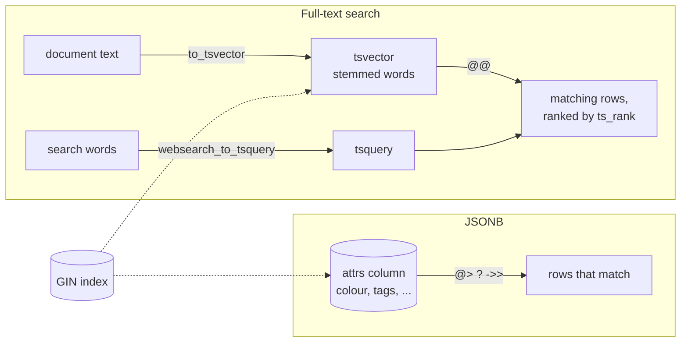

# JSONB and full-text search

After this you can store and query semi-structured data in a JSONB column, index it, and search text by words with `tsvector` and `tsquery` instead of `LIKE '%x%'`.

Before this: [data types and constraints](../03-schema-design/01-data-types-and-constraints.md) and [select, where and order by](../02-querying/01-select-where-and-order-by.md).

## The idea

Most columns are known in advance: a product has a name and a price. Some data isn't. One product has a colour and a screen size, another has a battery life and a list of certifications, and a third-party API sends you a payload you don't control. Adding a column for every possible field makes a wide table of mostly `NULL`.

Postgres has a column type for this, `jsonb`, which stores a JSON document and lets you query inside it. It also has a second feature for a different problem: finding rows whose text contains certain words, ranked by relevance. Both are served by the same kind of index, a GIN index.



## Key terms

**JSON** is a text format for nested objects, arrays, strings, numbers, booleans and `null`. The `json` type stores the text exactly as given. The `jsonb` type stores a parsed binary form: it drops insignificant whitespace, keeps the last value of a repeated key, does not keep key order, and supports indexes. Use `jsonb` unless you need the original text byte for byte.

The operator `->` returns a JSON value (and `->>` returns it as `text`), by key (`attrs->'colour'`) or by array position (`tags->0`). The operator `@>` tests **containment**: `a @> b` is true when `a` contains all of `b`. The operator `?` tests whether a key or array element exists at the top level.

A **GIN index** (generalized inverted index) maps each value or word to the rows that contain it, like the index at the back of a book. It is built for columns that hold many values per row.

A **tsvector** is a document reduced to a sorted list of normalized words (lexemes) with positions. A **tsquery** is a search expression such as `cable & usb`. The operator `@@` is true when the vector matches the query. **Stemming** reduces words to a root, so "jumped" and "jumps" both become "jump", and stop words such as "the" are dropped.

## How it works

JSONB first. The two JSON types differ in what they keep from the same input:

<div class="sql-runner" data-db="shop" markdown>

```sql
SELECT '{"b": 1, "a": 2, "a": 3}'::json  AS as_json,
       '{"b": 1, "a": 2, "a": 3}'::jsonb AS as_jsonb;
```

</div>

The `json` column keeps the text as written, including both `a` keys. The `jsonb` column returns `{"a": 3, "b": 1}`: one `a`, the last value, sorted.

To try the operators, we add an `attrs` column to `products` and fill it for the first six products with `jsonb_build_object`, which builds an object from key and value pairs, and `jsonb_build_array`.

<div class="sql-runner" data-db="shop" markdown>

```sql
ALTER TABLE products ADD COLUMN attrs jsonb NOT NULL DEFAULT '{}';
UPDATE products
SET attrs = jsonb_build_object('colour', 'black',
                               'wireless', name ILIKE '%wireless%',
                               'tags', jsonb_build_array(category, 'sale'))
WHERE product_id <= 6;
SELECT name, attrs->>'colour' AS colour, attrs->'tags'->>0 AS first_tag
FROM products
WHERE attrs @> '{"wireless": true}';
```

</div>

One row comes back, the Wireless Mouse. `attrs @> '{"wireless": true}'` is the form a GIN index can accelerate. A text comparison such as `attrs->>'wireless' = 'true'` finds the same row, but needs its own expression index.

```sql
CREATE INDEX products_attrs_gin ON products USING gin (attrs);
```

Full-text search turns text into a `tsvector` and the user's words into a `tsquery`. `websearch_to_tsquery` accepts plain input like a search box (`"wireless mouse"`, `-cheap`, `or`), so it is the safe choice for user text. Passing the configuration `'english'` selects stemming and stop words.

<div class="sql-runner" data-db="shop" markdown>

```sql
SELECT to_tsvector('english', 'The quick brown foxes jumped over the lazy dogs') AS doc,
       websearch_to_tsquery('english', 'fox jumping') AS q,
       to_tsvector('english', 'The quick brown foxes jumped') @@
         websearch_to_tsquery('english', 'fox jumping') AS matches;
```

</div>

The document becomes `'brown':3 'dog':9 'fox':4 'jump':5 'lazi':8 'quick':2`, and the query `'fox' & 'jump'` matches even though neither "fox" nor "jumping" appears in the text.

## Worked examples

<div class="example" markdown>

### Example 1: search products by word, ranked, with an index

`LIKE '%able%'` finds the characters anywhere, so it matches "Portable SSD 1TB" when you wanted cables, and it cannot use a normal B-tree index because of the leading `%`. Full-text search matches whole words.

1. Add a generated `tsvector` column built from the name and category. `STORED` keeps it in sync on every write.
2. Create a GIN index on it.
3. Search with `@@` and order by `ts_rank`, which scores how well a document matches (higher is better).

<div class="sql-runner" data-db="shop" markdown>

```sql
ALTER TABLE products ADD COLUMN search tsvector
  GENERATED ALWAYS AS (to_tsvector('english', name || ' ' || category)) STORED;
CREATE INDEX products_search_idx ON products USING gin (search);
SELECT name, round(ts_rank(search, q)::numeric, 4) AS rank
FROM products, websearch_to_tsquery('english', 'cable') AS q
WHERE search @@ q
ORDER BY rank DESC, name;
```

</div>

One product matches: USB-C Cable 2m. Check: `SELECT count(*) FROM products WHERE name LIKE '%able%'` returns 2, because it also matches "Portable SSD 1TB".

</div>

## Choosing JSONB or columns

Use columns for fields that every row has, that you filter or join on, or that need a constraint, a foreign key or a type check. Use JSONB for data whose shape varies by row or comes from outside (webhook payloads, user preferences, product attributes by category). A common design is both: real columns for the core fields and one JSONB column for the rest. If you query the same JSON key in every report, it wants to become a column.

For text search, Postgres full-text search is enough for a product catalogue or help articles on one database. A dedicated search engine is a separate system to run, so it is justified when you need typo tolerance, facets or search over very large text.

## Common mistakes

<div class="warning" markdown>

Watch out: `->` returns JSON and `->>` returns text. `WHERE attrs->'colour' = 'black'` compares a JSON value with a text literal and fails or never matches. Use `->>` for text comparison, or `@>`.

</div>

<div class="warning" markdown>

Watch out: a full-text query whose configuration differs from the index. `to_tsvector('english', col)` in the index and `to_tsvector(col)` in the query use different configurations, so the planner can't use the index. Use the same two-argument form everywhere, or a generated column as above.

</div>

<div class="warning" markdown>

Watch out: putting everything in one JSONB column. You lose type checks, foreign keys and simple statistics, and every query needs casts like `(attrs->>'price')::numeric`. Keep the stable fields as columns.

</div>

## Working with AI

<div class="ai" markdown>

Words to use: `jsonb`, containment `@>`, `->>`, GIN index, `tsvector`, `tsquery`, `websearch_to_tsquery`, `ts_rank`, stemming.

Prompts to try:

- "PostgreSQL 18. My `events` table has a `payload jsonb` column. Write a query for rows where payload has key `plan` equal to `pro`, in a form a GIN index can use, and the CREATE INDEX statement."
- "I search articles with `title ILIKE '%' || $1 || '%'` and it is slow on 2 million rows. Convert it to full-text search with a generated tsvector column, a GIN index and ts_rank ordering."

What to check:

- Operators: `->` vs `->>`, and that casts are applied before comparing numbers (`(x->>'n')::int`).
- That the query form matches the index. Run `EXPLAIN` and look for a `Bitmap Index Scan` on the GIN index, not a `Seq Scan`.
- That the search configuration (`'english'`) is the same in the index and the query.
- That `to_tsquery` isn't fed raw user input, which can raise a syntax error. `websearch_to_tsquery` accepts any text.

</div>

## Quiz

1\. Name two differences between `json` and `jsonb`.

<details class="solution" markdown>
<summary>Answer</summary>

`json` keeps the exact input text (whitespace, duplicate keys, key order). `jsonb` stores a parsed form that drops duplicates and ordering, and it supports GIN indexes and containment queries.

</details>

2\. What does this return?

<!-- db: shop -->
```sql
SELECT '{"a": 1, "b": {"c": 2}}'::jsonb @> '{"b": {"c": 2}}' AS contains,
       '{"a": 1, "b": {"c": 2}}'::jsonb ? 'c' AS has_c;
```

<details class="solution" markdown>
<summary>Answer</summary>

`contains` is `true` because the nested object matches. `has_c` is `false`, because `?` checks only top-level keys and `c` is nested inside `b`.

</details>

3\. A search for `LIKE '%mouse%'` is slow on a big table. Why, and what would you try?

<details class="solution" markdown>
<summary>Answer</summary>

The leading `%` means a B-tree index can't narrow the search, so Postgres reads every row. For whole-word search, use a `tsvector` column with a GIN index and `@@`. For substring search, a trigram (`pg_trgm`) GIN index is the tool, which this lesson doesn't cover.

</details>

4\. Write the query for products whose `search` text matches `speaker or monitor`. (Add the search column first.)

<!-- db: shop -->
```sql
ALTER TABLE products ADD COLUMN search tsvector
  GENERATED ALWAYS AS (to_tsvector('english', name)) STORED;
SELECT name FROM products
WHERE search @@ websearch_to_tsquery('english', 'speaker or monitor')
ORDER BY name;
```

<details class="solution" markdown>
<summary>Answer</summary>

The query above returns Bluetooth Speaker and 27in Monitor. `or` inside `websearch_to_tsquery` becomes the `|` operator.

</details>

## Lab

<div class="lab" markdown>

### Lab: tag products and search them

Goal: query a JSONB tag list, then rank a text search. Time: about 15 minutes. Runs in: the browser.

1. Add `attrs jsonb` to `products` and set `attrs = '{"tags": ["usb", "cable"]}'` for product 1 and `'{"tags": ["wireless", "mouse"]}'` for product 2.
2. Return names of products whose tags contain `"wireless"`, using `@>`.
3. Add a generated `tsvector` column on `name`, a GIN index, and return names matching `headphones` ranked by `ts_rank`.

Expected result: Wireless Mouse for step 2, and Noise-Cancelling Headphones for step 3.

<details class="solution" markdown>
<summary>Solution</summary>

<div class="sql-runner" data-db="shop" markdown>

```sql
ALTER TABLE products ADD COLUMN attrs jsonb;
UPDATE products SET attrs = '{"tags": ["usb", "cable"]}' WHERE product_id = 1;
UPDATE products SET attrs = '{"tags": ["wireless", "mouse"]}' WHERE product_id = 2;
ALTER TABLE products ADD COLUMN search tsvector
  GENERATED ALWAYS AS (to_tsvector('english', name)) STORED;
CREATE INDEX products_search_idx ON products USING gin (search);
SELECT 'jsonb' AS step, name FROM products WHERE attrs @> '{"tags": ["wireless"]}'
UNION ALL
SELECT 'text', name FROM products
WHERE search @@ websearch_to_tsquery('english', 'headphones');
```

</div>

</details>

</div>

## Where this shows up

- ORMs and APIs store settings and webhook payloads as JSONB, and Supabase returns rows as JSON.
- Query plans<!-- link: 02-explain-and-query-plans.md --> show whether a GIN index was used.
- [NoSQL databases](../05-databases-in-apps/03-nosql-databases.md) make the document model the default instead of one column.
