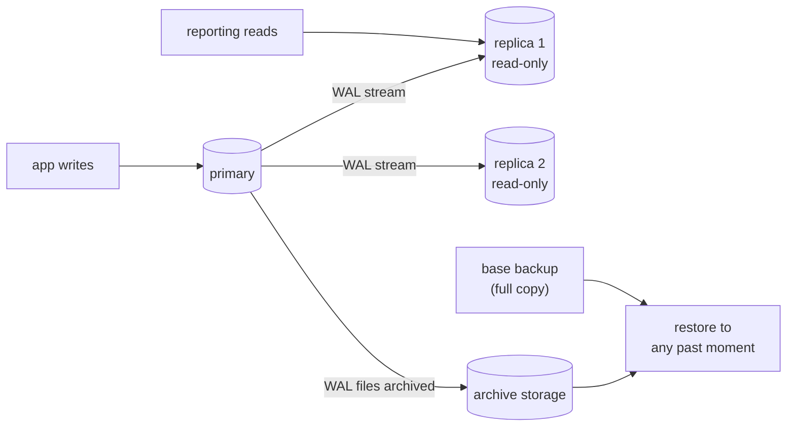
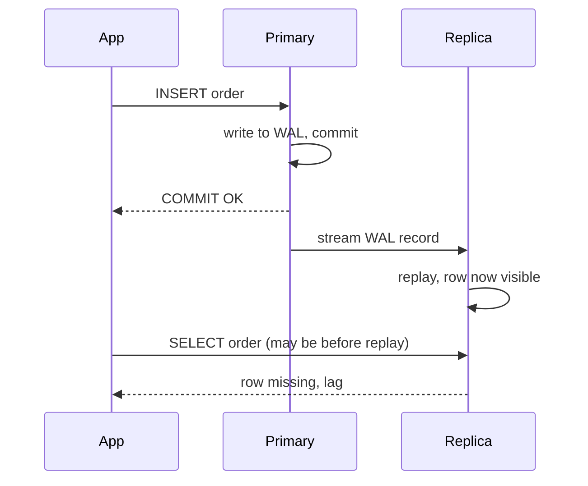
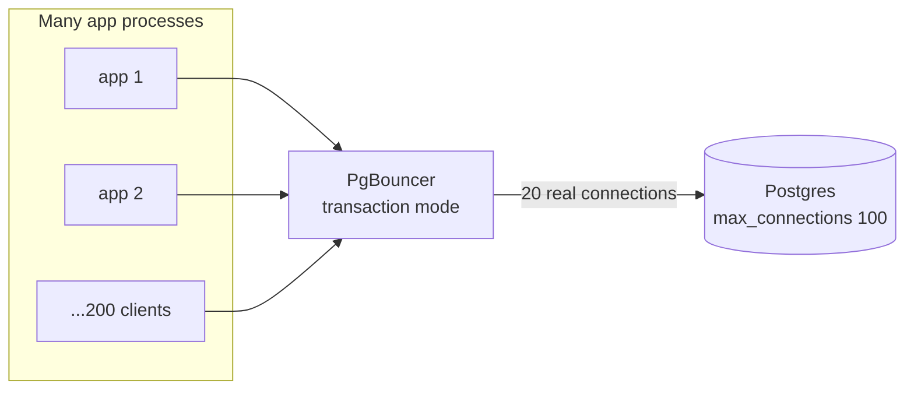

# Backups, replication and pooling

After this you can explain how Postgres data is backed up and restored, what a read replica is and why it lags, and why a busy app puts a connection pooler such as PgBouncer in front of the database.

Before this: [transactions and ACID](03-transactions-and-acid.md) and [roles, privileges and row-level security](05-roles-privileges-and-row-level-security.md).

## The idea

Three things go wrong with a production database. The data is lost or damaged (a bad deploy runs `DELETE` without `WHERE`, a disk fails). The one machine holding the data becomes the bottleneck, or goes down. And the app opens so many connections that the database spends its memory on connections instead of queries. Each problem has a standard Postgres answer: backups, replication and a connection pooler.

Most of this is done for you on a managed service (RDS, Supabase, Neon, Cloud SQL). You still need to know the words, because the settings page uses them, and because a backup you have never restored is not yet a backup.



In the diagram, every change goes first to the primary. Replicas receive the same change stream, the archive keeps it for recovery, and a periodic full copy gives recovery a starting point.

## Key terms

The **write-ahead log** (WAL) is the sequential log where Postgres records every change before it changes the table files, so a crash can be repaired by replaying the log. Backups and replication both reuse it.

A **logical backup** (`pg_dump`) is a file of SQL statements or rows that recreates the data. It is portable between versions and lets you restore one table, but it is slow on large databases. A **physical backup** (`pg_basebackup`) copies the database's files, and is fast to restore but only fits the same major version.

**Point-in-time recovery** (PITR) restores a physical base backup, then replays archived WAL up to a chosen moment, such as one minute before the bad `DELETE`.

**Streaming replication** keeps a second server (a **replica**, also called standby) up to date by sending it the primary's WAL as it is written. A replica can serve read-only queries, which is a **read replica**. **Replication lag** is how far behind the primary the replica is.

**Logical replication** sends row changes for chosen tables, via a publication and a subscription, so the target can be a different version or hold only some tables.

A **connection pooler** is a proxy that holds a small set of real database connections and shares them among many client connections.

## How it works

### Backups

A logical backup is one command, and a restore is another. In WSL (Ubuntu), these commands are not run in this book's browser database:

```bash
pg_dump --format=custom --file=shop.dump shop
pg_restore --dbname=shop_copy --clean --if-exists shop.dump
```

The custom format is compressed and lets `pg_restore` choose tables and run in parallel; plain SQL output is restored with `psql`. Restoring into a scratch database and checking row counts is the test that matters.

For PITR, you turn on WAL archiving (`archive_mode`, `archive_command`) so each finished WAL segment is copied to safe storage, take a base backup, and to recover you restore the base backup, set a `restore_command` and a `recovery_target_time`, and start the server ([continuous archiving docs](https://www.postgresql.org/docs/current/continuous-archiving.html), as of 2026). Managed services expose this as a "restore to a point in time" button and a retention period.

### Replication

The primary writes WAL; a process called the WAL sender streams it to each replica, which replays it. Replication is asynchronous by default: the primary commits without waiting for the replica, so a replica can be a moment behind, and a read right after a write may not see that write. Synchronous replication waits for a replica to confirm, which costs write latency. A replica can be promoted to primary if the primary fails, which is the basis of high availability.



Reading from a replica right after writing is the classic bug: the order was saved, the confirmation page read from a replica, and the order looks missing. Read from the primary when you just wrote.

### Pooling

Each Postgres connection is a separate server process using memory, and the server has a connection limit. The runner below shows this database's settings, and a publication, which is the logical replication object.

<div class="sql-runner" data-db="shop" markdown>

```sql
SELECT name, setting FROM pg_settings
WHERE name IN ('max_connections', 'wal_level') ORDER BY name;
CREATE PUBLICATION shop_pub FOR TABLE customers, orders;
SELECT pg_is_in_recovery() AS is_replica,
       (SELECT string_agg(pubname, ',') FROM pg_publication) AS publications;
```

</div>

The default `max_connections` is 100 in this runner, a typical default ([Postgres docs](https://www.postgresql.org/docs/current/runtime-config-connection.html), as of 2026). `pg_is_in_recovery()` is `false` on a primary and `true` on a streaming replica. A serverless platform or 50 app instances with 10 connections each would hit 100 quickly, even though most of those connections are idle.



In **transaction pooling** mode, PgBouncer lends a real connection only for the length of one transaction, then returns it to the pool, so 200 clients can share 20 connections. The cost is that anything tied to a session stops being reliable between transactions: `SET` and `RESET`, `LISTEN`, session-level advisory locks and `PREPARE` ([PgBouncer feature map](https://www.pgbouncer.org/features.html), as of 2026). Protocol-level prepared statements work if `max_prepared_statements` is non-zero. Session pooling keeps one connection per client for its whole connection, and statement pooling is stricter than transaction pooling. A minimal setup, unverified here:

```ini
[databases]
shop = host=127.0.0.1 port=5432 dbname=shop

[pgbouncer]
listen_port = 6432
pool_mode = transaction
default_pool_size = 20
max_client_conn = 500
```

The app then connects to port 6432 instead of 5432. Supabase and most managed providers offer a pooled connection string for exactly this.

## Worked examples

<div class="example" markdown>

### Example 1: recover from a bad DELETE

At 14:03 someone runs `DELETE FROM orders;` by mistake, and you notice at 14:05. You have a nightly base backup, WAL archiving and a 7 day retention.

1. Do not touch the damaged database. Provision a new server or use the provider's restore button.
2. Restore last night's base backup.
3. Set the recovery target to 14:02:59, one second before the delete, and let the server replay archived WAL up to it.
4. Check row counts in the restored database and copy the missing rows back (or switch the app over).

Check: compare `SELECT count(*) FROM orders` on the restored copy with a figure from monitoring or yesterday's report. Without WAL archiving, the best you could get is last night's state, losing a day of orders.

</div>

<div class="example" markdown>

### Example 2: size a pool

An app runs 40 containers, each with a pool of 10 connections: 400 possible connections against `max_connections = 100`. Put PgBouncer in transaction mode in front with `default_pool_size = 20` and `max_client_conn = 500`. The 400 client connections share 20 real ones, and the database does 20 transactions at once, which is usually more than its CPU cores can run anyway.

Check: while the app runs, `SELECT count(*) FROM pg_stat_activity;` on the server stays near 20 plus a few admin sessions.

</div>

## Common mistakes

<div class="warning" markdown>

Watch out: believing replicas are backups. A replica copies every change, including `DROP TABLE` and the bad `DELETE`, within seconds. Replicas protect against hardware failure; backups with PITR protect against mistakes.

</div>

<div class="warning" markdown>

Watch out: never testing a restore. A backup that is corrupt, incomplete or missing a role shows this only when you need it. Schedule a restore into a scratch database and run a count query.

</div>

<div class="warning" markdown>

Watch out: using session features through a transaction pooler, such as `SET search_path` on login or session advisory locks. The next transaction may run on another connection that never saw the `SET`. Set it per transaction (`SET LOCAL`) or in the role's settings.

</div>

## Working with AI

<div class="ai" markdown>

Words to use: WAL, `pg_dump`, `pg_basebackup`, point-in-time recovery, streaming replication, replication lag, read replica, PgBouncer, transaction pooling.

Prompts to try:

- "I run Postgres 18 on RDS with one read replica. My app reads an order from the replica right after writing it and sometimes gets nothing. Explain replication lag and give two ways to fix it."
- "Write a pgbouncer.ini for transaction pooling in front of one Postgres database with 40 app containers and max_connections 100. Explain each setting and which Postgres features break."

What to check:

- That backup commands are real. Look up each flag in the `pg_dump` and `pg_restore` manual pages, since AI answers often mix up options between tools.
- That the plan includes a tested restore as well as a backup job.
- That pool settings fit the limit: pool size times the number of pooler instances stays below `max_connections`.
- That the answer says whether replication is asynchronous or synchronous, and what a failure loses.

</div>

## Quiz

1\. What is the difference between `pg_dump` and a base backup with WAL archiving?

<details class="solution" markdown>
<summary>Answer</summary>

`pg_dump` is a logical backup: it exports the data as SQL or rows at one moment, and you can restore single tables. A base backup plus archived WAL is a physical backup that can restore the whole cluster to any moment up to the last archived WAL.

</details>

2\. A user saves a profile and the next page, served from a read replica, shows the old value. What happened?

<details class="solution" markdown>
<summary>Answer</summary>

Replication is asynchronous, and the replica had not yet replayed the WAL for that write (replication lag). Read from the primary right after a write, or wait for the replica to catch up.

</details>

3\. Your app opens 300 connections to a server whose `max_connections` is 100. What are two fixes?

<details class="solution" markdown>
<summary>Answer</summary>

Put a pooler such as PgBouncer in front so many clients share a few real connections, or reduce the per-instance pool size. Raising `max_connections` costs memory and is usually the last resort.

</details>

4\. Why does `SET search_path = app;` at the start of a session misbehave through PgBouncer in transaction mode?

<details class="solution" markdown>
<summary>Answer</summary>

Each transaction may run on a different server connection, so the setting applies only to whichever connection received it. Use `SET LOCAL` inside the transaction, or set it on the role with `ALTER ROLE ... SET search_path`.

</details>

## Lab

<div class="lab" markdown>

### Lab: dump, restore and compare

Goal: make a logical backup of a small database and restore it into a copy. Time: about 15 minutes. Runs in: WSL (Ubuntu) with PostgreSQL installed. These commands were not run by the book's checker.

1. Create a database with some data: `createdb labdb`, then `psql labdb -c "CREATE TABLE t AS SELECT g AS id FROM generate_series(1, 1000) g;"`.
2. Dump it: `pg_dump --format=custom --file=labdb.dump labdb`.
3. Create the copy and restore: `createdb labcopy`, then `pg_restore --dbname=labcopy labdb.dump`.
4. Compare: `psql labcopy -c "SELECT count(*) FROM t;"`.
5. Cleanup: `dropdb labdb`, `dropdb labcopy`, `rm labdb.dump`.

Expected result: the count is 1000.

```text
 count
-------
  1000
(1 row)
```

<details class="solution" markdown>
<summary>Solution</summary>

```bash
createdb labdb
psql labdb -c "CREATE TABLE t AS SELECT g AS id FROM generate_series(1, 1000) g;"
pg_dump --format=custom --file=labdb.dump labdb
createdb labcopy
pg_restore --dbname=labcopy labdb.dump
psql labcopy -c "SELECT count(*) FROM t;"
dropdb labdb
dropdb labcopy
rm labdb.dump
```

</details>

</div>

## Where this shows up

- Every provider's "backups" and "read replicas" settings use these terms.
- [Serverless apps](../05-databases-in-apps/01-sql-from-code-and-sql-injection.md) hit connection limits first, so they use a pooler.
- [Data pipelines](../../11-data-engineering-and-data-science/01-data-engineering/04-loading-data-into-postgres.md) often read from a replica so reports don't slow the app.
