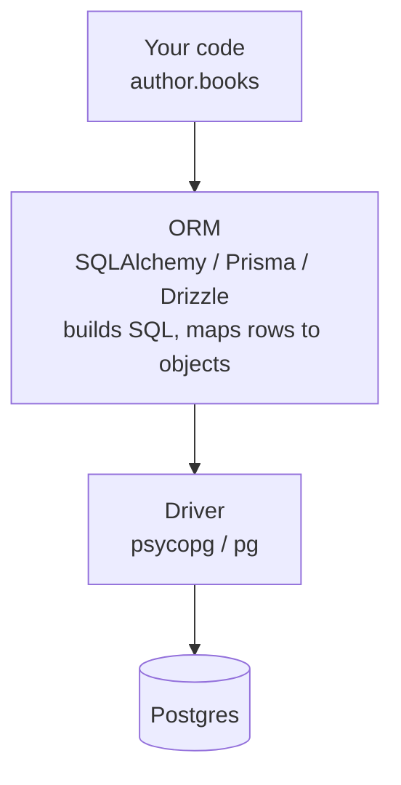
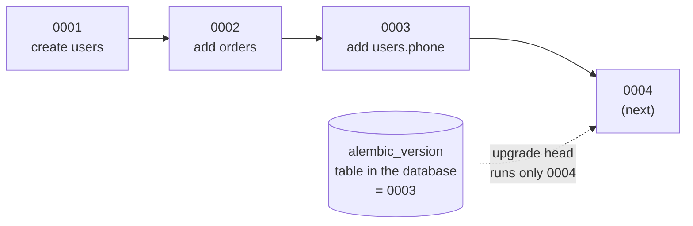

# ORMs and migrations

After this you can explain what an ORM does and where it hurts (the N+1 problem), and change a database schema safely over time with migration files.

Before this: [SQL from code and SQL injection](01-sql-from-code-and-sql-injection.md) and [creating and changing tables](../03-schema-design/02-creating-and-changing-tables-and-data.md).

## The idea

Writing `SELECT id, title FROM books WHERE author_id = %s` and turning each row into a Python object by hand gets repetitive. An **ORM** (object-relational mapper) does that translation: a class stands for a table, an instance stands for a row, and the library writes the SQL for you.

Your schema also changes. A feature needs a new column, and the production database already holds real data. You can't drop and recreate it, so each change is written as a small script, a migration, that moves the schema one step forward.



The ORM sits on top of the driver from the last lesson. It still sends SQL with parameters, so ORM queries are safe from injection unless you drop to raw string SQL inside it.

## Key terms

An **ORM** maps tables to classes and rows to objects, and builds SQL from method calls. Examples as of 2026: SQLAlchemy 2.x for Python ([docs](https://docs.sqlalchemy.org/en/20/)), and Prisma and Drizzle for TypeScript.

The **N+1 query problem** is one query to fetch a list of N parent rows, followed by N more queries, one per parent, to fetch each parent's children. The code looks like one loop, but the database sees N+1 round trips.

**Lazy loading** fetches related rows the first time you touch them. **Eager loading** fetches them up front, in the same query (a join) or in one extra query.

A **migration** is a versioned script that changes the schema, with an "up" step and usually a "down" step to undo it. A **migration tool** (Alembic for SQLAlchemy, Prisma Migrate, `drizzle-kit`) records which migrations have already run in a table in the database itself, and runs the rest in order.

## How it works

In SQLAlchemy 2.0 style, two models and a relationship look like this (the full runnable script is in Example 1):

```python
class Author(Base):
    __tablename__ = "authors"
    id: Mapped[int] = mapped_column(primary_key=True)
    name: Mapped[str] = mapped_column(String(50))
    books: Mapped[list["Book"]] = relationship(back_populates="author")
```

Loading authors with `select(Author)` runs one query. Reading `author.books` is lazy by default, so it runs another query for that author. Inside a loop over 5 authors that is 1 + 5 queries; over 500 authors, 501. On a development database with ten rows you never notice, and in production it is the classic reason a page is slow.

The fix is to say up front what you will need. `selectinload(Author.books)` loads all the books for all the authors in one extra query (`WHERE author_id IN (...)`), and `joinedload` uses a join. Prisma spells this `include`, and Drizzle has relational queries with `with`.

An ORM is a good default for simple reads and writes. Raw SQL is better for reports with window functions, big aggregations, bulk updates and anything where you want to see the exact query. Every ORM lets you run raw SQL with parameters, and a mix is normal. To see what an ORM sends, turn on query logging (`create_engine(url, echo=True)` in SQLAlchemy).

Migrations follow a fixed life cycle. You edit the models, ask the tool to generate a migration, read it, and commit it with the code. Each environment (your laptop, staging, production) applies it with one command.



The numbers are revision ids and the files live in Git. The version table says where this particular database is, so the tool knows what is left to run.

The Alembic commands (version 1.20, as of 2026), run here except `--autogenerate`, which needs `target_metadata` set in `env.py` and was not run:

```bash
alembic init migrations
alembic revision --autogenerate -m "add users.phone"
alembic upgrade head
alembic downgrade -1
```

```text
Output of upgrade head on a fresh database:
INFO  [alembic.runtime.migration] Running upgrade  -> c12f55e73fd0, create users table
```

Prisma Migrate uses `prisma migrate dev` on your machine and `prisma migrate deploy` in production ([docs](https://www.prisma.io/docs/orm/prisma-migrate)). Drizzle uses `drizzle-kit generate` and `drizzle-kit migrate` ([docs](https://orm.drizzle.team/docs/migrations)). These were not run here.

Two rules matter more than the tool. First, never edit a migration that has been applied anywhere shared; write a new migration that fixes it, because the other databases already ran the old text and would silently differ. Second, read generated migrations before you commit them: autogeneration can see a rename as "drop a column and add a new one", which deletes data.

For a live system, change the schema in steps that old and new code can both survive (often called expand and contract). Add the new column as nullable, deploy code that writes both columns, backfill old rows in small batches, switch reads to the new column, and drop the old column in a later release. Create indexes with `CREATE INDEX CONCURRENTLY` so writes aren't blocked, and avoid statements that hold a lock on a big table while they rewrite it.

## Worked examples

<div class="example" markdown>

### Example 1: counting the N+1 queries

This script builds 5 authors with one book each on an in-memory SQLite database, counts the SQL statements sent while looping, then does it again with eager loading. SQLAlchemy code is the same for Postgres apart from the connection URL (`postgresql+psycopg://...`).

```python
from sqlalchemy import ForeignKey, String, create_engine, event, select
from sqlalchemy.orm import (DeclarativeBase, Mapped, mapped_column,
                            relationship, Session, selectinload)

class Base(DeclarativeBase):
    pass

class Author(Base):
    __tablename__ = "authors"
    id: Mapped[int] = mapped_column(primary_key=True)
    name: Mapped[str] = mapped_column(String(50))
    books: Mapped[list["Book"]] = relationship(back_populates="author")

class Book(Base):
    __tablename__ = "books"
    id: Mapped[int] = mapped_column(primary_key=True)
    title: Mapped[str] = mapped_column(String(100))
    author_id: Mapped[int] = mapped_column(ForeignKey("authors.id"))
    author: Mapped[Author] = relationship(back_populates="books")

engine = create_engine("sqlite://")
Base.metadata.create_all(engine)
with Session(engine) as s:
    s.add_all([Author(name=f"A{i}", books=[Book(title=f"B{i}")]) for i in range(5)])
    s.commit()

count = 0
@event.listens_for(engine, "before_cursor_execute")
def counter(*args):
    global count
    count += 1

def titles(options=()):
    global count
    count = 0
    with Session(engine) as s:
        for a in s.scalars(select(Author).options(*options)):
            [b.title for b in a.books]
    return count

print("lazy loading:", titles(), "queries")
print("selectinload:", titles([selectinload(Author.books)]), "queries")
```

```text
lazy loading: 6 queries
selectinload: 2 queries
```

1. `select(Author)` is the "1": one query for all authors.
2. `a.books` inside the loop triggers a query per author, the "N" (5 here).
3. With `selectinload`, one extra query fetches the books for every author at once, so the count stays at 2 however many authors there are.

Check: change `range(5)` to `range(50)`. The lazy count becomes 51 and the eager count stays 2.

</div>

<div class="example" markdown>

### Example 2: reading a migration file

Alembic wrote the file skeleton; we filled in `upgrade` and `downgrade`. The file ran with `alembic upgrade head`, and `alembic current` then showed `c12f55e73fd0 (head)`.

```python
revision = 'c12f55e73fd0'
down_revision = None   # the first migration has no parent

def upgrade() -> None:
    op.create_table(
        "users",
        sa.Column("id", sa.Integer, primary_key=True),
        sa.Column("email", sa.String(255), nullable=False, unique=True),
    )

def downgrade() -> None:
    op.drop_table("users")
```

`down_revision` links each migration to the one before it, which is how the tool knows the order.

</div>

## Common mistakes

<div class="warning" markdown>

Watch out: assuming a loop over ORM objects is cheap. Lazy loading hides the queries. Turn on query logging or count statements in tests, and use eager loading when you read a relationship for every row.

</div>

<div class="warning" markdown>

Watch out: editing an old migration to "fix" it after it has been applied, or running schema changes by hand on production. The migration history then no longer describes the real database. Add a new migration instead.

</div>

<div class="warning" markdown>

Watch out: running `downgrade` on production as an undo button. Dropping a column also drops its data, and a down migration can't bring it back. Take a backup first, and prefer a new forward migration.

</div>

## Working with AI

<div class="ai" markdown>

Words to use: ORM, lazy loading, eager loading, N+1, migration, `down_revision`, expand and contract, backfill.

Prompts to try:

- "Here is my SQLAlchemy 2.0 model for Author and Book and a route that lists authors with their books: [paste]. It issues one query per author. Fix it with selectinload and show how to assert the number of queries in a pytest test."
- "Write an Alembic migration that adds a nullable `phone` column to `users`, backfills it from `profiles.phone` in batches of 1000, and does not lock the table for long. Postgres 17."

What to check:

- Autogenerated migrations: read the `upgrade` function for drops and for renames that became drop plus add.
- SQLAlchemy 1.x code in a 2.0 project (`session.query(...)`, no `Mapped[...]`). Both run, but mixing styles confuses the codebase.
- `nullable=False` added to a table with existing rows and no default or backfill. It fails on a non-empty table.
- Whether the answer needs a lock on a large table. Ask what lock the statement takes and for how long.

</div>

## Quiz

1\. What is the N+1 query problem, and what fixes it?

<details class="solution" markdown>
<summary>Answer</summary>

One query loads N parent rows, then the code triggers one more query per parent for its children, so N+1 queries run. Eager loading (`selectinload`, `joinedload`, `include`) or a join fetches the children together.

</details>

2\. A table has 200 authors. The code loops over `select(Author)` and reads `author.books` with lazy loading. How many SQL statements run?

<details class="solution" markdown>
<summary>Answer</summary>

201: one for the authors and one per author for the books.

</details>

3\. A migration `0007` was already applied in production, and you notice it forgot an index. A teammate suggests adding the index to `0007`. What should you do?

<details class="solution" markdown>
<summary>Answer</summary>

Leave `0007` alone and write `0008` that creates the index. Production would never re-run an edited `0007`, so the two databases would differ, and new environments would get a different history from production.

</details>

4\. You want to rename `users.fullname` to `users.name` with no downtime. Describe the order of steps.

<details class="solution" markdown>
<summary>Answer</summary>

Add `name` (nullable), deploy code that writes both columns, backfill old rows in batches, deploy code that reads `name`, then drop `fullname` in a later migration. A direct `RENAME` breaks any running code that still uses the old name.

</details>

## Lab

<div class="lab" markdown>

### Lab: find and fix an N+1

Goal: measure the queries a loop sends and cut them with eager loading. Time: about 15 minutes. Runs in: any terminal with Python 3.

1. Make a throwaway virtual environment and run `pip install sqlalchemy` in it.
2. Copy the script from Example 1 into `n1.py` and run it.
3. Change `range(5)` to `range(200)` and run again. Write down both counts.
4. Replace `selectinload` with `joinedload` (from `sqlalchemy.orm`). Run again. Expected: the count is 1, because a join returns everything in one statement. With `joinedload` on a collection you must call `.unique()` on the result: `s.scalars(...).unique()`.
5. Add `echo=True` to `create_engine` and read the SQL for each version.

Expected result: lazy loading sends 201 queries, `selectinload` sends 2, `joinedload` sends 1.

<details class="solution" markdown>
<summary>Solution</summary>

The only change to `titles` for step 4:

```python
for a in s.scalars(select(Author).options(*options)).unique():
```

and call `titles([joinedload(Author.books)])`. The `.unique()` call is needed because a join repeats each author once per book.

</details>

</div>

## Where this shows up

- Every web framework's data layer (Django ORM, Rails, Prisma in a Next.js app) is this lesson. Production incidents with "the page got slow after the data grew" are often N+1.
- Migrations run as a step in deployment, which the [CI/CD lessons](../../13-devops-and-cloud/02-ci-cd/01-ci-cd-concepts.md) cover.
