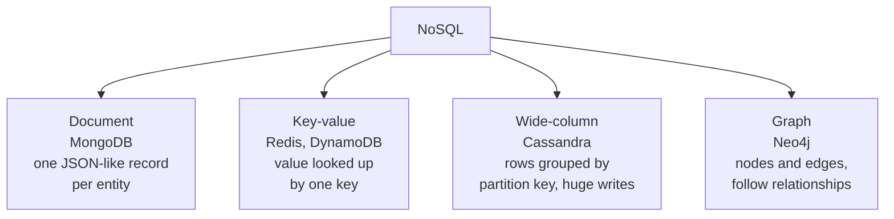

# NoSQL databases

After this you can name the four main families of NoSQL database, say what each is good at, and judge when plain Postgres with a JSONB column is enough.

Before this: [the relational model](../01-database-basics/02-the-relational-model.md) and [what a database is](../01-database-basics/01-what-a-database-is.md).

## The idea

Suppose a shop sells laptops (RAM, ports), T-shirts (size, colour) and mice (wireless or not). A relational table wants one column per attribute, so most cells would be empty, or you would need one table per product type. A different kind of database lets each record carry its own shape.

"NoSQL" is a loose label for databases that are not relational tables queried with SQL. It covers four quite different designs, each built around one way of accessing data.



Most of these systems exist because of scale or access pattern, not because SQL is bad. When one machine can't hold the data or take the writes, spreading it over many machines is easier if the database doesn't promise joins and multi-row transactions across all of it.

## Key terms

A **document database** stores each record as a JSON-like document, and documents in one collection can have different fields. MongoDB is the common example.

A **key-value store** maps a key to a value and is fast at exactly that: get, set, delete by key. Redis keeps it in memory; Amazon DynamoDB is a managed service that adds a sort key and secondary indexes.

A **wide-column store** such as Apache Cassandra spreads rows over many nodes by a partition key and is built for very high write rates. You design the table around the queries you will run, and queries without the partition key are slow or not allowed.

A **graph database** such as Neo4j stores nodes and edges and is fast at "friends of friends" style queries, where SQL would need a chain of joins or a [recursive CTE](../02-querying/06-ctes-and-recursive-queries.md).

**Schema-on-write** means the database checks the structure when you insert, as a relational table does. **Schema-on-read** means the database stores whatever you give it and your code interprets the structure when reading. The second is flexible, but nothing stops a typo like `colour` and `color` from both appearing.

## How it works

The trade is flexibility and scale against guarantees. A relational database offers joins, constraints and [ACID transactions](../04-postgres-in-depth/03-transactions-and-acid.md) across tables. Many NoSQL systems give up some of that so data can be split across servers. Several now offer transactions in limited forms (MongoDB has multi-document transactions, for example), so check the current docs before assuming a feature is missing.

When data lives on several machines and the network between them breaks (a partition), a system must choose: refuse some requests to keep every answer correct, or keep answering and risk stale data. This is the **CAP theorem**: during a partition you get consistency or availability, not both. Systems like Cassandra and DynamoDB let you tune that choice per query. The system design chapter covers it properly in [CAP and consistency](../../14-software-and-system-design/02-system-design/05-cap-and-consistency.md).

Design also differs. In SQL you model the data first and ask any question later with joins. In a document or wide-column store you list your queries first and shape the data so each query reads one document or one partition. That means copying data into several places (denormalizing), and keeping the copies in sync is your code's job.

Postgres covers a lot of the document case. A `jsonb` column stores JSON in a binary form that can be queried and indexed, so one table can hold fixed columns for the stable fields and a flexible `attrs` column for the rest. The full tour is in [JSONB and full-text search](../04-postgres-in-depth/07-jsonb-and-full-text-search.md).

## Worked examples

<div class="example" markdown>

### Example 1: the shop catalogue in Postgres with JSONB

The stable fields are real columns, the per-product attributes go in `attrs`, and a GIN index speeds up containment searches. This was run on PGlite (Postgres in a Node process), and the SQL is the same in `psql`.

```sql
CREATE TABLE products (
  id    serial PRIMARY KEY,
  name  text NOT NULL,
  attrs jsonb NOT NULL DEFAULT '{}'
);
INSERT INTO products (name, attrs) VALUES
  ('Laptop',  '{"ram_gb": 16, "ports": ["usb-c", "hdmi"]}'),
  ('T-shirt', '{"size": "M", "colour": "blue"}'),
  ('Mouse',   '{"wireless": true}');
CREATE INDEX products_attrs_idx ON products USING GIN (attrs);

SELECT name FROM products WHERE attrs @> '{"size": "M"}';
SELECT name, attrs->>'ram_gb' AS ram FROM products
 WHERE (attrs->>'ram_gb')::int >= 8;
```

```text
 name
---------
 T-shirt

 name   | ram
--------+-----
 Laptop | 16
```

1. `@>` means "contains": the left JSON includes the right JSON. A GIN index can serve it.
2. `->` returns JSON and `->>` returns text, so a number needs a cast (`::int`) before it is compared.
3. The `NOT NULL` and `PRIMARY KEY` still work. Only `attrs` is schema-on-read.

Check: the first query returns only the T-shirt, the second only the laptop (the other products have no `ram_gb`, so the comparison is not true for them).

</div>

<div class="example" markdown>

### Example 2: picking a store

A rate limiter that counts requests per user per minute: key-value (Redis), because it is one key, an atomic increment and an expiry. A chat app storing billions of messages by conversation and time: wide-column (Cassandra), because it is write-heavy and read by one partition key. A "who might you know" feature: graph. Customers, orders and invoices with money in them: Postgres.

</div>

## Common mistakes

<div class="warning" markdown>

Watch out: choosing NoSQL because "relational doesn't scale". A single well-indexed Postgres server handles far more than most apps ever need. Move when you can name the specific limit you hit.

</div>

<div class="warning" markdown>

Watch out: treating schema-on-read as "no schema". The structure still exists, in your code. Without checks, old documents with the old shape pile up and every reader has to handle all of them.

</div>

<div class="warning" markdown>

Watch out: using a document store for data that is really relational (users, orders, payments). You end up re-implementing joins and consistency in application code.

</div>

## Working with AI

<div class="ai" markdown>

Words to use: document store, key-value, wide-column, graph, schema-on-read, partition key, denormalization, CAP, JSONB.

Prompts to try:

- "We store user profiles with a few fixed fields and many optional settings. Compare a MongoDB collection with a Postgres table that has a jsonb column for the settings. Our data is under 10 GB and we already run Postgres."
- "Explain what happens to a DynamoDB read with strong consistency versus eventual consistency during a network partition, in plain words."

What to check:

- Whether the recommendation names a concrete limit (write volume, data size, access pattern) or only says "NoSQL scales better".
- Query design. Ask which queries the schema must serve, then check that each uses the partition key or an index.
- Feature claims about a product (transactions, joins, consistency). They change between versions, so confirm in the official docs.

</div>

## Quiz

1\. Match each to a family: Redis, MongoDB, Neo4j, Cassandra.

<details class="solution" markdown>
<summary>Answer</summary>

Redis is key-value, MongoDB is document, Neo4j is graph, Cassandra is wide-column.

</details>

2\. What is the difference between schema-on-write and schema-on-read?

<details class="solution" markdown>
<summary>Answer</summary>

With schema-on-write the database checks structure on insert and rejects bad rows. With schema-on-read it stores anything, and the code that reads it must cope with the shape it finds.

</details>

3\. Given `attrs = '{"size": "M", "colour": "blue"}'`, what does `attrs->>'colour'` return, and how does it differ from `attrs->'colour'`?

<details class="solution" markdown>
<summary>Answer</summary>

`->>` returns the text `blue`; `->` returns the JSON value `"blue"` (with quotes, as type `jsonb`).

</details>

4\. A team wants to move their orders and payments from Postgres to a document store "for scale". Their database is 40 GB. What do you ask them?

<details class="solution" markdown>
<summary>Answer</summary>

Which limit have they hit (writes per second, size, latency) and have they tried indexes, a bigger instance or read replicas? At 40 GB, one Postgres server is far from its limits, and orders and payments need transactions and constraints.

</details>

## Lab

<div class="lab" markdown>

### Lab: flexible attributes in Postgres

Goal: store products with different attributes in one table and query them. Time: about 15 minutes. Runs in: `psql` against any Postgres database you can write to (see [Postgres and psql](../01-database-basics/03-postgres-and-psql.md)).

1. Run the `CREATE TABLE`, `INSERT` and `CREATE INDEX` statements from Example 1.
2. Write a query that returns the names of products whose `attrs` has the key `wireless` (use the `?` operator).
3. Write a query that returns the first port of each product that has a `ports` array.
4. Add a `Keyboard` with `{"wireless": true, "layout": "us"}` and rerun step 2.
5. Cleanup: `DROP TABLE products;`

Expected result: step 2 returns `Mouse`; step 3 returns `Laptop | usb-c`; step 4 returns `Mouse` and `Keyboard`.

<details class="solution" markdown>
<summary>Solution</summary>

```sql
SELECT name FROM products WHERE attrs ? 'wireless';
SELECT name, attrs->'ports'->>0 AS first_port FROM products WHERE attrs ? 'ports';
INSERT INTO products (name, attrs) VALUES ('Keyboard', '{"wireless": true, "layout": "us"}');
```

Run on PGlite, which gave the results above. If your client treats `?` as a parameter marker, use `jsonb_exists(attrs, 'wireless')`.

</details>

</div>

## Where this shows up

- [Redis](04-redis-and-caching.md) is the key-value store you will most likely use, as a cache, in the next lesson.
- Choosing between stores is a standard system design question, covered in the [system design chapter](../../14-software-and-system-design/02-system-design/05-cap-and-consistency.md).
