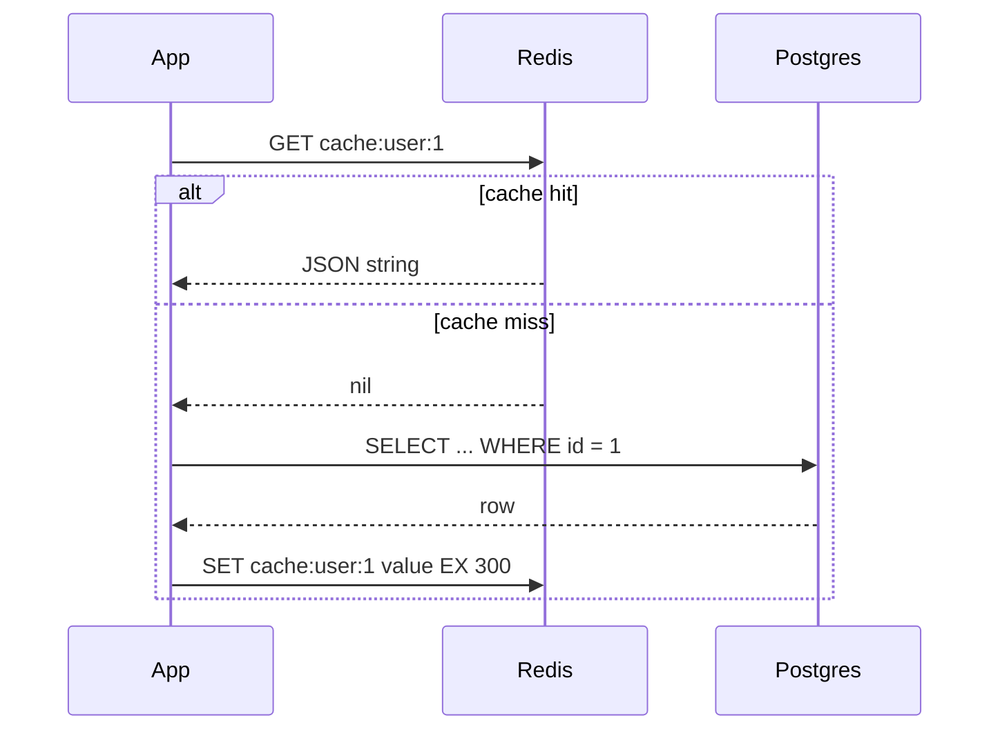

# Redis and caching

After this you can use Redis as a cache with the cache-aside pattern, set expiry times, and name the problems that come with caching (stale data, stampedes, eviction).

Before this: [NoSQL databases](03-nosql-databases.md) and [SQL from code](01-sql-from-code-and-sql-injection.md).

## The idea

A product page runs the same slow query for every visitor, and the answer changes once an hour. Running it 1000 times a minute wastes the database. If the first result is kept somewhere fast and reused, the other 999 requests skip the database.

**Redis** is an in-memory data store that answers simple commands in well under a millisecond. Because it holds data in RAM, it is fast, limited by memory size, and (unless you configure persistence) it can lose data on restart. That makes it a good place for copies of data and a bad place for the only copy.

The standard way to use it is **cache-aside**: the application, not the cache, loads data on a miss.



In the diagram, a hit costs one Redis call. A miss costs the Redis call, the database query and a write back, and every later request within 300 seconds is a hit.

## Key terms

A **cache** is a fast copy of data that lives somewhere slower. A **cache hit** finds the value; a **cache miss** doesn't.

A **TTL** (time to live) is the number of seconds after which Redis deletes a key by itself. You set it with `EX` on `SET` or with `EXPIRE`, and read it with `TTL`.

**Cache invalidation** is removing or replacing a cached value when the source data changes. If you don't, readers see stale data until the TTL runs out.

A **cache stampede** happens when a popular key expires and many requests miss at once, so all of them hit the database to rebuild the same value.

**Eviction** is Redis deleting keys to stay under its memory limit (`maxmemory`), chosen by the `maxmemory-policy` setting.

## How it works

Redis values have types, each with its own commands. Python examples use `redis-py` (`pip install redis`), with the connection URL from an environment variable.

| Type | Holds | Example use | Commands |
|---|---|---|---|
| string | text, number, or serialized JSON | cached page, counter | `SET`, `GET`, `INCR` |
| hash | field-to-value map | one user's fields | `HSET`, `HGETALL` |
| list | ordered items | simple queue | `RPUSH`, `LPOP` |
| set | unique items | tags, unique visitors | `SADD`, `SCARD` |
| sorted set | items ordered by a score | leaderboard | `ZADD`, `ZREVRANGE` |

There are more types (streams, bitmaps and others); see the [Redis data types page](https://redis.io/docs/latest/develop/data-types/).

When the data changes, the simplest invalidation is to delete the key (`DEL cache:user:1`) in the code that writes to Postgres. The next read misses and reloads. A short TTL is the safety net for the cases where you forget a delete.

To limit stampedes, add a little random jitter to TTLs so keys don't all expire together, and let only one request rebuild a hot key. `SET key value NX EX 10` sets a key only if it doesn't exist, which works as a short lock: the request that gets `True` rebuilds, and the others wait briefly or serve the old value.

Other common uses follow from a fast key with an expiry. A session store keeps `session:<id>` with a TTL, so logging out is a delete and an idle session expires by itself (see [sessions, cookies and JWT](../../09-back-end/02-auth/02-sessions-cookies-and-jwt.md)). A rate limiter increments a counter per user and window: `INCR` is atomic, so two requests at the same time still count correctly. A list can act as a job queue with `RPUSH` and `LPOP` in one line, but real job systems add retries and acknowledgements (see [background jobs](../../09-back-end/03-api-quality/01-background-jobs.md)).

When memory fills, what happens depends on the policy. As of 2026, the options in the [Redis eviction docs](https://redis.io/docs/latest/develop/reference/eviction/) include `noeviction` (writes fail with an error), `allkeys-lru` (drop the least recently used keys, the usual choice for a cache), `allkeys-lfu` (least frequently used), `volatile-ttl` (drop keys with the shortest remaining TTL) and the `volatile-*` variants that only consider keys that have a TTL. With `maxmemory` unset there is no limit, so eviction never starts and Redis grows until the machine runs out of memory.

## Worked examples

<div class="example" markdown>

### Example 1: cache-aside, with a call counter

Redis isn't installed here, so this uses `fakeredis`, an in-process stand-in with the same API. With a real server, replace the first line with `redis.Redis.from_url(os.environ["REDIS_URL"], decode_responses=True)`.

```python
import json, fakeredis

r = fakeredis.FakeRedis(decode_responses=True)
calls = 0

def load_user_from_db(uid):
    global calls
    calls += 1
    return {"id": uid, "name": "Ana"}

def get_user(uid):
    key = f"cache:user:{uid}"
    hit = r.get(key)
    if hit is not None:
        return json.loads(hit)
    user = load_user_from_db(uid)
    r.set(key, json.dumps(user), ex=300)
    return user

get_user(1); get_user(1); get_user(1)
print("db calls:", calls)
print("ttl:", r.ttl("cache:user:1"))
```

```text
db calls: 1
ttl: 300
```

1. The first call misses, loads from the "database", and stores the JSON with a 300 second TTL.
2. The second and third calls hit, so `calls` stays at 1.
3. The cache key `cache:user:1` has a prefix. Reusing a key that already holds another type (a hash named `user:1`, say) fails with `WRONGTYPE`; we hit that error while writing this lesson.

Check: after `r.delete("cache:user:1")`, the next `get_user(1)` makes `calls` 2.

</div>

<div class="example" markdown>

### Example 2: a rate limit of 3 requests per window

```python
def allowed(user, limit=3, window=60):
    key = f"rate:{user}"
    n = r.incr(key)
    if n == 1:
        r.expire(key, window)
    return n <= limit

print([allowed("ana") for _ in range(5)])
```

```text
[True, True, True, False, False]
```

The first request creates the counter and starts the window. This fixed-window version lets a burst of 3 at the end of one window and 3 at the start of the next through. If the process crashes between `INCR` and `EXPIRE`, the key never expires, so production code sets both in one atomic step (a pipeline or Lua script).

</div>

## Common mistakes

<div class="warning" markdown>

Watch out: caching without an invalidation plan. A value cached for an hour is wrong for an hour after an update. Delete the key on writes, and keep TTLs short for data that changes.

</div>

<div class="warning" markdown>

Watch out: treating Redis as the only copy of important data. Memory is limited, eviction deletes keys, and a restart can lose recent writes unless persistence is configured. Postgres stays the source of truth.

</div>

<div class="warning" markdown>

Watch out: caching a miss as a failure. If the user doesn't exist and you query Postgres every time, attackers can flood the database with random ids. Cache the "not found" result for a short time.

</div>

## Working with AI

<div class="ai" markdown>

Words to use: cache-aside, TTL, invalidation, stampede, eviction policy, `maxmemory`, hit rate, atomic.

Prompts to try:

- "Write cache-aside for get_product(product_id) in Python with redis-py. Cache JSON for 5 minutes with a random 0 to 30 second jitter, delete the key in update_product, and guard against a stampede with SET NX."
- "Our Redis is at maxmemory and writes return OOM errors. The policy is noeviction. We use it only as a cache. Which policy should we choose and what do we monitor?"

What to check:

- Every write path to the source data also invalidates the cache key.
- Keys have a TTL. A cache with no expiry and no eviction policy grows until it fails.
- Commands are real and their arguments are in the right order (`SET key value EX seconds`). Check the [command reference](https://redis.io/docs/latest/commands/).
- Read-then-write sequences that should be one atomic command or script.

</div>

## Quiz

1\. In cache-aside, who loads the data on a miss?

<details class="solution" markdown>
<summary>Answer</summary>

The application. It reads Postgres, writes the value into Redis and returns it. Redis doesn't know about the database.

</details>

2\. What does this print?

```python
r.set("n", 5, ex=60)
r.incr("n")
print(r.get("n"), r.ttl("n") > 0)
```

<details class="solution" markdown>
<summary>Answer</summary>

`6 True` (with `decode_responses=True`; otherwise `b'6'`). `INCR` adds one to the stored number and keeps the TTL.

</details>

3\. A popular key with a 5 minute TTL expires, and the database spikes for a few seconds. What is this called, and name two ways to reduce it.

<details class="solution" markdown>
<summary>Answer</summary>

A cache stampede. Add random jitter to TTLs, let one request rebuild the value under a `SET NX` lock, or refresh the key before it expires.

</details>

4\. Your cache uses `noeviction` and `maxmemory 1gb`. What happens when it is full?

<details class="solution" markdown>
<summary>Answer</summary>

Commands that add data return an error, while reads continue to work. For a cache, `allkeys-lru` is the usual choice because it drops old keys instead.

</details>

## Lab

<div class="lab" markdown>

### Lab: cache a slow function and rate-limit it

Goal: build cache-aside around a slow function and measure the effect. Time: about 15 minutes. Runs in: any terminal with Python 3.

1. Make a throwaway virtual environment and run `pip install fakeredis`.
2. Write `slow_square(n)` that sleeps 0.5 seconds and returns `n * n`.
3. Write `cached_square(n)` using cache-aside with key `sq:<n>`, a 60 second TTL, and the value stored as a string.
4. Time three calls to `cached_square(4)` with `time.perf_counter()`.
5. Add the `allowed` function from Example 2 and call it 5 times for one user.

Expected result: the first call takes about 0.5 seconds and the next two take under a millisecond.

<details class="solution" markdown>
<summary>Solution</summary>

```python
import time, fakeredis

r = fakeredis.FakeRedis(decode_responses=True)

def slow_square(n):
    time.sleep(0.5)
    return n * n

def cached_square(n):
    key = f"sq:{n}"
    hit = r.get(key)
    if hit is not None:
        return int(hit)
    value = slow_square(n)
    r.set(key, str(value), ex=60)
    return value

for _ in range(3):
    t = time.perf_counter()
    cached_square(4)
    print(f"{time.perf_counter() - t:.4f}s")
```

```text
0.5008s
0.0001s
0.0001s
```

Exact timings vary.

</details>

</div>

## Where this shows up

- Caching at every level (browser, CDN, application, database) is covered in HTTP caching<!-- link: ../../07-networking/02-web-protocols/02-http-headers-cookies-and-caching.md --> and caching strategies<!-- link: ../../14-software-and-system-design/02-system-design/03-caching-strategies.md -->.
- Rate limiting at the edge is in rate limiting and API gateways<!-- link: ../../14-software-and-system-design/02-system-design/07-rate-limiting-and-api-gateways.md -->.
