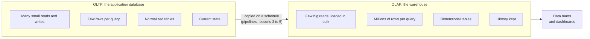

# OLTP vs OLAP and warehouses

After this you can tell a transactional workload from an analytical one, say why the second gets its own database, and write the kind of rollup query a warehouse exists to answer.

Before this: [joins](../../10-databases-sql-and-postgres/02-querying/04-joins.md) and [aggregates, GROUP BY and HAVING](../../10-databases-sql-and-postgres/02-querying/03-aggregates-group-by-and-having.md).

## The idea

A shop's checkout page runs queries like "insert this order" and "fetch order 42". Each touches a handful of rows and must answer in milliseconds, thousands of times a minute. On Monday the finance team asks: "revenue by category and month for the last 18 months". That query reads every sale ever made. Run it against the checkout database and it competes for disk, memory and locks with customers who are trying to pay.

The usual answer is to copy the data into a second database built for the second kind of question. The first kind of work is called OLTP, the second OLAP.



In the diagram, the left side is what you built in the Postgres chapters. The right side is the subject of this chapter.

## Key terms

**OLTP** (online transaction processing) is a workload of many short transactions that each read or write a few rows, such as placing an order. The database is **normalized**: each fact is stored once and tables are joined at query time.

**OLAP** (online analytical processing) is a workload of fewer, larger queries that scan and aggregate many rows, such as monthly revenue by store.

A **data warehouse** is a database that holds data copied from many source systems, organized for analysis and kept as history. A **data mart** is a smaller slice of a warehouse for one team or subject, such as sales or marketing.

A **row store** keeps all the columns of one row together on disk; a **column store** keeps all the values of one column together.

## How it works

A row store is fast when you need whole rows: "fetch order 42" reads one contiguous chunk. A report that needs only `net_amount` and `date_key` from 100 million rows still reads every other column off disk. A column store lays each column out separately, so that report reads two columns and skips the rest. Values in one column look alike, so they also compress well.

```text
Row store (one block per row)       Column store (one block per column)
[1 | Ana | Toronto | 40.00]         id:      [1, 2, 3]
[2 | Bo  | Ottawa  | 25.00]         name:    [Ana, Bo, Cy]
[3 | Cy  | Toronto | 60.00]         city:    [Toronto, Ottawa, Toronto]
                                    amount:  [40.00, 25.00, 60.00]
```

Postgres is a row store. Many cloud warehouses (BigQuery, Snowflake, Redshift) and DuckDB are column stores, as are Parquet files, which a later lesson on [file formats](08-file-formats-and-columnar-storage.md) covers. A row store like Postgres can still serve a small warehouse, and this book does that: the `warehouse` sample database is ordinary Postgres tables.

The second change is the table design. OLTP tables are normalized so that an update touches one place. Analytical tables are deliberately reshaped into a few wide dimension tables around one big fact table, which the [next lesson](02-star-schemas-and-dimensional-modelling.md) covers. The third is time: an OLTP row holds the current customer address, while a warehouse keeps what was true when each sale happened.

The `warehouse` database holds 1500 sales over 18 months. The query below is a typical OLAP question: one row per month, built from every sale. Joins are covered in the earlier chapter; here `dim_date` supplies the month name.

<div class="sql-runner" data-db="warehouse" markdown>

```sql
SELECT d.year, d.month, d.month_name,
       count(*) AS sales,
       sum(f.net_amount) AS revenue
FROM fact_sales f
JOIN dim_date d ON d.date_key = f.date_key
GROUP BY d.year, d.month, d.month_name
ORDER BY d.year, d.month;
```

</div>

The result has 18 rows. November 2025 is the biggest month, with 133 sales and 12909.44 in revenue. Compare the OLTP shape of work, which asks for one row by its key:

<div class="sql-runner" data-db="warehouse" markdown>

```sql
SELECT sale_id, date_key, quantity, net_amount
FROM fact_sales
WHERE sale_id = 42;
```

</div>

## Worked examples

<div class="example" markdown>

### Example 1: sorting questions into workloads

For each question, decide where it belongs and why.

1. "Mark order 9001 as shipped." One row, a write, current state: OLTP.
2. "Revenue by province for each quarter." Scans every sale, aggregates, uses history: OLAP.
3. "Show this customer's last five orders." A few rows found by an index on the customer: OLTP, even though it reads.
4. "Which category's share of revenue is growing?" Compares periods across all rows: OLAP.

The test is not read versus write. It is how many rows a query touches and how fast the answer is needed. Check yourself on the warehouse: the share of revenue by category needs all 1500 sales.

<div class="sql-runner" data-db="warehouse" markdown>

```sql
SELECT p.category, sum(f.net_amount) AS revenue,
       round(100 * sum(f.net_amount) / sum(sum(f.net_amount)) OVER (), 1) AS pct
FROM fact_sales f
JOIN dim_product p ON p.product_key = f.product_key
GROUP BY p.category
ORDER BY revenue DESC;
```

</div>

Electronics is 49.4% of the 161448.41 total.

</div>

## Common mistakes

<div class="warning" markdown>

Watch out: running heavy reports on the production OLTP database "because it already has the data". One long scan slows checkout. The fix is a [read replica](../../10-databases-sql-and-postgres/04-postgres-in-depth/08-backups-replication-and-pooling.md) for small teams, or a warehouse once reports get big.

</div>

<div class="warning" markdown>

Watch out: treating the warehouse as a backup of the application database. A warehouse is reshaped, delayed by the pipeline and may drop columns, so it can't restore the app.

</div>

## Working with AI

<div class="ai" markdown>

Words to use: OLTP, OLAP, normalized, dimensional model, row store, column store, data mart, fact table.

Prompts to try:

- "We run a Postgres 16 database for a shop (about 2 million orders). Finance runs monthly revenue reports that slow checkout. Compare a read replica with a separate warehouse for our size, and say what each costs us in freshness."
- "Explain why this query is slow on a row store but fast on a column store: [paste query]. Which columns does it read?"

What to check:

- Claims that a row store "can't" do analytics. Postgres handles millions of rows fine; the question is load and speed.
- Product names and limits for cloud warehouses. They change, so check the vendor's page.
- Advice to denormalize the OLTP database for reporting. Reporting copies belong in the warehouse.

</div>

## Quiz

1\. Give two differences between how an OLTP query and an OLAP query use data.

<details class="solution" markdown>
<summary>Answer</summary>

OLTP touches a few rows by key and needs current data in milliseconds. OLAP scans and aggregates many rows, often over history, and tolerates seconds or minutes.

</details>

2\. A table has 40 columns and 200 million rows. A report averages one column. Why does a column store read less data?

<details class="solution" markdown>
<summary>Answer</summary>

It stores each column separately, so the report reads one column's blocks and skips the other 39. A row store must read whole rows.

</details>

3\. Predict the number of rows returned.

<!-- db: warehouse -->
```sql
SELECT d.year, d.month
FROM fact_sales f JOIN dim_date d ON d.date_key = f.date_key
GROUP BY d.year, d.month;
```

<details class="solution" markdown>
<summary>Answer</summary>

18 rows: one per month from January 2025 to June 2026.

</details>

4\. A teammate proposes pointing the BI dashboard straight at the production database. What do you ask first?

<details class="solution" markdown>
<summary>Answer</summary>

How big the queries are and how often they run. If they scan large tables during business hours, they compete with checkout, so use a replica or a warehouse.

</details>

## Lab

<div class="lab" markdown>

### Lab: top three stores

Goal: write an OLAP query on the warehouse. Time: about 10 minutes.

1. Join `fact_sales` to `dim_store`.
2. Sum `net_amount` per `store_name`.
3. Order by revenue, largest first, and keep three rows.
4. Press Check.

Expected result: Toronto Eaton 19904.37, Vancouver Robson 19242.72, Halifax Waterfront 16618.33.

<div class="sql-runner" data-db="warehouse" data-solution="sol-top-stores" markdown>

```sql
-- write your query here
SELECT 1;
```

</div>

<details class="solution" id="sol-top-stores" markdown>
<summary>Solution</summary>

```sql
SELECT s.store_name, sum(f.net_amount) AS revenue
FROM fact_sales f
JOIN dim_store s ON s.store_key = f.store_key
GROUP BY s.store_name
ORDER BY revenue DESC
LIMIT 3;
```

</details>

</div>

## Where this shows up

- Every analytics job starts by asking where the data lives. [Star schemas and dimensional modelling](02-star-schemas-and-dimensional-modelling.md) is next.
- Dashboards and reports in later chapters assume a warehouse like this one, for example [analytics in SQL](../02-data-science-and-ml/02-analytics-sql-cohorts-funnels-retention.md).
