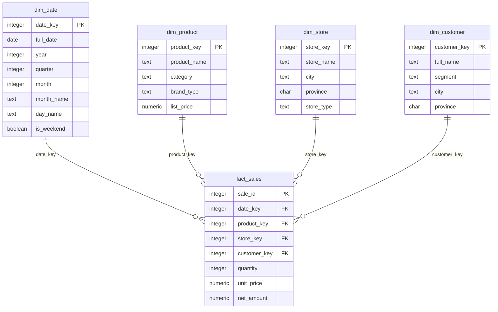

# Star schemas and dimensional modelling

After this you can read a star schema, choose the grain of a fact table, write rollups with `ROLLUP`, `CUBE` and `GROUPING SETS`, and explain how slowly changing dimensions keep history.

Before this: [OLTP vs OLAP and warehouses](01-oltp-vs-olap-and-warehouses.md).

## The idea

A normalized shop database spreads one sale over many tables: orders, order items, products, categories, customers. A warehouse query for "revenue by category, store type and month" would join a long chain. **Dimensional modelling** (Kimball's method) reshapes the data around the question people ask: one central table of measurable events, surrounded by descriptive tables to slice them by.

The diagram is the real `warehouse` sample database. `fact_sales` sits in the middle; each dimension points into it like the arms of a star.



## Key terms

A **fact table** records events with numbers to add up (the **measures**): `quantity`, `net_amount`. A **dimension table** describes the who, what, where and when of those events: product, store, customer, date. A **star schema** is one fact table joined to several denormalized dimension tables. A **snowflake schema** normalizes the dimensions further (category in its own table, then city, then province), which saves a little space and adds joins; most teams keep the star.

The **grain** is what one row of the fact table means. In `fact_sales` it is one sale line. Decide the grain first and write it down, because every measure and dimension must make sense at that grain.

A **surrogate key** is a meaningless integer made by the warehouse (`product_key`) instead of the source system's own id. The source id is the **business key**. A **conformed dimension** is one dimension shared by several fact tables, with the same keys and meanings, so that sales and returns can be compared by the same `dim_date`.

## How it works

Querying a star always has the same shape: join the fact to the dimensions you need, `GROUP BY` their columns, aggregate the measures. This query answers the "category by store type" question and also needs the extra subtotals a report usually shows. `ROLLUP (a, b)` adds a subtotal per `a` and a grand total, `CUBE (a, b)` adds every combination, and `GROUPING SETS` lists exactly the groupings you want. In the output a `NULL` means "all values of this column".

<div class="sql-runner" data-db="warehouse" markdown>

```sql
SELECT p.category, s.store_type, sum(f.net_amount) AS revenue
FROM fact_sales f
JOIN dim_product p ON p.product_key = f.product_key
JOIN dim_store s ON s.store_key = f.store_key
GROUP BY ROLLUP (p.category, s.store_type)
ORDER BY p.category NULLS LAST, s.store_type NULLS LAST;
```

</div>

The result has 21 rows: 15 category and store type pairs, 5 category subtotals and one grand total of 161448.41. Electronics subtotals to 79827.40. With `CUBE` the same query adds three more rows, the totals per store type (Mall 63753.89, Online 14356.44, Street 83338.08), giving 24.

A real `NULL` in the data would look the same as a subtotal `NULL`. The `GROUPING(column)` function returns 1 for a subtotal row and 0 otherwise, so use it to tell them apart.

<div class="sql-runner" data-db="warehouse" markdown>

```sql
SELECT p.category, s.store_type, d.year,
       sum(f.net_amount) AS revenue,
       GROUPING(p.category, s.store_type, d.year) AS grouping_mask
FROM fact_sales f
JOIN dim_product p ON p.product_key = f.product_key
JOIN dim_store s ON s.store_key = f.store_key
JOIN dim_date d ON d.date_key = f.date_key
GROUP BY GROUPING SETS ((p.category), (s.store_type, d.year), ())
ORDER BY grouping_mask, p.category, s.store_type, d.year;
```

</div>

This returns 12 rows from three groupings: 5 by category, 6 by store type and year, and one grand total. Without `GROUPING SETS` you would write three queries and `UNION ALL` them.

### Slowly changing dimensions

A customer moves from Toronto to Ottawa. Dimension rows change slowly, but the question "revenue by city" must decide which city an old sale belongs to. A **slowly changing dimension** (SCD) is a dimension whose attributes change over time, and the type says how the change is stored.

Type 1 overwrites the old value. The table is simple, but all history now says Ottawa, including sales made while the customer lived in Toronto. Type 2 keeps both: it adds a new row with a new surrogate key and the dates it was valid, and the old row is closed.

| customer_sk | customer_id | city | valid_from | valid_to |
|---|---|---|---|---|
| 1 | C-17 | Toronto | 2025-01-01 | 2025-08-31 |
| 2 | C-17 | Ottawa | 2025-09-01 | 9999-12-31 |

Each fact row stores the surrogate key that was current when it happened. Here that join is rebuilt by date, with three orders of C-17:

<div class="sql-runner" data-db="warehouse" markdown>

```sql
WITH dim_customer_v2(customer_sk, customer_id, city, valid_from, valid_to) AS (
  VALUES (1, 'C-17', 'Toronto', DATE '2025-01-01', DATE '2025-08-31'),
         (2, 'C-17', 'Ottawa',  DATE '2025-09-01', DATE '9999-12-31')
), orders(order_id, customer_id, order_date, amount) AS (
  VALUES (101, 'C-17', DATE '2025-03-10', 40.00),
         (102, 'C-17', DATE '2025-07-22', 25.00),
         (103, 'C-17', DATE '2025-10-05', 60.00)
)
SELECT c.city AS city_at_order_time, count(*) AS orders, sum(o.amount) AS revenue
FROM orders o
JOIN dim_customer_v2 c
  ON c.customer_id = o.customer_id
 AND o.order_date BETWEEN c.valid_from AND c.valid_to
GROUP BY c.city
ORDER BY c.city;
```

</div>

Two orders (65.00) belong to Toronto and one (60.00) to Ottawa. Under type 1 all three would be Ottawa. Type 3 keeps only the previous value in an extra column (`previous_city`); it is rare.

## Worked examples

<div class="example" markdown>

### Example 1: choosing a grain

A shop wants "revenue by product and store by day". Take the steps in order.

1. Name the event: a customer buys a product in a store on a date.
2. State the grain: one row per sale line. Not one row per order, because an order holds several products, and not one row per day and store, because then "by product" is lost.
3. List the dimensions that apply at that grain: date, product, store, customer.
4. List measures that add up at that grain: `quantity` and `net_amount` do; `unit_price` does not, because adding prices is meaningless.

Check: `fact_sales` has 1500 rows, and joining it to `dim_date` or `dim_store` still returns 1500. If a join returned more, a dimension has duplicate keys and the star is broken.

<div class="sql-runner" data-db="warehouse" markdown>

```sql
SELECT (SELECT count(*) FROM fact_sales) AS fact_rows,
       (SELECT count(*) FROM fact_sales f JOIN dim_date d USING (date_key)) AS joined_date,
       (SELECT count(*) FROM fact_sales f JOIN dim_store s USING (store_key)) AS joined_store;
```

</div>

All three counts are 1500.

</div>

## Common mistakes

<div class="warning" markdown>

Watch out: mixing grains. If a fact table holds both sale lines and monthly targets, `sum(amount)` double counts. One table, one grain.

</div>

<div class="warning" markdown>

Watch out: summing a measure that does not add across a dimension, such as a balance or a unit price. Average it or use the last value instead.

</div>

<div class="warning" markdown>

Watch out: joining a type 2 dimension on the business key alone. Each customer then matches several rows and the fact rows multiply. Join on the surrogate key, or add the date range to the condition.

</div>

## Working with AI

<div class="ai" markdown>

Words to use: fact table, dimension, grain, surrogate key, conformed dimension, slowly changing dimension, type 2, `GROUPING SETS`.

Prompts to try:

- "Here are my OLTP tables [paste CREATE TABLE]. Propose a star schema for revenue reporting in PostgreSQL. State the grain of the fact table first and list each dimension's columns."
- "Write a PostgreSQL query with GROUPING SETS giving revenue by category, by store type and year, and a grand total, and label the subtotal rows with GROUPING()."

What to check:

- That the stated grain matches the fact table's primary key and every measure adds at that grain.
- That a type 2 design has `valid_from`, `valid_to` and a surrogate key, and that the join uses them.
- That subtotal `NULL` values are told apart from real ones.

</div>

## Quiz

1\. What is the grain of `fact_sales`?

<details class="solution" markdown>
<summary>Answer</summary>

One row per sale line, identified by `sale_id`.

</details>

2\. Why do we use `product_key` instead of the source system's product id?

<details class="solution" markdown>
<summary>Answer</summary>

The warehouse controls surrogate keys, so they stay stable when source ids change or collide across systems, and type 2 history can have several rows for one business key.

</details>

3\. Predict the row count.

<!-- db: warehouse -->
```sql
SELECT p.category, s.store_type, sum(f.net_amount)
FROM fact_sales f
JOIN dim_product p ON p.product_key = f.product_key
JOIN dim_store s ON s.store_key = f.store_key
GROUP BY CUBE (p.category, s.store_type);
```

<details class="solution" markdown>
<summary>Answer</summary>

24 rows: 15 pairs, 5 category subtotals, 3 store type subtotals, 1 grand total.

</details>

4\. A customer's province changes and the report must show old sales under the old province. Type 1 or type 2?

<details class="solution" markdown>
<summary>Answer</summary>

Type 2. Type 1 overwrites the province, so old sales move to the new one.

</details>

## Lab

<div class="lab" markdown>

### Lab: rollup by year and quarter

Goal: write a `ROLLUP` query. Time: about 10 minutes.

1. Join `fact_sales` to `dim_date`.
2. Group by `ROLLUP (d.year, d.quarter)` and sum `net_amount`.
3. Order by year then quarter, with subtotals last.
4. Check that the last row is 161448.41.

Expected result: 9 rows, which are 6 quarters (2025 Q1 to 2026 Q2), 2 year subtotals and the grand total.

<div class="sql-runner" data-db="warehouse" data-solution="sol-rollup" markdown>

```sql
-- write your query here
SELECT 1;
```

</div>

<details class="solution" id="sol-rollup" markdown>
<summary>Solution</summary>

```sql
SELECT d.year, d.quarter, sum(f.net_amount) AS revenue
FROM fact_sales f
JOIN dim_date d ON d.date_key = f.date_key
GROUP BY ROLLUP (d.year, d.quarter)
ORDER BY d.year NULLS LAST, d.quarter NULLS LAST;
```

</details>

</div>

## Where this shows up

- Pipelines have to build these tables: [ETL and ELT pipelines](03-etl-and-elt-pipelines.md).
- dbt models<!-- link: 07-dbt-and-sql-transformations.md --> are usually the dimension and fact tables of a star.
