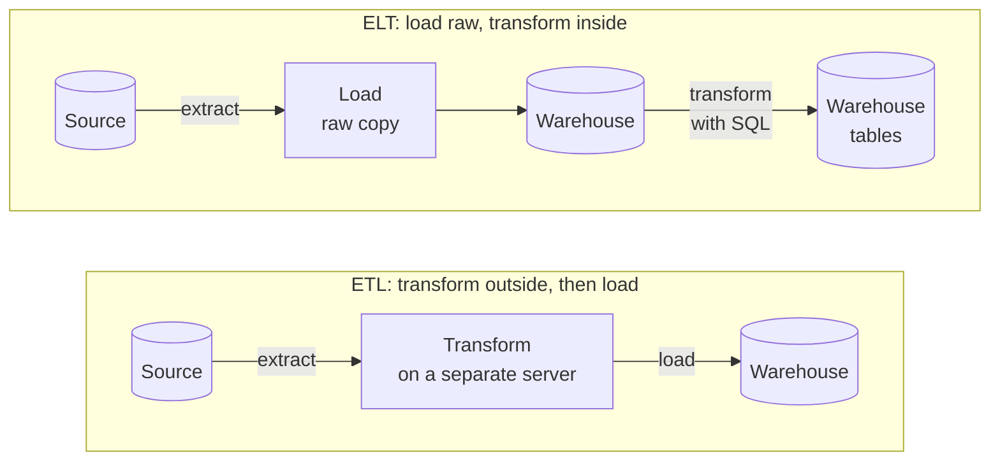
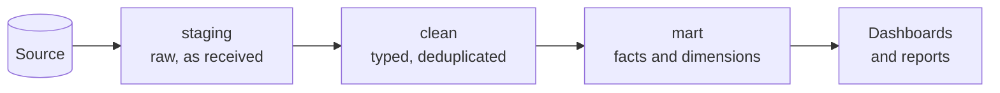

# ETL and ELT pipelines

After this you can describe the extract, transform and load steps, say why many teams now load first and transform inside the warehouse, and design a load that is safe to run twice.

Before this: [star schemas and dimensional modelling](02-star-schemas-and-dimensional-modelling.md).

## The idea

The application database keeps the sales. The warehouse needs them, cleaned and reshaped into the star from the last lesson. Something has to move the data every night. That something is a **data pipeline**: a series of steps that moves data from sources to a destination and changes its shape on the way.

There are two orders for the steps. The older one transforms before loading; the newer one loads raw data first and transforms it inside the warehouse.



## Key terms

**Extract** reads data from a source: a database, an API, files. **Transform** cleans and reshapes it: fix types, remove duplicates, join, aggregate. **Load** writes it into the destination. **ETL** does these in the order extract, transform, load, and **ELT** does extract, load, transform.

A **staging** area is where raw data lands first, unchanged. A common layout has three **layers** inside the warehouse, as shown below.

An **idempotent** load gives the same result whether it runs once or several times. An **incremental load** copies only data that is new or changed since the last run, tracked by a **watermark**: a stored value, such as the highest `date_key` loaded so far.

## How it works

ETL made sense when warehouses were expensive and slow, so the heavy cleaning ran on a cheaper server and only finished data was loaded. Cloud warehouses made storage cheap and let SQL scale across many machines, so ELT won: load the raw data once, keep it, and transform it with SQL (tools [such as dbt](07-dbt-and-sql-transformations.md) run those SQL steps). Raw data kept in the warehouse can be re-transformed when the logic changes, without going back to the source. ETL is still used when data must be masked or reduced before it may leave a system.



Each arrow in the diagram is a step that can be rerun. Staging keeps text exactly as it came, so a bad row can be inspected. The clean layer fixes types and duplicates. The mart layer is the star schema people query.

Two properties make a pipeline trustworthy. First, a load must be idempotent, because jobs fail halfway and are rerun. Either replace a whole partition (delete the day, then insert the day) or use an upsert on a key, shown in the [next lesson](04-loading-data-into-postgres.md). A plain `INSERT` on rerun duplicates rows. Second, an incremental load needs a watermark so the job reads only new data. The Python below extracts the rows of a CSV file newer than a stored date, using the `csv` module. The file is the 20,000-row `sales.csv` generated in the next lesson.

```python
import csv

watermark = "2026-06-25"          # highest sale_date already loaded
with open("sales.csv", newline="", encoding="utf-8") as f:
    new_rows = [r for r in csv.DictReader(f) if r["sale_date"] > watermark]

print(len(new_rows), "rows after the watermark")
print("new watermark:", max(r["sale_date"] for r in new_rows))
```

```text
3349 rows after the watermark
new watermark: 2026-06-30
```

Save the new watermark only after the load succeeds. Dates compare correctly as text because they are in `yyyy-mm-dd` form.

## Worked examples

<div class="example" markdown>

### Example 1: staging to clean

Four raw rows arrive as text. Row 1002 appears twice (a corrected re-send), row 1001 has a leading space in the date and row 1003 has `n/a` as the amount. The clean step must produce typed, deduplicated rows.

1. Keep the latest copy of each `sale_id`: `DISTINCT ON (sale_id)` with `ORDER BY sale_id, loaded_at DESC`.
2. Cast the id to `int` and the trimmed date to `date`.
3. Turn text that is not a number into `NULL` with `CASE`, rather than letting the cast fail the whole load.

<div class="sql-runner" data-db="warehouse" markdown>

```sql
WITH staging(sale_id, sale_date, amount, loaded_at) AS (
  VALUES ('1001', ' 2026-06-01', '19.99', 1),
         ('1002', '2026-06-01', '5.00',  1),
         ('1002', '2026-06-01', '5.50',  2),
         ('1003', '2026-06-02', 'n/a',   1)
)
SELECT DISTINCT ON (sale_id)
       sale_id::int AS sale_id,
       trim(sale_date)::date AS sale_date,
       CASE WHEN amount ~ '^[0-9]+(\.[0-9]+)?$' THEN amount::numeric END AS amount
FROM staging
ORDER BY sale_id, loaded_at DESC;
```

</div>

Check: three rows come back, 1002 has amount 5.50 (the later copy), and 1003 has a `NULL` [amount that a data quality check](09-data-quality.md) should flag.

</div>

<div class="example" markdown>

### Example 2: an incremental read in SQL

The warehouse holds sales through 2026-05-31 (`date_key` 20260531). The next run selects only newer rows.

<div class="sql-runner" data-db="warehouse" markdown>

```sql
WITH watermark AS (SELECT 20260531 AS last_loaded)
SELECT count(*) AS new_rows, min(f.date_key) AS first_key, max(f.date_key) AS new_watermark
FROM fact_sales f, watermark w
WHERE f.date_key > w.last_loaded;
```

</div>

76 new rows, from 20260601 to 20260630. Running the job again with the new watermark returns 0.

</div>

## Common mistakes

<div class="warning" markdown>

Watch out: a watermark on a timestamp that can arrive late. If a row dated June 3 shows up on June 5, a watermark of June 4 skips it forever. Re-read a few days before the watermark and make the load idempotent, or use an ingestion time that the pipeline sets.

</div>

<div class="warning" markdown>

Watch out: transforming staging in place. Keep staging raw, so you can rebuild the other layers.

</div>

## Working with AI

<div class="ai" markdown>

Words to use: ETL, ELT, staging, idempotent, incremental load, watermark, upsert, layers.

Prompts to try:

- "Write a PostgreSQL step that moves rows from staging_sales to clean_sales: cast types, keep the latest row per sale_id by loaded_at, and make it safe to run twice."
- "My nightly job reads rows where updated_at > last_run. Which rows can it miss, and how do I fix it?"

What to check:

- Reruns: run the generated job twice and compare row counts.
- A watermark saved before the load finishes.
- Casts that fail on one bad row and stop the whole load.

</div>

## Quiz

1\. Name the difference between ETL and ELT.

<details class="solution" markdown>
<summary>Answer</summary>

ETL transforms before loading; ELT loads raw data first and transforms inside the warehouse.

</details>

2\. A job inserts yesterday's 500 sales. It fails after 300 rows and is rerun. Why is a plain `INSERT` a problem and what are two fixes?

<details class="solution" markdown>
<summary>Answer</summary>

The first 300 rows are inserted twice. Delete the day's partition inside the same transaction before inserting, or upsert on the sale key.

</details>

3\. Predict the output.

<!-- db: warehouse -->
```sql
SELECT count(*) FROM fact_sales WHERE date_key > 20260630;
```

<details class="solution" markdown>
<summary>Answer</summary>

0. The latest `date_key` is 20260630.

</details>

4\. Why keep a raw staging layer?

<details class="solution" markdown>
<summary>Answer</summary>

To inspect bad rows and to rebuild the clean and mart layers when the logic changes, without calling the source again.

</details>

## Lab

<div class="lab" markdown>

### Lab: a watermark query

Goal: count the sales added in the last quarter. Time: about 10 minutes.

1. Take the watermark 20260331.
2. Count rows and total `net_amount` of `fact_sales` with a larger `date_key`.

Expected result: the counts for April to June 2026, which are 237 sales (71, 90 and 76).

<div class="sql-runner" data-db="warehouse" data-solution="sol-watermark" markdown>

```sql
-- write your query here
SELECT 1;
```

</div>

<details class="solution" id="sol-watermark" markdown>
<summary>Solution</summary>

```sql
SELECT count(*) AS new_rows, sum(net_amount) AS revenue
FROM fact_sales
WHERE date_key > 20260331;
```

</details>

</div>

## Where this shows up

- Writing the load itself: [loading data into Postgres](04-loading-data-into-postgres.md).
- Scheduling and retries: [orchestration and idempotent jobs](06-orchestration-and-idempotent-jobs.md).
