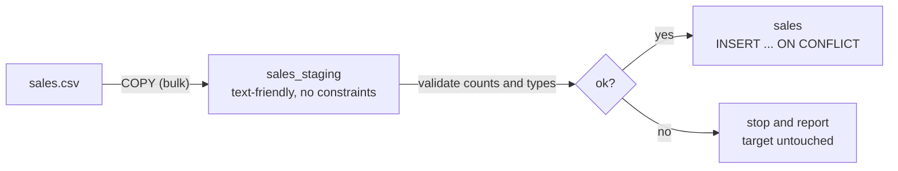

# Loading data into Postgres

After this you can bulk-load a CSV file with `COPY`, load through a staging table, upsert into the real table with `INSERT ... ON CONFLICT`, and check that the load kept every row.

Before this: [ETL and ELT pipelines](03-etl-and-elt-pipelines.md) and [creating and changing tables and data](../../10-databases-sql-and-postgres/03-schema-design/02-creating-and-changing-tables-and-data.md).

## The idea

A partner sends `sales.csv` every night with 20,000 rows. The obvious loader reads the file in Python and runs one `INSERT` per row. That works, but each statement is parsed, planned and (over a network) sent separately. Postgres has a command made for this job, `COPY`, which streams the whole file in as one statement.

The safe pattern has two stops. Data is copied into a staging table that has no constraints, checked, and then merged into the real table.



## Key terms

**`COPY`** is the Postgres command that moves rows between a table and a file or stream, in text, CSV or binary format. **`\copy`** is a `psql` command that does the same through your own machine: it reads the file on the client and sends it to the server as `COPY ... FROM STDIN`. Plain `COPY ... FROM 'file'` makes the server read a file on the server's disk, which needs a superuser or the `pg_read_server_files` role ([COPY docs](https://www.postgresql.org/docs/current/sql-copy.html), as of 2026).

An **upsert** inserts a row, or updates the existing one when a key already exists. In Postgres it is `INSERT ... ON CONFLICT (key) DO UPDATE`. In the update, `EXCLUDED` names the row that was rejected.

## How it works

Start by making a test file with Python's `csv` module. It quotes a value that contains a comma, which is the usual way a hand-written splitter breaks.

```python
import csv, random
random.seed(1)
with open("sales.csv", "w", newline="", encoding="utf-8") as f:
    w = csv.writer(f)
    w.writerow(["sale_id", "sale_date", "store", "amount"])
    for i in range(1, 20001):
        w.writerow([i, f"2026-06-{random.randint(1, 30):02d}",
                    random.choice(["Toronto", "Ottawa", "O'Brien, Ltd"]),
                    round(random.uniform(5, 200), 2)])
```

The file has 20,001 lines, and its first rows look like this:

```text
sale_id,sale_date,store,amount
1,2026-06-05,"O'Brien, Ltd",170.25
2,2026-06-25,Toronto,54.74
```

Loading it in a real Postgres is a `psql` step. Run this in WSL (Ubuntu) with a database already created. I could not run this here because there is no Postgres server on this machine; it is written from the documentation (unverified).

```bash
psql mydb -c "CREATE TABLE sales_staging (sale_id int, sale_date date, store text, amount numeric(10,2))"
psql mydb -c "\copy sales_staging FROM 'sales.csv' WITH (FORMAT csv, HEADER true)"
```

```text
COPY 20000
```

`HEADER true` skips the first line. Other options you will meet are `DELIMITER ';'` for other separators, `NULL ''` to say which text means `NULL` (in CSV format an unquoted empty string is `NULL` by default), and `QUOTE`. A bad row aborts the whole `COPY` by default, and the `ON_ERROR` option (newer versions only; check the COPY page for yours) can skip them instead.

The same command runs in the browser database PGlite, which lets us measure it from Node. This script loads the file with `COPY`, then loads the same 20,000 rows with one `INSERT` each into a copy of the table, and times both. It runs in-process, so the gap is smaller than over a network.

```javascript
import { PGlite } from "@electric-sql/pglite"
import { readFile } from "node:fs/promises"

const db = new PGlite()
await db.exec(`CREATE TABLE sales (sale_id int PRIMARY KEY, sale_date date, store text, amount numeric(10,2));
               CREATE TABLE sales_row AS SELECT * FROM sales WITH NO DATA;`)
const csv = await readFile("sales.csv")

let t = performance.now()
await db.query(`COPY sales FROM '/dev/blob' WITH (FORMAT csv, HEADER true)`,
               [], { blob: new Blob([csv]) })
console.log("COPY ms:", Math.round(performance.now() - t))

const lines = csv.toString().trim().split("\n").slice(1)
t = performance.now()
for (const line of lines) {
  const [id, d, , amt] = line.split(/,(?=(?:[^"]*"[^"]*")*[^"]*$)/)
  await db.query("INSERT INTO sales_row VALUES ($1, $2, 'x', $3)", [id, d, amt])
}
console.log("20000 single INSERTs ms:", Math.round(performance.now() - t))
console.log((await db.query("SELECT count(*)::int AS n, sum(amount) AS total FROM sales")).rows)
```

```text
COPY ms: 50
20000 single INSERTs ms: 552
[ { n: 20000, total: '2042741.05' } ]
```

In this run `COPY` was about 11 times faster, with no network between client and server; a real connection widens the gap. The `'/dev/blob'` path and the `blob` option are PGlite's way to give `COPY` a file; with a real server you use `\copy`. A plain `line.split(",")` fails on the `"O'Brien, Ltd"` row, so use a real CSV parser.

The merge step uses the upsert. This block creates a target with two rows and a staging table with one changed row (id 2) and one new row (id 3), runs the upsert twice, and shows the result.

<div class="sql-runner" data-db="warehouse" markdown>

```sql
CREATE TEMP TABLE target (sale_id int PRIMARY KEY, amount numeric(10,2));
CREATE TEMP TABLE staging (sale_id int, amount numeric(10,2));
INSERT INTO target VALUES (1, 10.00), (2, 20.00);
INSERT INTO staging VALUES (2, 25.00), (3, 30.00);
INSERT INTO target (sale_id, amount)
SELECT sale_id, amount FROM staging
ON CONFLICT (sale_id) DO UPDATE SET amount = EXCLUDED.amount;
INSERT INTO target (sale_id, amount)
SELECT sale_id, amount FROM staging
ON CONFLICT (sale_id) DO UPDATE SET amount = EXCLUDED.amount;
SELECT sale_id, amount FROM target ORDER BY sale_id;
```

</div>

The result is three rows: (1, 10.00), (2, 25.00), (3, 30.00). The second run changed nothing, which is what idempotent means. `ON CONFLICT` needs a unique index or primary key on the conflict column, and staging must not contain the same key twice, or Postgres raises an error.

## Worked examples

<div class="example" markdown>

### Example 1: validating a load

Never trust "no error" as "all rows arrived". After loading, compare the file with the table.

1. Count data lines in the file: 20,001 lines minus the header is 20,000.
2. Count rows in the table: the script above printed `n: 20000`.
3. Compare a sum of the money column in both places.

```python
import csv
from decimal import Decimal
with open("sales.csv", newline="", encoding="utf-8") as f:
    rows = list(csv.DictReader(f))
print(len(rows), sum(Decimal(r["amount"]) for r in rows))
```

```text
20000 2042741.05
```

Check: count 20000 and total 2042741.05 match the table. `Decimal` avoids float rounding in the file-side sum.

</div>

## Common mistakes

<div class="warning" markdown>

Watch out: using `COPY` when you mean `\copy`. `COPY 'sales.csv'` looks for the file on the database server, which may be a different machine, and your role may not be allowed to read files there. Use `\copy` from `psql`.

</div>

<div class="warning" markdown>

Watch out: loading straight into the final table. One bad value aborts the load, and a rerun inserts duplicates. Load into staging, then upsert.

</div>

<div class="warning" markdown>

Watch out: an upsert that overwrites newer data with older. If an old file is replayed, `DO UPDATE` rewrites good rows. Add `WHERE target.updated_at < EXCLUDED.updated_at` to the `DO UPDATE` clause when files can arrive out of order.

</div>

## Working with AI

<div class="ai" markdown>

Words to use: `COPY`, `\copy`, staging table, upsert, `ON CONFLICT`, `EXCLUDED`, idempotent, row count.

Prompts to try:

- "PostgreSQL 16, psql in WSL. Give the \copy command and a CREATE TABLE for a CSV with header sale_id,sale_date,store,amount. Fields with commas are quoted."
- "Write an INSERT ... ON CONFLICT upsert from sales_staging into sales that updates only when the staging row is newer."

What to check:

- `COPY` where `\copy` is needed, and the other way round.
- An upsert with no unique index on the conflict column, which fails at run time.
- Row-by-row `INSERT` loops for large files.
- Invented `COPY` options. Compare with the COPY page.

</div>

## Quiz

1\. What does `\copy` do that `COPY ... FROM 'file'` does not?

<details class="solution" markdown>
<summary>Answer</summary>

It reads the file on your machine and streams it to the server, so no file access on the server is needed.

</details>

2\. In `ON CONFLICT (sale_id) DO UPDATE SET amount = EXCLUDED.amount`, what is `EXCLUDED`?

<details class="solution" markdown>
<summary>Answer</summary>

The row that the insert tried to add and that conflicted. Its values replace the stored ones.

</details>

3\. Predict the final table after the upsert block ran with staging rows (2, 25.00) and (3, 30.00) on a target holding (1, 10.00) and (2, 20.00).

<details class="solution" markdown>
<summary>Answer</summary>

(1, 10.00), (2, 25.00), (3, 30.00). Row 2 is updated, row 3 is inserted, row 1 is untouched.

</details>

4\. The file has 20,000 data lines but the table has 19,998 rows after the load. Name two causes to check.

<details class="solution" markdown>
<summary>Answer</summary>

Duplicate keys that an upsert collapsed, or rows rejected or skipped by an option such as `ON_ERROR`. Compare the keys in staging with the target.

</details>

## Lab

<div class="lab" markdown>

### Lab: load and validate a CSV

Goal: bulk-load 20,000 rows and prove none were lost. Time: about 15 minutes. Runs in: Git Bash or PowerShell with Python and Node (`npm install @electric-sql/pglite` in an empty folder).

1. Save the Python generator above as `make_csv.py` and run `python make_csv.py`.
2. Save the Node script as `load.mjs` and run `node load.mjs`.
3. Compare the printed count and total with the Python check.
4. Change the generator to write `sale_id` 1 twice, reload into the table with a primary key, and read the error.
5. Cleanup: delete the folder.

Expected result: steps 1 to 3 print 20000 and 2042741.05; step 4 fails with a duplicate key error.

<details class="solution" markdown>
<summary>Solution</summary>

Step 4 stops the `COPY` with `duplicate key value violates unique constraint`, and nothing is loaded because the statement is one transaction. A staging table without a primary key accepts the file, and you remove duplicates with `SELECT DISTINCT ON (sale_id)` before the upsert.

</details>

</div>

## Where this shows up

- Orchestrators rerun these loads on failure: [orchestration and idempotent jobs](06-orchestration-and-idempotent-jobs.md).
- Checking counts and types is [data quality](09-data-quality.md).
