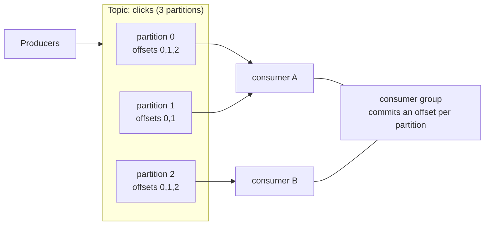

# Batch and streaming

After this you can choose between batch and streaming for a data feed, explain topics, partitions, consumer groups and offsets, and say why exactly-once delivery is hard.

Before this: [ETL and ELT pipelines](03-etl-and-elt-pipelines.md).

## The idea

The pipelines so far run on a schedule: every night, copy yesterday's sales. That is **batch** processing. It is simple, but the dashboard is always up to a day old. A fraud check on a card payment can't wait until tomorrow. **Stream** processing handles each event within seconds of when it happens.

The difference is when work starts. A batch job waits until a window of data has collected and then processes it all. A stream processor works on each event as it arrives.

```mermaid
gantt
    title Same events, two schedules
    dateFormat HH:mm
    axisFormat %H:%M
    section Batch
    Events collect (window 1)  :a1, 00:00, 120m
    Job runs on window 1       :crit, a2, 02:00, 20m
    Events collect (window 2)  :a3, 02:20, 100m
    section Stream
    Event processed on arrival :b1, 00:10, 2m
    Event processed on arrival :b2, 00:45, 2m
    Event processed on arrival :b3, 01:30, 2m
```



In the diagram, a batch result for an event at 00:10 is not available until the job ends at 02:20. The streamed event is processed at 00:10.

## Key terms

A **batch window** is the slice of data one batch run processes, for example one day. **Latency** is the delay between an event happening and its result being available. **Throughput** is how much data a system handles per unit time.

An **event** is a record that something happened (a click, a payment), with a timestamp. An **event stream** is an ordered, ever-growing sequence of events. **Kafka** is a widely used system for storing and delivering event streams. In Kafka, events are written to a **topic**, a named log. A topic is split into **partitions**, each an ordered, append-only log. Events with the same key go to the same partition, so their order is kept. An **offset** is an event's position in its partition. A **consumer group** is a set of consumers that share a topic: each partition is read by one consumer in the group, and the group remembers the last **committed offset** per partition. Separate groups read the same topic independently.

**Change data capture** (CDC) turns a database's changes into a stream of events. Debezium is a common tool: it reads the database's transaction log and publishes each insert, update and delete as an event to Kafka. That feeds the warehouse without querying the tables.

## How it works

Consider the tradeoff. Batch is cheaper and easier to reason about: one run, one output, easy to rerun. Streaming gives low latency but needs servers running all the time, handling late and out-of-order events, and recovering after failure. Most data work needs less freshness than people first say, so the usual question is "how stale is acceptable?" If the answer is hours, use batch.



A toy version of the log fits in a few lines of Python. The key is hashed to pick a partition (`crc32` is stable between runs, unlike Python's `hash` for strings), and the group commits an offset per partition.

```python
from zlib import crc32

PARTITIONS = 3
log = [[] for _ in range(PARTITIONS)]            # one topic, three partitions

def produce(key, value):
    p = crc32(key.encode()) % PARTITIONS         # same key -> same partition
    log[p].append((key, value))

for i, user in enumerate(["ana", "bo", "ana", "cy", "bo", "ana"]):
    produce(user, f"click-{i}")

offsets = {p: 0 for p in range(PARTITIONS)}      # the group's committed offsets

def poll(p):
    msgs = log[p][offsets[p]:]
    offsets[p] = len(log[p])                     # commit after processing
    return msgs

for p in range(PARTITIONS):
    print("partition", p, poll(p))
print("offsets", offsets)
print("second poll", [poll(p) for p in range(PARTITIONS)])
```

```text
partition 0 [('ana', 'click-0'), ('ana', 'click-2'), ('ana', 'click-5')]
partition 1 []
partition 2 [('bo', 'click-1'), ('cy', 'click-3'), ('bo', 'click-4')]
offsets {0: 3, 1: 0, 2: 3}
second poll [[], [], []]
```

All three of `ana`'s clicks are in partition 0 in order; the committed offsets mean a second poll returns nothing new. Commit timing is the hard part. If the consumer commits before processing and crashes, the event is lost (**at most once**). If it processes first and crashes before committing, the event is delivered again (**at least once**). **Exactly once** means each event's effect happens once. No system gets that for free across a network, because a crash between "did the work" and "recorded that it did" can't be avoided. Kafka offers transactions for work inside Kafka; for outside systems the practical answer is at-least-once delivery plus an idempotent write, such as the upsert from the previous lesson<!-- link: 04-loading-data-into-postgres.md --> keyed on an event id.

## Worked examples

<div class="example" markdown>

### Example 1: a batch of tumbling windows

A **tumbling window** is a fixed, non-overlapping time slice. Batch jobs over a day or a week are tumbling windows, and stream processors use the same idea on live data. Here the June 2026 sales are grouped by calendar week.

1. `date_trunc('week', full_date)` maps each date to the Monday that starts its week.
2. Group by that Monday and count sales.

<div class="sql-runner" data-db="warehouse" markdown>

```sql
SELECT date_trunc('week', d.full_date)::date AS week_start,
       count(*) AS sales,
       sum(f.net_amount) AS revenue
FROM fact_sales f
JOIN dim_date d ON d.date_key = f.date_key
WHERE d.full_date >= DATE '2026-06-01'
GROUP BY 1
ORDER BY 1;
```

</div>

Check: 5 windows with 24, 9, 11, 28 and 4 sales, which add up to the 76 June sales from the incremental-load example. The last window has only 4 sales because it holds just June 29 and 30; an unfinished window is why streaming systems must decide when a window is "closed".

</div>

## Common mistakes

<div class="warning" markdown>

Watch out: choosing streaming because "real time" sounds better. If the report is read once a morning, a nightly batch is simpler and cheaper.

</div>

<div class="warning" markdown>

Watch out: assuming a topic is ordered. Order holds inside one partition only, so events that must stay in order need the same key.

</div>

<div class="warning" markdown>

Watch out: trusting "exactly-once" in a product description. Ask where the effect is recorded and what happens on a crash between work and commit.

</div>

## Working with AI

<div class="ai" markdown>

Words to use: batch window, latency, topic, partition, consumer group, offset, at-least-once, idempotent consumer.

Prompts to try:

- "We have 50,000 order events per hour and a dashboard that is read each morning. Compare a nightly batch with a Kafka plus stream processor design on cost, complexity and freshness."
- "My consumer processes a message, writes to Postgres, then commits the offset. What happens if it crashes between the write and the commit, and how do I make the write safe to repeat?"

What to check:

- Claims of exactly-once with no idempotent write or transaction named.
- Partition keys that send most events to one partition.
- Version-specific Kafka settings. Compare them with the Kafka docs.

</div>

## Quiz

1\. Define latency, and say which of batch and streaming usually has lower latency.

<details class="solution" markdown>
<summary>Answer</summary>

Latency is the delay between an event and its result. Streaming has lower latency; batch waits for the window to close.

</details>

2\. Why do events for one customer need the same partition key?

<details class="solution" markdown>
<summary>Answer</summary>

Order is guaranteed only inside a partition, and the same key always maps to the same partition.

</details>

3\. A consumer commits the offset first and then crashes while processing the message. What is lost?

<details class="solution" markdown>
<summary>Answer</summary>

That message. The group restarts after the committed offset, so it is never processed (at most once).

</details>

4\. Predict the output.

<!-- db: warehouse -->
```sql
SELECT count(DISTINCT date_trunc('week', d.full_date))
FROM fact_sales f JOIN dim_date d ON d.date_key = f.date_key
WHERE d.full_date >= DATE '2026-06-01';
```

<details class="solution" markdown>
<summary>Answer</summary>

5, the same five weekly windows as the example.

</details>

## Lab

<div class="lab" markdown>

### Lab: watch the partitions

Goal: see keys map to partitions and offsets move. Time: about 10 minutes. Runs in: any terminal with Python.

1. Save the toy log above as `stream.py` and run it.
2. Change `PARTITIONS` to 2 and rerun. Which partition does each user land in now?
3. Add a user `"dee"` event and poll again. Do the offsets still add up to the number of events?
4. Simulate a crash: in `poll`, move the offset update after a `raise` for one message and observe the repeat.

Expected result: every user's events stay in one partition in order, and the total of the committed offsets equals the events produced.

<details class="solution" markdown>
<summary>Solution</summary>

With a stable hash the placement changes only because the number of partitions changed. The offsets add up to the event count (6, then 7). For step 4, if the offset is updated after processing and the process fails first, the next poll returns the same events again: at-least-once delivery.

</details>

</div>

## Where this shows up

- Keeping jobs rerunnable: [orchestration and idempotent jobs](06-orchestration-and-idempotent-jobs.md).
- Stream storage often lands in files and lakes: [file formats and columnar storage](08-file-formats-and-columnar-storage.md).
