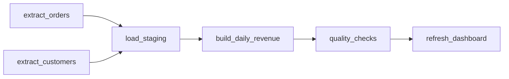

# Orchestration and idempotent jobs

After this you can describe a pipeline as a DAG of tasks, explain why every task must be safe to run twice, and write a load that is idempotent per partition.

Before this: [batch and streaming](05-batch-and-streaming.md) and [ETL and ELT pipelines](03-etl-and-elt-pipelines.md).

## The idea

A nightly pipeline has steps: extract orders, extract customers, load both, build the daily revenue table, run checks, refresh a dashboard. Some steps need others to finish first; some can run side by side. A cron entry can start a script at 02:00, but it can't say "run step 3 only after steps 1 and 2 succeeded, retry step 2 twice, and tell me if step 4 never started".

An **orchestrator** is a program that runs tasks in dependency order, retries failures, records every run, and shows the state of each task. Examples: Apache Airflow, Dagster and Prefect.



In the diagram, each box is a task and each arrow means "must finish successfully first". Nothing points backwards, so the graph is a DAG. The two extract tasks have no arrow between them and can run in parallel.

## Key terms

A **DAG** (directed acyclic graph) is a set of tasks with one-way dependencies and no cycles. A cycle would mean a task waits, eventually, for itself.

A **scheduler** starts work at set times (cron is the classic one). An orchestrator contains a scheduler and adds dependencies, retries, history and alerts.

A **run** is one execution of the DAG for one **logical date**, the slice of time the data belongs to (for example 2026-01-03), not the moment the code started. A **backfill** is running the DAG for past logical dates, for example after fixing a bug.

A job is **idempotent** if running it once or many times with the same input leaves the same final state. The word comes from mathematics: $f(f(x)) = f(x)$.

## How it works

Orchestrators retry, and humans re-run. A task can crash after writing half its rows, a retry then runs it again, and a backfill runs a month of old dates at once. If the task only appends, every rerun adds duplicates. So each task writes in a way that a rerun replaces its own earlier output.

The usual pattern is to make the write depend on the **partition**, the slice of the target table that one run owns (one day, one hour). There are two standard forms.

1. Delete-insert by partition: in one transaction, delete the rows for the run's partition, then insert the freshly computed rows. A rerun deletes what the earlier attempt wrote.
2. Upsert or `MERGE`: insert a row, or update it when the key already exists. This needs a unique key. `MERGE` is in PostgreSQL 15 and later ([MERGE docs](https://www.postgresql.org/docs/current/sql-merge.html)); `INSERT ... ON CONFLICT` is the older Postgres form.

Two rules go with this. Compute from the logical date, never from `now()`, or a backfill of January would use today's date. And keep the delete and the insert in one transaction, or a crash between them leaves the day empty.

Airflow, Dagster and Prefect express the same ideas in Python. This Airflow 3 sketch (taken from the [TaskFlow tutorial](https://airflow.apache.org/docs/apache-airflow/stable/tutorial/taskflow.html); not run here) shows a schedule, `catchup` (whether missed past runs are created) and retries:

```python
from airflow.sdk import dag, task
from datetime import datetime

@dag(schedule="@daily", start_date=datetime(2026, 1, 1), catchup=False)
def daily_revenue():
    @task(retries=2)
    def build(): ...
    build()

daily_revenue()
```

Cron's limits follow from the above: it has no dependencies between jobs, no retry, no record of which dates ran, and no backfill. It is fine for one self-contained script.

## Worked examples

<div class="example" markdown>

### Example 1: delete-insert by partition

The job below owns one day of `daily_sales`. We run it twice for the same day on the `warehouse` database.

1. `DELETE` removes any rows for 20250103. On the first run there are none.
2. `INSERT ... SELECT` writes the day's order count and revenue from `fact_sales`.
3. The second run deletes the first run's row and writes the same row again.

<div class="sql-runner" data-db="warehouse" markdown>

```sql
CREATE TABLE daily_sales (
  date_key integer PRIMARY KEY,
  orders   integer NOT NULL,
  revenue  numeric(12,2) NOT NULL
);

DELETE FROM daily_sales WHERE date_key = 20250103;
INSERT INTO daily_sales
SELECT date_key, count(*), sum(net_amount)
FROM fact_sales WHERE date_key = 20250103 GROUP BY date_key;

DELETE FROM daily_sales WHERE date_key = 20250103;
INSERT INTO daily_sales
SELECT date_key, count(*), sum(net_amount)
FROM fact_sales WHERE date_key = 20250103 GROUP BY date_key;

SELECT * FROM daily_sales;
```

</div>

Check: one row, 3 orders, revenue 94.74, even though the job ran twice. Delete the two `DELETE` lines and the second `INSERT` fails on the primary key; if the table had no primary key, it would silently hold two rows and 189.48 of revenue.

</div>

<div class="example" markdown>

### Example 2: the same idea with MERGE, in Python with a backfill

`MERGE` updates matching keys and inserts the rest, so one statement can load several days.

<div class="sql-runner" data-db="warehouse" markdown>

```sql
CREATE TABLE daily_sales (
  date_key integer PRIMARY KEY,
  orders   integer NOT NULL,
  revenue  numeric(12,2) NOT NULL
);

MERGE INTO daily_sales AS t
USING (SELECT date_key, count(*) AS orders, sum(net_amount) AS revenue
       FROM fact_sales WHERE date_key BETWEEN 20250101 AND 20250103
       GROUP BY date_key) AS s
ON t.date_key = s.date_key
WHEN MATCHED THEN UPDATE SET orders = s.orders, revenue = s.revenue
WHEN NOT MATCHED THEN INSERT (date_key, orders, revenue)
  VALUES (s.date_key, s.orders, s.revenue);

SELECT * FROM daily_sales ORDER BY date_key;
```

</div>

The result has 3 rows (22.49, 7.59 and 94.74). The Python version below wraps delete and insert in one transaction, retries a failed day, and is run over the whole range twice.

<details class="code" markdown>
<summary>In code</summary>

```python
import sqlite3
from datetime import date, timedelta

db = sqlite3.connect(":memory:")
db.execute("CREATE TABLE sales (day TEXT, amount REAL)")
db.execute("CREATE TABLE daily (day TEXT PRIMARY KEY, total REAL)")
db.executemany("INSERT INTO sales VALUES (?, ?)",
               [("2026-01-01", 10), ("2026-01-01", 5), ("2026-01-02", 7)])

def run_day(day):
    with db:  # one transaction: both statements commit together or not at all
        db.execute("DELETE FROM daily WHERE day = ?", (day,))
        db.execute("INSERT INTO daily SELECT day, sum(amount) FROM sales "
                   "WHERE day = ? GROUP BY day", (day,))

def backfill(start, end, retries=2):
    d = start
    while d <= end:
        for attempt in range(retries + 1):
            try:
                run_day(d.isoformat())
                break
            except sqlite3.Error:
                if attempt == retries:
                    raise
        d += timedelta(days=1)

backfill(date(2026, 1, 1), date(2026, 1, 2))
backfill(date(2026, 1, 1), date(2026, 1, 2))  # run the whole range again
print(db.execute("SELECT * FROM daily ORDER BY day").fetchall())
```

```text
[('2026-01-01', 15.0), ('2026-01-02', 7.0)]
```

</details>

</div>

## Common mistakes

<div class="warning" markdown>

Watch out: a plain `INSERT` in a task. The first retry doubles the day. On the `warehouse` database, inserting the day 20250103 twice gives 2 rows and 189.48 of revenue instead of 1 row and 94.74. Use delete-insert or `MERGE`.

</div>

<div class="warning" markdown>

Watch out: `WHERE order_date = current_date` inside a task. A backfill of last week then loads today seven times. Pass the logical date in as a parameter.

</div>

<div class="warning" markdown>

Watch out: an upsert that only updates some columns. If the source later changes or removes a row, the old values or the stale row stay. Decide whether a partition is replaced as a whole (delete-insert) or merged by key.

</div>

## Working with AI

<div class="ai" markdown>

Words to use: DAG, idempotent, logical date, partition, backfill, retry, `MERGE`, `catchup`.

Prompts to try:

- "Write an Airflow 3 DAG using `airflow.sdk` with three tasks: extract, load, check. The load must be idempotent per logical date using delete-insert in one Postgres transaction. No `datetime.now()`."
- "Here is my task code: [paste]. If it fails halfway and the orchestrator retries it, or I backfill 30 days, what ends up in the target table?"

What to check:

- Imports. Airflow 2 and 3 differ (`airflow.sdk` is Airflow 3); compare with the version you installed and its docs.
- Any `now()`, `current_date` or `datetime.now()` in task code.
- Delete and insert in one transaction, and the delete filtered on the same partition column as the insert.
- Whether `catchup` is set on purpose, because a new DAG with an old `start_date` may create hundreds of runs.

</div>

## Quiz

1\. Why can cron alone not run a pipeline that has dependencies?

<details class="solution" markdown>
<summary>Answer</summary>

Cron starts a command at a time. It has no notion of "after job A succeeded", no retries, no record of past runs and no backfill, so you would encode all of that in scripts yourself.

</details>

2\. A task appends yesterday's rows to a table. It fails on its last step and the orchestrator retries it. What is wrong, and what are two fixes?

<details class="solution" markdown>
<summary>Answer</summary>

The first attempt may already have written rows, so the retry duplicates them. Fix with delete-insert by partition in one transaction, or with an upsert/`MERGE` on a unique key.

</details>

3\. Predict the number of rows in `daily_sales` and the revenue after this runs.

<div class="sql-runner" data-db="warehouse" markdown>

```sql
CREATE TABLE daily_sales (date_key integer, orders integer, revenue numeric(12,2));
INSERT INTO daily_sales SELECT date_key, count(*), sum(net_amount) FROM fact_sales WHERE date_key = 20250103 GROUP BY date_key;
INSERT INTO daily_sales SELECT date_key, count(*), sum(net_amount) FROM fact_sales WHERE date_key = 20250103 GROUP BY date_key;
SELECT count(*) AS rows_for_day, sum(revenue) AS revenue FROM daily_sales;
```

</div>

<details class="solution" markdown>
<summary>Answer</summary>

2 rows and 189.48. Without a key or a delete step, the second insert adds a copy of the first.

</details>

4\. Why compute from the logical date and not from `now()`?

<details class="solution" markdown>
<summary>Answer</summary>

A rerun or backfill happens at a different time than the data it covers. With `now()`, rerunning January's job in March would load March's data under January's label.

</details>

## Lab

<div class="lab" markdown>

### Lab: make a load idempotent

Goal: turn an appending load into a rerun-safe one and prove it. Time: about 10 minutes. Runs in: the browser.

1. In the runner, create `daily_sales(date_key integer PRIMARY KEY, orders integer, revenue numeric(12,2))`.
2. Load day 20250104 with a plain `INSERT ... SELECT` from `fact_sales`.
3. Run the same load again and note the error.
4. Add a `DELETE` for that day before the insert, then run the pair twice.
5. Finish with `SELECT * FROM daily_sales`.

Expected result: one row for 20250104 after both runs.

<div class="sql-runner" data-db="warehouse" markdown>

```sql
-- write your steps here
SELECT 1;
```

</div>

<details class="solution" markdown>
<summary>Solution</summary>

<!-- db: warehouse -->
```sql
CREATE TABLE daily_sales (date_key integer PRIMARY KEY, orders integer, revenue numeric(12,2));
DELETE FROM daily_sales WHERE date_key = 20250104;
INSERT INTO daily_sales SELECT date_key, count(*), sum(net_amount) FROM fact_sales WHERE date_key = 20250104 GROUP BY date_key;
DELETE FROM daily_sales WHERE date_key = 20250104;
INSERT INTO daily_sales SELECT date_key, count(*), sum(net_amount) FROM fact_sales WHERE date_key = 20250104 GROUP BY date_key;
SELECT * FROM daily_sales;
```

</details>

</div>

## Where this shows up

- The next lesson, [dbt and SQL transformations](07-dbt-and-sql-transformations.md), builds the "build_daily_revenue" step as SQL models.
- [Data quality](09-data-quality.md) adds the checks gate before the dashboard refresh.
