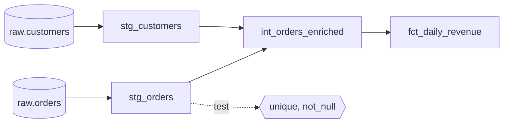

# dbt and SQL transformations

After this you can read a dbt project, explain what `ref()` and a materialization do, and add tests to a model.

Before this: [ETL and ELT pipelines](03-etl-and-elt-pipelines.md) and [orchestration and idempotent jobs](06-orchestration-and-idempotent-jobs.md).

## The idea

In ELT the raw data is already in the warehouse, and the "T" is a pile of SQL: clean the orders, join them to customers, aggregate by day. Left as loose scripts, that pile has no order, no tests and no record of which table feeds which.

dbt (data build tool) turns each piece of SQL into a **model**: one file holding one `SELECT`. dbt reads the files, works out the dependencies, and runs them in order as `CREATE VIEW` or `CREATE TABLE` statements in your warehouse. dbt does not move data out of the warehouse; the SQL runs inside it.



In the diagram, the cylinders are sources (tables dbt does not build). The next layer is **staging**: one model per source table that renames, casts and lowercases, nothing more. **Intermediate** models join and reshape. **Marts** are the tables people query: facts and dimensions, as in [star schemas](02-star-schemas-and-dimensional-modelling.md). This staging, intermediate, marts layout is the convention in dbt's [project structure guide](https://docs.getdbt.com/best-practices/how-we-structure/1-guide-overview).

## Key terms

A **model** is a `.sql` file containing a single `SELECT`. The file name is the name of the table or view dbt creates.

`ref('name')` refers to another model. dbt replaces it with the real table name and uses it to build the dependency graph, so models run in the right order.

`source('raw', 'orders')` refers to a table loaded by something else. It is declared in a YAML file, which lets dbt show it in the graph.

A **materialization** is how dbt stores a model: `view` (a stored query; cheap, recomputed on every read), `table` (rebuilt in full on each run), `incremental` (only new or changed rows are processed on later runs) or `ephemeral` (inlined as a CTE, never created).

A **test** is a `SELECT` that returns the rows that break a rule. The test passes when it returns zero rows.

**Lineage** is the graph of which model depends on which, generated from the `ref()` and `source()` calls.

## How it works

A small project looks like this:

```text
shop/
  dbt_project.yml          project name, default materializations
  profiles.yml             how to connect (usually outside the repo)
  models/
    staging/
      sources.yml          declares raw.customers and raw.orders
      stg_orders.sql
      stg_customers.sql
    marts/
      fct_daily_revenue.sql
      schema.yml           tests and column descriptions
```

A staging model is plain SQL plus a Jinja call. Jinja is a template language: dbt fills in `{{ ... }}` before sending the SQL to the database.

```sql
select
    order_id,
    customer_id,
    cast(amount_cents as decimal(12, 2)) / 100 as amount,
    lower(status) as status,
    cast(ordered_at as date) as order_date
from {{ source('raw', 'orders') }}
```

The mart joins two staging models with `ref()`:

```sql
select o.order_date, c.province,
       count(*) as orders, sum(o.amount) as revenue
from {{ ref('stg_orders') }} as o
join {{ ref('stg_customers') }} as c using (customer_id)
where o.status = 'paid'
group by o.order_date, c.province
```

Tests are declared in YAML next to the model. The four built into dbt are `unique`, `not_null`, `accepted_values` and `relationships` (every value in this column exists in another model's column, which is a foreign key check):

```yaml
version: 2
models:
  - name: stg_orders
    columns:
      - name: order_id
        data_tests: [unique, not_null]
      - name: customer_id
        data_tests:
          - relationships:
              arguments:
                to: ref('stg_customers')
                field: customer_id
```

`dbt run` builds the models, `dbt test` runs the tests, `dbt build` does both in dependency order, and `dbt docs generate` writes a documentation site with the lineage graph. The syntax above is from the [dbt data tests docs](https://docs.getdbt.com/docs/build/data-tests); older projects write `tests:` and put arguments directly under the test name. dbt Core 1.x is a Python package (`dbt-core` plus an adapter such as `dbt-postgres` or `dbt-duckdb`); dbt announced a v2 line in 2026, so check which major version you install.

An **incremental** model keeps its old rows and only processes new ones:

```sql
{{ config(materialized='incremental', unique_key='order_id') }}

select order_id, customer_id, amount, status, order_date
from {{ ref('stg_orders') }}

where order_date >= (select max(order_date) from {{ this }})

```

On the first run the `if` block is skipped and the whole table is built. Later runs add only recent rows, and `unique_key` makes dbt replace rows with a matching key instead of duplicating them, the same idempotency idea as the previous lesson.

## Worked examples

<div class="example" markdown>

### Example 1: run and test a real project

We built the project above in a throwaway virtual environment with `dbt-core` 1.12.6 and `dbt-duckdb` 1.11.0 (a DuckDB file stands in for the warehouse), with five raw orders and three customers. The raw status values are `PAID`, `Paid`, `paid` and `refunded`.

1. Run `dbt run`. dbt builds `stg_customers` and `stg_orders` as views and `fct_daily_revenue` as a table, in that order, because of the `ref()` calls.
2. Run `dbt test`. All five tests pass.
3. Read the mart.

```bash
dbt run --profiles-dir .
dbt test --profiles-dir .
```

```text
1 of 3 OK created sql view model main.stg_customers
2 of 3 OK created sql view model main.stg_orders
3 of 3 OK created sql table model main.fct_daily_revenue
Done. PASS=3 WARN=0 ERROR=0 SKIP=0 NO-OP=0 REUSED=0 TOTAL=3
Done. PASS=5 WARN=0 ERROR=0 SKIP=0 NO-OP=0 REUSED=0 TOTAL=5
```

The mart holds three rows: (2026-01-01, ON, 2 orders, 35.00), (2026-01-02, BC, 1, 40.00) and (2026-01-02, QC, 1, 18.00). Check: the refunded order (7.00) is absent, and the three spellings of `paid` were all counted because staging lowercased them.

</div>

<div class="example" markdown>

### Example 2: a failing test

We inserted an order with `order_id` 10 again, for the unknown customer 9, then ran `dbt test -s stg_orders`.

```text
FAIL 1 relationships_stg_orders_customer_id__customer_id__ref_stg_customers_
FAIL 1 unique_stg_orders_order_id
Got 1 result, configured to fail if != 0
Done. PASS=1 WARN=0 ERROR=2 SKIP=0 NO-OP=0 REUSED=0 TOTAL=3
```

Both bad rows are caught: the duplicate key by `unique` and the orphan customer by `relationships`. `not_null` still passes.

</div>

## Common mistakes

<div class="warning" markdown>

Watch out: hard-coding table names (`from analytics.stg_orders`) instead of `ref()`. dbt then cannot see the dependency, so it may run models in the wrong order and the lineage graph has gaps.

</div>

<div class="warning" markdown>

Watch out: an incremental model with no `unique_key`, or a filter that skips late-arriving rows. A rerun appends duplicates, and rows that arrive a day late are never picked up. Use a key, and filter with some overlap.

</div>

<div class="warning" markdown>

Watch out: a passing test suite is not proof of correct data. The tests check only the rules you wrote. The mart above would pass even if every amount were 100 times too large.

</div>

## Working with AI

<div class="ai" markdown>

Words to use: model, `ref()`, `source()`, materialization, incremental, `unique_key`, staging, mart, lineage.

Prompts to try:

- "Write a dbt staging model for `raw.orders` (columns: order_id, customer_id, amount_cents, status, ordered_at) that casts types and lowercases status. Use `source()`. Then write the schema.yml with unique and not_null tests, in dbt Core 1.12 syntax."
- "Convert this 120-line SQL script into dbt models: staging, one intermediate, one mart. Use `ref()` between them. [paste]"

What to check:

- Test syntax against your dbt version. Older examples use `tests:` and no `arguments:` block; compare with the docs page for your version.
- Every table reference is a `ref()` or `source()`, not a literal name.
- The `is_incremental()` filter. Ask what happens to a row that arrives late.
- Adapter-specific SQL (date functions, `qualify`) that your warehouse may not support.

</div>

## Quiz

1\. What does `ref('stg_orders')` give you that writing the table name does not?

<details class="solution" markdown>
<summary>Answer</summary>

dbt resolves it to the right schema for the environment and records the dependency, so it builds `stg_orders` first and shows the link in the lineage graph.

</details>

2\. A `view` model and a `table` model hold the same SELECT. What differs when you query them?

<details class="solution" markdown>
<summary>Answer</summary>

The view re-runs its SELECT on every read, so it is always current but costs compute each time. The table stores the result from the last `dbt run`, so reads are fast but can be stale.

</details>

3\. A test `unique` on `order_id` reports "Got 1 result". What does that mean?

<details class="solution" markdown>
<summary>Answer</summary>

The test's query returned one row: one `order_id` value that appears more than once. A passing test returns zero rows.

</details>

4\. An incremental model uses `where order_date >= (select max(order_date) from {{ this }})` and `unique_key='order_id'`. Why `>=` and not `>`?

<details class="solution" markdown>
<summary>Answer</summary>

With `>`, rows later on the latest date that arrive after the last run would be missed. With `>=`, the latest day is reloaded, and `unique_key` replaces its rows instead of duplicating them.

</details>

## Lab

<div class="lab" markdown>

### Lab: a three-model dbt project

Goal: build and test a tiny dbt project on DuckDB. Time: about 20 minutes. Runs in: WSL (Ubuntu) or any shell with Python (unverified in WSL; the example above ran on Windows).

1. Create a virtual environment, then run `pip install dbt-duckdb`.
2. Create the files from "How it works" (`dbt_project.yml`, `profiles.yml` with `type: duckdb` and `path: shop.duckdb`, the sources file and the three models).
3. Load raw tables with a short Python script using the `duckdb` package: `raw.customers` and `raw.orders`.
4. Run `dbt build --profiles-dir .`.
5. Insert a duplicate `order_id`, then run `dbt test` and read the failure.
6. Cleanup: delete the folder and the virtual environment.

Expected result: `PASS=8` on the first `dbt build` (3 models and 5 tests), then a `FAIL` on `unique` after step 5.

<details class="solution" markdown>
<summary>Solution</summary>

Use the models and YAML from this lesson. `dbt build` runs models and tests in dependency order, so a failing test on `stg_orders` also skips downstream models that depend on it.

</details>

</div>

## Where this shows up

- [Data quality](09-data-quality.md) goes beyond the four built-in tests.
- Analytics engineering jobs use dbt daily; the models usually run from an orchestrator as in [orchestration](06-orchestration-and-idempotent-jobs.md).
