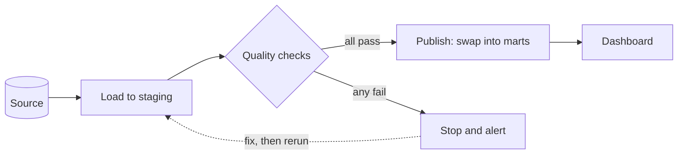

# Data quality

After this you can name the dimensions of data quality, write SQL checks for each, and place a check gate in a pipeline so bad data stops before it reaches a dashboard.

Before this: [dbt and SQL transformations](07-dbt-and-sql-transformations.md) and [star schemas and dimensional modelling](02-star-schemas-and-dimensional-modelling.md).

## The idea

A pipeline that finishes without an error has not shown that its output is right. A source system can send a day of rows twice, drop a column, or send an order for a customer who isn't in the customer table. The job succeeds, and the revenue chart is wrong. Nobody sees an error, so the problem lasts until someone notices.

The remedy is to treat checks as part of the pipeline. After loading, run queries that count rule violations. If any count is above zero, stop, mark the run failed and alert someone, instead of publishing.



In the diagram, the diamond is the gate. Data waits in staging until it passes; the marts and the dashboard keep serving the last good version. Because the load is idempotent (see [orchestration](06-orchestration-and-idempotent-jobs.md)), fixing the problem and rerunning is safe.

## Key terms

**Data quality** is how well data fits its intended use. It is described along dimensions, each of which can be tested:

| Dimension | Question | Example check |
|---|---|---|
| Completeness | Is anything missing? | no `NULL` in required columns; row count matches the source |
| Validity | Are values allowed? | quantity between 1 and 100; status in a known list |
| Uniqueness | Is each thing recorded once? | no duplicate `sale_id` |
| Consistency | Do related facts agree? | every fact row's `customer_key` exists in the customer table; totals agree between systems |
| Freshness | Is it recent enough? | the newest row is less than a day old |

A **data quality check** is a query or assertion that finds rows (or counts) violating a rule. **Reconciliation** compares the same figure across two places, such as the rows in the source and in the warehouse.

## How it works

Each check is a `SELECT` that returns the number of bad rows, so the pass condition is the same for all: zero. That makes checks easy to combine with `UNION ALL` and to run from a scheduler or from dbt.

1. Pick the rules for the table: its key, its required columns, its allowed ranges, its foreign keys.
2. Write one query per rule that counts violations.
3. Run them after the load, before the publish step.
4. Fail the run if any count is above zero. For rules you are unsure of, report a warning first, then promote it to a failure.

Tools exist so you don't write this plumbing yourself. dbt tests (the previous lesson) cover `unique`, `not_null`, `accepted_values` and `relationships`, and packages such as dbt-utils and dbt-expectations add more. Great Expectations is a Python library where you declare "expectations" (for example, column values are between 1 and 100) against a dataset and it produces a validation report ([docs](https://docs.greatexpectations.io/)); Soda and similar tools work the same way. All of them run checks like the ones below.

## Worked examples

<div class="example" markdown>

### Example 1: five checks on the warehouse

We run five checks against the real `fact_sales` table (1500 rows). Each returns a count of violations.

1. Duplicate keys: group by `sale_id` and keep groups of more than one row.
2. Nulls in a required column.
3. Orphans: a left join to the dimension, keeping the fact rows where no dimension row matched.
4. A range: quantity must be from 1 to 100.
5. A business rule: `net_amount` must not exceed quantity times unit price (a discount can only lower it).

<div class="sql-runner" data-db="warehouse" markdown>

```sql
SELECT 'duplicate sale_id' AS check_name, count(*) AS bad_rows
FROM (SELECT sale_id FROM fact_sales GROUP BY sale_id HAVING count(*) > 1) d
UNION ALL
SELECT 'null product_key', count(*) FROM fact_sales WHERE product_key IS NULL
UNION ALL
SELECT 'orphaned customer_key', count(*)
FROM fact_sales f LEFT JOIN dim_customer c ON c.customer_key = f.customer_key
WHERE c.customer_key IS NULL
UNION ALL
SELECT 'quantity out of range', count(*) FROM fact_sales WHERE quantity NOT BETWEEN 1 AND 100
UNION ALL
SELECT 'net_amount above list total', count(*) FROM fact_sales WHERE net_amount > quantity * unit_price;
```

</div>

Check: all five counts are 0, so the gate would open. A freshness check compares `max(date_key)` with the current date; here the newest sale is 20260630 and the oldest is 20250101, so freshness would fail in any live pipeline that expects yesterday's data.

</div>

<div class="example" markdown>

### Example 2: checks that fail

We copy January 2025 into a temporary staging table and add four bad rows: sale 9001 twice, sale 9002 for customer 999 who doesn't exist, and sale 9003 with quantity $-3$. Then we run the checks, including a row-count reconciliation against the source.

<div class="sql-runner" data-db="warehouse" markdown>

```sql
CREATE TEMP TABLE stg_sales AS
SELECT * FROM fact_sales WHERE date_key <= 20250131;

INSERT INTO stg_sales VALUES
  (9001, 20250115, 1, 1, 1, 2, 10.00, 20.00),
  (9001, 20250115, 1, 1, 1, 2, 10.00, 20.00),
  (9002, 20250116, 1, 1, 999, 1, 10.00, 10.00),
  (9003, 20250117, 1, 1, 1, -3, 10.00, -30.00);

SELECT 'duplicate sale_id' AS check_name, count(*) AS bad_rows
FROM (SELECT sale_id FROM stg_sales GROUP BY sale_id HAVING count(*) > 1) d
UNION ALL
SELECT 'orphaned customer_key', count(*)
FROM stg_sales s LEFT JOIN dim_customer c ON c.customer_key = s.customer_key
WHERE c.customer_key IS NULL
UNION ALL
SELECT 'quantity out of range', count(*) FROM stg_sales WHERE quantity NOT BETWEEN 1 AND 100
UNION ALL
SELECT 'row count vs source', (SELECT count(*) FROM stg_sales) - (SELECT count(*) FROM fact_sales WHERE date_key <= 20250131);
```

</div>

The result is 1 duplicated key (sale 9001), 1 orphan, 1 out-of-range quantity, and a row-count difference of 4 (all four inserted rows). The gate closes. Note that the count is of groups for the duplicate check and of rows for the others; decide which one your alert should report.

</div>

## Common mistakes

<div class="warning" markdown>

Watch out: a check that passes because it tests nothing. `WHERE x = NULL` is never true, and an inner join to a dimension hides orphans instead of finding them. Always test a new check against data you know is bad, as in Example 2.

</div>

<div class="warning" markdown>

Watch out: checking only after publishing. If the check runs on the live table, users have already seen the bad data. Check in staging, then publish.

</div>

<div class="warning" markdown>

Watch out: alert fatigue. A check that fails every day for a known reason gets ignored, and then the real failure is ignored too. Fix the cause or remove the check; use warnings for rules you are still tuning.

</div>

## Working with AI

<div class="ai" markdown>

Words to use: completeness, validity, uniqueness, freshness, consistency, reconciliation, orphaned row, quality gate.

Prompts to try:

- "Here is the DDL for my `fact_sales` and `dim_customer` tables: [paste]. Write PostgreSQL queries that each return the count of violations for: duplicate primary keys, orphaned foreign keys, negative quantities and a stale `loaded_at`. Return them as one `UNION ALL`."
- "Write the dbt `schema.yml` tests for these columns, using `unique`, `not_null`, `accepted_values` and `relationships`, in the syntax of dbt Core 1.12."

What to check:

- Run each generated check on rows you break on purpose. A check that cannot fail is useless.
- Whether the check uses the correct join direction (left join plus `IS NULL` finds orphans).
- Thresholds an AI invents (for example, "freshness under 6 hours") and ranges. They must come from your business rules.
- Great Expectations method names, which changed across major versions. Compare with the docs for your installed version.

</div>

## Quiz

1\. Which quality dimension does an orphaned foreign key violate?

<details class="solution" markdown>
<summary>Answer</summary>

Consistency: the fact row refers to a dimension row that does not exist.

</details>

2\. A pipeline loads 10,000 rows from a source that has 10,000 rows, but one `order_id` appears twice and one order is missing. Which check catches this, and which does not?

<details class="solution" markdown>
<summary>Answer</summary>

A uniqueness check on `order_id` catches the duplicate. A plain row-count reconciliation passes (10,000 equals 10,000), so it misses the offsetting error. Reconcile on a distinct count or a sum too.

</details>

3\. This orphan check always returns 0 even though orphans exist. Why?

<!-- db: warehouse -->
```sql
SELECT count(*)
FROM fact_sales f
JOIN dim_customer c ON c.customer_key = f.customer_key
WHERE c.customer_key IS NULL;
```

<details class="solution" markdown>
<summary>Answer</summary>

The inner join removes fact rows with no matching customer before the `WHERE` runs, so `c.customer_key` is never `NULL`. Use `LEFT JOIN`.

</details>

4\. Why run the checks on staging rather than on the final table?

<details class="solution" markdown>
<summary>Answer</summary>

On staging, a failure stops the run before consumers see the data. On the final table, the bad rows are already published.

</details>

## Lab

<div class="lab" markdown>

### Lab: build a quality gate

Goal: write checks that catch four planted problems. Time: about 15 minutes. Runs in: the browser.

1. Copy the setup from Example 2 into the runner.
2. Add a fifth planted row with `product_key` 500, which doesn't exist in `dim_product`.
3. Write an orphan check for `product_key`.
4. Add a check that flags `net_amount` greater than `quantity * unit_price`, and plant a row that breaks it.
5. Union all checks into one result and confirm each planted problem shows a count above 0.

Expected result: every check row shows at least 1.

<div class="sql-runner" data-db="warehouse" markdown>

```sql
-- build your gate here
SELECT 1;
```

</div>

<details class="solution" markdown>
<summary>Solution</summary>

<!-- db: warehouse -->
```sql
CREATE TEMP TABLE stg_sales AS SELECT * FROM fact_sales WHERE date_key <= 20250131;
INSERT INTO stg_sales VALUES
  (9004, 20250118, 500, 1, 1, 1, 10.00, 10.00),
  (9005, 20250119, 1, 1, 1, 1, 10.00, 15.00);

SELECT 'orphaned product_key' AS check_name, count(*) AS bad_rows
FROM stg_sales s LEFT JOIN dim_product p ON p.product_key = s.product_key
WHERE p.product_key IS NULL
UNION ALL
SELECT 'net above list total', count(*) FROM stg_sales WHERE net_amount > quantity * unit_price;
```

</details>

</div>

## Where this shows up

- Orchestrators place checks as a task before the publish step, as in [orchestration](06-orchestration-and-idempotent-jobs.md).
- Statistics for data work<!-- link: ../02-data-science-and-ml/01-statistics-for-data-work.md --> covers spotting outliers that fixed range rules miss.
