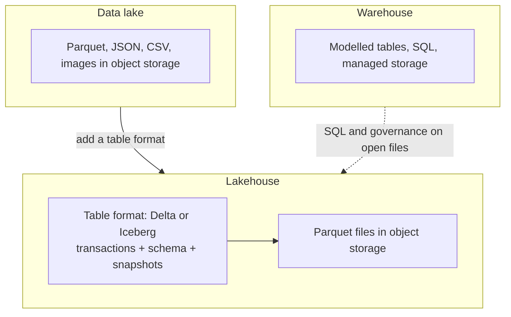

# Lakes, lakehouses and cloud warehouses

After this you can tell a data lake, a warehouse and a lakehouse apart, explain why cloud platforms separate storage from compute, and read a vendor's pricing page with the right question in mind.

Before this: [file formats and columnar storage](08-file-formats-and-columnar-storage.md) and [OLTP vs OLAP and warehouses](01-oltp-vs-olap-and-warehouses.md).

## The idea

A company collects order tables, app logs, JSON from partners and images. A warehouse wants structured, modelled tables; the logs and images don't fit. Storing everything cheaply as files first and deciding on structure later is the idea behind a data lake. The problem with plain files is that they have no transactions, no schema enforcement and no easy updates. A lakehouse adds those on top of the files.



In the diagram, the lake is files only. The warehouse is tables managed by the vendor. The lakehouse keeps open files in object storage but adds a table layer so queries behave like they do on tables.

## Key terms

**Object storage** stores files as objects in flat buckets, addressed by key: Amazon S3, Google Cloud Storage, Azure Blob Storage. It is cheap and scales without limit, but you can't edit a file in place; you replace the whole object.

A **data lake** is a large store of raw and processed data in open file formats, usually on object storage, with the schema applied when data is read (**schema on read**).

A **data warehouse** is a database built for analytics. Data is loaded into modelled tables with the schema fixed up front (**schema on write**), as in [star schemas](02-star-schemas-and-dimensional-modelling.md).

A **table format** is metadata kept beside the data files that tracks which files make up a table at each point in time. It gives a folder of Parquet files ACID transactions, schema changes, row-level updates and time travel (querying an older snapshot). The two common open formats are [Delta Lake](https://delta.io/) and [Apache Iceberg](https://iceberg.apache.org/).

A **lakehouse** is a lake with a table format and a SQL engine on top, so one copy of the data serves both BI and data science.

**Separation of storage and compute** means the data lives in shared storage and query engines are started, sized and stopped independently. Two teams can query the same data on separate compute without slowing each other, and you pay for compute only while it runs.

## How it works

A query in a lakehouse goes through the table format first. The engine reads the table's metadata to find the current list of data files, applies partition and column statistics to skip files (the pruning from the previous lesson), and then reads only the needed columns of the remaining Parquet files from object storage. An `UPDATE` writes new files and records in the metadata that the old ones are no longer part of the table; nothing is edited in place.

Cost follows from the separation. Storage is billed by the amount kept, compute by time or capacity used, and some services bill by bytes scanned per query. So a query on an unpartitioned table with `SELECT *` costs more than one that prunes. Always find out which of the three units a service bills, and set budgets or alerts before you let anyone run queries.

The main cloud platforms, as of 2026 (check each page for current features and pricing, which change often):

[Snowflake](https://docs.snowflake.com/en/user-guide/intro-key-concepts) describes three layers: shared storage, independent compute clusters called virtual warehouses, and a cloud services layer for metadata and security. Because compute is separate, you resize or pause a virtual warehouse without moving data.

[BigQuery](https://cloud.google.com/bigquery/docs/introduction) is Google Cloud's serverless warehouse: there are no clusters to size, and you pay either by data processed per query or by reserved capacity (unverified here; see the [pricing page](https://cloud.google.com/bigquery/pricing)). Partitioning and selecting few columns directly reduce the bill.

[Amazon Redshift](https://docs.aws.amazon.com/redshift/latest/mgmt/welcome.html) is AWS's warehouse. It comes as provisioned clusters or as a serverless option, and can also query data in S3.

[Databricks](https://docs.databricks.com/) is a platform built around the lakehouse idea and Apache Spark, using Delta Lake tables on cloud object storage, with SQL, notebooks and ML tooling.

## Worked examples

<div class="example" markdown>

### Example 1: querying a partitioned folder like a table

The partitioned Parquet folder from the file formats lesson already behaves like a small lake: files in `province=XX/` folders. We queried it with DuckDB 2.0.0 using `read_parquet` and `hive_partitioning=true`.

```python
import duckdb
q = """select province, count(*) as n, round(sum(amount), 2) as total
       from read_parquet('part/*/*.parquet', hive_partitioning=true)
       group by 1 order by 1"""
print(duckdb.sql(q).fetchall())
```

```text
[('AB', 199729, 12008733.53), ('BC', 200854, 12041953.02), ('MB', 199806, 12007605.39), ('ON', 199957, 12013984.9), ('QC', 199654, 11994587.12)]
```

Check: the five counts add to 1,000,000, the number of rows written. The folder name became the `province` column. What the folder lacks is a table format: no transactions, so a reader could see a half-written folder, and no record of which files belong to the table.

</div>

<div class="example" markdown>

### Example 2: reading a cost question

A team's BigQuery-style bill is mostly "bytes scanned". Two fixes: partition the table by date and require a date filter, and replace `SELECT *` in dashboards with the three columns they use. Both cut bytes read for the same answers, which is the pruning idea from the file formats lesson applied to money.

</div>

## Common mistakes

<div class="warning" markdown>

Watch out: "lake" without governance becomes a data swamp: files nobody can find, trust or delete. A catalog (names, owners, schemas) and quality checks matter more than the storage choice.

</div>

<div class="warning" markdown>

Watch out: starting a large cloud cluster or warehouse and leaving it running. Compute bills while it runs. Set auto-suspend and a budget alert, and shut down what you create in labs.

</div>

## Working with AI

<div class="ai" markdown>

Words to use: object storage, data lake, lakehouse, table format, Iceberg, Delta, separation of storage and compute, partition pruning.

Prompts to try:

- "We have 2 TB of Parquet on S3, 10 analysts using SQL and one data scientist using Python. Compare Snowflake, BigQuery, Redshift and a lakehouse on Iceberg for this, listing what is billed in each (storage, compute, scan)."
- "Explain what an Iceberg snapshot is and how time travel works, with a three-step example."

What to check:

- Prices, free tiers and feature names. Models invent them or give old figures; read the vendor's current page.
- Claims that one platform "is faster". Ask for a benchmark with your workload and check it yourself.
- Confusion between table formats (Delta, Iceberg) and file formats (Parquet).

</div>

## Quiz

1\. What does a table format like Iceberg add to a folder of Parquet files?

<details class="solution" markdown>
<summary>Answer</summary>

Metadata that tracks which files make up the table over time, giving transactions, schema changes, row-level updates and time travel.

</details>

2\. Why can two teams query the same data without slowing each other in Snowflake or a lakehouse?

<details class="solution" markdown>
<summary>Answer</summary>

Storage is shared and compute is separate. Each team runs its own compute cluster against the same data.

</details>

3\. A service bills per TiB scanned. A dashboard runs `SELECT *` over a 2 TiB table every hour with a filter on date. What two changes reduce cost?

<details class="solution" markdown>
<summary>Answer</summary>

Partition the table by date so the filter prunes data, and select only the needed columns so a columnar store reads less.

</details>

4\. Is Parquet a lakehouse? Explain.

<details class="solution" markdown>
<summary>Answer</summary>

No. Parquet is a file format. A lakehouse needs a table format (Delta or Iceberg) and an engine on top.

</details>

## Lab

<div class="lab" markdown>

### Lab: choose a platform on paper

Goal: justify a choice using the vocabulary, with no cloud account and no cost. Time: about 10 minutes.

1. Pick a scenario: a 50-person retailer with 100 GB of data, or a firm with 500 TB of logs.
2. List what it stores, who queries it, and how fast.
3. Choose warehouse or lakehouse, and name what you pay for (storage, compute, scan).
4. Write the two mistakes most likely to raise the bill, and the control for each.

Expected result: a half-page note that names a billing unit and a control.

<details class="solution" markdown>
<summary>Solution</summary>

For 100 GB, a managed warehouse (or even Postgres) is enough; the main cost risk is idle compute, controlled by auto-suspend. For 500 TB of logs, a lakehouse on object storage is cheaper per TB; the main risks are unpartitioned scans and tiny files, controlled by partitioning and compaction.

</details>

</div>

## Where this shows up

- Job postings for data engineers list Snowflake, BigQuery, Databricks or Redshift, plus Spark and dbt.
- [Data quality](09-data-quality.md) checks apply equally to lake and warehouse tables.
