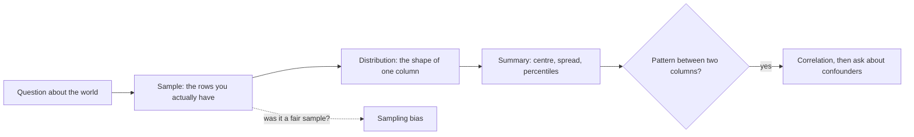
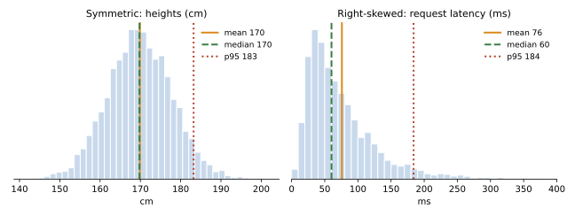

# Statistics for data work

After this you can summarise a column of numbers with the right statistic, explain why p95 latency matters more than the average, and spot three ways a dataset misleads you: sampling bias, confounders and Simpson's paradox.

Before this: [discrete probability](../../05-discrete-math-for-cs/05-discrete-probability.md) and [lists, dicts, sets and tuples](../../03-programming-fundamentals/01-python-basics/04-lists-dicts-sets-and-tuples.md).

## The idea

A dashboard says the average response time is 206 ms. Support says users complain the app hangs. Both can be true: twenty requests averaged 206 ms, but most took about 60 ms and a few took over two seconds. One number cannot describe a column of data, and the wrong number hides the problem.

Statistics for data work is a small toolkit. Pick a summary that matches the shape of the data, report how spread out the values are, and ask where the data came from before trusting any pattern in it.



## Key terms

The **mean** is the sum of the values divided by their count. The **median** is the middle value after sorting; half the values are below it. The **mode** is the most common value.

The **variance** is the average squared distance from the mean, and the **standard deviation** is its square root, which puts spread back in the units of the data. Python's `statistics.stdev` divides by $n-1$, the sample version, because the mean is itself estimated from the same data.

A **percentile** is the value below which a given share of the data falls. The 95th percentile (**p95**) is the value that 95% of requests are faster than. **p50** is the median.

A **distribution** describes how often each value occurs. It is **skewed** when one tail is longer than the other.

A **sample** is the subset you observed; the **population** is the group you want to know about. **Sampling bias** means the sample systematically differs from the population.

A **confounder** is a third variable that affects both of two variables you compare. **Correlation** measures how closely two variables move together, from $-1$ to $1$.

## How it works

Shape decides the summary. In the left panel, mean and median agree. In the right panel, a few slow requests pull the mean right, past the median, so the mean describes almost nobody.



Latency, income, file sizes and prices are right-skewed, so report the median and percentiles. Services also tend to have an SLO (a target) such as "p95 under 300 ms", because the slow tail is what users feel and a page that makes ten calls hits a slow one in about 40% of loads ($1 - 0.95^{10}$).

Two columns that move together are correlated, but that does not mean one causes the other. Ice cream sales and swimming accidents rise together because both follow temperature, the confounder. Only a randomised experiment (next but one lesson, [A/B testing](03-ab-testing.md)) separates cause from correlation.

## Worked examples

<div class="example" markdown>

### Example 1: twenty requests

We have 20 response times in milliseconds and want a fair summary.

1. Compute mean, median and standard deviation with the `statistics` module.
2. Compute percentiles with `quantiles(n=100)`; index 94 is p95. The `inclusive` method treats the data as the whole population.
3. Compare mean and median. A mean much larger than the median means a long right tail.

<details class="code" markdown>
<summary>In code</summary>

```python
import statistics as st

latency_ms = [42, 45, 47, 48, 50, 51, 52, 55, 58, 61,
              63, 66, 70, 74, 80, 95, 120, 340, 410, 2300]
print("mean  ", round(st.mean(latency_ms), 1))
print("median", st.median(latency_ms))
print("stdev ", round(st.stdev(latency_ms), 1))
q = st.quantiles(latency_ms, n=100, method="inclusive")
print("p90", round(q[89], 1), "p95", round(q[94], 1), "p99", round(q[98], 1))
```

```text
mean   206.3
median 62.0
stdev  502.5
p90 347.0 p95 504.5 p99 1940.9
```

</details>

The mean is more than three times the median, and the standard deviation is larger than the mean: both say the data is skewed. The real story is "typical 62 ms, one in ten over 347 ms". Check: remove the 2300 and the mean drops to about 96, which shows how much one outlier controls it.

</div>

<div class="example" markdown>

### Example 2: Simpson's paradox

Two checkout pages, A and B, are shown to visitors on mobile and desktop. Counts are conversions out of visitors.

| Device | A | B |
|---|---|---|
| Mobile | 30 / 300 = 10.0% | 110 / 900 = 12.2% |
| Desktop | 180 / 600 = 30.0% | 50 / 100 = 50.0% |
| Overall | 210 / 900 = 23.3% | 160 / 1000 = 16.0% |

B wins on each device, yet A wins overall. Device is the confounder: B was shown mostly to mobile visitors, who convert less on either page. The overall rate mixes the audience with the page. The fix is to compare within groups, or to randomise so both pages get the same mix.

</div>

## Common mistakes

<div class="warning" markdown>

Watch out: reporting an average for skewed data. Use the median plus p95 or p99, and say which one you used.

Watch out: reading a correlation as a cause. Ask what third variable could drive both, then look for an experiment.

Watch out: trusting a sample you did not choose. A survey of app users says nothing about people who left the app, and a log that only records successful requests hides the failures.

</div>

## Working with AI

<div class="ai" markdown>

Words to use: median, percentile, standard deviation, skewed distribution, sampling bias, confounder, Simpson's paradox.

Prompts to try:

- "Here are 5,000 request latencies from a Postgres-backed API. Give me p50, p95 and p99 with NumPy, and explain why the mean is misleading here."
- "These two variants have these conversion counts per device. Could this be Simpson's paradox? Show the per-group and pooled rates."

What to check:

- Which standard deviation: population ($n$) or sample ($n-1$). NumPy's `np.std` defaults to population, `statistics.stdev` to sample.
- Percentile method: different libraries interpolate differently, so p95 can differ slightly. Compare with a hand count on a small list.
- Causal wording ("increased", "led to") on a purely observational result.

</div>

## Quiz

1\. Why can the mean of response times be 200 ms while most users see about 60 ms?

<details class="solution" markdown>
<summary>Answer</summary>

A few very slow requests pull the mean up while the median stays near the typical value. The data is right-skewed, so the median and percentiles describe it better.

</details>

2\. Predict: a service has 4 requests at 10 ms and 1 at 110 ms. What are the mean and median?

<details class="solution" markdown>
<summary>Answer</summary>

Mean $= (40 + 110) / 5 = 30$ ms. Median is the third sorted value, 10 ms.

</details>

3\. A page makes 20 independent calls, each with a 1% chance of being slower than p99. About how often does a page load hit at least one slow call?

<details class="solution" markdown>
<summary>Answer</summary>

$1 - 0.99^{20} \approx 0.18$, so about 18% of loads. This is why tail latency matters more as a system makes more calls.

</details>

4\. Customers who buy a premium plan also open the app more. A teammate proposes pushing notifications to raise purchases. What do you check first?

<details class="solution" markdown>
<summary>Answer</summary>

Whether the link is causal. Engaged users may both open the app and buy (a confounder), so notifications might not change purchases. Run a randomised test: send notifications to a random half and compare.

</details>

## Lab

<div class="lab" markdown>

### Lab: summarise a skewed column

Goal: see mean, median and percentiles disagree on simulated data. Time: about 10 minutes. Runs in: any terminal with Python 3.

1. Save the script below as `summary.py`.
2. Run `python summary.py`.
3. Change `sigma=0.7` to `0.3` and run again. Predict first: does the gap between mean and median grow or shrink?
4. Cleanup: delete `summary.py`.

```python
import random
import statistics as st

random.seed(1)
data = [random.lognormvariate(4.1, 0.7) for _ in range(5000)]
q = st.quantiles(data, n=100, method="inclusive")
print(f"mean {st.mean(data):.1f}  median {st.median(data):.1f}  p95 {q[94]:.1f}  p99 {q[98]:.1f}")
```

Expected result: the mean sits above the median and p99 is about five times the median. With `sigma=0.3` the gap nearly closes.

```text
mean 75.6  median 59.6  p95 187.0  p99 298.2
mean 62.5  median 60.0  p95 98.0  p99 119.7
```

The first line is `sigma=0.7`, the second is `sigma=0.3`.

<details class="solution" markdown>
<summary>Solution</summary>

A log-normal variable is the exponential of a normal one, so it has a long right tail. The larger `sigma` is, the longer the tail and the further the mean moves above the median: the theoretical ratio of mean to median is $e^{\sigma^2/2}$, about 1.28 for 0.7 and 1.05 for 0.3.

</details>

</div>

## Where this shows up

- Percentile alerts in monitoring and SLOs<!-- link: ../../13-devops-and-cloud/04-operations/01-logging-metrics-and-monitoring.md -->.
- [A/B testing](03-ab-testing.md) builds on sampling and confounders; [training, testing and metrics](05-training-testing-and-metrics.md) reuses them for model evaluation.
