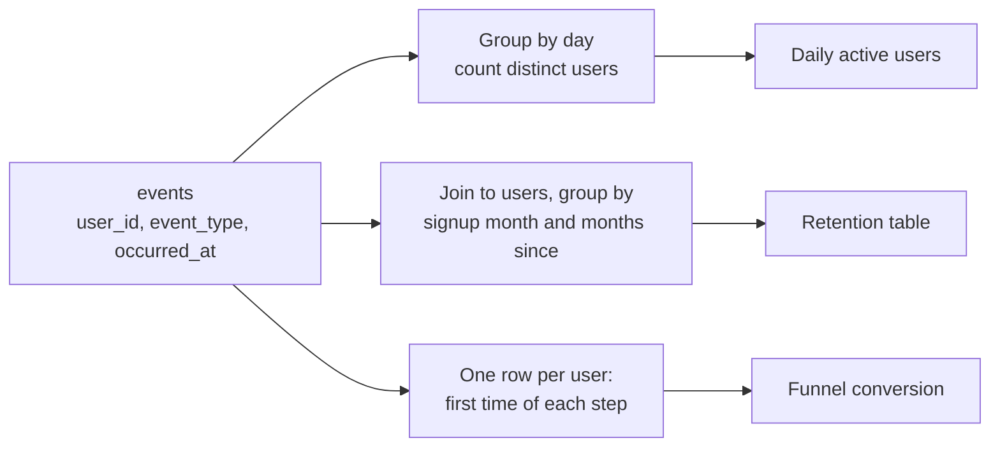
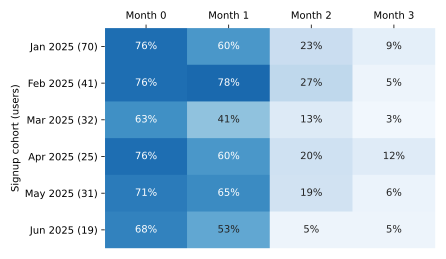
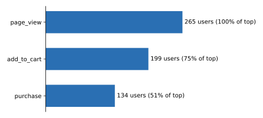

# Analytics in SQL: cohorts, funnels and retention

After this you can write SQL that answers the three standard product questions: how many people use it each day, how many come back, and where they drop out.

Before this: [window functions](../../10-databases-sql-and-postgres/02-querying/07-window-functions.md), [aggregates and GROUP BY](../../10-databases-sql-and-postgres/02-querying/03-aggregates-group-by-and-having.md) and [text, dates and times](../../10-databases-sql-and-postgres/02-querying/09-text-dates-and-times.md).

## The idea

A small web app wants to know three things. How many distinct people use it each day? Of the people who signed up in March, how many are still active in April and May? Of the people who looked at a page, how many added something to a cart, and how many bought it?

All three come from one table of events: who did what, and when. The `events` sample database has `users` (one row per user, with `signup_date`) and `events` (one row per action, with `event_type` and `occurred_at`). Analytics queries group those events by day, by signup month or by step.



## Key terms

**Daily active users (DAU)** is the number of distinct users with at least one qualifying event on a given day.

A **cohort** is a group of users who share a starting point, here the month they signed up. **Retention** is the share of a cohort still active some number of periods later.

A **funnel** is an ordered list of steps, with the number of users who reach each one. **Conversion** is the share who move from one step to the next.

An **event** is one recorded action. The `events` table stores `occurred_at` as `timestamp` (no time zone); this lesson treats those values as UTC.

## How it works

Three habits make these queries reliable.

1. Decide what "active" means and filter for it. Here `signup` is not activity, so every query excludes it.
2. Count distinct users, not rows. A user with ten page views is still one active user: `count(DISTINCT user_id)`.
3. Fix the time zone before grouping by day. A purchase at 02:00 UTC is still the previous evening in Toronto, so a day in UTC and a day in Toronto contain different events. Convert with `AT TIME ZONE` and put `SET TIME ZONE 'America/Toronto'` at the top so anything the session formats also uses Toronto time. `SET TIME ZONE` changes only how the session reads and shows `timestamptz` values; because `occurred_at` has no zone, the explicit double `AT TIME ZONE` is what moves the day boundary.

For daily active users, convert the timestamp, take the date, count distinct users, and use `lag()` to compare with the previous day that has data. The window function runs after the grouping, so it sees one row per day.

<div class="sql-runner" data-db="events" markdown>

```sql
SET TIME ZONE 'America/Toronto';

WITH local AS (
  SELECT user_id,
         ((occurred_at AT TIME ZONE 'UTC') AT TIME ZONE 'America/Toronto')::date AS day
  FROM events
  WHERE event_type <> 'signup'
)
SELECT day,
       count(DISTINCT user_id) AS dau,
       lag(count(DISTINCT user_id)) OVER (ORDER BY day) AS prev_active_day
FROM local
WHERE day BETWEEN '2025-01-02' AND '2025-01-10'
GROUP BY day
ORDER BY day;
```

</div>

The first row has `NULL` for `prev_active_day` because there is no earlier row. January 6 is missing: no one was active that day, so `lag` compares January 7 with January 5 (4 users), not with a zero. If you need zero-filled days, join to `generate_series` first. Check: January 5 has 4 active users and the next active day has 1, so `prev_active_day` on January 7 reads 4.

## Worked examples

<div class="example" markdown>

### Example 1: signup cohorts and retention

We want, for each signup month, the percentage of users active in month 0 (the signup month), month 1, month 2 and month 3.

1. `cohort` gives each user's signup month with `date_trunc('month', signup_date)`.
2. `activity` lists each user once per month in which they did anything except sign up.
3. `joined` pairs them and computes `month_n`, the number of months between the cohort month and the active month.
4. The final query counts users per `month_n` with `FILTER` and divides by the cohort size. Dividing by `cohort_size` and not by the month 0 count keeps a user who signed up but never did anything in the denominator.

<div class="sql-runner" data-db="events" markdown>

```sql
WITH cohort AS (
  SELECT user_id, date_trunc('month', signup_date)::date AS cohort_month
  FROM users
),
activity AS (
  SELECT DISTINCT user_id, date_trunc('month', occurred_at)::date AS active_month
  FROM events
  WHERE event_type <> 'signup'
),
sizes AS (
  SELECT cohort_month, count(*) AS cohort_size FROM cohort GROUP BY cohort_month
),
joined AS (
  SELECT c.cohort_month, c.user_id,
         (extract(year FROM a.active_month) - extract(year FROM c.cohort_month)) * 12
         + extract(month FROM a.active_month) - extract(month FROM c.cohort_month) AS month_n
  FROM cohort c
  JOIN activity a ON a.user_id = c.user_id
)
SELECT j.cohort_month, s.cohort_size,
       round(100.0 * count(*) FILTER (WHERE month_n = 0) / s.cohort_size) AS m0,
       round(100.0 * count(*) FILTER (WHERE month_n = 1) / s.cohort_size) AS m1,
       round(100.0 * count(*) FILTER (WHERE month_n = 2) / s.cohort_size) AS m2,
       round(100.0 * count(*) FILTER (WHERE month_n = 3) / s.cohort_size) AS m3
FROM joined j
JOIN sizes s ON s.cohort_month = j.cohort_month
WHERE j.cohort_month < '2025-07-01'
GROUP BY j.cohort_month, s.cohort_size
ORDER BY j.cohort_month;
```

</div>

The result is a table, and it reads best as a heat table: each row is a cohort, each column is months since signup, and darker cells mean more of the cohort is still active.



Check by reading across: each row falls quickly after month 1, which is the shape the data was built with. The February cohort's month 1 (78%) is higher than its month 0 (76%); that is possible because many February signups did their first real action the next month.

</div>

<div class="example" markdown>

### Example 2: a funnel with window functions

A funnel needs one row per user with the first time they reached each step. A user counts for a step only if they also passed the earlier ones, in order. Then a window function turns three counts into two percentages: `first_value` gives the top of the funnel and `lag` gives the previous step.

<div class="sql-runner" data-db="events" markdown>

```sql
WITH firsts AS (
  SELECT user_id,
         min(occurred_at) FILTER (WHERE event_type = 'page_view')   AS viewed_at,
         min(occurred_at) FILTER (WHERE event_type = 'add_to_cart') AS carted_at,
         min(occurred_at) FILTER (WHERE event_type = 'purchase')    AS bought_at
  FROM events
  GROUP BY user_id
),
steps AS (
  SELECT 1 AS step, 'page_view' AS name, count(viewed_at) AS users FROM firsts
  UNION ALL
  SELECT 2, 'add_to_cart', count(*) FROM firsts WHERE carted_at >= viewed_at
  UNION ALL
  SELECT 3, 'purchase', count(*) FROM firsts WHERE bought_at >= carted_at AND carted_at >= viewed_at
)
SELECT name, users,
       round(100.0 * users / first_value(users) OVER (ORDER BY step)) AS pct_of_top,
       round(100.0 * users / lag(users) OVER (ORDER BY step))         AS pct_of_previous
FROM steps
ORDER BY step;
```

</div>

Of 265 users who viewed a page, 199 (75%) added to a cart, and 134 of those 199 (67%) bought, which is 51% of the top. `events` holds 227 purchase rows, more than 134, because some users bought several times and some bought without the earlier steps in order; the ordered, once-per-user count is the funnel number. Check: 199 / 265 = 0.751 and 134 / 199 = 0.673.



</div>

## Common mistakes

<div class="warning" markdown>

Watch out: `count(*)` where you need `count(DISTINCT user_id)`. Ten page views from one user then count as ten active users.

Watch out: grouping by day in the wrong time zone, or comparing a half-finished current month with full months. Exclude the incomplete period, as the retention query does with its `WHERE` on the cohort month.

Watch out: a funnel that counts a purchase from a user who never viewed a page. Require the steps in order, as in Example 2.

</div>

## Working with AI

<div class="ai" markdown>

Words to use: cohort, retention, funnel, conversion, `date_trunc`, `count(DISTINCT ...)`, window function, `AT TIME ZONE`.

Prompts to try:

- "In PostgreSQL 16, write a monthly signup retention query for `users(user_id, signup_date)` and `events(user_id, event_type, occurred_at timestamp)`. Divide by cohort size and exclude `signup` events. Explain each CTE."
- "Convert `occurred_at` (a `timestamp` stored in UTC) to America/Toronto before grouping by day, and say why a plain `::date` would be wrong."

What to check:

- `AT TIME ZONE` on a `timestamp` and on a `timestamptz` do opposite things. Run a row near midnight and compare by hand.
- The denominator of retention: cohort size, not the month 0 count.
- Whether funnel steps are ordered per user, and whether one user is counted once per step.
- Month arithmetic: subtracting two dates gives days, not months.

</div>

## Quiz

1\. Why does the DAU query count `DISTINCT user_id` and not rows?

<details class="solution" markdown>
<summary>Answer</summary>

A user with many events in one day is one active user. Counting rows measures activity volume, not people.

</details>

2\. A purchase is stored as `2025-03-01 02:30:00` (UTC, no zone). Which Toronto day does it belong to?

<details class="solution" markdown>
<summary>Answer</summary>

February 28. Toronto is UTC-5 in early March (before daylight saving time starts on March 9, 2025), so 02:30 UTC is 21:30 the evening before.

</details>

3\. A retention query shows month 1 retention of 150% for a cohort. What is the likely bug?

<details class="solution" markdown>
<summary>Answer</summary>

Users are counted more than once per month, usually from joining raw events instead of distinct user-month rows (the `DISTINCT` in the `activity` CTE), or the denominator is the wrong count.

</details>

4\. In the funnel, why is the `pct_of_previous` of the first step `NULL`?

<details class="solution" markdown>
<summary>Answer</summary>

`lag(users)` looks at the previous row, and the first row has none. A division by `NULL` gives `NULL`.

</details>

## Lab

<div class="lab" markdown>

### Lab: funnel by plan

Goal: break the funnel down by plan to see whether paying plans convert better. Time: about 15 minutes. Runs in: the box below.

1. Start from Example 2's `firsts` CTE and join `users` to get `plan`.
2. For each plan, count users who viewed a page, users who carted after viewing, and users who purchased after carting.
3. Add `purchase_pct`: purchasers divided by viewers, as a percentage.
4. Order by plan name. Compare the three rates and say whether the sample is large enough to trust a gap (hint: check each plan's viewer count).

<div class="sql-runner" data-db="events" data-solution="sol-funnel-plan" markdown>

```sql
-- write your query here
SELECT 1;
```

</div>

<details class="solution" id="sol-funnel-plan" markdown>
<summary>Solution</summary>

```sql
WITH firsts AS (
  SELECT user_id,
         min(occurred_at) FILTER (WHERE event_type = 'page_view')   AS viewed_at,
         min(occurred_at) FILTER (WHERE event_type = 'add_to_cart') AS carted_at,
         min(occurred_at) FILTER (WHERE event_type = 'purchase')    AS bought_at
  FROM events
  GROUP BY user_id
)
SELECT u.plan,
       count(f.viewed_at) AS viewers,
       count(*) FILTER (WHERE f.carted_at >= f.viewed_at) AS carted,
       count(*) FILTER (WHERE f.bought_at >= f.carted_at AND f.carted_at >= f.viewed_at) AS bought,
       round(100.0 * count(*) FILTER (WHERE f.bought_at >= f.carted_at AND f.carted_at >= f.viewed_at)
             / count(f.viewed_at)) AS purchase_pct
FROM firsts f
JOIN users u ON u.user_id = f.user_id
GROUP BY u.plan
ORDER BY u.plan;
```

Basic converts 62% of its viewers and free 49%. Pro, at 46%, is lower than free. With only 50 to 158 viewers per plan, a gap of a few points is within noise (see [A/B testing](03-ab-testing.md)); the 62% for basic is based on 31 buyers.

</details>

</div>

## Where this shows up

- [A/B testing](03-ab-testing.md) uses the same per-user rows and conversion rates.
- [Star schemas and dimensional modelling](../01-data-engineering/02-star-schemas-and-dimensional-modelling.md) shows the warehouse layout these queries usually run on at scale.
