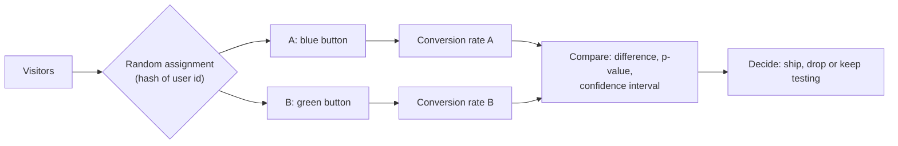

# A/B testing

After this you can design a simple experiment, run a two-proportion z-test in Python, read a p-value and a confidence interval correctly, and avoid the two most common traps: peeking and testing too many metrics.

Before this: [statistics for data work](01-statistics-for-data-work.md) and [analytics in SQL](02-analytics-sql-cohorts-funnels-retention.md).

## The idea

A designer proposes a green checkout button instead of the blue one. The funnel says 4.8% of visitors buy today. If you ship green and the rate goes to 5.4% next month, you still do not know whether the button did it, because the season, a promotion or the mix of visitors may have changed too. This is the confounder problem from the statistics lesson.

An **A/B test** removes it by running both versions at the same time. Each visitor is assigned at random to A (control) or B (treatment), so the two groups differ only by the button, apart from chance. Chance is the remaining problem: two random groups never convert at exactly the same rate. The statistics decide whether the observed gap is bigger than chance would produce.



## Key terms

A **hypothesis test** starts from the **null hypothesis**: there is no real difference between A and B. The **alternative** is that there is one.

A **p-value** is the probability of seeing a difference at least this large if the null hypothesis were true. It is not the probability that the null is true. By convention a result with $p < 0.05$ is called **statistically significant**; 0.05 is the **significance level**, $\alpha$.

A **confidence interval** is a range computed so that, if you repeated the experiment many times, 95% of the intervals would contain the true difference.

**Power** is the probability that the test detects a real difference of a chosen size; 80% is a common target. **Sample size** is the number of users needed per group to reach that power.

A **primary metric** is the one number chosen before the test to decide it. **Guardrail metrics** are others, such as page load time or refunds, that must not get worse.

## How it works

Plan the test before running it.

1. Write the hypothesis and the one primary metric (conversion rate).
2. Choose the smallest difference worth detecting (the minimum detectable effect).
3. Compute the sample size per group from the baseline rate, that difference, $\alpha$ and power.
4. Randomise by user, not by page view, so one person always sees the same version.
5. Run until the planned size is reached. Then compute the test once.

Sample size grows fast as the effect shrinks. Detecting a rise from 4.8% to 5.4% (+0.6 points) needs about 21,100 users per group, while a rise to 5.8% (+1.0 point) needs about 7,900. Halving the effect roughly quadruples the sample, because the standard error shrinks with $\sqrt{n}$.

For two conversion rates, the **two-proportion z-test** pools both groups to estimate the standard error of the difference, then divides the observed difference by it:

$$z = \frac{\hat p_B - \hat p_A}{\sqrt{\hat p\,(1-\hat p)\left(\frac{1}{n_A}+\frac{1}{n_B}\right)}}$$

Here $\hat p_A$ and $\hat p_B$ are the observed rates and $\hat p$ is the pooled rate. The p-value is the chance of a $z$ at least that far from 0 under the normal curve.

## Worked examples

<div class="example" markdown>

### Example 1: the green button

We ran 10,000 visitors per group. A had 480 purchases and B had 540.

1. Compute the rates: 4.80% and 5.40%, a difference of 0.60 points.
2. Pool the groups: $\hat p = 1020 / 20000 = 0.051$.
3. Compute $z$ and the two-sided p-value from the normal distribution.
4. Compute the 95% interval for the difference, using each group's own variance.

<details class="code" markdown>
<summary>In code</summary>

```python
from math import sqrt
from statistics import NormalDist

conv_a, n_a = 480, 10_000
conv_b, n_b = 540, 10_000
p_a, p_b = conv_a / n_a, conv_b / n_b
pooled = (conv_a + conv_b) / (n_a + n_b)
se = sqrt(pooled * (1 - pooled) * (1 / n_a + 1 / n_b))
z = (p_b - p_a) / se
p_value = 2 * (1 - NormalDist().cdf(abs(z)))
print(f"A {p_a:.2%}  B {p_b:.2%}  diff {p_b - p_a:.2%}")
print(f"z = {z:.2f}  p = {p_value:.3f}")

se_diff = sqrt(p_a * (1 - p_a) / n_a + p_b * (1 - p_b) / n_b)
lo, hi = (p_b - p_a) - 1.96 * se_diff, (p_b - p_a) + 1.96 * se_diff
print(f"95% CI for the difference: {lo:.2%} to {hi:.2%}")
```

```text
A 4.80%  B 5.40%  diff 0.60%
z = 1.93  p = 0.054
95% CI for the difference: -0.01% to 1.21%
```

</details>

The p-value is 0.054, just above 0.05, and the interval barely includes 0. The honest reading: the data is compatible with "no effect" and with an effect of up to about 1.2 points. It does not prove the button is useless, and it does not show it works. Options are to collect more data to the planned size, or to decide on cost and risk. Do not round 0.054 to "significant".

</div>

<div class="example" markdown>

### Example 2: peeking inflates false positives

Suppose A and B are identical (an "A/A test"), both at 5%, 2,000 users each, and you check the p-value after every 200 users and stop at the first $p < 0.05$. We simulated 2,000 such experiments:

```text
false positives, peeking 10 times: 0.1925
false positives, one look: 0.05
```

With one planned look, 5% of A/A tests look significant, as promised. With ten looks, 19% do. Each look is another chance for noise to cross the line. The same logic applies to **multiple testing**: with 20 independent metrics, the chance that at least one shows $p < 0.05$ by luck is $1 - 0.95^{20} = 64\%$. Pick one primary metric in advance, or use a correction such as dividing $\alpha$ by the number of tests (Bonferroni).

</div>

## Common mistakes

<div class="warning" markdown>

Watch out: stopping the test the moment the p-value dips under 0.05. Fix the sample size first, or use a method built for sequential looks.

Watch out: reading "p = 0.03" as "a 97% chance B is better". The p-value assumes the null is true; it says how surprising the data is, not how likely each hypothesis is.

Watch out: a significant result that is too small to matter. With millions of users a 0.01-point lift is significant. Check the interval against the smallest change worth shipping.

</div>

## Working with AI

<div class="ai" markdown>

Words to use: null hypothesis, p-value, confidence interval, power, minimum detectable effect, randomisation unit, guardrail metric, multiple comparisons.

Prompts to try:

- "I have 10,000 users per arm with 480 and 540 conversions. Run a two-proportion z-test in Python with `statistics.NormalDist`, and report the z, the two-sided p-value and the 95% interval for the difference."
- "My baseline conversion is 4.8%. How many users per group do I need to detect +0.6 points at 80% power and alpha 0.05? Show the formula."

What to check:

- One-sided versus two-sided p-values; the two-sided one is the default for "is B different".
- That the randomisation unit matches the analysis unit (users, not sessions).
- That the sample size was set before the test, and that the answer matches a hand calculation within a few percent.
- Any plain-English claim like "95% sure B is better" or "proves": those misstate what the numbers mean.

</div>

## Quiz

1\. Why assign visitors to A and B at random instead of showing A in week 1 and B in week 2?

<details class="solution" markdown>
<summary>Answer</summary>

Random assignment makes the groups comparable at the same time, so season, promotions and traffic mix affect both equally. Sequential weeks confound the button with everything that changed between the weeks.

</details>

2\. A test returns $p = 0.04$ with 95% interval 0.1 to 2.0 points. In plain words, what does the p-value say?

<details class="solution" markdown>
<summary>Answer</summary>

If there were no real difference, a gap this large or larger would show up about 4% of the time by chance. It is not a 96% probability that B is better.

</details>

3\. Predict: you want to detect a lift half as large as before. Does the needed sample per group go up by about 2 times or 4 times?

<details class="solution" markdown>
<summary>Answer</summary>

About 4 times. The standard error shrinks with $\sqrt{n}$, so halving the effect needs four times the data. From the examples: +1.0 point needs 7,875 per group and +0.5 would need about 30,100.

</details>

4\. A teammate checks the dashboard daily for two weeks and ships B the first day it shows $p < 0.05$. What is wrong?

<details class="solution" markdown>
<summary>Answer</summary>

Repeated looks inflate the false positive rate well above 5% (about 19% with ten looks in the simulation). Fix the sample size and look once, or use a sequential test designed for continuous monitoring.

</details>

## Lab

<div class="lab" markdown>

### Lab: simulate the peeking trap

Goal: reproduce the false positive rate of an A/A test with and without peeking. Time: about 15 minutes. Runs in: any terminal with Python 3.

1. Save the script below as `peek.py`.
2. Run `python peek.py` and note both rates.
3. Change `peeks=10` to `20`. Predict first: does the false positive rate go up or down?
4. Change `p=0.05` to `0.2`. Does the rate with one look still sit near 5%?
5. Cleanup: delete `peek.py`.

```python
import random
from math import sqrt

def aa_test(peeks, n=2000, p=0.05):
    ca = cb = 0
    for i in range(1, n + 1):
        ca += random.random() < p
        cb += random.random() < p
        if i % (n // peeks) == 0:
            pool = (ca + cb) / (2 * i)
            se = sqrt(pool * (1 - pool) * 2 / i)
            if se and abs((cb - ca) / i / se) > 1.96:
                return True
    return False

random.seed(3)
runs = 2000
print("peeking 10 times:", sum(aa_test(10) for _ in range(runs)) / runs)
print("one look        :", sum(aa_test(1) for _ in range(runs)) / runs)
```

Expected result: about 5% with one look and well above that with ten.

```text
peeking 10 times: 0.1925
one look        : 0.05
```

<details class="solution" markdown>
<summary>Solution</summary>

More peeks give more chances for noise to cross $z = 1.96$, so the rate rises with `peeks=20` (0.2535 with this seed). The one-look rate stays near 5% for any baseline `p` (0.052 at `p=0.2`), because the test is calibrated to its own significance level; only the peeking rate changes shape. Which exact values you get depends on the seed.

</details>

</div>

## Where this shows up

- Product teams split traffic with feature flags and read the result with the funnel queries from [analytics in SQL](02-analytics-sql-cohorts-funnels-retention.md).
- [Training, testing and metrics](05-training-testing-and-metrics.md) applies the same idea (compare on data you did not tune on) to models.
