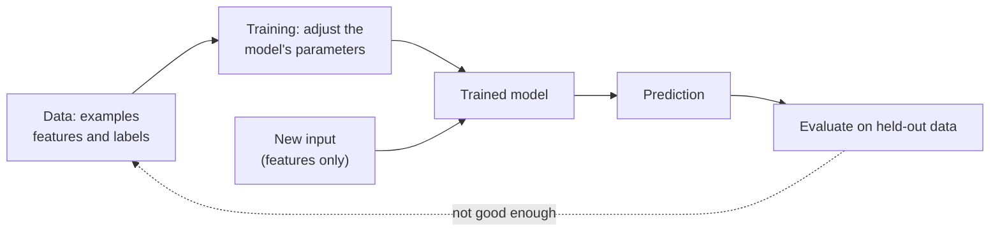
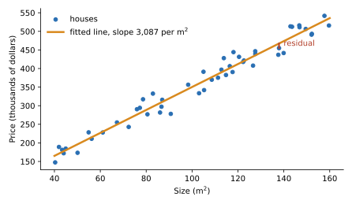
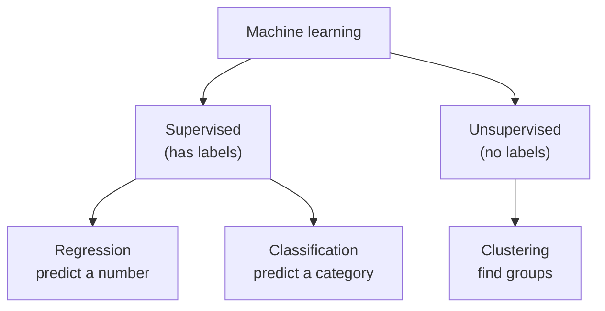

# What machine learning is

After this you can describe a machine learning problem in the standard vocabulary (features, labels, model, training), tell supervised from unsupervised learning, and decide when a plain rule or query is the better tool.

Before this: [statistics for data work](01-statistics-for-data-work.md) and [Python basics](../../03-programming-fundamentals/01-python-basics/04-lists-dicts-sets-and-tuples.md).

## The idea

You want to price houses. One approach is to write rules: "a 100 m$^2$ house costs 350,000 dollars". The rules break the first time a house has a different size, location or age. The other approach is to collect 50 sold houses, with their size and sale price, and let a program find the rule that fits them.

That is machine learning: instead of writing the rule, you give a program examples and it finds the rule. The rule is called a **model**, the examples are the **training data**, and finding the rule is **training** (or fitting). Afterwards the model predicts the price of a house it has never seen.



## Key terms

A **feature** is one input column the model uses, such as `size_m2`. A **label** (or target) is the column to predict, such as `price`. A row of features is an **example**.

**Supervised learning** trains on examples that have labels. **Unsupervised learning** has features only and looks for structure, such as groups.

A **parameter** is a number inside the model that training sets, such as the slope of a line. A **hyperparameter** is a setting you choose before training, such as the number of clusters.

**Regression** predicts a number (a price). **Classification** predicts a category (spam or not). **Clustering** puts similar examples into groups without labels.

**Inference** means using a trained model to predict. Training is slow and done rarely; inference is fast and done often.

## How it works

Take the simplest model: a line $\hat y = w x + b$, where $x$ is the size, $\hat y$ is the predicted price, and the slope $w$ and intercept $b$ are the parameters. Training tries values of $w$ and $b$ and keeps the ones with the smallest total error. The difference between actual and predicted price for one house is its **residual**.



Every supervised model, from a line to a large neural network, follows the same loop: guess parameters, measure the error on the training examples, adjust the parameters to reduce it. Models differ in how flexible the rule can be and in how they adjust.



## Worked examples

<div class="example" markdown>

### Example 1: fit a line, then cluster

First we fit a line to 50 simulated houses (the true rule is price $= 3000 \times$ size $+ 50{,}000$, plus noise), and ask for the price of a 100 m$^2$ house. Then we give `KMeans` two blobs of points with no labels and ask for two groups.

<details class="code" markdown>
<summary>In code</summary>

```python
import numpy as np
from sklearn.linear_model import LinearRegression
from sklearn.cluster import KMeans

rng = np.random.default_rng(0)
size = rng.uniform(40, 160, 50)                      # m^2
price = 3000 * size + 50_000 + rng.normal(0, 20_000, 50)
model = LinearRegression().fit(size.reshape(-1, 1), price)
print("learned slope    :", round(model.coef_[0]))
print("learned intercept:", round(model.intercept_))
print("predict 100 m^2  :", round(model.predict([[100]])[0]))

blobs = np.vstack([rng.normal([0, 0], 0.6, (30, 2)), rng.normal([5, 5], 0.6, (30, 2))])
km = KMeans(n_clusters=2, n_init=10, random_state=0).fit(blobs)
print("cluster sizes:", np.bincount(km.labels_))
print("centres:", km.cluster_centers_.round(1).tolist())
```

```text
learned slope    : 3087
learned intercept: 41660
predict 100 m^2  : 350383
cluster sizes: [30 30]
centres: [[4.9, 5.1], [-0.1, 0.0]]
```

</details>

The model recovered a slope near 3,000 and an intercept near 50,000 without being told the rule; the gap (3,087 and 41,660) is the noise in 50 examples. `fit` is training, `predict` is inference. In the second half, `KMeans` was never told which point belongs where; it found two groups of 30 around the centres we built, (0, 0) and (5, 5). Check: the prediction for 100 m$^2$ is close to $3000 \times 100 + 50{,}000 = 350{,}000$.

</div>

## When not to use ML

ML needs examples, costs effort to evaluate and monitor, and gives answers that are right most of the time rather than always. A rule, a SQL query or a lookup table is better when:

- the logic is known and stable (tax brackets, unit conversions),
- you must explain or guarantee each result (access control),
- you have few examples, or no way to check the output,
- a wrong answer is expensive and a simple baseline is already good enough.

Always build a baseline first, such as "predict the average price". A model that cannot beat it is not worth deploying.

## Common mistakes

<div class="warning" markdown>

Watch out: jumping to a model before checking the data. Missing values, wrong units and duplicates teach the model the wrong rule. Look at the columns first, with the tools from the statistics lesson.

Watch out: skipping the baseline. Without "always predict the average", a number like 80% accuracy has no meaning.

Watch out: calling a model "intelligent". A trained line or forest is a fitted function. It repeats patterns in its examples, including the mistakes in them.

</div>

## Working with AI

<div class="ai" markdown>

Words to use: features, label, supervised, regression, classification, clustering, baseline, parameters, inference.

Prompts to try:

- "I have a CSV of 10,000 past support tickets with a `category` column. Is this supervised classification or clustering? What would be the baseline model, and what would I measure?"
- "Is machine learning appropriate for calculating Ontario sales tax on an order? Compare it with a lookup table."

What to check:

- Whether the suggested model matches the problem type: a number needs regression, a category needs classification.
- That the answer names a baseline and an evaluation on held-out data.
- A proposal to use ML where a rule or SQL query would do.
- Library calls: look each up in the scikit-learn docs, since AI sometimes invents arguments.

</div>

## Quiz

1\. In the house example, which column is the label and which is a feature?

<details class="solution" markdown>
<summary>Answer</summary>

`price` is the label (what we predict). `size_m2` is a feature (an input).

</details>

2\. Classify each as regression, classification or clustering: (a) predict tomorrow's electricity demand in kWh, (b) decide whether an email is spam, (c) group customers by browsing behaviour with no predefined segments.

<details class="solution" markdown>
<summary>Answer</summary>

(a) Regression, (b) classification, (c) clustering.

</details>

3\. A fitted line has slope 3,087 and intercept 41,660. Predict the price of a 120 m$^2$ house.

<details class="solution" markdown>
<summary>Answer</summary>

$3087 \times 120 + 41660 = 412{,}100$ dollars.

</details>

4\. A teammate wants to train a model to decide whether a user may view an invoice. What do you suggest?

<details class="solution" markdown>
<summary>Answer</summary>

Use an access-control rule, such as a check on the owner id. The logic is known, must be exact, and a model's occasional mistakes would be a security bug.

</details>

## Lab

<div class="lab" markdown>

### Lab: beat the baseline

Goal: see that a model is only useful relative to a baseline. Time: about 10 minutes. Runs in: any terminal with Python 3 and scikit-learn (`pip install scikit-learn` in a virtual environment).

1. Save the script below as `baseline.py`. It splits the 50 houses into 40 for training and 10 for testing.
2. Run it and compare the two errors (mean absolute error in dollars).
3. Change `20_000` to `120_000` (a lot more noise) and run again. Predict first: does the model still beat the baseline by a large margin?
4. Cleanup: delete `baseline.py`.

```python
import numpy as np
from sklearn.dummy import DummyRegressor
from sklearn.linear_model import LinearRegression
from sklearn.metrics import mean_absolute_error

rng = np.random.default_rng(0)
size = rng.uniform(40, 160, 50).reshape(-1, 1)
price = 3000 * size.ravel() + 50_000 + rng.normal(0, 20_000, 50)
X_tr, X_te, y_tr, y_te = size[:40], size[40:], price[:40], price[40:]
for name, m in [("baseline (mean)", DummyRegressor()), ("linear", LinearRegression())]:
    m.fit(X_tr, y_tr)
    print(f"{name:16} MAE {mean_absolute_error(y_te, m.predict(X_te)):>9,.0f}")
```

Expected result with `20_000` of noise: the line cuts the error to about a fifth of the baseline.

```text
baseline (mean)  MAE    74,209
linear           MAE    16,099
```

<details class="solution" markdown>
<summary>Solution</summary>

With `120_000` the output is a baseline MAE of 117,632 and a linear MAE of 96,593, so the model is only about 18% better. When the noise swamps the signal, features explain little and even the best line cannot do much. The baseline shows you that, and a lone number like "MAE 96,593" would not.

</details>

</div>

## Where this shows up

- [Training, testing and metrics](05-training-testing-and-metrics.md) explains how to evaluate honestly.
- [Neural networks and deep learning](07-neural-networks-and-deep-learning.md) shows the same fit-by-adjusting loop at larger scale.
