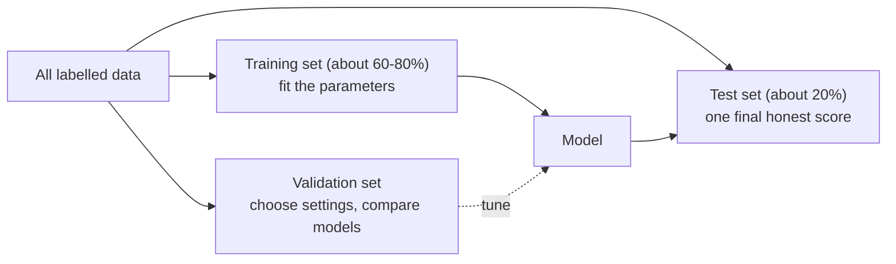
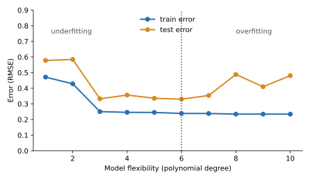
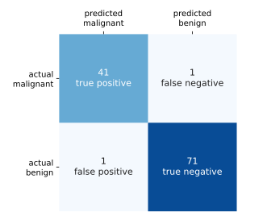

# Training, testing and metrics

After this you can split data correctly, recognise overfitting, choose a metric that fits the problem, and catch data leakage before it fools you.

Before this: [what machine learning is](04-what-machine-learning-is.md).

## The idea

A student memorises last year's exam and its answers. On that exam they score 100%. On this year's exam, with different questions, they score 60%. The first score measured memory; only the second measured understanding.

A model can memorise in the same way. Its score on the data it trained on says little about new data, and new data is what you care about. So you hide part of the data from training and use it only to judge the result.



## Key terms

The **training set** fits the parameters. The **validation set** is used to choose hyperparameters and compare models. The **test set** is touched once, at the end, for a final score.

**Overfitting** is when a model fits the noise in its training data and does worse on new data. **Underfitting** is when it is too simple to capture the pattern even on training data.

**Cross-validation** splits the data into $k$ folds, trains $k$ times, each time holding out a different fold, and averages the scores. It gives a steadier estimate than one split.

**Data leakage** is when information from outside the training set, such as test rows or the label itself, reaches the model during training.

A **confusion matrix** counts predictions by actual and predicted class. For a chosen positive class: **true positive** (TP), **false positive** (FP), **false negative** (FN), **true negative** (TN).

## How it works

Overfitting shows up as a gap. As a model gets more flexible, error on the training data keeps falling, but error on unseen data falls and then rises. In the figure, the training error (blue) drops to 0.23 while the test error (orange) bottoms out near 0.33 and then climbs: polynomials of degree 8 to 10 fit the 30 training points' noise.



The gap between the two curves is the signal. A large gap means overfitting: simplify the model, add data, or add regularisation. Two high errors close together mean underfitting: use a more flexible model or better features.

Metrics depend on the problem.

| Metric | Formula | Use it when |
|---|---|---|
| Accuracy | (TP + TN) / all | Classes are balanced and errors cost the same |
| Precision | TP / (TP + FP) | A false alarm is costly (spam filter hiding real mail) |
| Recall | TP / (TP + FN) | A miss is costly (missing a disease, fraud) |
| F1 | $2PR/(P+R)$ | One number that balances precision and recall |
| MAE | mean of $\lvert \text{error} \rvert$ | Regression, errors in the same units |
| RMSE | $\sqrt{\text{mean of error}^2}$ | Regression, big misses should hurt more |

**ROC-AUC** summarises a classifier across all decision thresholds: it is the probability that a random positive example is scored higher than a random negative one, so 0.5 is chance and 1.0 is perfect. It judges the ranking and ignores the threshold you finally pick.

For errors of 10, $-20$, 30 and $-100$ dollars, MAE is $(10+20+30+100)/4 = 40$ and RMSE is $\sqrt{(100+400+900+10000)/4} \approx 53.4$. RMSE is larger because the single 100 dollar miss counts for more.

## Worked examples

<div class="example" markdown>

### Example 1: a cancer classifier, scored honestly

The `load_breast_cancer` dataset has 569 tumours with 30 measurements each, labelled malignant (212) or benign (357). We hold out 20% as a test set, scale the features, fit a logistic regression and score it. We treat malignant (label 0) as the positive class, since a missed malignant tumour is the costly error.

1. `train_test_split` with `stratify=y` keeps the class mix the same in both parts and `random_state` makes the split repeatable.
2. The `Pipeline` fits the scaler on the training rows only, then applies it to the test rows.
3. Compute the confusion matrix and the metrics on the 114 test rows.
4. Run 5-fold cross-validation for a steadier estimate.

<details class="code" markdown>
<summary>In code</summary>

```python
from sklearn.datasets import load_breast_cancer
from sklearn.model_selection import train_test_split, cross_val_score
from sklearn.pipeline import make_pipeline
from sklearn.preprocessing import StandardScaler
from sklearn.linear_model import LogisticRegression
from sklearn.metrics import (confusion_matrix, precision_score, recall_score,
                             f1_score, accuracy_score, roc_auc_score)

X, y = load_breast_cancer(return_X_y=True)
X_tr, X_te, y_tr, y_te = train_test_split(X, y, test_size=0.2, random_state=42, stratify=y)
clf = make_pipeline(StandardScaler(), LogisticRegression(max_iter=1000)).fit(X_tr, y_tr)
pred = clf.predict(X_te)
print(confusion_matrix(y_te, pred, labels=[0, 1]))
print("accuracy ", round(accuracy_score(y_te, pred), 3))
print("precision", round(precision_score(y_te, pred, pos_label=0), 3))
print("recall   ", round(recall_score(y_te, pred, pos_label=0), 3))
print("f1       ", round(f1_score(y_te, pred, pos_label=0), 3))
print("roc auc  ", round(roc_auc_score(y_te, clf.predict_proba(X_te)[:, 1]), 3))
scores = cross_val_score(clf, X, y, cv=5)
print("cv scores", scores.round(3), "mean", scores.mean().round(3))
```

```text
[[41  1]
 [ 1 71]]
accuracy  0.982
precision 0.976
recall    0.976
f1        0.976
roc auc   0.995
cv scores [0.982 0.982 0.974 0.974 0.991] mean 0.981
```

</details>



Read the matrix first. Of 42 malignant tumours, 41 were caught (recall $41/42 = 0.976$); of 42 predicted malignant, 41 were right (precision $41/42 = 0.976$). Accuracy is $(41+71)/114 = 0.982$. The cross-validation mean is 0.981, close to the single split, so the split was not lucky. The test set was used once.

</div>

<div class="example" markdown>

### Example 2: two traps that give a good score for the wrong reason

Accuracy on imbalanced data: a fraud detector sees 1,000 transactions, 10 fraudulent. A "model" that always predicts "not fraud" scores 99% accuracy and has recall 0.

```text
accuracy 0.99 recall 0.0
```

Leakage through preprocessing: we make 100 rows of pure noise (500 random features, random labels), so no honest model can beat 50%. If we choose the 10 "best" features with `SelectKBest` on all rows first and then cross-validate, the score is 0.70. If `SelectKBest` sits inside the pipeline, so it is refit on each training fold, the score is 0.50. The first number is an illusion: the selection step had already seen the labels of the rows used for testing.

</div>

## Common mistakes

<div class="warning" markdown>

Watch out: fitting a scaler, imputer or feature selector on all the data before splitting. Put every step inside a `Pipeline` so it is fit on training rows only.

Watch out: tuning on the test set. Each time you look at test results and change something, the test set becomes a validation set. Keep one final test score.

Watch out: shuffling time-ordered data. For forecasting, train on the past and test on the future; a random split lets the model see the future.

</div>

## Working with AI

<div class="ai" markdown>

Words to use: train/test split, stratify, cross-validation, overfitting, precision, recall, F1, data leakage, pipeline.

Prompts to try:

- "My classifier gets 99% accuracy on a fraud dataset with 1% positives. Which metrics should I report instead, and how do I compute them in scikit-learn?"
- "Review this scikit-learn script for data leakage. Check where `fit_transform` is called relative to `train_test_split`."

What to check:

- Which class is "positive" in precision and recall. scikit-learn defaults to label 1, which may not be the class you care about.
- That scalers and encoders are inside the pipeline or fit only on training data.
- A suspiciously good score (above 99% on a hard problem) usually means leakage: look for features computed from the label.
- Random splits on time-ordered or grouped data (the same customer in train and test).

</div>

## Quiz

1\. What does a large gap between training score and test score tell you?

<details class="solution" markdown>
<summary>Answer</summary>

The model is overfitting: it fits the training data's noise and does not generalise. Simplify it, add data or regularise.

</details>

2\. A model flags 50 emails as spam; 40 really are spam. There are 100 spam emails in total. What are precision and recall?

<details class="solution" markdown>
<summary>Answer</summary>

Precision $= 40/50 = 0.8$. Recall $= 40/100 = 0.4$.

</details>

3\. Predict: a model's errors are 0, 0, 0 and 40. Which is larger, MAE or RMSE, and by how much?

<details class="solution" markdown>
<summary>Answer</summary>

MAE is $40/4 = 10$. RMSE is $\sqrt{1600/4} = 20$. RMSE is twice as large because the one big error is squared.

</details>

4\. You standardise the features on the whole dataset, then split into train and test. The test score is 0.95. What is wrong?

<details class="solution" markdown>
<summary>Answer</summary>

The means and standard deviations used to scale the training rows came partly from the test rows. That is mild leakage, and the score is slightly optimistic. Fit the scaler on the training set only, ideally inside a `Pipeline`.

</details>

## Lab

<div class="lab" markdown>

### Lab: watch a tree overfit

Goal: measure training and test accuracy of decision trees as they get deeper. Time: about 15 minutes. Runs in: any terminal with Python 3 and scikit-learn.

1. Save the script below as `depth.py`.
2. Run it and find the depth where test accuracy peaks.
3. Change `random_state=42` in `train_test_split` to `1` and run again. Predict first: will the best depth be the same?
4. Cleanup: delete `depth.py`.

```python
from sklearn.datasets import load_breast_cancer
from sklearn.model_selection import train_test_split
from sklearn.tree import DecisionTreeClassifier

X, y = load_breast_cancer(return_X_y=True)
X_tr, X_te, y_tr, y_te = train_test_split(X, y, test_size=0.2, random_state=42, stratify=y)
for depth in [1, 2, 3, 5, 8, None]:
    tree = DecisionTreeClassifier(max_depth=depth, random_state=0).fit(X_tr, y_tr)
    print(depth, round(tree.score(X_tr, y_tr), 3), round(tree.score(X_te, y_te), 3))
```

Expected result: training accuracy rises to 1.0 while test accuracy peaks at a shallow depth.

```text
1 0.923 0.921
2 0.958 0.895
3 0.976 0.939
5 0.993 0.93
8 1.0 0.912
None 1.0 0.912
```

<details class="solution" markdown>
<summary>Solution</summary>

Depth 3 has the best test accuracy (0.939). From depth 8 the tree reaches 1.0 on training data, memorising it, and test accuracy falls to 0.912. With only 114 test rows, one row is 0.9 percentage points, so the best depth moves with the split: with `random_state=1` test accuracy peaks at 0.956 from depth 5 on and never falls. That is why you compare models with cross-validation and not one split.

</details>

</div>

## Where this shows up

- [Regression and classification with scikit-learn](06-regression-and-classification-with-scikit-learn.md) applies this split-and-score routine to real models.
- The same hold-out idea, applied to an LLM's answers, is [evals](../../15-ai-and-llms/02-building-with-llms/07-evals.md).
