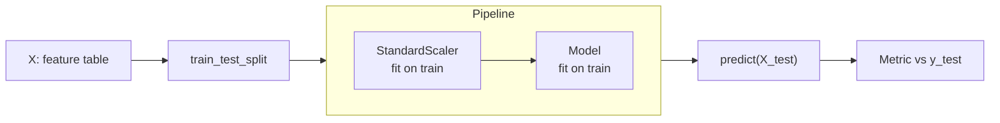

# Regression and classification with scikit-learn

After this you can fit, score and read a linear model, a logistic regression, a decision tree and a random forest in scikit-learn, and say which one to try first.

Before this: [training, testing and metrics](05-training-testing-and-metrics.md).

## The idea

Most everyday ML on tables is one of two jobs. Predict a number from columns (regression), or predict a category from columns (classification). scikit-learn gives every model the same interface, so the code for a line, a tree and a forest looks almost identical. The skill is in the surrounding steps: split, scale, score honestly and read what the model learned.



## Key terms

An **estimator** is any scikit-learn object with `fit(X, y)`. A model also has `predict(X)` and `score(X, y)`. A **transformer**, such as a scaler, has `fit` and `transform`.

A **pipeline** chains transformers and a final model into one estimator, so scaling is learned from the training rows only.

**Linear regression** predicts a number as a weighted sum of the features plus an intercept. **Logistic regression** is a classifier that passes a weighted sum through the S-shaped sigmoid function to get a probability between 0 and 1.

A **decision tree** asks a sequence of yes/no questions about features ("is `worst radius` below 16.8?") and predicts from the leaf you land in. A **random forest** trains many trees on random subsets of rows and features and averages their votes.

A **coefficient** is the weight a linear model gives a feature. **Feature importance** is a forest's score for how much each feature reduced error across its trees.

## How it works

Linear and logistic models are sensitive to the scale of features, because a weight on a feature measured in thousands is not comparable with a weight on one measured in fractions. `StandardScaler` rewrites each column to mean 0 and standard deviation 1, which also makes coefficients comparable. Trees and forests split on thresholds and do not need scaling.

After standardising, a linear coefficient reads as "the predicted change in the target when this feature rises by one standard deviation, with the others held fixed". For logistic regression the coefficient is a change in the log-odds of the positive class, so only the sign and the relative size are easy to read.

Two cautions. Coefficients describe the model, not the world: they show association, not cause. And when two features are strongly correlated, the model can split credit between them, so one coefficient can come out positive and the other negative.

Trees can fit any pattern if allowed to grow, which means they overfit (see the previous lesson); limit `max_depth`. A forest reduces that by averaging many different trees, at the price of being harder to read.

## Worked examples

<div class="example" markdown>

### Example 1: predicting diabetes progression (regression)

`load_diabetes` has 442 patients with 10 measurements (age, sex, body mass index `bmi`, blood pressure `bp`, and six blood serum values `s1` to `s6`) and a number measuring disease progression one year later. We compare against a baseline that always predicts the training mean.

1. Split 80/20. Compute the baseline error.
2. Fit a pipeline of scaler and `LinearRegression`. Report MAE, RMSE and $R^2$.
3. Print the four largest coefficients by absolute value.
4. Fit a depth-3 tree and a 200-tree forest and compare MAE.

<details class="code" markdown>
<summary>In code</summary>

```python
from sklearn.datasets import load_diabetes
from sklearn.ensemble import RandomForestRegressor
from sklearn.linear_model import LinearRegression
from sklearn.metrics import mean_absolute_error, root_mean_squared_error
from sklearn.model_selection import train_test_split
from sklearn.pipeline import make_pipeline
from sklearn.preprocessing import StandardScaler
from sklearn.tree import DecisionTreeRegressor

data = load_diabetes()
X_tr, X_te, y_tr, y_te = train_test_split(data.data, data.target, test_size=0.2, random_state=0)
print("baseline MAE", round(mean_absolute_error(y_te, [y_tr.mean()] * len(y_te)), 1))

reg = make_pipeline(StandardScaler(), LinearRegression()).fit(X_tr, y_tr)
pred = reg.predict(X_te)
print("linear MAE", round(mean_absolute_error(y_te, pred), 1),
      "RMSE", round(root_mean_squared_error(y_te, pred), 1), "R2", round(reg.score(X_te, y_te), 3))
coefs = reg[-1].coef_
for name, c in sorted(zip(data.feature_names, coefs), key=lambda p: -abs(p[1]))[:4]:
    print(f"{name:4} {c:6.1f}")

tree = DecisionTreeRegressor(max_depth=3, random_state=0).fit(X_tr, y_tr)
print("tree MAE", round(mean_absolute_error(y_te, tree.predict(X_te)), 1))
rf = RandomForestRegressor(n_estimators=200, random_state=0).fit(X_tr, y_tr)
print("forest MAE", round(mean_absolute_error(y_te, rf.predict(X_te)), 1))
```

```text
baseline MAE 59.2
linear MAE 46.2 RMSE 58.5 R2 0.332
s5     35.8
s1    -31.2
bmi    27.5
s2     15.3
tree MAE 54.6
forest MAE 47.8
```

</details>

The linear model beats the baseline (46.2 against 59.2) but explains only a third of the variance ($R^2 = 0.332$), so the features carry limited signal. The forest, at 47.8, does no better than the line on this split, and the shallow tree is worse. A fancier model is not automatically better on a small, noisy table. Among the coefficients, `bmi` is positive as expected. `s1` and `s2` are correlated serum measurements and take opposite signs (-31.2 and +15.3), which is the credit-splitting warning from above. Do not read either one alone. Check: the baseline MAE should be larger than every model's MAE, and it is.

</div>

<div class="example" markdown>

### Example 2: tumour type (classification)

The same routine on `load_breast_cancer` (label 1 is benign, 0 is malignant) with three classifiers.

<details class="code" markdown>
<summary>In code</summary>

```python
from sklearn.datasets import load_breast_cancer
from sklearn.ensemble import RandomForestClassifier
from sklearn.linear_model import LogisticRegression
from sklearn.model_selection import train_test_split
from sklearn.pipeline import make_pipeline
from sklearn.preprocessing import StandardScaler
from sklearn.tree import DecisionTreeClassifier

data = load_breast_cancer()
X_tr, X_te, y_tr, y_te = train_test_split(data.data, data.target, test_size=0.2,
                                          random_state=42, stratify=data.target)
log = make_pipeline(StandardScaler(), LogisticRegression(max_iter=1000)).fit(X_tr, y_tr)
print("logistic accuracy", round(log.score(X_te, y_te), 3))
coefs = log[-1].coef_[0]
for name, c in sorted(zip(data.feature_names.tolist(), coefs.tolist()), key=lambda p: -abs(p[1]))[:3]:
    print(f"{name:22} {c:6.2f}")

tree = DecisionTreeClassifier(max_depth=3, random_state=0).fit(X_tr, y_tr)
print("tree accuracy", round(tree.score(X_te, y_te), 3))
forest = RandomForestClassifier(n_estimators=200, random_state=0).fit(X_tr, y_tr)
print("forest accuracy", round(forest.score(X_te, y_te), 3))
imp = sorted(zip(data.feature_names.tolist(), forest.feature_importances_.tolist()), key=lambda p: -p[1])[:3]
for name, v in imp:
    print(f"{name:22} {v:.3f}")
```

```text
logistic accuracy 0.982
worst texture           -1.26
radius error            -1.08
worst concave points    -0.95
tree accuracy 0.939
forest accuracy 0.956
worst perimeter        0.138
worst radius           0.123
worst concave points   0.120
```

</details>

Logistic regression on scaled features gives 0.982, the tree 0.939 and the forest 0.956. Because label 1 is benign, a negative coefficient means a higher value makes benign less likely. The forest's importances point at tumour size features (`worst perimeter`, `worst radius`), while the logistic regression's largest weights are other features: both are valid summaries of correlated measurements, and neither says what causes a tumour to be malignant. With 114 test rows, 0.982 against 0.956 is a difference of three rows, so the ranking is weak evidence. Cross-validate before you pick.

</div>

## Common mistakes

<div class="warning" markdown>

Watch out: reading coefficients of unscaled features as importance. A weight depends on the feature's units. Scale first, or compare the effect of a standard deviation.

Watch out: assuming the more complex model wins. On Example 1, the forest was no better than a line. Start with a baseline and a linear or logistic model, and add complexity only when the validation score improves.

Watch out: trusting one score from a 100-row test set. Cross-validation (the previous lesson) shows how much the score moves.

</div>

## Working with AI

<div class="ai" markdown>

Words to use: pipeline, `StandardScaler`, coefficient, regularisation, feature importance, max depth, random forest, baseline.

Prompts to try:

- "Using scikit-learn 1.x, write a pipeline with `StandardScaler` and `LogisticRegression` for a CSV with numeric columns, a `train_test_split` with `stratify`, and print a confusion matrix and the F1 score."
- "Here are my linear regression coefficients on scaled features. Explain what each one means, and warn me about any that might be affected by correlated features."

What to check:

- That every scikit-learn function exists in your version (`root_mean_squared_error` is newer than `mean_squared_error(squared=False)`, which scikit-learn has since removed). Run the code and read the docs.
- That scaling happens inside the pipeline, not before the split.
- That importances and coefficients are not described as causes.
- That the code compares against a baseline.

</div>

## Quiz

1\. Why put `StandardScaler` inside a pipeline instead of scaling the whole table first?

<details class="solution" markdown>
<summary>Answer</summary>

The scaler's mean and standard deviation should come from the training rows only. Scaling the whole table lets test information leak into training.

</details>

2\. A logistic regression coefficient for `worst texture` is $-1.26$ and the positive class is benign. What does that say?

<details class="solution" markdown>
<summary>Answer</summary>

Holding the other features fixed, a higher `worst texture` lowers the log-odds of benign, so the model is less sure the tumour is benign. It describes association in this data, not cause.

</details>

3\. In Example 1 the forest MAE was 47.8 and the linear MAE 46.2. Which model do you keep, and what else do you want to know?

<details class="solution" markdown>
<summary>Answer</summary>

The linear model: it scores slightly better, is simpler and is easier to read. Confirm with cross-validation, because a gap of 1.6 on one split can come from the split.

</details>

4\. You set `max_depth=None` on a decision tree and get 100% training accuracy. Is that good news?

<details class="solution" markdown>
<summary>Answer</summary>

No. An unlimited tree can memorise the training rows. Check test accuracy, which in the lab of the previous lesson fell to 0.912 while training accuracy was 1.0.

</details>

## Lab

<div class="lab" markdown>

### Lab: compare three models with cross-validation

Goal: replace single-split scores with cross-validated scores. Time: about 15 minutes. Runs in: any terminal with Python 3 and scikit-learn.

1. Save the script below as `compare.py`.
2. Run it. It scores three classifiers on the breast cancer data with 5-fold cross-validation.
3. Add `from sklearn.dummy import DummyClassifier` and a `"baseline": DummyClassifier()` entry. Predict first: what accuracy does a model that always says the majority class get?
4. Cleanup: delete `compare.py`.

```python
from sklearn.datasets import load_breast_cancer
from sklearn.ensemble import RandomForestClassifier
from sklearn.linear_model import LogisticRegression
from sklearn.model_selection import cross_val_score
from sklearn.pipeline import make_pipeline
from sklearn.preprocessing import StandardScaler
from sklearn.tree import DecisionTreeClassifier

X, y = load_breast_cancer(return_X_y=True)
models = {
    "logistic": make_pipeline(StandardScaler(), LogisticRegression(max_iter=1000)),
    "tree": DecisionTreeClassifier(max_depth=3, random_state=0),
    "forest": RandomForestClassifier(n_estimators=200, random_state=0),
}
for name, model in models.items():
    s = cross_val_score(model, X, y, cv=5)
    print(f"{name:9} mean {s.mean():.3f}  std {s.std():.3f}")
```

Expected result:

```text
logistic  mean 0.981  std 0.007
tree      mean 0.917  std 0.022
forest    mean 0.960  std 0.019
```

With the baseline entry added, the fourth line is `baseline  mean 0.627  std 0.004`.

<details class="solution" markdown>
<summary>Solution</summary>

The baseline gets 0.627 because 357 of 569 tumours are benign ($357/569 = 0.627$), so "always benign" is right 62.7% of the time. Every model beats it by a wide margin. The logistic regression leads and is also the steadiest (smallest standard deviation across folds); the depth-3 tree trails by about 6 points, which is larger than its fold-to-fold spread, so that ranking is more believable than the 0.981 against 0.960 gap with the forest.

</details>

</div>

## Where this shows up

- [Neural networks and deep learning](07-neural-networks-and-deep-learning.md) replaces these models with a more flexible one, trained the same way.
- Trained models usually run inside scheduled jobs; see [orchestration and idempotent jobs](../01-data-engineering/06-orchestration-and-idempotent-jobs.md).
