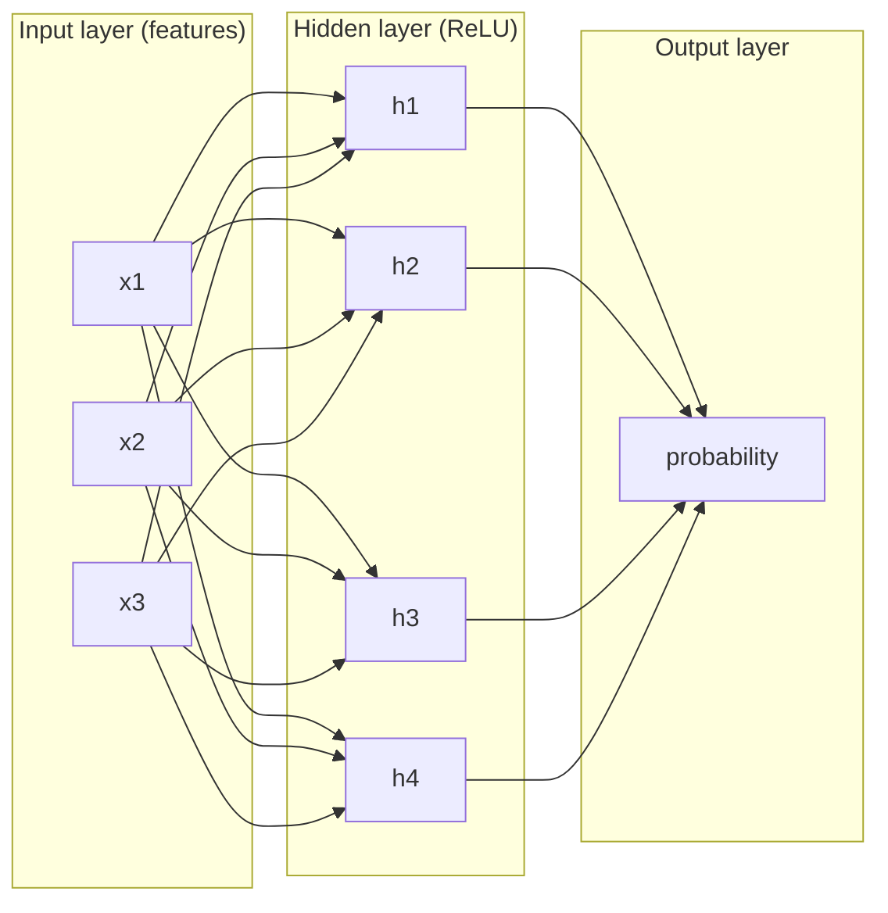
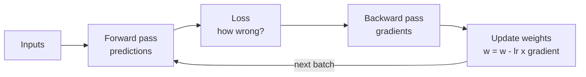

# Neural networks and deep learning

After this you can describe a neural network as layers of weighted sums and activations, explain training as gradient descent on a loss, and say why GPUs and embeddings matter for large models.

Before this: [regression and classification with scikit-learn](06-regression-and-classification-with-scikit-learn.md).

## The idea

Logistic regression draws one straight boundary between classes. Some patterns cannot be separated that way. The classic case is XOR, "true when exactly one of two inputs is 1": no single line separates the four points correctly.

A neural network stacks simple units so that the output of one layer feeds the next. The first layer builds simple features from the inputs, the next combines them into more complex ones, and so on. The network learns both the features and the final decision, from examples, with the same fit-by-reducing-error loop as before.



## Key terms

A **neuron** (or unit) computes a weighted sum of its inputs plus a bias, then applies an activation: $a = f(w_1 x_1 + w_2 x_2 + \dots + b)$.

An **activation function** $f$ bends the output. **ReLU** is $\max(0, z)$. The **sigmoid** squashes any number into the range 0 to 1. Without activations, stacked layers collapse into one linear model.

A **layer** is a group of neurons that share the same inputs. A **hidden layer** sits between input and output. **Deep learning** means networks with many layers.

The **loss** is one number measuring how wrong the predictions are on the training data, such as mean squared error. **Gradient descent** repeatedly nudges every parameter a small step in the direction that reduces the loss. The step size is the **learning rate**. **Backpropagation** is the algorithm that computes the gradient for all parameters at once.

An **epoch** is one pass over the training data.

An **embedding** is a list of numbers (a vector) that represents an item, such as a word, so that similar items get nearby vectors.

## How it works

Training repeats four steps.

1. **Forward pass:** push the inputs through the layers to get predictions.
2. **Loss:** compare predictions with the labels.
3. **Backward pass:** backpropagation finds how the loss changes with each weight, the gradient.
4. **Update:** move each weight a small step against its gradient: $w \leftarrow w - \eta \cdot \text{gradient}$, with learning rate $\eta$.



A useful picture is walking down a hill in fog: you feel the slope under your feet (the gradient) and step downhill. A learning rate that is too big overshoots, and one that is too small takes forever.

Why GPUs? A layer is a matrix multiplication: many independent multiply-and-add operations on the same inputs. A CPU has a few fast cores; a GPU has thousands of simpler ones that do those operations in parallel, so training and inference are much faster. GPU memory size also limits how large a model you can train.

Embeddings: A network takes numbers, not words or user ids. An embedding layer maps each id to a learned vector, and training moves vectors for similar items close together. This idea is the bridge to language models: a large language model turns text into tokens, tokens into embeddings, and passes them through many layers (a transformer). The AI chapter picks this up in from ML to transformers<!-- link: ../../15-ai-and-llms/01-how-llms-work/01-from-ml-to-transformers.md -->.

## Worked examples

<div class="example" markdown>

### Example 1: gradient descent on one weight

The data follows $y = 3x$ for $x = 1, 2, 3, 4$. The model is $\hat y = w x$ with one parameter, starting at $w = 0$. The loss is the mean squared error and the learning rate is 0.02.

1. At $w=0$ every prediction is 0, so the loss is the mean of $(3x)^2$, which is 67.5.
2. The gradient of the loss with respect to $w$ is the mean of $2(\hat y - y)x$, which is $-45$. The negative sign says: increase $w$.
3. The update is $w \leftarrow 0 - 0.02 \times (-45) = 0.9$.
4. Repeat. The loss falls and $w$ climbs toward 3.

<details class="code" markdown>
<summary>In code</summary>

```python
import numpy as np

x = np.array([1.0, 2.0, 3.0, 4.0])
y = 3 * x
w = 0.0
lr = 0.02
for step in range(1, 6):
    pred = w * x
    loss = np.mean((pred - y) ** 2)
    grad = np.mean(2 * (pred - y) * x)
    w -= lr * grad
    print(f"step {step}: loss {loss:7.3f}  gradient {grad:7.3f}  w {w:.3f}")
```

```text
step 1: loss  67.500  gradient -45.000  w 0.900
step 2: loss  33.075  gradient -31.500  w 1.530
step 3: loss  16.207  gradient -22.050  w 1.971
step 4: loss   7.941  gradient -15.435  w 2.280
step 5: loss   3.891  gradient -10.804  w 2.496
```

</details>

The loss roughly halves each step and the gradient shrinks as $w$ nears 3, so the steps get smaller on their own. Check: step 1 matches the hand calculation (67.5, $-45$, 0.9). A neural network does this for thousands to billions of weights at once.

</div>

<div class="example" markdown>

### Example 2: a small network in scikit-learn

`MLPClassifier` is scikit-learn's basic neural network (a multilayer perceptron). On XOR, logistic regression is stuck at chance and one hidden layer solves it. On the breast cancer data we use two hidden layers of 16 and 8 units and count the parameters.

<details class="code" markdown>
<summary>In code</summary>

```python
import numpy as np
from sklearn.datasets import load_breast_cancer
from sklearn.linear_model import LogisticRegression
from sklearn.model_selection import train_test_split
from sklearn.neural_network import MLPClassifier
from sklearn.pipeline import make_pipeline
from sklearn.preprocessing import StandardScaler

X = np.array([[0, 0], [0, 1], [1, 0], [1, 1]] * 25)
y = np.array([0, 1, 1, 0] * 25)
print("logreg on XOR", LogisticRegression().fit(X, y).score(X, y))
mlp = MLPClassifier(hidden_layer_sizes=(8,), activation="tanh", max_iter=2000, random_state=0).fit(X, y)
print("MLP on XOR   ", mlp.score(X, y))

X, y = load_breast_cancer(return_X_y=True)
X_tr, X_te, y_tr, y_te = train_test_split(X, y, test_size=0.2, random_state=42, stratify=y)
net = make_pipeline(StandardScaler(),
                    MLPClassifier(hidden_layer_sizes=(16, 8), max_iter=1000, random_state=0)).fit(X_tr, y_tr)
mlp = net[-1]
print("accuracy", round(net.score(X_te, y_te), 3))
print("weight shapes", [w.shape for w in mlp.coefs_])
print("parameters", sum(w.size for w in mlp.coefs_) + sum(b.size for b in mlp.intercepts_))
```

```text
logreg on XOR 0.5
MLP on XOR    1.0
accuracy 0.965
weight shapes [(30, 16), (16, 8), (8, 1)]
parameters 641
```

</details>

The weight shapes match the diagram: 30 inputs to 16 hidden units, 16 to 8, 8 to 1 output. The parameter count is $30 \times 16 + 16$ (weights and biases of layer 1) $+ 16 \times 8 + 8 + 8 \times 1 + 1 = 641$. The network scores 0.965 on the test set, below the logistic regression's 0.982 from the previous lesson: on a small table with 30 numeric columns, a neural network has no built-in advantage. Deep learning wins on images, audio and text, where features are hard to design by hand and data is plentiful.

</div>

## Common mistakes

<div class="warning" markdown>

Watch out: reaching for a neural network on a small table. A logistic regression or a forest is faster to train, easier to explain and often as accurate. Compare against them first.

Watch out: a learning rate that is too high. The loss goes up or becomes `nan`. Lower it by a factor of 10 and try again.

Watch out: forgetting to scale the inputs. Networks train poorly when features have very different ranges, so use `StandardScaler` in the pipeline.

</div>

## Working with AI

<div class="ai" markdown>

Words to use: layer, activation function, loss, gradient descent, learning rate, epoch, embedding, overfitting.

Prompts to try:

- "My `MLPClassifier` has test accuracy 0.97 and training accuracy 1.0. What does the gap mean and which three settings could I change?"
- "Explain backpropagation for a network with one hidden layer using a numeric example with two inputs, and show every gradient."

What to check:

- That a claimed gradient or shape works: recompute a tiny case by hand or check array shapes.
- Advice to use deep learning for a small tabular problem; compare against a simpler model.
- Loose language such as "the network understands": it fits parameters that reduce a loss.
- That the training loop evaluates on held-out data and does not rely on the training loss alone.

</div>

## Quiz

1\. Why do neural networks need non-linear activations?

<details class="solution" markdown>
<summary>Answer</summary>

Without them, each layer is a linear function, and a stack of linear functions is one linear function. Activations such as ReLU let the network represent curved boundaries like XOR.

</details>

2\. Predict: in Example 1, what happens to $w$ after step 1 if the learning rate is 0.2 instead of 0.02?

<details class="solution" markdown>
<summary>Answer</summary>

$w = 0 - 0.2 \times (-45) = 9$, which overshoots the target of 3. The next gradient is positive and large, so the weights oscillate or blow up. A high learning rate is why the loss sometimes goes up.

</details>

3\. A network has layers of size 10, 5 and 1 (10 inputs, one hidden layer of 5, one output). How many parameters does it have?

<details class="solution" markdown>
<summary>Answer</summary>

Layer 1: $10 \times 5 + 5 = 55$. Layer 2: $5 \times 1 + 1 = 6$. Total 61.

</details>

4\. Training accuracy is 100% and test accuracy is 90%. Name two things to try.

<details class="solution" markdown>
<summary>Answer</summary>

Any two of: fewer or smaller layers, more training data, regularisation (such as `alpha` in `MLPClassifier`), stopping training earlier.

</details>

## Lab

<div class="lab" markdown>

### Lab: choose the learning rate

Goal: see how the learning rate decides whether gradient descent converges. Time: about 10 minutes. Runs in: any terminal with Python 3 and NumPy.

1. Save the script below as `lr.py`.
2. Run it and compare the final loss for each learning rate.
3. Add `0.2` to the list. Predict first: converge or blow up?
4. Cleanup: delete `lr.py`.

```python
import numpy as np

x = np.array([1.0, 2.0, 3.0, 4.0])
y = 3 * x
for lr in [0.001, 0.02, 0.1]:
    w = 0.0
    for _ in range(50):
        grad = np.mean(2 * (w * x - y) * x)
        w -= lr * grad
    print(f"lr {lr:<6} w {w:10.4f}  loss {np.mean((w * x - y) ** 2):.6f}")
```

Expected result:

```text
lr 0.001  w     1.5909  loss 14.891101
lr 0.02   w     3.0000  loss 0.000000
lr 0.1    w     3.0000  loss 0.000000
```

<details class="solution" markdown>
<summary>Solution</summary>

A learning rate of 0.001 is stable but too slow: after 50 steps $w$ is still 1.59. Rates 0.02 and 0.1 reach 3. With `0.2`, $w$ ends near $-3.4 	imes 10^{15}$ and the loss is astronomically large. The update multiplies the error by $1 - 15\eta$ each step (the 15 comes from $2 	imes$ the mean of $x^2$, which is 7.5), and that factor has size above 1 once $\eta > 2/15 pprox 0.133$, so each step overshoots by more than the last.

</details>

</div>

## Where this shows up

- From ML to transformers<!-- link: ../../15-ai-and-llms/01-how-llms-work/01-from-ml-to-transformers.md --> continues with embeddings, attention and language models.
- [Training, testing and metrics](05-training-testing-and-metrics.md) applies to networks unchanged: split, watch the gap, score once.
