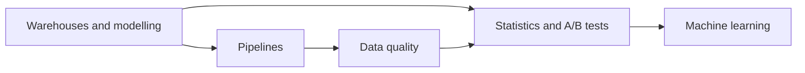

# Data engineering and data science

Warehouses, pipelines and dimensional modelling, then statistics, A/B testing and the basics of machine learning.

Before this folder: Databases, SQL and Postgres.

This folder has two chapters. Data engineering covers moving and shaping data: OLTP versus OLAP, warehouses and star schemas, ETL and ELT, batch and streaming, orchestration, dbt, columnar file formats and data quality. Data science and machine learning covers statistics, SQL analytics (cohorts, funnels), A/B testing, and the basics of training and evaluating models, up to neural networks.

AI tools can write a pipeline or a model quickly, but they do not know whether the numbers are right. The failures here are specific: a job that is not idempotent and double counts on retry, a metric with no baseline, a model evaluated on its training data, a result that is not statistically meaningful.

It builds on [Databases, SQL and Postgres](../10-databases-sql-and-postgres/index.md), since most of the work is SQL. It leads on to [AI and LLMs](../15-ai-and-llms/index.md), which depends on the machine learning ideas, and to [The workplace](../16-the-workplace/index.md).

### How to use this folder

- Labs use Postgres in WSL from the previous folder.
- The lakes, lakehouses and cloud warehouses lesson is optional, and only describes AWS services.
- Read What machine learning is before the AI and LLMs folder.

<!-- lessons:start -->
## Lessons

### 1. [Data engineering](01-data-engineering/index.md)

1. [OLTP vs OLAP and warehouses](01-data-engineering/01-oltp-vs-olap-and-warehouses.md)
2. [Star schemas and dimensional modelling](01-data-engineering/02-star-schemas-and-dimensional-modelling.md)
3. [ETL and ELT pipelines](01-data-engineering/03-etl-and-elt-pipelines.md)
4. [Loading data into Postgres](01-data-engineering/04-loading-data-into-postgres.md)
5. [Batch and streaming](01-data-engineering/05-batch-and-streaming.md)
6. [Orchestration and idempotent jobs](01-data-engineering/06-orchestration-and-idempotent-jobs.md)
7. [dbt and SQL transformations](01-data-engineering/07-dbt-and-sql-transformations.md)
8. [File formats and columnar storage](01-data-engineering/08-file-formats-and-columnar-storage.md)
9. [Data quality](01-data-engineering/09-data-quality.md)
10. [Lakes, lakehouses and cloud warehouses](01-data-engineering/10-lakes-lakehouses-and-cloud-warehouses.md) (optional)

### 2. [Data science and machine learning](02-data-science-and-ml/index.md)

1. [Statistics for data work](02-data-science-and-ml/01-statistics-for-data-work.md)
2. [Analytics in SQL: cohorts, funnels and retention](02-data-science-and-ml/02-analytics-sql-cohorts-funnels-retention.md)
3. [A/B testing](02-data-science-and-ml/03-ab-testing.md)
4. [What machine learning is](02-data-science-and-ml/04-what-machine-learning-is.md)
5. [Training, testing and metrics](02-data-science-and-ml/05-training-testing-and-metrics.md)
6. [Regression and classification with scikit-learn](02-data-science-and-ml/06-regression-and-classification-with-scikit-learn.md)
7. [Neural networks and deep learning](02-data-science-and-ml/07-neural-networks-and-deep-learning.md)

<!-- lessons:end -->
