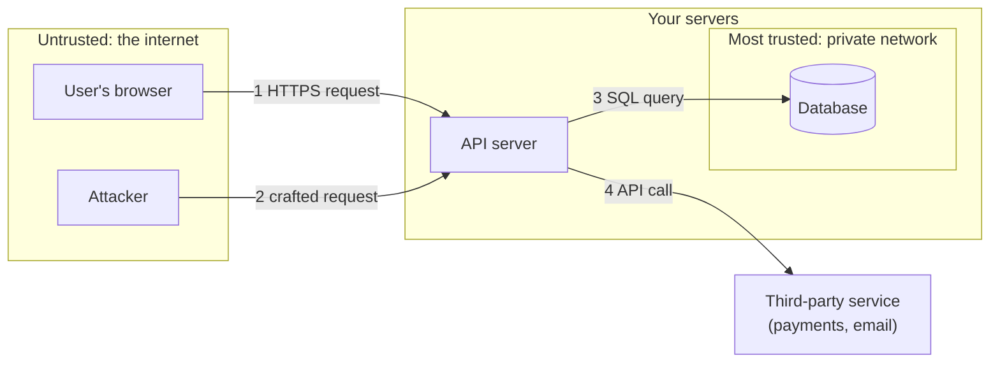

# Security mindset and threat modelling

After this you can draw a data-flow diagram of a small web app, mark where trust changes, and list threats against it with STRIDE.

Before this: [Authentication vs authorization](../../09-back-end/02-auth/01-authentication-vs-authorization.md) and [What a back end does](../../09-back-end/01-servers-and-apis/01-what-a-back-end-does.md).

## The idea

You build a notes app: a browser, an API and a database. It works. Now someone asks, "Is it secure?" That question has no answer until you say what you are protecting and from whom. A student sharing notes with friends and a clinic storing patient records face different attackers and lose different things.

The security mindset is a habit: for every feature, ask how it could be misused as well as how it is meant to be used. **Threat modelling** is that habit written down in four questions: what are we building, what can go wrong, what do we do about it, and did we do a good enough job (the [OWASP Threat Modeling Cheat Sheet](https://cheatsheetseries.owasp.org/cheatsheets/Threat_Modeling_Cheat_Sheet.html) uses the same four).

The first step is a picture. In the diagram, each box is a part of the system, each arrow is data moving, and each dashed box is a **trust boundary**: a line where data passes between parts that trust each other differently.

Every arrow that crosses a boundary is a place to ask what could go wrong. Arrow 2 is the important one: the API must treat every byte from the internet as hostile, even when it arrives from a logged-in user.

## Key terms

An **asset** is something worth protecting: user data, money, availability, a reputation.

An **attacker** (or threat actor) is whoever might harm an asset, with a goal, skills and access. A bored teenager with a scanner and a former employee with a password are different attackers.

The **attack surface** is every point where an attacker can send input or reach the system: endpoints, forms, file uploads, admin pages, dependencies, even support staff.

A **trust boundary** is the place where data moves between components with different privilege or trust. Validation and authentication belong on these lines.

**Defence in depth** means stacking independent protections so that one failure does not lose the asset. **Least privilege** means each user, process and key gets only the access its job needs. **Secure by default** means the safe setting is the one you get without configuring anything.

## How it works: STRIDE

**STRIDE** is a checklist of six threat types. Walk each arrow and box in your diagram and ask whether each letter applies.

| Letter | Threat | Property broken | Example in the notes app | Typical defence |
|---|---|---|---|---|
| S | Spoofing | Authentication | Logging in with a stolen password | MFA, hashed passwords, rate limits |
| T | Tampering | Integrity | Changing another user's note id in a request | Authorization checks, signed data |
| R | Repudiation | Non-repudiation | "I never deleted that note" | Audit logs |
| I | Information disclosure | Confidentiality | A stack trace showing database credentials | Generic errors, encryption |
| D | Denial of service | Availability | Ten thousand requests a second to `/search` | Rate limits, timeouts, caching |
| E | Elevation of privilege | Authorization | A normal user calling `/admin/delete-user` | Server-side role checks, least privilege |

Then rank the threats by likelihood and damage, and fix the top few. You cannot remove all risk, so the output of a threat model is a short, ordered list, not a promise.

Three design rules turn the list into decisions:

1. Defence in depth: validate input at the API, use parameterized queries in the database layer, and run the database user with no permission to drop tables. An injection bug then has less to destroy.
2. Least privilege: the API's database account needs `SELECT` and `INSERT` on its own tables, not superuser. See [roles and privileges](../../10-databases-sql-and-postgres/04-postgres-in-depth/05-roles-privileges-and-row-level-security.md).
3. Secure defaults: new accounts start with the lowest role, new storage is private, and cookies are `HttpOnly` unless someone argues otherwise.

## Worked examples

### Example 1: threats on one arrow

Take arrow 2 in the diagram: a request to `POST /notes/42` that edits note 42.

1. Spoofing: how does the API know who sent it? It reads a session cookie. A stolen cookie spoofs the user.
2. Tampering: the body contains `{"owner": 7}`. If the API saves that field as sent, the user can reassign the note.
3. Information disclosure: if note 42 belongs to someone else and the error says "note 42 belongs to user 9", it leaks who owns it.
4. Elevation of privilege: if the API checks that the user is logged in but not that they own note 42, any user edits any note.

Check: write the four findings as test cases (a second user tries to edit note 42 and must get 403 with a generic body). A threat you cannot turn into a test is usually too vague to fix.

## Common mistakes

Watch out: security by obscurity. Hiding `/admin-7f3a` instead of checking roles protects nothing once the URL leaks. Assume the attacker knows how the system works; only secrets (keys, passwords) should stay secret.

Watch out: trusting the client. A disabled button or a JavaScript check is a usability feature. The server repeats every check, because an attacker sends requests without your front end.

Watch out: threat modelling once, at the start. Redo it when you add a feature that crosses a new boundary, such as a payment provider or file upload.

## Working with AI

Words to use: asset, attack surface, trust boundary, STRIDE, least privilege, defence in depth, secure by default.

Prompts to try:

- "Here is the data-flow diagram of my Express and Postgres notes app (browser, API, database, Stripe). List STRIDE threats for each arrow that crosses a trust boundary, ranked by likelihood and impact, with one test for each."
- "Review this Express route for elevation-of-privilege and tampering threats. Show the exact line where the ownership check should be."

What to check:

- Generic advice ("use encryption") with no link to a specific arrow. Ask which arrow and which threat.
- Missing boundaries, especially third-party services, background jobs and admin tools. Compare with your own diagram.
- Defences that run only in the browser. Confirm each one also exists on the server.

## Quiz

1\. What is a trust boundary, and why do checks belong on it?

Answer

It is a line where data moves between components with different trust, such as the internet and your API. Data crossing it may be hostile, so authentication and validation happen there.

2\. Which STRIDE letter is a user reading another user's invoice by changing `/invoices/17` to `/invoices/18`?

Answer

Information disclosure (I), caused by a missing authorization check. If they could also edit it, that would be tampering (T).

3\. Your app's database account is a superuser "to avoid permission errors". Which two ideas does this break?

Answer

Least privilege, and defence in depth: any bug that reaches the database now has full power over it.

4\. A teammate says the admin page is safe because no page links to it. What do you answer?

Answer

That is obscurity. The URL can leak or be guessed, so the server must check the admin role on every request to it.

## Lab

### Lab: threat-model a project

Goal: produce a one-page threat model for an app you have built. Time: about 15 minutes. Runs in: any text editor.

1. Draw a data-flow diagram as a Mermaid `flowchart` with at least a browser, your server, a database and one third-party service. Add a `subgraph` for each trust boundary.
2. List the assets, in order of what hurts most to lose.
3. For each arrow that crosses a boundary, write one STRIDE threat in a table like the one above.
4. Pick the top three by likelihood and damage, and write the defence and a test for each.

Expected result: a diagram, a table of about six threats, and three tests you could write today.

Solution

There is no single answer. A good result names a specific file or route for each defence ("`routes/notes.js`, check `note.ownerId === req.user.id`") and has at least one threat on the third-party arrow, which people often skip.

## Where this shows up

- [OWASP top 10](02-owasp-top-10.md) is a list of the threats that actually happen most.
- [Injection and input validation](03-injection-and-input-validation.md) defends the main trust boundary.
- [Roles, privileges and row-level security](../../10-databases-sql-and-postgres/04-postgres-in-depth/05-roles-privileges-and-row-level-security.md) applies least privilege inside the database.
