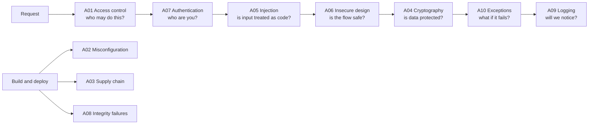

# OWASP top 10

After this you can name the ten most common web application risks in the current OWASP list, give an example of each, and say which part of your code to check.

Before this: [Security mindset and threat modelling](01-security-mindset-and-threat-modelling.md).

## The idea

Security has no end, so you need a priority list. The Open Worldwide Application Security Project (**OWASP**) publishes the **OWASP Top 10**, a ranking of the most critical web application security risks, built from data about real applications and a community survey. As of 2026 the current edition is [OWASP Top 10:2025](https://top10.owasp.org/2025), and it is an awareness list, not a complete standard: a team uses it as a shared vocabulary and a first checklist.

Each entry is a category of weakness, not one bug. In the diagram, the ten categories sit where a request meets them.

## The list

The names and order below are copied from the official page. Skim the first time; the cheat sheet repeats them in a table with a one-line defence for each.

### A01: Broken access control

The app lets a user do something their role does not allow. It has been first for years. Example: `GET /invoices/18` returns another customer's invoice because the code checks login but not ownership. Defence: deny by default and check ownership on the server for every request. See [authentication vs authorization](../../09-back-end/02-auth/01-authentication-vs-authorization.md).

### A02: Security misconfiguration

Insecure settings, left on by default or set carelessly. Example: a debug page enabled in production, a public cloud storage bucket, or default admin credentials. Defence: one hardened, repeatable configuration and the security headers in [XSS, CSRF and browser security](04-xss-csrf-and-browser-security.md).

### A03: Software supply chain failures

A weakness in code, tools or services your app depends on. Example: a malicious version of an npm package runs code on every machine that installs it. Defence: lockfiles, scanning and pinned versions, covered in [secrets and dependency security](06-secrets-and-dependency-security.md).

### A04: Cryptographic failures

Data is not protected, or protected badly. Example: passwords stored as unsalted MD5, or traffic over plain HTTP. Defence: HTTPS everywhere, Argon2id for passwords, and well-tested libraries, never your own cipher.

### A05: Injection

Untrusted input is interpreted as part of a command or query. Example: `' OR 1=1 --` in a login form, or `; rm -rf` in a shell argument. Defence: parameterized queries and no shell strings. See [injection and input validation](03-injection-and-input-validation.md).

### A06: Insecure design

The flaw is in the plan, not the code, so no amount of clean code fixes it. Example: a password reset that asks for the user's date of birth, which an attacker can look up. Defence: threat modelling before building, as in [lesson 1](01-security-mindset-and-threat-modelling.md).

### A07: Authentication failures

The app cannot reliably tell who a user is. Example: no limit on login attempts, so a script tries 10 million leaked passwords. Defence: rate limits, MFA and safe session handling, in [secure authentication](05-secure-authentication.md).

### A08: Software or data integrity failures

Code or data is trusted without checking it was not changed. Example: a build pipeline that downloads a script over HTTP and runs it, or deserializing data from a user. Defence: signed artifacts, verified checksums and never deserializing untrusted objects.

### A09: Security logging and alerting failures

Attacks happen and nobody sees them. Example: 40,000 failed logins in an hour that raise no alert, because failures were never logged. Defence: log authentication and access-control events, keep logs out of the app's reach, and alert on patterns. See [logging, metrics and monitoring](../../13-devops-and-cloud/04-operations/01-logging-metrics-and-monitoring.md).

### A10: Mishandling of exceptional conditions

The app behaves unsafely when something goes wrong. Example: an error handler that fails open, so a crashed authorization service means "allow", or a stack trace shown to the user. Defence: fail closed, catch errors centrally and return a generic message.

## Worked examples

### Example 1: classify a bug report

A tester reports: "I changed `?user_id=5` to `?user_id=6` and saw someone else's address."

1. Is user input interpreted as code? No, so not A05.
2. Does the app know who the tester is? Yes, they are logged in, so not A07.
3. Does the app check the logged-in user may see user 6? No. That is A01, broken access control.

Check: write a test where user 5 requests user 6's page and expects 403. The fix is a check on the server, not a hidden parameter.

## Common mistakes

Watch out: treating the Top 10 as a checklist you can finish. It names categories; passing it does not make an app secure. The [OWASP ASVS](https://owasp.org/www-project-application-security-verification-standard/) is the detailed standard.

Watch out: memorising the old order. Editions change: 2025 added A03 (supply chain) and A10 (exceptional conditions). Check the year when you cite a number.

## Working with AI

Words to use: broken access control, injection, misconfiguration, supply chain, fail closed, OWASP Top 10:2025.

Prompts to try:

- "Review this Express router for OWASP Top 10:2025 A01 and A07 problems. Point to the lines and show a test for each."
- "Map these five findings from my pen test to OWASP Top 10:2025 categories and explain each mapping in one sentence."

What to check:

- Category numbers from an older list (2021 had Injection at A03). Compare with [the 2025 page](https://top10.owasp.org/2025).
- "Fixes" that only hide the symptom, such as removing a link instead of adding a server-side check. Request the URL directly to confirm.

## Quiz

1\. Which category covers a user editing another user's order by changing an id in the URL?

Answer

A01, broken access control.

2\. A code reviewer finds `catch (e) { return next(); }` in an authorization middleware, so errors let the request through. Which entry is this?

Answer

A10, mishandling of exceptional conditions. It fails open; it should deny.

3\. Why is "a password reset based on security questions" A06 and not a coding bug?

Answer

The design is weak even if every line is correct, since the answers are guessable or public. Only a different design fixes it.

4\. Name two OWASP entries that involve code you did not write.

Answer

A03 (supply chain failures) and A08 (software or data integrity failures).

## Lab

### Lab: audit your own project against the list

Goal: find one real issue in code you wrote. Time: about 15 minutes. Runs in: any editor.

1. Open [the 2025 list](https://top10.owasp.org/2025) and a project of yours.
2. For each of A01, A02, A05 and A07, find the code that deals with it (route guards, config files, database calls, login).
3. Write one question per entry ("does every route check ownership?") and answer it with a file name.
4. Fix or file an issue for the weakest answer.

Expected result: four answered questions and one concrete fix.

Solution

Typical findings: a route with `requireLogin` but no ownership check (A01), `DEBUG=true` in a committed config (A02), a string-built query (A05), no rate limit on `/login` (A07).

## Where this shows up

- Each of A05, A07 and A03 has its own lesson next: [injection](03-injection-and-input-validation.md), [authentication](05-secure-authentication.md) and [dependencies](06-secrets-and-dependency-security.md).
- Code review and security questionnaires at work use these names.
