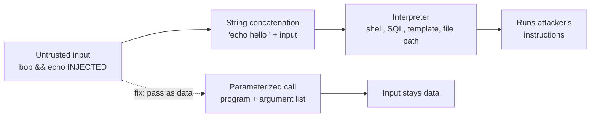

# Injection and input validation

After this you can spot the shared cause of SQL, command and template injection and path traversal, and fix each with the right tool.

Before this: [OWASP top 10](02-owasp-top-10.md) and [SQL from code and SQL injection](../../10-databases-sql-and-postgres/05-databases-in-apps/01-sql-from-code-and-sql-injection.md).

## The idea

A search box sends `bob` to your server. The server builds a string such as `echo hello bob` and runs it. Then someone sends `bob && echo INJECTED`, and the server runs two commands. The program could not tell where the data stopped and the instructions began.

That is the cause of every injection bug: **injection** happens when untrusted input is mixed into text that an interpreter (a SQL engine, a shell, a template engine, a file system) reads as instructions. The earlier lesson on SQL injection shows the database version in full; here we see the family.



In the diagram, the solid path is the bug and the dashed path is the fix: keep code and data in separate channels so the interpreter never has to guess.

## Key terms

**Parameterization** sends the instruction and the values separately: a SQL statement with placeholders plus a list of values, or a program name plus an argument list. The values are never parsed as instructions.

**Command injection** runs attacker-chosen commands through a shell. **Template injection** puts user input into a template's source, so the engine evaluates it. **Path traversal** uses `../` to leave the intended folder.

**Input validation** checks that input has the expected shape (type, length, range, format) before use. An **allow-list** accepts only known-good values; a **deny-list** rejects known-bad ones. **Output encoding** converts characters that are special in the destination (such as `<` in HTML) into harmless text on the way out.

## How it works

The defences, in order of strength:

1. Do not hand strings to an interpreter. Use parameterized queries, argument lists without a shell, and a template whose source you wrote.
2. Validate against an allow-list: an `id` is an integer, a `sort` is one of `name` or `date`, a username matches `^[a-z0-9_]{3,20}$`. Deny-lists fail because attackers find the encoding or case you forgot.
3. Encode output for its destination (HTML, URL, SQL identifier). See [XSS, CSRF and browser security](04-xss-csrf-and-browser-security.md).
4. Limit damage with least privilege: a database user that cannot drop tables, a process that cannot read `/etc`.

Validation helps but is not the main fix. A name like `O'Brien` is valid, and it must not break your query; parameterization handles that, validation does not. The [OWASP Injection Prevention Cheat Sheet](https://cheatsheetseries.owasp.org/cheatsheets/Injection_Prevention_Cheat_Sheet.html) and [Input Validation Cheat Sheet](https://cheatsheetseries.owasp.org/cheatsheets/Input_Validation_Cheat_Sheet.html) cover each interpreter.

## Worked examples

<div class="example" markdown>

### Example 1: command injection, then the fix

We run both versions on our own machine with the throwaway script `inj2.py`. The vulnerable function builds a shell string (`shell=True`); the fixed one passes an argument list. The fixed one calls Python itself as a stand-in program, because `echo` is a shell built-in on Windows.

```python
import subprocess, sys

def greet_bad(name):
    return subprocess.run(f"echo hello {name}", shell=True, capture_output=True, text=True).stdout

def greet_good(name):
    code = "import sys; print('hello', sys.argv[1])"
    return subprocess.run([sys.executable, "-c", code, name], capture_output=True, text=True).stdout

payload = "bob && echo INJECTED"
print(greet_bad(payload))
print(greet_good(payload))
```

```text
hello bob 
INJECTED

hello bob && echo INJECTED
```

1. `greet_bad` hands the whole string to a shell, which treats `&&` as "then run". The second command ran.
2. `greet_good` gives the program one argument. The `&&` is just characters inside it.

Check: the output has `INJECTED` on its own line only for the bad version. In real code the second command would be `curl ... | sh`, not `echo`.

</div>

<div class="example" markdown>

### Example 2: path traversal

A download endpoint serves files from a `public` folder. The vulnerable version joins the name onto the folder. The fix resolves the final path and checks it is still inside.

```python
from pathlib import Path

def read_bad(name):
    return (root / "public" / name).read_text()

def read_good(name):
    base = (root / "public").resolve()
    path = (base / name).resolve()
    if not path.is_relative_to(base):
        raise ValueError("path escapes the public folder")
    return path.read_text()

evil = "../secret.txt"
```

Running both on a temporary folder that holds `public/hello.txt` and a `secret.txt` beside it:

```text
bad : db-password=hunter2
good: path escapes the public folder
```

Template injection works the same way. With Jinja2 3.1.6, concatenating input into the template source evaluates it, while passing it as a variable does not:

```python
from jinja2 import Environment
user = "{{ 7 * 7 }}"
print(Environment().from_string("Hello " + user).render())
print(Environment().from_string("Hello {{ name }}").render(name=user))
```

```text
Hello 49
Hello {{ 7 * 7 }}
```

On a real engine `{{ 7 * 7 }}` can become code that reads files or environment variables, so a 49 on screen means you have a serious bug.

</div>

## Common mistakes

<div class="warning" markdown>

Watch out: escaping by hand. Replacing `'` with `\'` misses encodings and differs between databases. Use the driver's placeholders.

Watch out: parameterizing values but concatenating identifiers. `ORDER BY ${req.query.sort}` cannot be a placeholder. Map the input through an allow-list (`{"name": "name", "date": "created_at"}`) and use the mapped value.

Watch out: validating on the client only. An attacker skips your form. Validate on the server, as in [validation and error handling](../../09-back-end/01-servers-and-apis/05-validation-and-error-handling.md).

</div>

## Working with AI

<div class="ai" markdown>

Words to use: parameterized query, allow-list, `shell=False`, path traversal, template injection, output encoding.

Prompts to try:

- "Review this Express handler for injection. List every place user input reaches SQL, a shell, a file path or a template, and rewrite each with parameterization."
- "Write a pytest that sends `../../etc/passwd`, `..%2f..%2fetc%2fpasswd` and a null byte to my `/download` route and asserts a 400 or 404."

What to check:

- String formatting (`f"..."`, `+`, `.format`) anywhere near `execute`, `exec`, `os.system` or `subprocess`. Search the code for these.
- A "sanitize" function used as the only fix. Ask where the placeholder is.
- Path checks that compare strings with `startswith` before resolving `..`. Test with `../`.

</div>

## Quiz

1\. What is the one cause shared by SQL, command and template injection?

<details class="solution" markdown>
<summary>Answer</summary>

Untrusted input is mixed with instructions in one string that an interpreter parses.

</details>

2\. A route runs `os.system("convert " + filename + " out.png")`. What payload runs a second command, and what is the fix?

<details class="solution" markdown>
<summary>Answer</summary>

A filename like `a.jpg; rm -rf ~` (or `&&` on Windows). Use `subprocess.run(["convert", filename, "out.png"])` without a shell, and validate the filename against an allow-list.

</details>

3\. Is rejecting any input containing `DROP` a good defence for SQL injection?

<details class="solution" markdown>
<summary>Answer</summary>

No. It is a deny-list: attackers use other statements, other cases or encodings, and it rejects honest input like a user named "Dropkick". Use parameterized queries.

</details>

4\. Why does `(base / name).resolve()` followed by `is_relative_to(base)` work, when checking `".." in name` does not?

<details class="solution" markdown>
<summary>Answer</summary>

Resolving produces the real final path after `..`, symlinks and encodings, so the check tests where the file actually is. A substring test misses other spellings of the same path.

</details>

## Lab

<div class="lab" markdown>

### Lab: break and fix a download endpoint

Goal: exploit then fix path traversal in your own throwaway server. Time: about 15 minutes. Runs in: any terminal with Python 3. Target only `127.0.0.1`.

1. Create a folder with `public/hello.txt` and `secret.txt` beside `public`.
2. Write a function `read_bad(name)` as in Example 2, call it with `../secret.txt`, and see the secret.
3. Write `read_good(name)` and call it with `hello.txt` and `../secret.txt`.
4. Add a third case with an absolute path, `C:/Windows/win.ini` or `/etc/hostname`, and observe what happens.
5. Cleanup: delete the folder.

Expected result: `hello` for the good name and a `ValueError` for the other two.

<details class="solution" markdown>
<summary>Solution</summary>

In step 4 the join `base / "/etc/hostname"` discards `base` and gives the absolute path. The `resolve()` and `is_relative_to` check still rejects it, which is why that check is better than looking for `..`.

</details>

</div>

## Where this shows up

- [XSS, CSRF and browser security](04-xss-csrf-and-browser-security.md) is injection into a web page.
- [ORMs and migrations](../../10-databases-sql-and-postgres/05-databases-in-apps/02-orms-and-migrations.md) parameterize for you until you write raw SQL.
