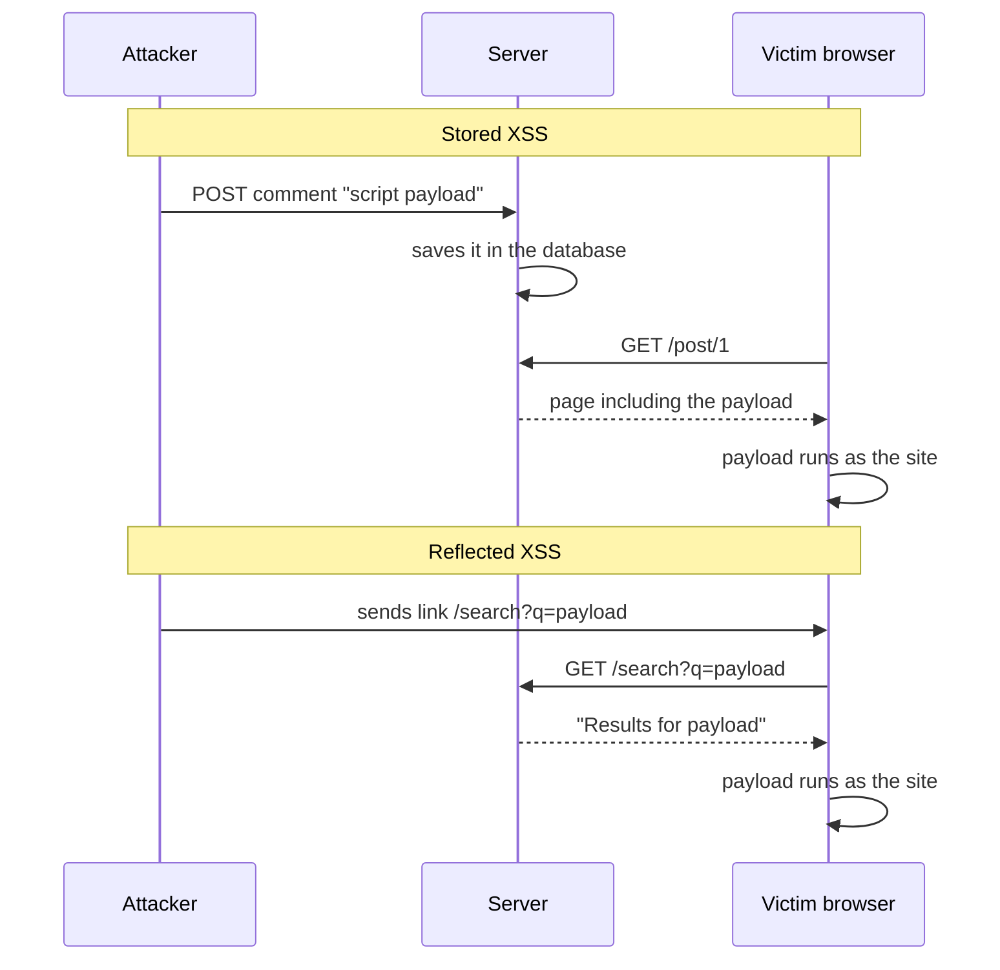
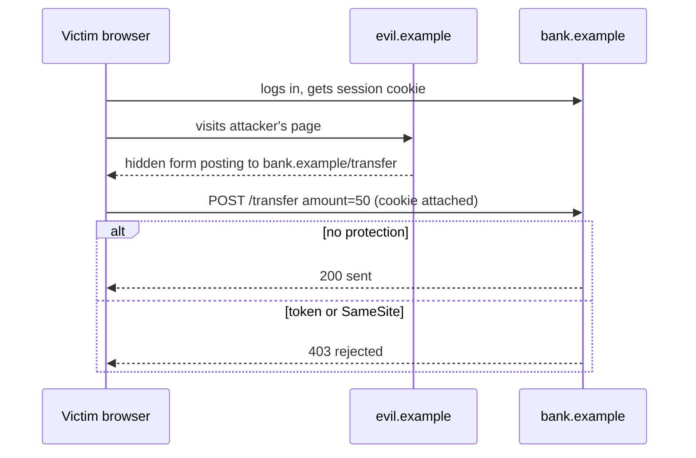

# XSS, CSRF and browser security

After this you can explain how XSS and CSRF work, fix both in a small server, and set the browser-side headers that limit the damage when a bug slips through.

Before this: [Injection and input validation](03-injection-and-input-validation.md), [sessions, cookies and JWT](../../09-back-end/02-auth/02-sessions-cookies-and-jwt.md) and [CORS and same origin](../../09-back-end/02-auth/04-cors-and-same-origin.md).

## The idea

A comment box on a blog saves whatever you type and shows it to every visitor. Someone posts `<script>...</script>` as their comment. If the page prints it unchanged, the browser cannot tell the author's script from the attacker's, and runs both with full access to the site: the cookies it can read, the pages it can call, the forms it can fill.

That is **cross-site scripting (XSS)**: injection into a web page, where the attacker's text becomes HTML or JavaScript in someone else's browser. A related attack, **cross-site request forgery (CSRF)**, tricks a logged-in user's browser into sending a request the user never meant to send. Both abuse the fact that the browser attaches trust to a site, not to a person.

There are three kinds of XSS. In stored XSS the payload sits in the database; in reflected XSS it travels in a link. **DOM-based XSS** happens entirely in the browser, when your own JavaScript writes untrusted data into the page with `innerHTML` or `document.write`.



In the diagram, stored XSS needs no link, since every visitor is hit, while reflected XSS needs the victim to open an attacker's link.

## Key terms

**Output encoding** (escaping) turns characters that are special in HTML, such as `<` and `&`, into text entities (`&lt;`, `&amp;`) so the browser shows them instead of running them.

A **Content Security Policy (CSP)** is an HTTP response header that tells the browser which sources of scripts, styles and frames it may load ([MDN](https://developer.mozilla.org/en-US/docs/Web/HTTP/Guides/CSP)). It is a second layer for when escaping fails.

A **CSRF token** is a random, per-session value placed in a form and checked by the server, which a forged request from another site cannot know. The **SameSite** cookie attribute tells the browser whether to send the cookie on cross-site requests ([MDN](https://developer.mozilla.org/en-US/docs/Web/HTTP/Reference/Headers/Set-Cookie#samesitesamesite-value)).

**Clickjacking** loads your site in an invisible frame on the attacker's page, so the victim's click lands on your button. The CSP directive `frame-ancestors` says who may frame you.

## How it works

Fixing XSS, in order:

1. Encode output for where it lands: HTML body, attribute, URL or JavaScript. Template engines (React, Jinja2 with autoescape, Express with EJS `<%= %>`) do this by default; the danger is the opt-outs, `dangerouslySetInnerHTML`, `| safe`, `<%- %>` and `innerHTML`.
2. If users must submit HTML, run it through a sanitizer library such as DOMPurify, never a hand-written regex.
3. Add a CSP so injected inline scripts do not run.
4. Mark session cookies `HttpOnly`, so a script that does run cannot read the session id.

Fixing CSRF, in order: set session cookies to `SameSite=Lax` (the default in modern browsers, but set it explicitly), require a CSRF token on every state-changing request (`POST`, `PUT`, `DELETE`), and never change state on a `GET`.



The browser attaches the cookie automatically, so the bank cannot tell the forged form from the real one. A token fixes this: the attacker's page cannot read the bank's form to copy the token. `SameSite=Lax` fixes it differently, because the browser withholds the cookie from a cross-site `POST`. See the [OWASP XSS Prevention](https://cheatsheetseries.owasp.org/cheatsheets/Cross_Site_Scripting_Prevention_Cheat_Sheet.html) and [CSRF Prevention](https://cheatsheetseries.owasp.org/cheatsheets/Cross-Site_Request_Forgery_Prevention_Cheat_Sheet.html) cheat sheets.

The other security headers are one-line switches. `Strict-Transport-Security` forces HTTPS, `X-Content-Type-Options: nosniff` stops the browser guessing file types, `Referrer-Policy` limits what URLs leak, and `Permissions-Policy` turns off features such as the camera. The cheat sheet lists them in a table.

## Worked examples

<div class="example" markdown>

### Example 1: reflected XSS and a forged transfer

We run a throwaway server on `127.0.0.1:8001` (Python's `http.server`) with two versions of a greeting page and two versions of a transfer endpoint, then call each from a script. The bad greeting puts `name` straight into HTML; the good one calls `html.escape` and sends a CSP:

```python
# bad
self.send(200, f"<p>Hello {name}</p>", [("Content-Type", "text/html")])
# good
self.send(200, f"<p>Hello {html.escape(name)}</p>", [
    ("Content-Type", "text/html"),
    ("Content-Security-Policy", "default-src 'self'; script-src 'self'; frame-ancestors 'none'"),
])
```

The good transfer endpoint rejects a request whose `csrf` form field differs from the token issued to the real page. The client sends `<script>alert(1)</script>` as `name`, then posts a transfer with the session cookie but no token, as a forged form would, and then with the token:

```text
/bad <p>Hello <script>alert(1)</script></p>
   CSP: None
/good <p>Hello &lt;script&gt;alert(1)&lt;/script&gt;</p>
   CSP: default-src 'self'; script-src 'self'; frame-ancestors 'none'
sid=sess-123; HttpOnly; SameSite=Lax; Path=/
forged, no token  /transfer-bad : sent, balance 50
forged, no token  /transfer-good: 403 bad CSRF token
real form, token  /transfer-good: sent, balance 0
```

1. The bad page returns the `<script>` tag intact; a browser would run it.
2. The good page returns `&lt;script&gt;`, which the browser shows as text.
3. The vulnerable transfer accepted the forged request because the cookie was valid. The protected one returned 403.

Check: open `http://127.0.0.1:8001/bad?name=%3Cscript%3Ealert(1)%3C/script%3E` in a browser while the server runs; the bad page shows an alert and the good one shows the tag as text. Do this only against your own local server.

</div>

## Common mistakes

<div class="warning" markdown>

Watch out: thinking a CSP replaces escaping. It limits damage; the bug is still there. Also avoid `'unsafe-inline'` in `script-src`, which turns off the main protection.

Watch out: storing a session token in `localStorage`. Any XSS reads it. A cookie with `HttpOnly` is out of reach of scripts.

Watch out: relying on CORS to stop CSRF. CORS controls who may read responses, not who may send requests; the forged `POST` above still arrives.

</div>

## Working with AI

<div class="ai" markdown>

Words to use: stored XSS, reflected XSS, DOM XSS, output encoding, Content Security Policy, CSRF token, SameSite, `frame-ancestors`.

Prompts to try:

- "Find every place in this React component tree where user data reaches `dangerouslySetInnerHTML` or `innerHTML`, and say how to sanitize each."
- "Write a strict CSP for an Express app that serves its own JavaScript and loads fonts from Google Fonts, and list what each directive allows."

What to check:

- A CSP containing `'unsafe-inline'`, `'unsafe-eval'` or `*`. These disable what the policy is for.
- CSRF middleware added but applied only to some routes, or not to `PUT` and `DELETE`. Send a forged request with curl.
- Hand-rolled `replace("<", "")` filters. Use the framework's escaping or DOMPurify.

</div>

## Quiz

1\. What is the difference between stored and reflected XSS?

<details class="solution" markdown>
<summary>Answer</summary>

Stored XSS is saved on the server and hits every visitor who loads the page. Reflected XSS is echoed from the current request, so the victim must open a crafted link.

</details>

2\. A page does `div.innerHTML = location.hash.slice(1)`. Which kind of XSS is this and how do you fix it?

<details class="solution" markdown>
<summary>Answer</summary>

DOM-based XSS. Use `textContent` instead, or sanitize with DOMPurify if HTML is needed.

</details>

3\. A user is logged in to your site. They visit a page that auto-submits a form to your `POST /delete-account`. The cookie is `SameSite=Lax`. Does the request succeed?

<details class="solution" markdown>
<summary>Answer</summary>

Normally no: Lax cookies are not sent on cross-site `POST` requests, so the server sees no session. Add a CSRF token as a second layer, since the protection depends on browser behaviour.

</details>

4\. Which header stops another site embedding yours in an iframe?

<details class="solution" markdown>
<summary>Answer</summary>

CSP `frame-ancestors 'none'` (or `'self'`). The older `X-Frame-Options: DENY` does the same job.

</details>

## Lab

<div class="lab" markdown>

### Lab: patch a vulnerable page

Goal: exploit and fix reflected XSS and CSRF on localhost. Time: about 20 minutes. Runs in: any terminal with Python 3 and a browser.

1. Write a server with `GET /bad?name=...` that prints `name` into HTML, and start it on `127.0.0.1`.
2. Open `/bad?name=<script>alert(1)</script>` and watch the alert fire.
3. Add `/good` with `html.escape` and a `Content-Security-Policy` header and compare.
4. Add a `POST /transfer` guarded by a token stored in the session, and call it with `curl` with and without the token.
5. Cleanup: stop the server.

Expected result: an alert on `/bad`, text on `/good`, and 403 for the tokenless `POST`.

<details class="solution" markdown>
<summary>Solution</summary>

The complete server is about 40 lines and matches the snippets in Example 1: `html.escape` for output, a `secrets.token_hex(8)` token compared with the submitted `csrf` field, and a `Set-Cookie` with `HttpOnly; SameSite=Lax`.

</details>

</div>

## Where this shows up

- [Secure authentication](05-secure-authentication.md) protects the session that XSS and CSRF try to abuse.
- Frameworks such as React and Django escape by default, so most XSS bugs come from the opt-outs.
